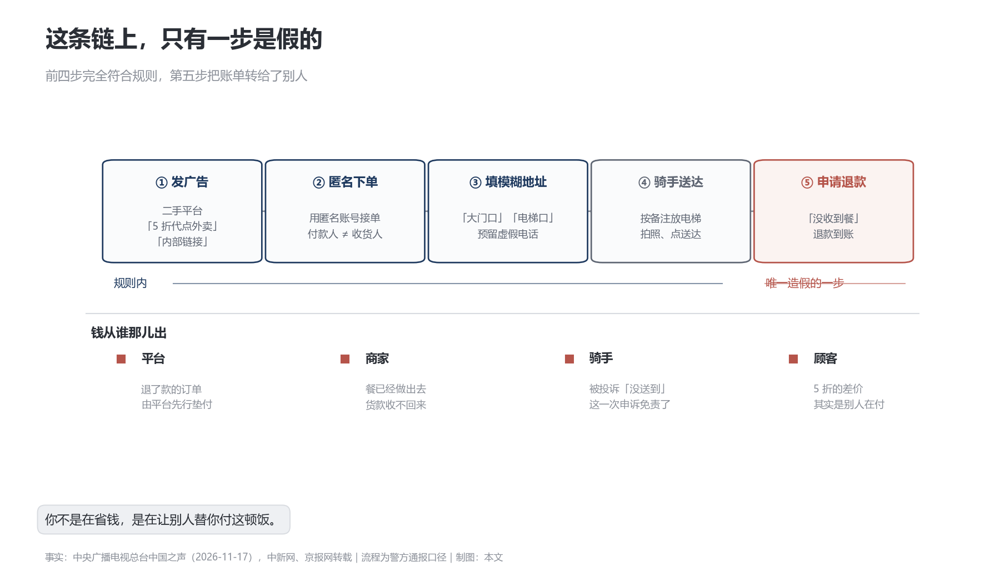
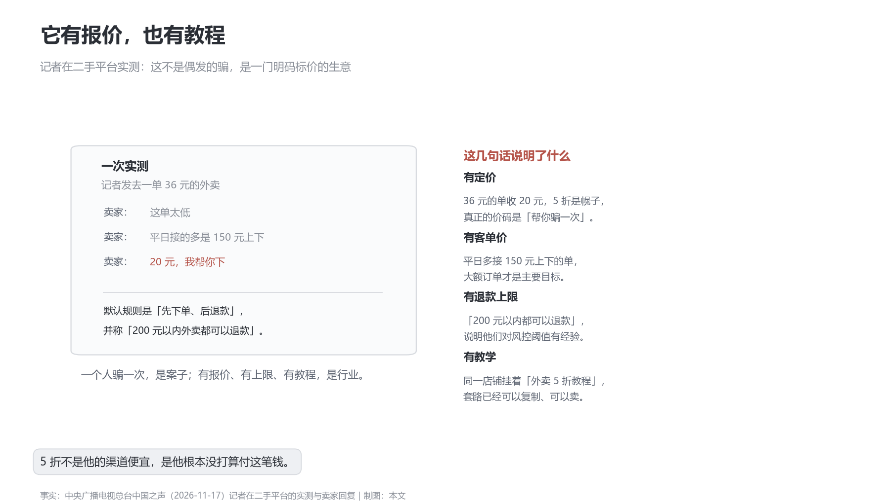
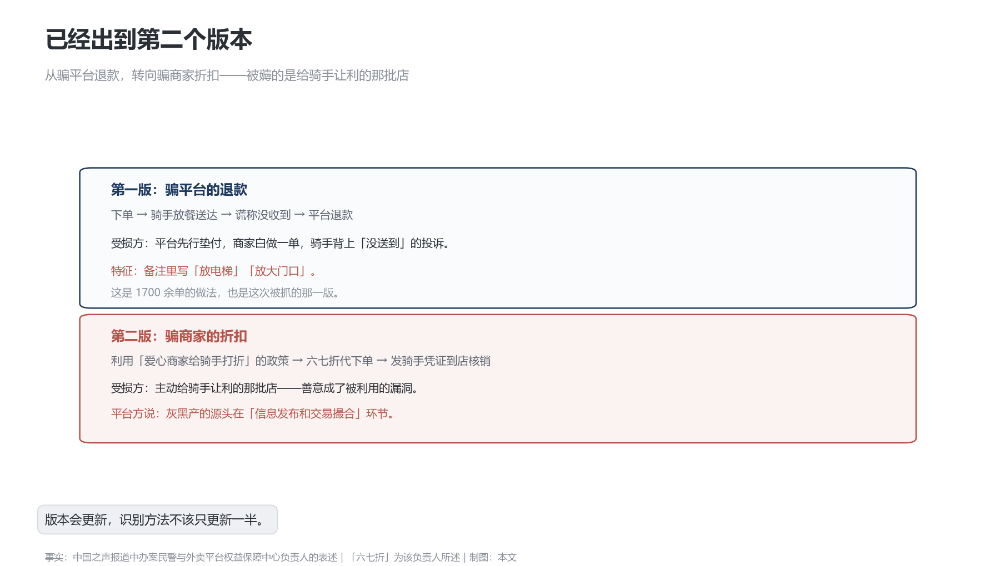

# 5 折代点外卖：他下单，你取餐，然后他说"没收到"

二手平台上刷到"5 折代点外卖"，你心动过吗？

福建警方刚披露的案子，把这个折扣的账算清楚了：他没有内部渠道，也没有员工价。他只是根本没打算付这笔钱。

## 一、先从一个骑手的订单说起

今年 8 月，外卖骑手小陈接到福建长乐一个小区的订单。顾客备注：放电梯位置。

他照做了——把餐放进电梯，拍照发给顾客，点了送达。这是平台规则允许的正常操作。

没过多久，平台推送退款通知：下单人声称没有收到餐品。

小陈向外卖站反馈。平台调取订单、核验后，帮他申诉免责。也是在这个过程中，平台发现这类订单有个共同特征：**备注里写着"放电梯""放大门口"**。

这个细节很重要。它不是骗子的疏忽，是设计——模糊地址让"到底送到没送到"变成一件说不清的事。

## 二、第二天，同一个地址又来一单

警方在现场蹲守。同一地址又出现一笔高额外卖订单，顺着这条线，一个 6 人团伙浮出水面。

福州市公安局长乐分局民警王晓晨介绍：初步查证，该团伙作案 1700 余单，涉及全国 21 个省市、700 多名群众；6 名嫌疑人已被刑事拘留，案件还在侦办。

1700 单，21 个省市，700 多人。这不是一个人贪小便宜，是一条能跨省复制的流水线。

## 三、这条链上，只有一步是假的

他们的做法，拆开看是五步：

在二手平台发"5 折代点外卖""内部链接"的广告；用匿名账号接单；刻意填写大门口、电梯口这类模糊地址，预留虚假电话号码；骑手按备注放餐、拍照、确认送达；顾客取餐之后，团伙转身申请退款，理由是"没收到"。

前四步全部符合规则。骑手没做错，平台没做错，连地址都是"有效地址"。

假的只有第五步。

所以钱不是凭空变出来的：平台先垫付退款，商家餐已经做出去、货款收不回来，骑手要背一次"没送到"的投诉——小陈这次申诉成功了，但不是每个骑手都会。

## 四、它有报价，也有教程

记者在二手平台上搜到不少"5 折代下单"的链接。发去一单 36 元的外卖，卖家的反应值得逐句看：

先是嫌低——"平日接的多是 150 元上下的单"；然后话锋一转，报价 20 元，"我帮你下"。

交谈中，对方默认的操作方式是"先下单、后退款"，还宣称"200 元以内外卖都可以退款"。

同一家店铺里，还挂着一条"外卖 5 折教程"的链接。

一个人骗一次，是案子。有报价、有客单价、有退款上限、有教程可以卖，这是行业。

## 五、这套东西已经出到第二个版本

某外卖平台权益保障中心负责人张通说，近期又发现新变种：从直接骗平台退款，转向骗商家的折扣。

手法是利用"爱心商家给骑手打折"的政策——以六七折代下单为名在二手平台揽客，下单后把骑手凭证发给用户，用户拿着凭证去店里核销，赚的是商家让给骑手的那部分优惠。

被薅的，恰恰是那批主动给骑手让利的店。善意成了漏洞。

## 六、你交出去的，不只是几块钱

中国人民大学法学院教授刘俊海分析，这类骗局特殊在付款人、收货人和下单账号控制人三者分离——跨平台、多主体的交易结构，给诈骗留了缝。

对参与"代下单"的消费者来说，风险是双向的：

一头是信息。你的收货地址、账号信息交给了陌生第三方，福建长乐警方提示，这类信息极易被泄露、倒卖，为后续被诈骗埋下隐患。

另一头是责任。明知对方靠虚假退款牟利仍然参与，也可能要承担法律责任。

---

所以下次看到"5 折代点外卖"，其实只需要问一句：

**他为什么能拿到这个价？**

正常的折扣，来自平台补贴、商家让利、批量采购——都能说出理由。说不出来源的折扣，通常意味着有一笔账没结，只是结账的人不是你。

那么问题来了：你身边有人用过这类"代下单"吗？后来怎么样了？

---

*事实来源：今年 8 月，外卖骑手小陈在福建长乐一小区按备注将餐品放入电梯、拍照并点击送达后收到退款通知，下单人称未收到餐品；平台核验后帮其申诉免责，"备注放电梯"成为风控识别异常订单的重要特征；次日同一地址再现高额订单，福州长乐警方现场蹲守研判，锁定 6 人团伙，初步查证作案 1700 余单、涉及全国 21 个省市 700 多名群众，6 名嫌疑人已被刑事拘留，案件正在侦办——据中央广播电视总台中国之声 2026 年 11 月 17 日报道（中新网、京报网、中国经济网转载），办案民警为福州市公安局长乐分局王晓晨。团伙手法为网上发布"5 折代点外卖"广告、匿名账号接单、填写大门口电梯口等模糊地址并预留虚假电话、顾客取餐后谎称未收到以骗取平台退款。记者在二手平台实测：36 元订单卖家报价 20 元代下，称平日多接 150 元上下的单，默认"先下单、后退款"并称"200 元以内外卖都可以退款"，同店挂有"外卖 5 折教程"链接。新变种"利用爱心商家给骑手打折政策、以六七折代下单骗取商家折扣"，引自该平台权益保障中心负责人张通；消费者信息泄露与法律责任风险，引自刘俊海与警方的分析。文中"前四步合规、第五步造假""结账的人不是你"等表述为作者分析。*