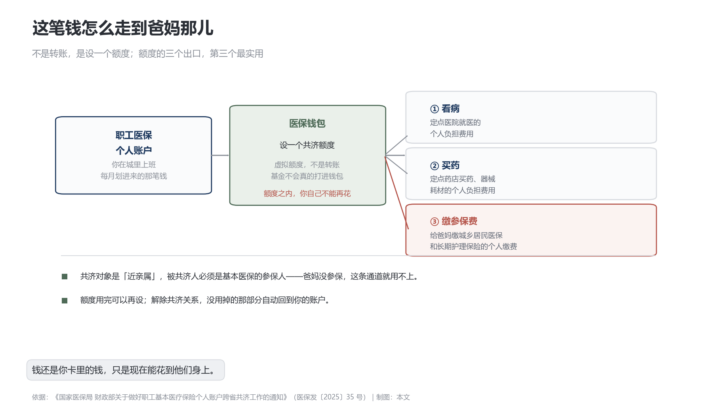
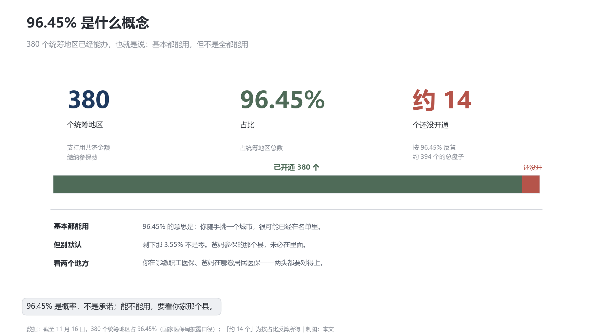
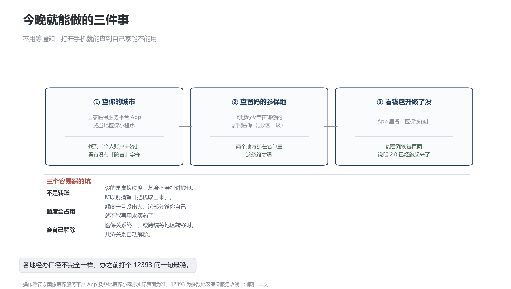

# 医保卡里的钱，跨省也能给爸妈用了

你在城里上班，每月医保个人账户里划进一笔钱，平时不怎么花。

爸妈在老家，每年要缴一笔城乡居民医保的钱，几百块，自己掏。

这两笔钱以前是两回事，隔着省界。现在有一条通道把它们接上了：职工医保个人账户跨省共济。

## 一、先分清"卡里的钱"是哪一笔

很多人把医保卡当成一个钱包，其实里面是两笔性质完全不同的钱。

一笔是**统筹基金**，大家缴、大家用，报销走的是它，不归个人，不能共济。

另一笔是**个人账户**，就是每月从工资里划进你名下、显示余额的那个数。这笔钱是你的，能结转、能给家人用——跨省共济共济的就是它。

这条通道不是国家多给一笔钱，是把你已有的钱换个花法。

## 二、不是转账，是设额度

这是最容易搞错的地方。

按《国家医保局 财政部关于做好职工基本医疗保险个人账户跨省共济工作的通知》（医保发〔2025〕35 号），做法是：依托全国统一的医保信息平台设立"个人医保钱包"，由你——共济人——为近亲属设定一个**共济额度**。

文件里写明了两条：

- **虚拟额度管理**，"不得将医保基金实际拨入个人医保钱包"。也就是说，钱不会打进一个能提现的账户，你取不出来。
- **额度之内，共济人自己不能再使用**这笔个人账户资金。

所以你设出去多少，自己这边就少多少可用额度。解除共济关系时，还没用完的部分自动回到你的账户。

## 三、三个出口，第三个最实用

共济额度能花在三个地方：

① 在定点医疗机构就医，个人负担的那部分费用；
② 在定点零售药店买符合规定的药品、医疗器械、耗材，个人负担的费用；
③ 参加**城乡居民基本医疗保险、长期护理保险的个人缴费**。

第三个才是对跨省家庭最实际的部分：你在城里缴职工医保，用个人账户的钱给老家的爸妈缴他们那笔居民医保。

被共济人必须是基本医保的参保人（职工医保或居民医保都算，没参保就不行）。共济对象是"近亲属"，一人可对多人，一个被共济人也能接受多人共济。

## 四、96.45% 这个数字，要看清分母

国家医保局 11 月 16—17 日披露：截至 11 月 16 日，各省份均已完成医保钱包 2.0 版升级运行，全国 **380 个统筹地区**支持用共济金额缴纳参保费，占统筹地区总数的 **96.45%**。

96.45% 的意思是"基本都能用"，不是"全都能用"。

按占比反算，统筹地区总数约 394 个，还有十来个没开通。落到具体人身上：爸妈参保的那个县，可能恰好不在名单里。

所以判断能不能用，要同时看两头：**你在哪缴职工医保，爸妈在哪缴居民医保。**两头都对得上，这条路才通。

## 五、今晚就能查的三件事

不用等通知，也不用户口本、证明、跑窗口。

**第一步，查你的城市。**打开国家医保服务平台 App，或当地医保小程序，找"个人账户共济"入口，看有没有"跨省"字样。

**第二步，问爸妈的参保地。**居民医保是县区一级缴的，要问清是哪个县（区），再对照是否开通。

**第三步，看钱包升级没有。**App 里搜"医保钱包"，能进钱包页面，说明 2.0 版跑起来了。

## 六、三个坑，提前知道

**别指望取现。**设的是虚拟额度，基金不会打进钱包，取不出来，也转不到别人卡上。

**额度会占用。**设出去的部分你就不能再花了，设之前先估一下今年的用药需求。

**关系会自己解除。**任一方医保关系终止、或跨统筹地区转移时，共济关系自动解除——换城市工作记得重建。

各地口径不完全一样，界面名称也可能不同。办之前打个医保服务热线（多数地区是 12393）问一句，比在群里问靠谱。

---

这笔钱不多，一年攒下来可能就够缴一两次居民医保。

但"能用到"和"有多少"是两件事。躺在卡里的一千块，和替爸妈缴掉的那几百块，价值不一样。

你卡里的余额，上次看是什么时候？

---

*政策依据：《国家医保局 财政部关于做好职工基本医疗保险个人账户跨省共济工作的通知》（医保发〔2025〕35 号，2025 年 12 月 24 日成文），其中明确共济对象为职工医保参保人的近亲属、被共济人须为基本医保参保对象，依托全国统一医保信息平台设立个人医保钱包并实行虚拟额度管理，用途包括定点机构就医与定点药店购药械耗材的个人负担费用，以及参加城乡居民基本医保、长期护理保险的个人缴费，额度内共济人不得再使用、关系解除时未用额度自动恢复、医保关系终止或跨统筹地区转移时关系自动解除——原文据中国政府网国务院政策文件库。数据口径：截至 11 月 16 日，全国 380 个统筹地区支持使用共济金额缴纳参保费、占统筹地区总数 96.45%，各省份均已完成医保钱包 2.0 版升级运行——据国家医保局 11 月 16—17 日披露（素材方口径），本次检索未找到可交叉核对的公开报道；文中"约 394 个统筹地区、约十来个未开通"系按 96.45% 反算所得，非官方公布数字。素材另提及"居民医保人均财政补助标准提高 24 元至每人每年 724 元"，属财政补助事项，与个人账户共济不是同一制度，本文未采用。文中操作路径以国家医保服务平台 App 及各地医保小程序实际界面为准，"12393"为多数地区医保服务热线，具体以当地公布为准；"先估用药需求""换城市记得重建关系"等提示为作者建议。*