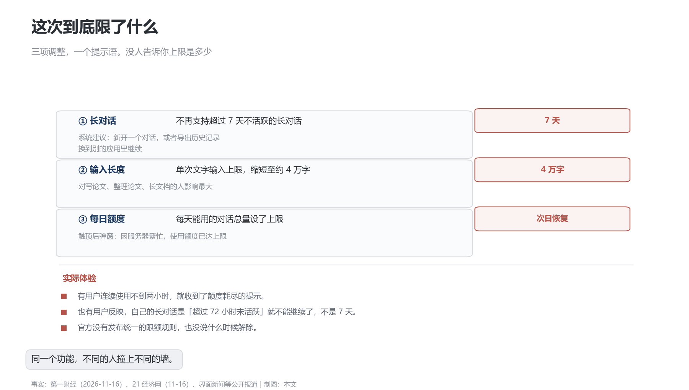
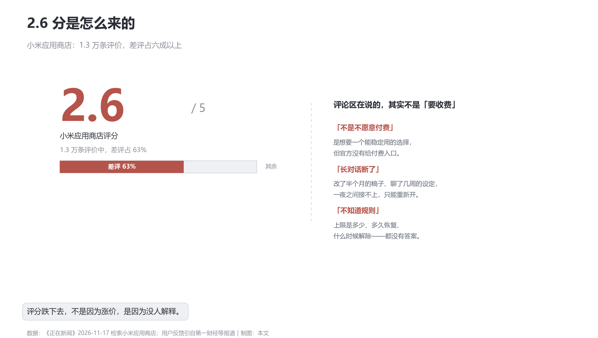
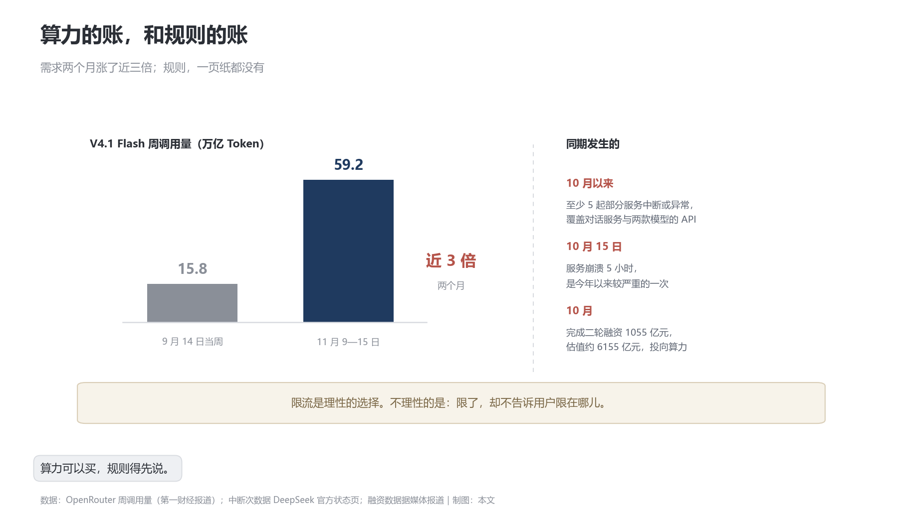

# DeepSeek 限额了：2.6 分的评论区，在问同一个问题

11 月 16 日，"DeepSeek 使用额度已达上限"上了微博热搜。

11 月 17 日，小米应用商店里它的评分是 2.6 分——1.3 万条评价，差评占 63%。

两天时间，一个用了快两年没要过钱的产品，评论区的语气变了。

## 一、先看限了什么

公开报道里的三项调整，都不算大：

**长对话**：不再支持超过 7 天不活跃的长对话，系统建议新开一个，或者导出记录换到别处继续。

**输入长度**：单次文字输入上限缩短至约 4 万字。

**每日额度**：每天能用的对话总量设了上限，触顶后弹窗——"因服务器繁忙，使用额度已达上限"。

对偶尔问两句的人，影响不大。但有用户连续使用不到两小时，就撞上了这堵墙。

## 二、奇怪的是，标准不一样

这是最值得说的一点。

有用户收到的提示是"超过 7 天不活跃"，也有用户反映，自己的长对话是"超过 72 小时未活跃"就不能继续了。

同样是长对话，一个人有七天，一个人只有三天。

官方至今没有发布统一的限额规则，也没说这项限制什么时候解除。用户能拿到的全部信息，就是那个弹窗。

所以这不叫"限额"。限额是"每天 50 次"，你知道边界在哪，可以安排自己的用法。现在的情况是：边界存在，但没人告诉你它在哪儿，你只能撞上去才知道。

## 三、评论区骂的不是"想白嫖"

这是我觉得最需要说清楚的一点。

第一财经的报道里，有用户讲得很明白：自己并非不愿意付费，只是希望能继续稳定使用，而官方没有给出付费的选择。

想稳定用，眼下唯一的出路是转去 API。但 API 要单独计费、要配接口、要装第三方工具——这不是一个普通用户能走的路。有人直接提了建议：能不能像别家一样，出个月卡、季卡、年卡，让高频用户花钱买更稳的服务和更高的额度。

这个诉求很朴素：**我不是要免费，我是要一个能付钱的地方。**

评分掉下去，不是因为涨价，是因为连"怎么付钱"都没人回答。

## 四、算力是真的紧，这一点不该骂

限流背后有个很硬的数字。

据 OpenRouter 统计，11 月 9 日至 15 日这一周，DeepSeek V4.1 Flash 完成 59.2 万亿 Token 调用，居全球首位。而 9 月 14 日那一周，这个数字是 15.8 万亿——两个月，涨了近三倍。

算力的扩容速度没跟上这条曲线。10 月以来，平台至少发生 5 起部分服务中断或异常；10 月 15 日那次崩溃持续 5 小时，是今年以来较严重的一次。

钱也在往里投。10 月完成二轮融资 1055 亿元，估值约 6155 亿元，主要投向算力基础设施。创始人梁文锋今年 7 月跟投资人聊了近 4 小时，反复说的是同一件事：今天 AI 最大的问题还是算力。

所以限流这个决定，本身是理性的。算力就那么多，长对话消耗最大，先削峰值——这个账算得过来。

## 五、但"免费两年"不是一张欠条

网上有种说法，把这次调整归结为"白嫖党该急了"。

这个说法站不住。免费是公司自己的选择，不是用户求来的。DeepSeek 两年没收钱，是因为它把 C 端商业化排在了后面——目标是 AGI，短期收入被创始人称作"芝麻"。用户没有承诺过永远不付钱，公司也没有承诺过永远免费。

真正的问题不在收不收，在怎么收、什么时候说。

一个产品从免费转向有限服务，这本来是个正常的商业动作。它可以发一条公告，写清楚每天多少次、什么时候恢复、付费包什么时候上。这些都不难。

现在它以另一种形式出现了：一个写着"算力不足"的弹窗，在你写到一半的时候弹出来。

---

一个产品最贵的东西，从来不是算力，是可预期性。

用户可以接受你变贵，也可以接受你变慢。但用户没法接受的是：今天能用的功能，明天不知道为什么就不能用了。

算力可以买，规则得先说。

你那边的对话框，今天还开得起来吗？

---

*事实来源：11 月 16 日"DeepSeek 使用额度已达上限"登上微博热搜，用户反映 App 及网页版调整包括不再支持超过 7 天不活跃的长对话（亦有用户反映为 72 小时）、单次文字输入上限缩短至约 4 万字、每日对话额度受限，触顶提示"因服务器繁忙，使用额度已达上限"，有用户连续使用不到两小时即触顶；官方未发布统一限额规则、未披露解除时间；限额主要针对 C 端 App 与网页版，API 为独立规则与按量计费；有用户表示并非不愿付费，但官方未提供付费选项——据第一财经（2026-11-16）、21 经济网（11-16）、界面新闻等报道。11 月 17 日《正在新闻》检索小米应用商店，DeepSeek 评分 2.6 分，1.3 万条评价中差评占 63%。调用量数据：OpenRouter 统计 11 月 9—15 日当周 V4.1 Flash 完成 59.2 万亿 Token 调用居全球首位，9 月 14 日当周为 15.8 万亿；10 月以来至少 5 起部分服务中断或异常，10 月 15 日崩溃 5 小时；10 月完成二轮融资 1055 亿元、估值约 6155 亿元；梁文锋今年 7 月与投资人交流内容——以上据第一财经报道。应用商店评分与差评比例会随时间变动，文中为 11 月 17 日数据。文中"限额与限流的区别""免费不是欠条""可预期性"等分析为作者判断。*