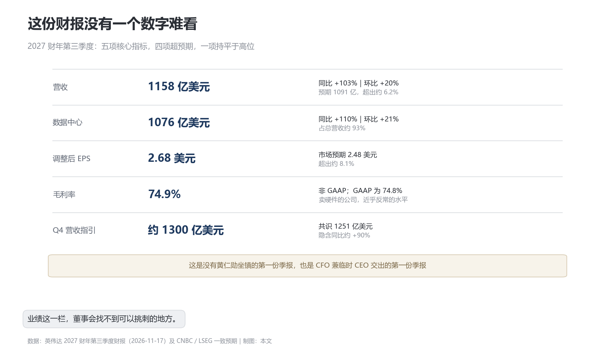
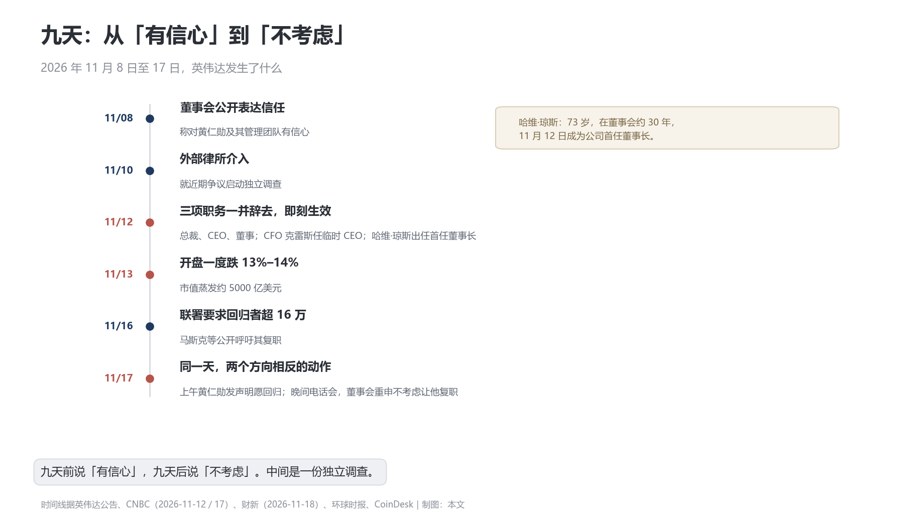
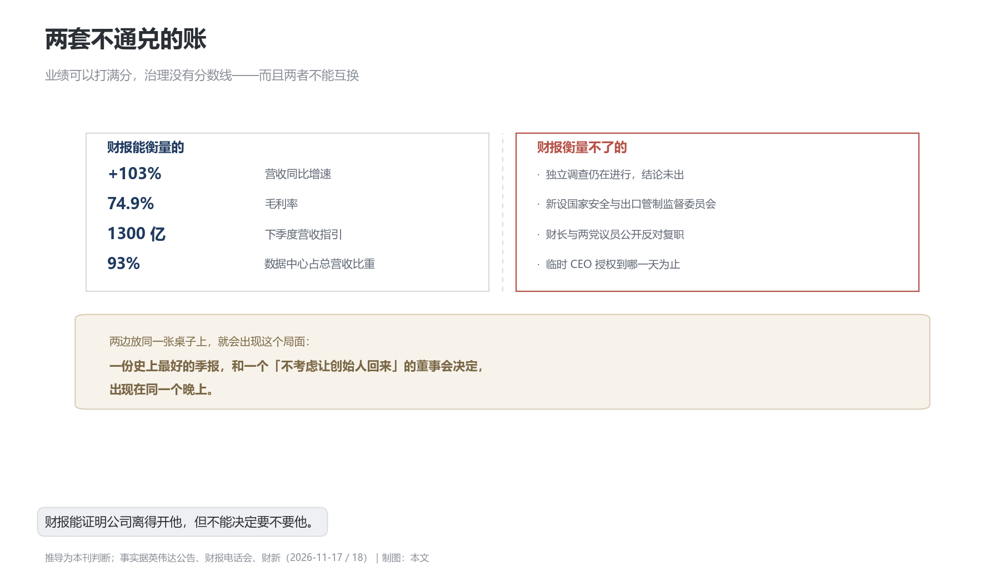

# 营收 1158 亿、净利爆表，董事会却拒绝黄仁勋复职：英伟达的「后创始人」难题

11 月 17 日，英伟达交出 2027 财年第三季度财报。

营收 1158 亿美元，同比 +103%，环比 +20%，比市场预期的 1091 亿高出约 6.2%。数据中心一个部门 1076 亿，同比 +110%，占总营收 93%。调整后 EPS 2.68 美元，预期 2.48。毛利率 74.9%。下季度指引 1300 亿，共识 1251 亿，隐含同比还有约 90%。

盘后股价涨超 3%。

这是英伟达史上最好的一份季报，也是没有黄仁勋坐镇的第一份。

同一天晚上，财报电话会上，董事长哈维·琼斯说：不打算让黄仁勋复职，将考虑内部和外部候选人，不会仓促决定。

## 一、这份财报干净得反常

我做财经稿有个习惯：看到"超预期"，先找那个不体面的数字。有没有一次性收益，毛利率是不是被某个高单价产品撑起来的，指引是不是只敢动半年。这次，三条都没找到。

74.9% 的毛利率放在一家卖硬件的公司身上近乎反常。它说明的不是卖得多，是定价权还在自己手里。指引给到 1300 亿并明确高于共识，等于把自己钉在一个数字上——没把握的公司不会这么干。

而且这份财报的签字人不是创始人。签它的是 CFO 科莱特·克雷斯，11 月 12 日之后，她同时是临时 CEO。

一家公司在失去创始人的第五天，交出了史上最好的一季。这件事本身比任何单项数字都重要。

## 二、九天

把时间摊开看。

**11 月 8 日**，董事会公开表示对黄仁勋及其管理团队有信心。

**11 月 10 日**，聘请外部律所，就相关争议启动独立调查。

**11 月 12 日**，黄仁勋辞去总裁、CEO、董事三项职务，即刻生效。据 CNBC，董事会在前一夜作出了让他去职的决定。同日，董事哈维·琼斯成为公司首任董事长——这个位子在过去 33 年里并不存在。

**11 月 13 日**，开盘一度跌 13%–14%，市值蒸发约 5000 亿美元。

**11 月 16 日**，网上联署要求他回归者超过 16 万人，马斯克等公开呼吁。

**11 月 17 日上午**，黄仁勋发布辞职后首份声明：若董事会认为回归符合股东、员工、公司和美国的最佳利益，他愿重返 CEO。他同时承认自己在个人生活中犯了严重错误、未达到公司标准、给董事会造成了问题，并承诺配合独立调查。

当天晚上，董事会说不考虑。

九天。从"有信心"到"不考虑"。

## 三、拒绝的理由不是业绩

这是最容易被读错的地方。

很多人会理解成"业绩这么好，董事会还不让他回来，是不是有内情"。恰恰相反——**正因为业绩这么好，董事会才敢拒绝。**

因为决定他去留的从来不是财报，是一份还没出结论的独立调查。这两件事不在同一个评价体系里。

董事会同期还新设了"国家安全与出口管制监督委员会"。美国财长与两党资深议员公开反对他复职，特朗普则表示不介意。一个 CEO 的去留被摆到财政部长和国会议员面前讨论，这已经超出公司治理的范畴。

所以琼斯那句"不会仓促决定"不是客套，是程序语言：调查没完，决定就不做。这句话同时把问题推到了下一份、或者下下份财报之后。

## 四、"后创始人"的真问题

英伟达过去 33 年有一项隐形资产：只要黄仁勋在，很多判断不需要解释。客户愿意为"他在"付溢价，供应链愿意为"他在"排产，投资人愿意为"他在"容忍高估值。

这份财报证明了一件事：至少这个季度，公司不需要他也能跑得很好。

但它证明不了另一件事：下个季度、明年、2028 年，那些还没签的订单、还没定的价格、还没解决的交付问题，由谁拍板。

业绩可以量化创始人的价值，但量化不了创始人的风险。董事会现在要处理的，恰好是后者。

---

一份超预期的财报可以搁置治理问题，但它回答不了"创始人离场后的英伟达往哪走"。

这个问题，董事会用"不仓促"推迟了，黄仁勋用"我愿意"推了回来。九天里，两边都没让步。

而英伟达现在有一位临时 CEO、一位上任六天的董事长，和一份史上最好的财报。

---

*事实来源：2026 年 11 月 17 日英伟达发布 2027 财年第三季度（截至 10 月 25 日）财报，营收 1158 亿美元、同比 +103%、环比 +20%，数据中心 1076 亿美元、同比 +110%、环比 +21%，GAAP 毛利率 74.8%、非 GAAP 74.9%；据 CNBC 引 LSEG 一致预期，营收预期 1091 亿美元、调整后 EPS 预期 2.48 美元（实际 2.68），第四财季营收指引约 1300 亿美元（隐含同比约 +90%）、高于共识 1251 亿美元，盘后股价涨超 3%——以上据英伟达官方新闻稿与 CNBC（2026-11-17）。人事与时间线：11-08 董事会公开表达对黄仁勋及管理团队有信心，11-10 聘请外部律所（Wachtell Lipton）启动独立调查，11-12 黄仁勋辞去总裁、CEO 及董事会成员职务并即刻生效、CFO 科莱特·克雷斯任临时 CEO 并保留 CFO、董事哈维·琼斯（73 岁，在董事会约 30 年）出任首任董事长、董事会启动全球遴选并同时考虑内部与外部候选人，据 CNBC 知情人士称董事会于前一夜作出让其去职的决定；11-13 开盘一度跌 13%–14%、市值蒸发约 5000 亿美元；11-16 联署要求其回归者超 16 万人、马斯克等公开呼吁；11-17 上午黄仁勋发布辞职后首份声明，称若董事会认为回归符合股东、员工、公司及美国的最佳利益愿重返 CEO，并承认个人生活中犯下严重错误、未达公司对每个人的期望、给董事会造成问题、承诺配合独立调查；同日财报电话会上董事长哈维·琼斯重申不打算让其复职、将考虑内部和外部候选人、不会仓促决定；美国财长贝森特与两党资深议员公开反对其复职，特朗普表示不介意；董事会另已成立「国家安全与出口管制监督委员会」——以上据英伟达公告、CNBC、财新（2026-11-17／18）、中国日报、AP、环球时报、CoinDesk。文中「这份财报干净得反常」「正因为业绩这么好董事会才敢拒绝」「业绩可以量化创始人的价值，但量化不了创始人的风险」等判断为作者观点，非公司与董事会口径；「九天」指 11 月 8 日至 17 日，「上任六天」按 11 月 12 日至 18 日计算。*
