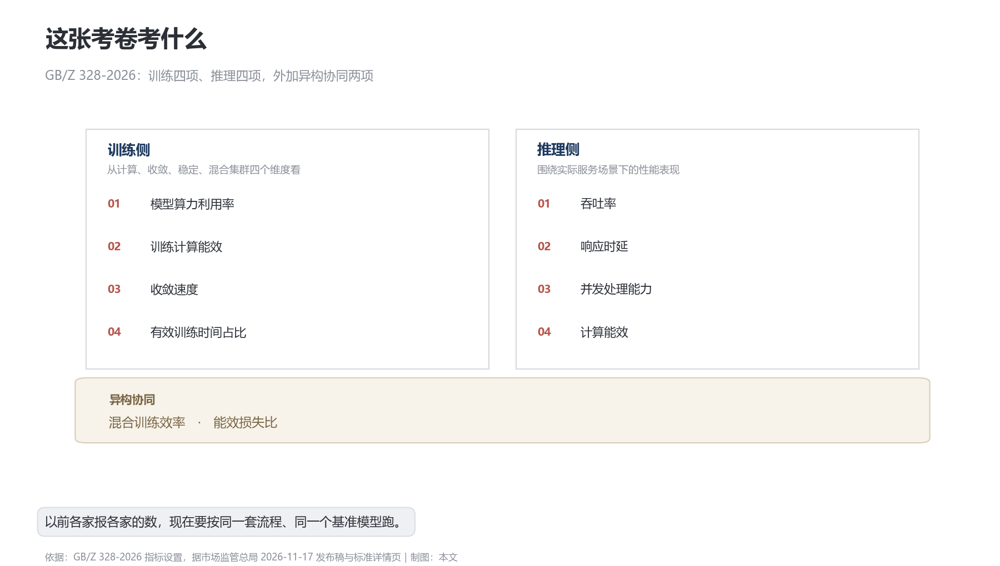
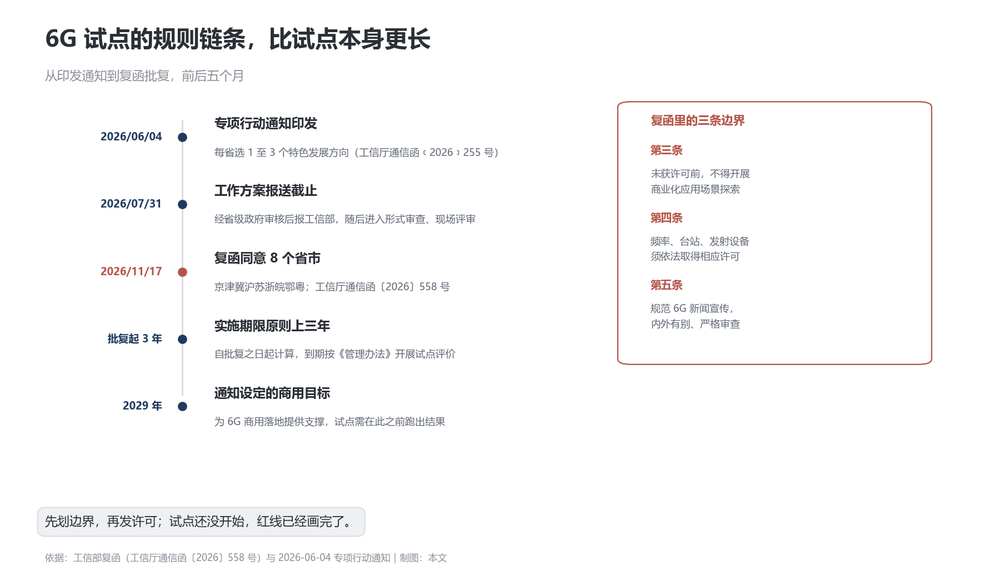
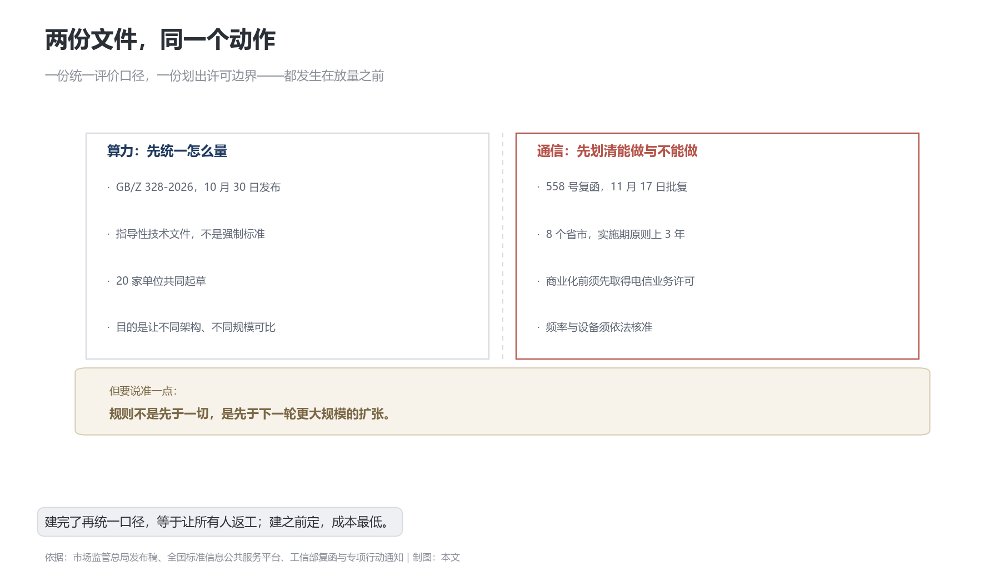

# AI 算力有了「统一考卷」，6G 试点 8 省市：规则开始先于规模

11 月 17 日，两份文件同日公开。

一份来自市场监管总局：《智能计算集群效能指标与测试方法》国家标准化指导性技术文件对外公布。另一份来自工信部：复函同意北京、河北、上海、江苏、浙江、安徽、湖北、广东 8 个省市开展 6G 创新发展部省协同试点。

一份定"怎么量"，一份定"什么不能做"。

## 一、这张考卷考什么

标准号 GB/Z 328-2026，10 月 30 日发布，11 月 17 日对外公布，由全国智能计算标准化工作组（SWG32）归口。

它是国内第一份面向大模型训练与推理场景的集群效能指标体系。训练侧看四项：模型算力利用率、训练计算能效、收敛速度、有效训练时间占比，对应计算、收敛、稳定和混合集群四个维度。推理侧看四项：吞吐率、响应时延、并发处理能力、计算能效。另加异构协同两项：混合训练效率、能效损失比。

官方理由是：集群正从千卡走向万卡乃至更大规模，实际效能被资源利用率、通信开销、任务调度、稳定性多重稀释；传统"以硬件峰值算力为主"的评价方式，反映不了真实效率。

一台机器标称多少算力，和它跑大模型时真正干出多少活，是两件事。以前没有统一尺子，各家报各家的数。

## 二、GB/Z 不是强制标准

GB/Z 是国家标准化**指导性技术文件**，既不是强制性国家标准，也不是推荐性的 GB/T。它没有强制力，不达标不会被罚。

但它解决的是另一个层面的问题：口径。同一套测试流程、计算方法和结果报告要求，加上基准参考模型和典型测试框架——这让不同软硬件架构、不同规模的集群第一次能放在一起比。

它的约束力不来自处罚，来自"你用不用同一把尺子"。20 家起草单位里，之江实验室领衔，阿里云、中国电信、中兴、中国信通院、浪潮、海光等都在名单上——将来要按这个口径报数的人，基本都参与写了这份文件。

## 三、6G 那边划的是另一条线

工信部这份复函（工信厅通信函〔2026〕558 号）共六条，真正要紧的是第三、四、五条。

第三条：试点中若涉及 6G 商业应用，企业应依规取得电信业务经营许可；**未获许可前，不得开展商业化应用场景探索**。

第四条：涉及频率使用、台站设置、发射设备的，须依法取得频率许可证、台站执照及型号核准证。

第五条：规范 6G 新闻宣传，坚持内外有别、严格审查。

这不是"放开"，是"划界"。而且划在试点开始之前。

链条更早就开始了：6 月 4 日印发专项行动通知，各省选 1 至 3 个特色发展方向；7 月 31 日前报送方案；11 月 17 日复函批复；实施期限原则上 3 年，自批复之日起计算。通知给的总目标是 2029 年，为 6G 商用落地提供支撑。

## 四、同一个动作

两件事的共同点不在"算力"或"6G"，在顺序。

算力先统一评价口径，再谈更大规模的集群建设；通信先划许可和频率边界，再谈场景探索。都是先摆尺子和红线，再谈规模。

但要留余地：规则不是"先于一切"。6G 试点本身已是规模动作，算力集群也早就在建。准确讲，规则先于的是**下一轮更大规模的扩张**——万卡之后还有十万卡，试点之后还有试商用。

在这个节点先定口径，成本最低。等建完了再统一标准，等于让所有人返工。

## 五、真正的看点

一份指导性文件、一份复函都算不上强约束。意义不在能管住谁，而在把"怎么算好""什么不能做"提前写进了公共文本。

过去几年是先上量、后补规则，这次顺序反过来了。

反过来之后，竞争方式也会变：以前比谁能堆更多卡、报更大的数；以后要比谁能用同一把尺子，量出更高的实际利用率。

---

一张考卷发下来，第一件事不是答题，是所有人先确认自己看的是不是同一份卷子。

---

*事实来源：GB/Z 328-2026《智能计算集群效能指标与测试方法》为国家标准化指导性技术文件，发布日期 2026-10-30，2026-11-17 由市场监管总局（国家标准委）对外公布；由 SWG32（全国智能计算标准化工作组）归口，主管部门国家标准委，标准类别为方法，CCS L80，ICS 35.080；主要起草单位 20 家，含之江实验室、阿里云计算、中国电信、中兴通讯、中国信通院、蚂蚁科技、成都超算、中国软件评测中心、浪潮信息、超聚变、中移（苏州）软件、海光信息、浙江大华、京东科技、联想（北京）、上海超级计算中心、上海曦智科技、深圳思谋信息、中国科学院计算机网络信息中心等。指标体系：训练效能从计算性能、收敛性能、稳定性能、混合集群性能四个维度设置模型算力利用率、训练计算能效、收敛速度、有效训练时间占比等指标；推理效能围绕吞吐率、响应时延、并发处理能力及计算能效；针对异构算力协同提出混合训练效率、能效损失比；文件并明确测试流程、计算方法与结果报告要求，提供基准参考模型及典型测试框架，提出推动算力评价从关注硬件配置和理论性能转向关注实际应用效能——以上据市场监管总局 2026-11-17 发布稿与全国标准信息公共服务平台标准详情页。6G 部分：工业和信息化部办公厅《关于同意北京市等8个省（市）开展6G创新发展部省协同试点工作的复函》，工信厅通信函〔2026〕558 号，2026-11-17 成文并发布，同意北京市、河北省、上海市、江苏省、浙江省、安徽省、湖北省、广东省为试点省（市）；复函第三条要求涉及 6G 商业应用的须依规取得电信业务经营许可、未获许可前不得开展商业化应用场景探索，第四条要求涉频率、台站、发射设备依法取得相应许可与型号核准，第五条要求规范 6G 新闻宣传、内外有别严格审查，第六条明确按《6G 创新发展部省协同试点专项行动管理办法》定期开展试点评价；前置文件为工信部办公厅《关于组织开展6G创新发展部省协同试点专项行动的通知》（工信厅通信函﹝2026﹞255 号，2026-06-04），提出到 2029 年为 6G 商用落地提供支撑，有关省（市）选择 1 至 3 个特色发展方向编制方案并于 2026-07-31 前报送，实施期限原则上为 3 年、自批复之日起计算——以上据工信部官网原文。文中"这不是放开而是划界""规则先于的是下一轮更大规模的扩张""竞争方式会变"等判断为作者观点，非文件口径；两份文件的实际执行效果尚待观察。*
