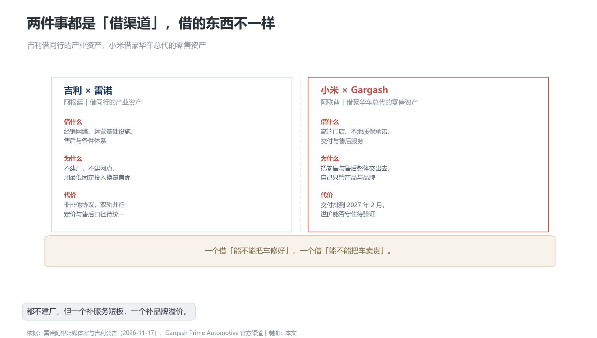
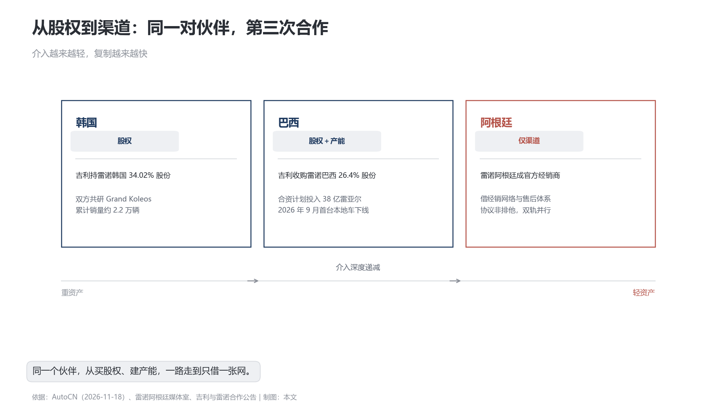
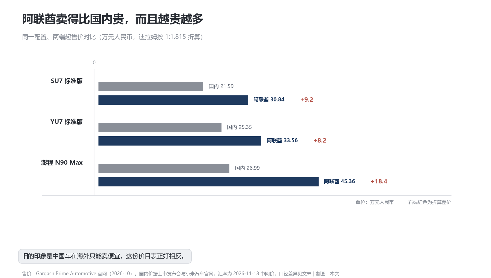

# 吉利借雷诺卖车，小米去阿联酋卖高价：中国车企出海不再只靠建厂

11 月 17 日，吉利与雷诺签了一纸协议：雷诺阿根廷公司成为吉利新能源车型在阿根廷的官方经销商，用雷诺在当地的门店、运营设施和售后体系卖吉利的车。

往前一个月，小米汽车在阿联酋进入兑现阶段——SU7、YU7 可下单，澎程 N70、N90 同步预售，渠道是本地代理 Gargash Prime Automotive。

一个借同行的网络，一个借豪华车总代的网络。看着都像"借"，但借的东西不一样。

## 一、先纠正一个流行读法

不少解读把这两件事说成"吉利借力、小米自建"。不准确。

小米在阿联酋也没自建。零售、交付、售后全部交给 Gargash Prime——这是 Gargash 集团新设的高端业务部，该集团 1918 年起在阿联酋经营，历史上代理过奔驰、阿尔法·罗密欧。小米出的是产品和品牌，门店是别人的。

真正的差别在借什么：吉利借的是同行的产业资产——制造背景、本地运营、售后与备件；小米借的是零售资产——高端门店、本地质保、交付能力。

一个借"能不能把车修好"，一个借"能不能把车卖贵"。

## 二、吉利为什么挑阿根廷

阿根廷不算好市场，但有窗口。

按当地 49/2025 与 50/2025 号法令，离岸价 1.6 万美元以下的电动及混动车型可免缴 35% 的南共市对外关税，每年配额 5 万辆、有效期五年。盘子也不大：2025 年阿根廷新车登记 61.2 万辆，电气化车型 2.6 万辆，纯电只有 1279 辆，中国品牌在纯电细分占约 55%。

总量有限、规则复杂、天花板由配额决定——这种市场自建网络不划算。借雷诺的网点，等于用最低固定成本换即时可用的覆盖面。

这也是吉利与雷诺的第三层合作。韩国那边，吉利持雷诺韩国 34.02% 股份，共研的 Grand Koleos 累计约 2.2 万辆；巴西那边，2025 年 11 月吉利收购雷诺巴西 26.4% 股份，雷诺保持控股，合资计划投入 38 亿雷亚尔做本地化，今年 9 月首台本地制造的 EX5 EM-i 已在巴拉那州下线。

从股权，到股权加产能，再到只做渠道——介入越来越轻。

## 三、小米为什么去阿联酋

因为那里卖得出价。

官方价目：SU7 标准版 169,900 迪拉姆，YU7 标准版 184,900，澎程 N70 Pro 209,900，N90 Max 249,900。按 1 迪拉姆约合 1.815 元折算，SU7 标准版约 30.8 万元，而国内同款起售 21.59 万元。

差价不是齐的：SU7 标准版高约 9.2 万元，YU7 标准版高约 8.2 万元，澎程 N90 Max 高约 18.4 万元。越高配、越是新序列，溢价越厚。

这是粗算：国内售价含 13% 增值税，阿联酋含 5% 关税与 5% 增值税，也没计物流和认证成本。但方向不会错。

## 四、真正的变化

两件事合起来看，动作从"卖更多车"变成了"选对市场、选对搭档"。

过去出海的主线是建厂：重资产、长周期、换一个本地化身份。现在多出一条路——不建厂，渠道交给最懂当地的人，自己只管产品和品牌。

代价也明确。吉利这边是非排他协议，阿根廷会出现"雷诺渠道＋原有进口代理"双轨，定价与售后口径怎么统一是待解问题。小米这边是等：首批交付 2026 年 12 月，多数配置排到 2027 年 2 月。

但两家算的都不是一个市场的账。吉利前 10 个月出口 90.5 万辆、同比增 168%，拉美及非洲超 18 万辆、增 236%，阿根廷只是这条线上的一颗子。小米要的是"中国车能卖高价"被看见一次。

---

建厂是把车运出去，借渠道是把车卖出去。前者考的是钱，后者考的是选谁。

---

*事实来源：2026-11-17 雷诺集团与吉利汽车签署战略合作协议，雷诺阿根廷公司成为吉利新能源车型在阿根廷官方经销商，雷诺开放其现有经销网络、运营基础设施与售后服务能力；该协议非排他性，阿根廷现有吉利经销商表示合作关系仍然有效，短期将出现「雷诺渠道＋原有进口代理」双轨销售，协议未披露投放车型、时间表与销量目标——据雷诺阿根廷媒体室、LA NACION、Clarín、界面新闻、AutoCN（2026-11-18）。吉利与雷诺此前合作：韩国——吉利持雷诺韩国 34.02% 股份，共研 Grand Koleos 累计销量约 2.2 万辆；巴西——2025 年 11 月吉利收购雷诺巴西公司 26.4% 股份，雷诺保持控股并合并报表，合资公司计划投入 38 亿雷亚尔推进本地化生产，2026 年 9 月首台巴西本地制造 Geely EX5 EM-i 在巴拉那州下线，纯电 EX2 计划 12 月投产——据 AutoCN（2026-11-18）。阿根廷政策与市场：第 49/2025 与 50/2025 号法令，离岸价不超过 1.6 万美元的电动及混动汽车可免缴 35% 南方共同市场对外关税，每年配额 5 万辆、有效期五年，2026 年配额分配向进口商倾斜（进口商 30720 辆、终端企业 19280 辆）；2025 年阿根廷新车登记 61.2 万辆、同比 +47.8%，电气化车型 2.6 万辆、同比 +88%，纯电 1279 辆、同比 +130%，中国品牌在纯电细分约占 55%——据 AutoCN（2026-11-18），素材方口径。吉利出口：2026 年前 10 个月累计出口 90.5 万辆、同比 +168%，10 月单月 10.7 万辆、连续第五个月超 10 万辆，前三季度新能源出口 48.4 万辆、占 61%，拉美及非洲超 18 万辆、同比 +236%——据 AutoCN（2026-11-18），素材方口径。小米汽车阿联酋：经销商 Gargash Prime Automotive（Gargash 集团新设高端业务部，该集团 1918 年起在阿联酋经营，历史代理奔驰、阿尔法·罗密欧、GAC 等），2026 年 10 月中旬正式开售，共 13 个配置，质保 5 年或 15 万公里、保养至 6 万公里；SU7 标准版 169,900 迪拉姆、YU7 标准版 184,900、澎程 SkyNomad N70 Pro 209,900、N90 Max 249,900、SU7 Ultra 375,900；首批交付 2026 年 12 月，其余配置排至 2027 年 2 月——据 tbreak（2026-10-19／20 更新）与 Gargash Prime Automotive 官网。澎程（SkyNomad）为小米汽车增程 SUV 序列中文名，2026-07-08 官宣，与 SU7、YU7 并列；N70 国内 20.99 万元起、N90 Max 国内 26.99 万元起（小米汽车官网）；SU7 标准版国内 21.59 万元、YU7 标准版 25.35 万元（上市发布会口径）。汇率取 2026-11-18 迪拉姆兑人民币约 1.815，折算为粗略对比，两端税制不同、未计物流与认证成本，故差价仅供量级参考。文中「借的东西不一样」「从股权到渠道」「建厂是把车运出去，借渠道是把车卖出去」等判断为作者观点，非企业与协议口径。*
