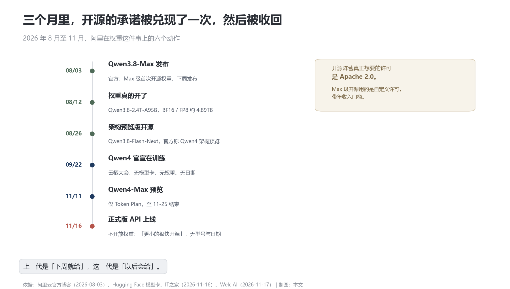
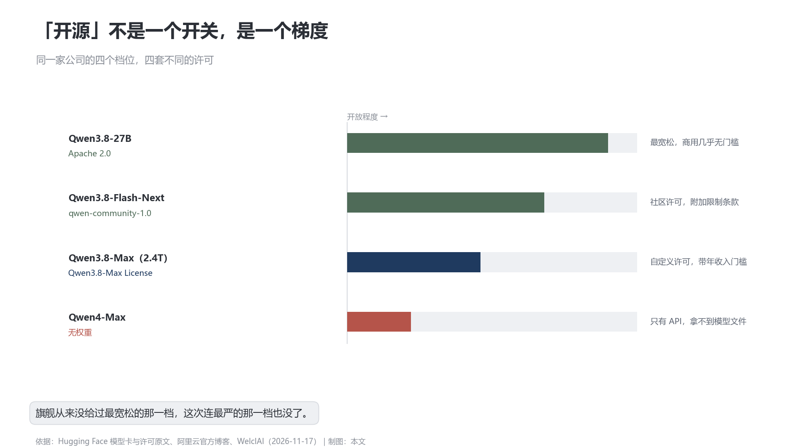
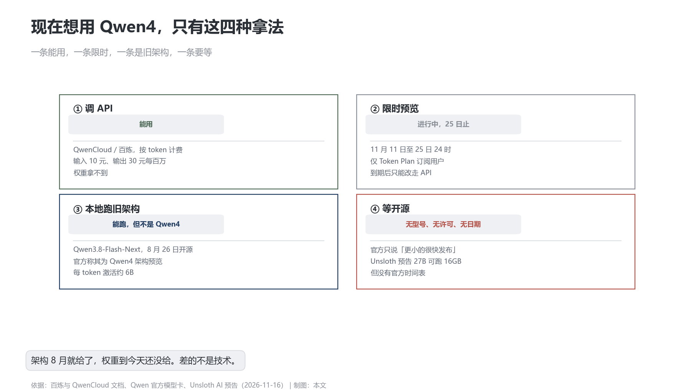

# Qwen4-Max 开了 API，Qwen4 的开源权重还没来

11 月 16 日，Qwen4-Max 正式上线，API 开放。

2.4 万亿总参数，每个 token 激活约 710 亿，100 万 token 上下文，原生支持文本、图片、视频输入。国内接口输入 10 元、输出 30 元每百万 token，比上一代降了约 17%；缓存输入低到 0.075 美元。还同时兼容 OpenAI 和 Anthropic 的接口格式。

公告里另一半话才是重点：**不开放权重**。只说"Qwen4 系列中规模更小的开放权重模型将很快面向全球开发者发布"——没说多大、没说用什么许可、也没说哪天。

## 一、这次到底开的是什么

先把"开放"两个字拆开。

开的是**接入**：调 API 可以，走 Token Plan 可以，在 QwenWork、Qoder、Qwen Studio 里用也可以。不开的是**权重**：拿不到模型文件，拷不走，部署不到自己的机房，也没法改。

对绝大多数企业用户，这没什么区别——反正也不会自己去跑一个 2.4 万亿参数的模型。但对开源社区，这是两件完全不同的事。

还有一个容易被忽略的时间点：11 月 11 日到 25 日，Qwen4-Max 以 `qwen4-max-preview` 的名义做过限时预览，只对 Token Plan 订阅用户开放。今天（18 日）还在窗口期内，25 日 24 时之后就只剩 API。

## 二、上一代是开过的

这才是这件事值得写的原因。

2026 年 8 月 3 日，Qwen3.8-Max 发布。官方博客里有一句很重的话：**"这是 Qwen-Max 级模型首次开源权重，开放权重将于下周发布。"**

然后它真的做了。8 月 12 日，`Qwen/Qwen3.8-2.4T-A95B` 上线 Hugging Face 和 ModelScope，BF16 与 FP8 两版，约 4.89TB。当时行业里的解读是：最强模型必须闭源的规矩，被阿里改了。

所以三个月后这一代收回，不叫"一直如此"，叫**改回去了**。

而且仔细看，上一代那次开源也打了折。Qwen3.8-Max 用的是自定义的 Qwen3.8-Max License，带年收入门槛；真正给到 Apache 2.0 的，是同代的 27B 小模型。开源阵营最想要的那一档，旗舰从来没给过。

## 三、架构早就开源了，只是不叫 Qwen4

还有一个更微妙的细节。

2026 年 8 月 26 日，阿里开源了 Qwen3.8-Flash-Next。官方模型卡的原话是："an experimental preview of the architecture that will underpin Qwen4"——**支撑 Qwen4 的架构的实验预览版**。

它就是 Qwen4 的地基：125B 主干加 51B 的 n-gram 嵌入，落盘约 180B，每 token 只激活约 6B，用的是 `qwen-community-1.0` 许可。

也就是说，Qwen4 的架构，8 月就给了；Qwen4 的权重，今天还没有。

中间差的不是技术，是决定。

## 四、收得很有讲究

细看这次的说法，用词是"陆续"、"很快"——不是"不会"。

这个措辞很聪明。它给了一个不承诺日期的承诺，让人继续等。知乎上有条热评说得直白："一个模型把大伙干成望夫石了。"开源量化团队 Unsloth 也在 11 月 16 日当天预告，说更小的 Qwen4 快来了，Qwen4-27B 能在 16GB 内存上跑——但这是第三方的预告，不是官方时间表。

商业上这个选择不难理解。2.4 万亿参数的模型，训练成本高，卖 API 是唯一能收回成本的路径；权重一旦放出去，云厂商和同行都能拿去部署，价格立刻被打下来。OpenAI 和 Anthropic 从来没开过旗舰权重，阿里凭什么一定要开。

但阿里的位置和它们不同。它是靠开源把 Qwen 这个名字做起来的——开发者愿意用，是因为模型能下载、能改、能塞进自己的产品里。旗舰闭源，短期收入更好看，长期是在花那笔攒了两年的信用。

顺带说一句，这份闭源也没有换来代差。官方自建评测 Work360 上是 52.69 对 47.74，确实进步了；但同一份材料里 16 项基准对 Claude Opus 5.5 是 6 胜 10 负，Terminal-Bench 4.0 上 48.5 分，还低于 Kimi K3.1 的 67.2。

---

开源从来不是义务。一家公司想闭源，完全可以说得过去。

真正的问题是节奏：八月刚用"首次开源 Max 级"赢了一次掌声，十一月就把它收回去，只在括号里留一句"更小的很快来"。

模型可以等。信用等不了。

---

*事实来源：2026-11-16 阿里发布 Qwen4-Max，稀疏 MoE、总参 2.4 万亿、每 token 激活约 710 亿（官方标注，较 Qwen3.8-Max 的 95B 少约 25%；部分中文报道写 950 亿，与"减少 25%"不自洽，本文采 710 亿口径）、100 万 token 上下文、原生支持文本/图片/视频输入与文本输出；国内 API 输入由 12 元降至 10 元、输出由 36 元降至 30 元每百万 token（降约 17%），国际版输入 1.50 美元、输出 4.50 美元每百万 token，缓存输入 0.075 美元；兼容 OpenAI Chat Completions／Responses 与 Anthropic Messages API；可在 QwenCloud、Token Plan、Qwen Studio、QwenWork、Qoder 使用。该次发布不开放权重，官方仅称"Qwen4 系列中规模更小的开放权重模型将很快面向全球开发者发布"，未给规模、许可证与时间表——据阿里云官方博客、IT之家（2026-11-16）、WelclAI（2026-11-17）、Crypto Briefing、SiliconANGLE、MetaEra。预览期：11 月 11 日 10:00 至 11 月 25 日 24:00（UTC+8），模型 ID qwen4-max-preview，仅 Token Plan。上一代：2026-08-03 Qwen3.8-Max 发布，官方称"Qwen-Max 级模型首次开源权重、下周发布"；08-12 开源 Qwen3.8-2.4T-A95B（BF16 与 FP8 两版，约 4.89TB，Qwen3.8-Max License，带年收入门槛）；Qwen3.8-27B 为 Apache 2.0。08-26 开源 Qwen3.8-Flash-Next，官方模型卡称其为 "an experimental preview of the architecture that will underpin Qwen4"，规格 125B 主干 + 51B n-gram embedding + 4B MTP ≈ 180B 落盘、每 token 激活约 6B，许可 qwen-community-1.0。09-22 云栖大会公布 Qwen4 在训练中、未给日期。11-16 Unsloth AI 预告 Qwen4-27B 可在 16GB 内存运行（第三方预告，非官方时间表）。评测：官方 Work360 得 52.69（上代 47.74）；官方 16 项基准对 Claude Opus 5.5 为 6 胜 10 负；Terminal-Bench 4.0 得 48.5，Kimi K3.1 为 67.2；成本降幅各口径不一（官方约 60%、企业版 58%、MetaEra 62%）。文中"开的是接入、不开的是权重""中间差的不是技术，是决定""信用等不了"等判断为作者观点。*
