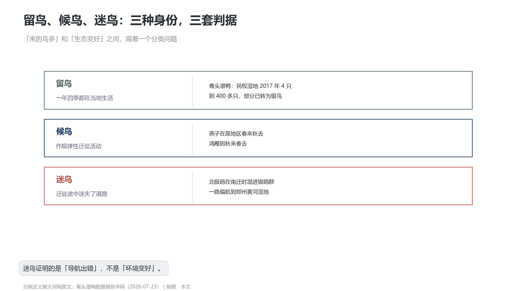

# 大批鸟类来河南「蹭吃蹭喝蹭暖」：有的是回家，有的是走错了路

立冬刚过，河南的湿地里又热闹起来。

网上的说法很生动：大批鸟类来河南"蹭吃蹭喝蹭暖"了。听着像一群不请自来的亲戚，冬天过来蹭暖气。

这个说法有一半是对的，另一半得拆开看。

## 一、先看来了什么

11 月 17 日，大河网汇总了河南几处湿地的监测情况，四个地方，四条消息。

灵宝市银水湖，林业局日常巡护时记录到 20 余只黑鹳。这个数字刷新了灵宝的观测纪录——此前在金水湖只零星见过几只。黑鹳是国家一级保护动物，有"鸟中大熊猫"之称，对水质和栖息环境要求极高，是公认的生态指示物种。

濮阳县黄河湿地，上千只野鸭成群集结，被拍成了"鸭浪"。斑嘴鸭、绿头鸭、针尾鸭混在一起游弋起落。

驻马店宿鸭湖湿地，拍到了红胸黑雁和黑颈䴙䴘，两种都是国家二级保护。

还有一条容易被当成同类消息的：郑州黄河湿地中牟区域，11 月 12 日中午，郑州师范学院教授李长看在一群银鸥里发现了一只北极鸥。

前三条是"回来了"，第四条不是。

## 二、"迷鸟"这个词才是重点

那只北极鸥是一只迷鸟。

大河网的报道把三个概念分得很清楚：**留鸟**是一年四季都在当地生活的；**候鸟**是作规律性迁徙的，比如中原地区春来秋去的燕子、秋来春去的鸿雁；**迷鸟**则是迁徙途中不小心迷失了道路的鸟。

这只北极鸥是在南迁时混进了西伯利亚银鸥群，跟着一路偏航，飞到了郑州黄河湿地。

它能不能留下越冬，还要继续监测。

为什么这点重要？因为"鸟变多了"和"生态变好了"之间，隔着一个分类问题。

黑鹳集群、鸭浪、红胸黑雁——这些是候鸟按着千百年的路线如期抵达，反映的是栖息地质量。而迷鸟只说明一件事：这只鸟的导航出错了。它可以出现在任何地方，跟当地环境好不好没有因果关系。

把"稀客现身"直接等同于"环境变好"，是这类报道里最常见的偷懒。真正值得说的是：稀客里，哪些是按路线来的，哪些是走丢的。

## 三、数字确实在这一边

不过河南的鸟确实在变多，这一点有硬数据。

最近一个越冬季，河南的全国越冬水鸟同步监测覆盖全省 18 个省辖市，设 122 个观测分区，197 人参与，记录到水鸟 157 种、38.18 万只，比上一年同期分别增长 13% 和 6.8%。

更能说明问题的是趋势。民权黄河故道湿地的青头潜鸭，从 2017 年的 4 只增加到 400 多只，因为食物充足、环境舒适，其中一部分已经不再迁徙，变成了留鸟——从"过冬的客人"变成"常住的居民"，这是比数量增长更硬的指标。

河南的湿地不足国土面积的 5%，却养着全省 68.9% 的脊椎动物。这是个很悬殊的比例，也解释了为什么候鸟通道上的河南，每年要接待几十万只过境鸟类。

## 四、回到"蹭"这个字

"蹭吃蹭喝蹭暖"是个可爱的说法，但它把三件事混成了一件。

鸟来这里，不是因为河南"管饭"。是这条迁徙路线在这里，是湿地还在，是水里的鱼虾还够吃。它们不是来蹭的，是来赴一个几十万年的约。人类只是没有把路挖断。

至于那些迷鸟，更谈不上蹭——它们本来不想来。

这个冬天，河南的湿地会陆续迎来更多候鸟。大鸨、白鹤还在路上。看鸟的时候多问一句"这只是哪一种"，比说一句"环境真好了"更有意思。

---

一只鸟飞对了地方，叫回家；飞错了地方，叫新闻。

---

*事实来源：2026-11-17 大河网报道（记者刘瑞朝）汇总河南候鸟越冬情况——灵宝市银水湖由林业局日常巡护监测记录到黑鹳 20 余只、为灵宝湿地范围内监测到的最大黑鹳种群并刷新当地观测纪录（此前金水湖仅零星数只）；濮阳县黄河湿地省级自然保护区内上千只野鸭集结形成"鸭浪"，以斑嘴鸭、绿头鸭、针尾鸭等雁形目鸭科水鸟为主，大鸨、白鹤等将接踵而至；驻马店汝南宿鸭湖湿地省级自然保护区由鸟类摄影爱好者拍到红胸黑雁与黑颈䴙䴘，均为国家二级保护野生动物，红胸黑雁在国内属罕见迷鸟；郑州黄河湿地保护区中牟区域 11 月 12 日中午由郑州师范学院教授、鸟类专家李长看观测到混在银鸥群中的北极鸥一只，属迷鸟，该记录刷新河南鸟类纪录（央广网 2026-11-16），是否留下越冬尚需进一步监测。留鸟、候鸟、迷鸟的定义及北极鸥偏航经过，据大河网原文。黑鹳为国家一级重点保护野生动物、生态指示物种，据国家林草局等公开材料；全球黑鹳种群约 24000—44000 只、中国约 1000 只，为"湿地国际"统计口径，国家林草局与张掖黑河湿地国家级自然保护区管理局等多方引用。河南越冬水鸟数据：2026 年度全国越冬水鸟同步监测河南区域调查记录水鸟 157 种、38.18 万只，较 2025 年同期分别增长 13% 和 6.8%，覆盖 18 个省辖市、122 个观测分区、197 人参与（国家林草局政府网 2026-01-23）——需说明该调查对应上一越冬季结果，并非本季数据。青头潜鸭由 2017 年 4 只增至 400 多只、部分转为留鸟，据新华网（2026-07-23）引民权县黄河故道国家湿地公园管理中心主任任剑英。河南湿地不足国土面积 5%、生存全省 68.9% 脊椎动物，据大河网（2026-02-02）。河南位于东亚—澳大利西亚候鸟迁徙路线，据大河网原文。文中"把稀客现身等同于环境变好是偷懒""鸟不是来蹭的，是来赴约""飞对了叫回家，飞错了叫新闻"等判断为作者观点。*