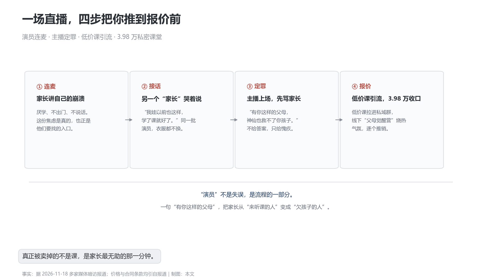
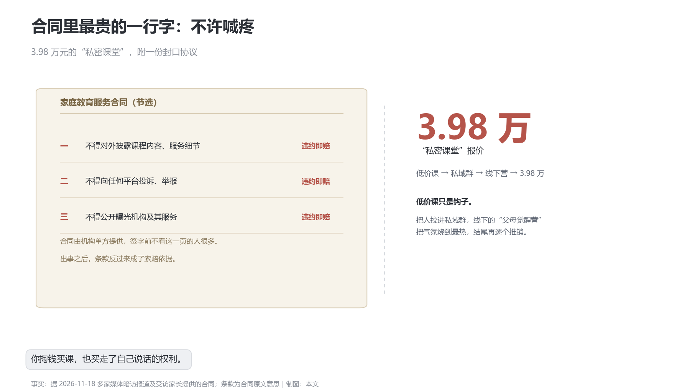
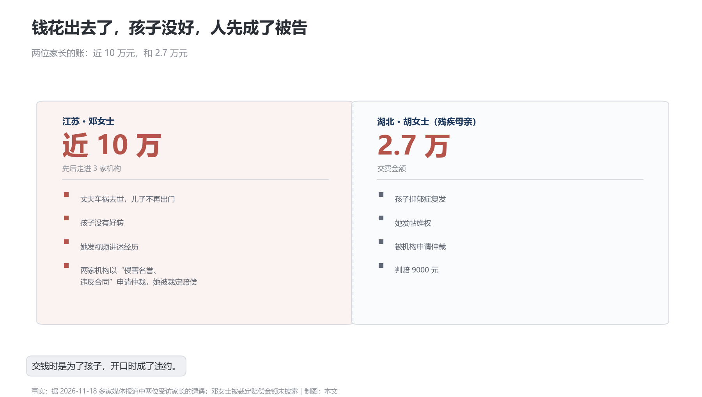

# 直播间里哭着说“孩子好了”的家长，是演员

直播间里，一个家长哭着说：我娃以前也这样，学了课就好了。

你心动了。

记者暗访发现：那个哭的人，是演员。衣服都不换，几个直播间来回演。

## 一、眼泪是排好的，报价是算好的

先把那场直播还原一遍。

第一步，连麦。家长哭着讲自己的孩子：厌学、不出门、不说话。这份焦虑是真的。

第二步，另一个“家长”接上来，哭着说：我娃以前也这样，学了课就好了。她可能刚在隔壁直播间哭过同一句话，连衣服都没换。你看到的是“一个和你一样的家长”，其实是排好的第二棒。

第三步，主播上场。他不急着卖课，先定罪：“有你这样的父母，神仙也救不了你孩子。”

这句话不提供答案，只提供愧疚。而愧疚，是最容易被换算成付款的情绪。

第四步，报价。低价课只是钩子，把你拉进私域群；线下“父母觉醒营”把气氛烧到最热，结尾逐个推销 3.98 万元的“私密课堂”。

一套流程走完，你记住的是别人家孩子好了，你怀疑的是自己不够努力。他们记住的，是今天有几个家长进了群。

低价课、私域群、线下营，一层层都在筛人：愿意继续掏钱的人被留下，开始怀疑的人被劝退。

这套东西还能复制：演员、话术、报价、合同，每个环节都有模板。被卖的不是课，是家长最无助的那一分钟。

## 二、合同里最贵的一行字

比 3.98 万更让人愤怒的，是合同。

机构在合同里写明：不许对外说，不许投诉，不许曝光，否则赔违约金。

合同本该约定服务，这里却主要约定沉默。

你为孩子掏的钱，买来的是一份“不许喊疼”的协议。

## 三、两个花过钱的人

江苏邓女士的丈夫死于车祸，儿子受了打击，不再出门。她带着孩子先后走进 3 家机构，花了近 10 万元，孩子没有好转。

她把经历拍成视频发出去。两家机构反手以“侵害名誉、违反合同”申请仲裁，她被裁定赔偿。

湖北的胡女士是一位残疾母亲。她交了 2.7 万元，孩子的抑郁症复发。她发帖维权，被机构仲裁，判赔 9000 元。

“侵害名誉”“违反合同”这两顶帽子，恰好对应她们做过的两件事：说出真相，和签过字。

两个人的路径几乎一样：交钱的时候，是为了孩子；开口的时候，成了违约。她们不是没花钱，是把最难拒绝的那笔钱，交给了最懂她们软肋的人。

## 四、下次看到那个哭的人，先问一句

不用等通报，也不用等谁被查处。下次刷到这种直播间，你只看一个细节：

那个哭着说“孩子好了”的家长，敢不敢把脸转过来，让你看清楚？

再问一句：这句话，她今天在几个直播间说过？

真正的改变，有名字、有学校、有具体的日子；只会重复同一套词的，大概率不是家长，是演员。

孩子厌学、抑郁，是很多家庭最不敢说出口的事。也正因为不敢说，它最容易被标价。

你越愧疚，它越报价。

能救孩子的，从来不是 3.98 万的课，是你在被愧疚推着掏钱之前，肯停下来的那一分钟。

---

*事实来源：11 月 18 日，多家媒体曝光“家庭教育”直播间剧本连麦乱象。记者暗访发现，直播间里哭着称“我娃以前也这样，学了课就好了”的“家长”是同一批演员，衣服不换，在几个直播间来回演；演员演完焦虑后主播上场，以“有你这样的父母，神仙也救不了你孩子”等话术放大家长愧疚，随后报价。低价课只是引流钩子，家长被拉进私域群后，线下“父母觉醒营”逐个推销 3.98 万元的“私密课堂”。机构合同写明：不许对外说，不许投诉，不许曝光，否则赔偿违约金。江苏邓女士在丈夫车祸去世后，儿子深受打击不再出门，她先后在 3 家机构花费近 10 万元，孩子毫无好转；她发视频讲述遭遇后，两家机构以“侵害名誉、违反合同”申请仲裁，她被裁定赔偿。湖北残疾母亲胡女士交费 2.7 万元，孩子抑郁症复发，她发帖维权后被机构仲裁，被判赔 9000 元。文中“把脸转过来”“你越愧疚，它越报价”等为作者分析。*
