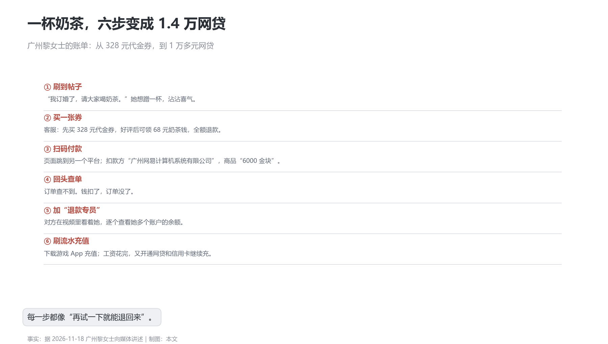
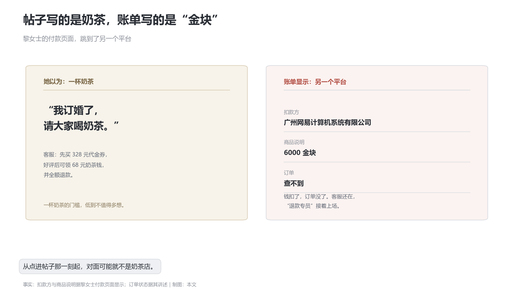
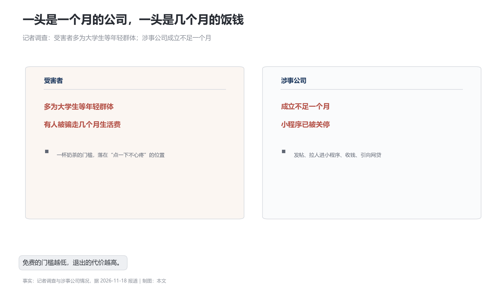

# 想蹭一杯免费奶茶，一小时后背了 1.4 万网贷

11 月 18 日，广州的黎女士向媒体讲述了自己的经历。

她在社交平台刷到一条帖子：“我订婚了，请大家喝奶茶。”她想蹭一杯，沾沾喜气。

不到一小时，她的工资见了底，还背上了 1 万多元的网贷和信用卡账单。总损失超过 1.4 万元。

## 一、一杯奶茶的六步

第一步，刷到帖子。文案很简单：订婚，请大家喝奶茶。

第二步，进小程序。客服说，先买一张 328 元的电商平台代金券，好评之后可以领 68 元奶茶钱，并全额退款。

第三步，扫码付款。页面跳到了另一个平台。扣款方显示为“广州网易计算机系统有限公司”，商品说明是“6000 金块”。

第四步，回头查订单。查不到。钱扣了，订单没了。

第五步，客服让她添加“退款专员”。对方在视频里看着她，逐个查看她多个账户的余额。

第六步，以“刷流水才能退款”为由，让她下载游戏 App 充值。工资花完，她又开通网贷和信用卡，继续充。

六步走完，1.4 万元没了。

## 二、每一步都踩在同一个念头

这套流程最狠的地方，不是骗术多高明，是它每一步都踩着同一个念头：钱已经出去了，得弄回来。

328 元不算小钱，但“好评后全额退款”听上去像一道保险。订单查不到的时候，人第一反应不是止损，是“怎么把钱要回来”。

于是有了“退款专员”，有了视频看余额，有了“刷流水”。越急，越深。

帖子说的是奶茶，付款页面写的却是“6000 金块”。“退款专员”要看的，不是订单号，是她账户里还有多少钱。

从点进帖子那一刻起，她面对的可能就不是一家卖奶茶的店。

## 三、公司成立不到一个月

涉事公司成立不足一个月。小程序已被关停。

一个成立不到一个月的公司，能在社交平台上发帖、拉人进小程序、收钱，再把人引到网贷——这条链路，比一家正经奶茶店开张快得多。

小程序是门面，客服是话术，游戏充值是出口。

## 四、被骗的不止她一个

记者调查发现，受害者多为大学生等年轻群体，有人被骗走几个月生活费。

一杯奶茶的门槛，正好落在“点一下不心疼”的位置。等到发现不对，付出去的是几个月的生活费。

他们不是贪，是想省一杯奶茶的钱。

## 五、下次看到，先截图再报警

这类帖子最常见的话术，是“免费送”“沾喜气”“先付一点，马上退”。

记住三件事：

让你先付钱的“免费”，不是免费。

退款不需要你“刷流水”，更不需要你打开视频给人看余额。

看到不对，先截图——帖子、聊天记录、付款页面、扣款方名字，都截下来，再报警。

你刷到过这种“免费送”吗？转给家里刚工作的孩子，也许比一杯奶茶有用。

---

*事实来源：2026 年 11 月 18 日，广州黎女士向媒体讲述：她在社交平台刷到“订婚请喝奶茶”的帖子，想蹭一杯沾喜气；进入小程序后，客服让她先买一张 328 元的电商平台代金券，称好评后可领 68 元奶茶钱并全额退款；她扫码后付款页面跳转到另一个平台，扣款方显示为“广州网易计算机系统有限公司”，商品说明为“6000 金块”；她回头查不到订单；客服又诱导她添加“退款专员”，在视频监控下查看她的多个账户余额，以“刷流水才能退款”为由让她下载游戏 App 充值；不到一小时，她的工资见底，还背上了 1 万多元的网贷和信用卡账单，总损失超过 1.4 万元。涉事公司成立不足一个月，小程序已被关停。记者调查发现，受害者多为大学生等年轻群体，有人被骗走几个月生活费。文中“每一步都踩在同一个念头”“不是贪，是想省一杯奶茶的钱”等分析为作者判断。*
