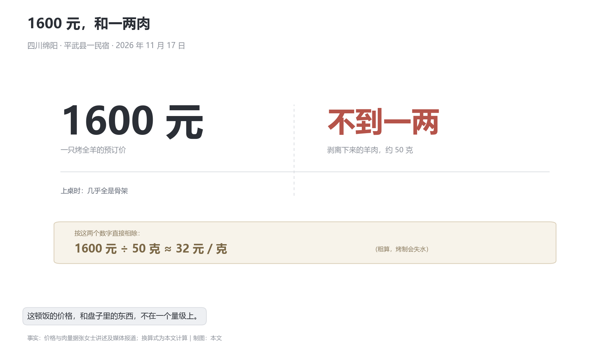
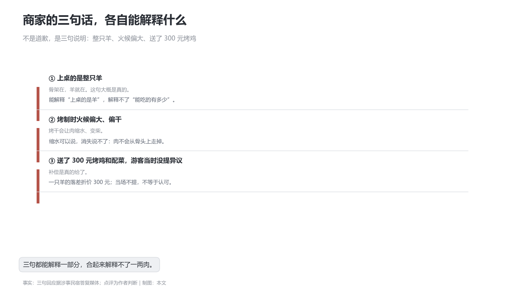
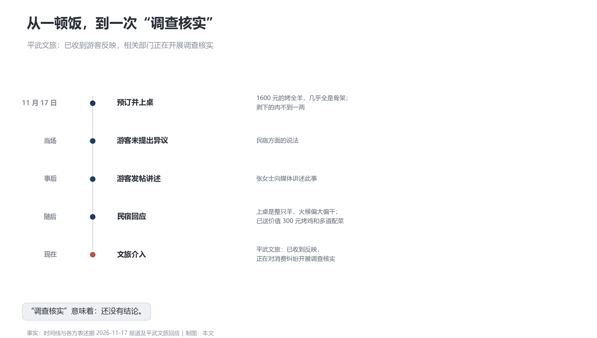

# 1600 元的烤全羊，剥不出一两肉

11 月 17 日，四川绵阳，张女士在平武县一家民宿花 1600 元预订了一只烤全羊。

上桌之后，整只羊几乎全是骨架。她把肉剥下来，不到一两，约 50 克。

## 一、两个数字放在一起

1600 元，50 克。

按这两个数字直接相除，一克羊肉约 32 元。这个算法很粗——烤制会流失水分，骨头上总归带点肉。但它至少说明一件事：这顿饭的价格，和盘子里的东西，已经不在一个量级上。

有人会顺手算 1600 块能买几只羊。这个账其实算不清：羊有大小，烤全羊的报价里还有加工、场地、人工。所以真正值得看的不是“能买几只羊”，而是商家自己给出的解释。

## 二、商家的三句话

事发后，涉事民宿的回应可以拆成三句。

第一句：上桌的是整只羊。

这句大概率是真的。骨架在，羊就在。它能说明上的是羊，说明不了能吃的有多少。

第二句：只是烤制时火候偏大、偏干。

烤干会让肉缩水、变柴，这个道理没错。但缩水是体积变小，不是从骨头上消失。火候能解释口感，解释不了分量。

第三句：事发后已为游客赠送价值 300 元的烤鸡和多道配菜，并称游客当时“并没有提出异议”。

300 元的烤鸡是实实在在给出的补偿。可它也顺带定了一个价：在这家店看来，一只烤全羊和一两肉的落差，值 300 元加几道配菜。

至于“没有提出异议”——当场不提，可能是因为一桌人正在吃饭，也可能因为旅途还没结束，不想把行程吵散。事后发帖讲述，本身也是一种异议。

## 三、现在到哪一步了

平武文旅回应：已收到游客反映，相关部门正在对消费纠纷开展调查核实。

“调查核实”四个字，意味着目前还没有结论。

现在两边各执一词。游客讲的是：剥下来不到一两。商家讲的是：上桌的是整只羊，只是烤干了。

羊有多大、上桌前是什么状态、烤完还剩多少，得靠称重、照片、点菜单据这些东西来核对。这些恰恰是“调查核实”要做的事——它不是一句表态，是一个需要证据的动作。

## 四、那“烤干了”算不算理由

回到开头那个问题。

烤全羊“烤干了”，是技术失误，还是把骨架端上桌的理由？

技术失误是要认账的：烤过了，就该重做、退款，或者按实际情况收费。把失误当成解释，等于说“我这儿出了点问题，所以你得接受这个结果”。

而那只 300 元的烤鸡，其实说明了态度——真觉得这顿饭没问题，不必送。

一顿 1600 元的饭，端上桌的是骨架，端下桌的是一句“火候偏大”。你觉得，这个解释站得住吗？

---

*事实来源：2026 年 11 月 17 日，四川绵阳张女士在平武县一民宿花 1600 元预订烤全羊，上桌后发现几乎全是骨架，剥离下来的羊肉不到一两（约 50 克）；涉事民宿回应称，上桌的是整只羊，只是烤制时火候偏大偏干，事发后已为游客赠送价值 300 元的烤鸡和多道配菜，并称游客当时“并没有提出异议”；平武文旅回应，已收到游客反映，相关部门正在对消费纠纷开展调查核实。文中“约 32 元 / 克”为按 1600 元与 50 克两个数字直接相除得到的粗算，非涉事双方说法；“300 元烤鸡是一份定价”“把失误当成解释”等为作者判断。*