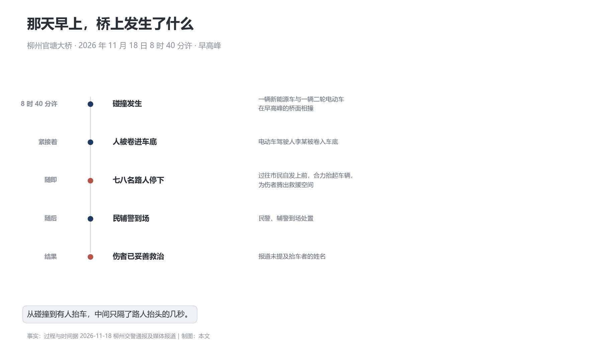
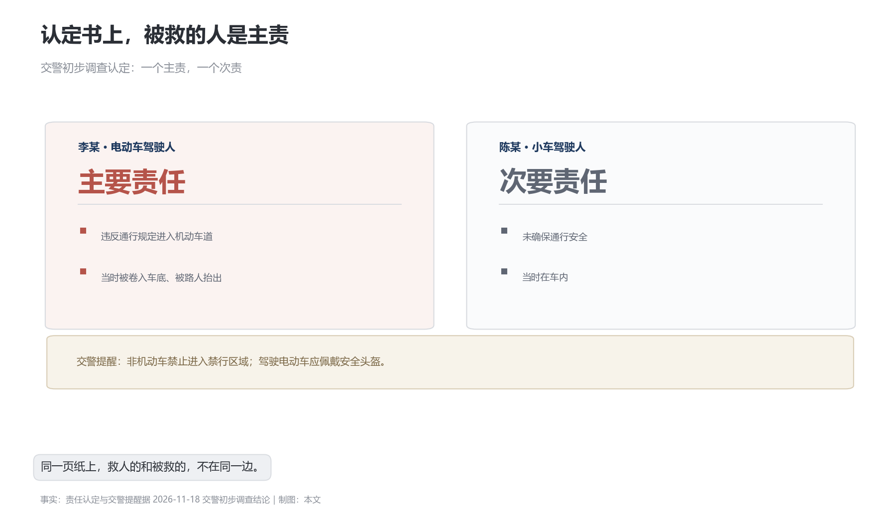
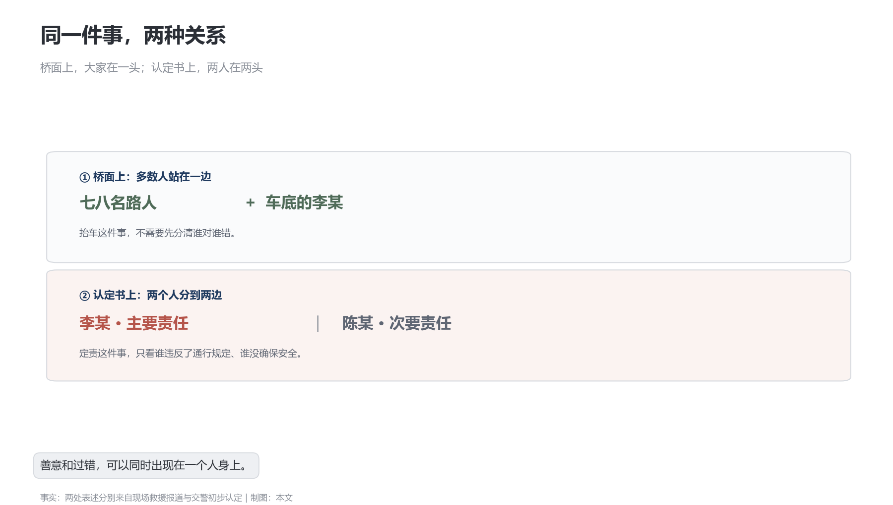

# 抬车的人和被抬的人，在认定书上站到了两边

11 月 18 日早上 8 时 40 分许，柳州官塘大桥，早高峰。

一辆新能源车和一辆二轮电动车撞在一起。骑电动车的是李某，人被卷进了车底。

过往的七八名市民停了下来，一起把车抬起来，给救援腾出空间。民辅警随后到场处置，伤者已得到妥善救治。

人救出来了。接着，责任认定下来了。

## 一、那天早上，桥面上

时间、地点、人物都清楚：8 时 40 分许，官塘大桥，早高峰；一辆新能源车，一辆二轮电动车；被卷入车底的是电动车驾驶人李某。

停下来的是七八名过往市民，彼此不认识，也没有谁先组织。他们做的事很具体：把车抬起来，让人能出来。

随后民辅警到场处置。伤者得到了妥善救治。报道里没有写抬车的人叫什么。

一场事故里，这一段的语气是暖的。

## 二、认定书上，被救的人是主责

交警初步调查认定：

电动车驾驶人李某，违反通行规定进入机动车道，承担主要责任。

小车驾驶人陈某，未确保通行安全，承担次要责任。

同一份认定里，一个主责，一个次责。而被抬出来的那个人，是主责。

交警同时提醒：非机动车禁止进入禁行区域，驾驶电动车应当佩戴安全头盔。

## 三、救人是一件事，定责是另一件事

很多人第一反应是不服：人都救了，还追究他走错道？

这两件事，本来就不在同一个时间点上。

抬车，看的是那一刻谁离得近。定责，看的是在那之前谁违反了通行规定。前者是现场的选择，后者是事后的划分。一个人可以既违规、又被救——这两件事不互相抵消。

反过来，如果因为他违规就不抬车，那是另一套逻辑。那套逻辑里，没有“路过的人”这个角色。

这两条线并不矛盾，只是被同一件事同时摊开。责任按通行规定算，救援按当时的选择算——两把尺子，量的是两段时间：出事之前谁走错了道，出事之后谁愿意停下来。

## 四、抬车是别人的善意，命是自己的

所以交警那两句提醒，读起来才有点重。

第一句，非机动车禁止进入禁行区域。桥面、机动车道这些地方，车速快、刹车距离长。走进去，等于把安全交给每个司机都反应及时。

第二句，戴头盔。头盔不改变事故会不会发生，只改变发生之后人还能不能站起来。

七八个人抬得起一辆车，抬不动“如果当时没走那条道”。

下次看到有人被卷进车底，该抬还是抬——这是不用犹豫的事。只是自己骑车出门的时候，走哪条道、戴不戴头盔，最好在出门前就想清楚。

抬车是别人的善意。命，是自己的。

你骑电动车，平时走的是哪条道？

---

*事实来源：2026 年 11 月 18 日 8 时 40 分许，柳州官塘大桥早高峰，一辆新能源车与一辆二轮电动车发生碰撞，电动车驾驶人李某被卷入车底；过往七八名市民自发上前合力抬车，为伤者腾出救援空间，随后民辅警到场处置，伤者已得到妥善救治。交警初步调查认定：李某违反通行规定进入机动车道，承担主要责任；小车驾驶人陈某未确保通行安全，承担次要责任。交警同时提醒，非机动车禁止进入禁行区域，驾驶电动车应佩戴安全头盔。文中“救人是一件事，定责是另一件事”“善意和过错可以同时出现在一个人身上”等为作者分析。*