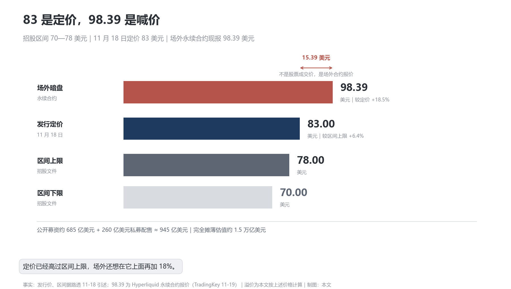
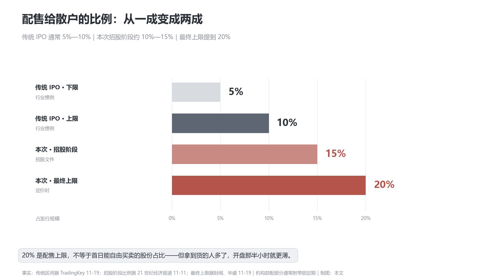
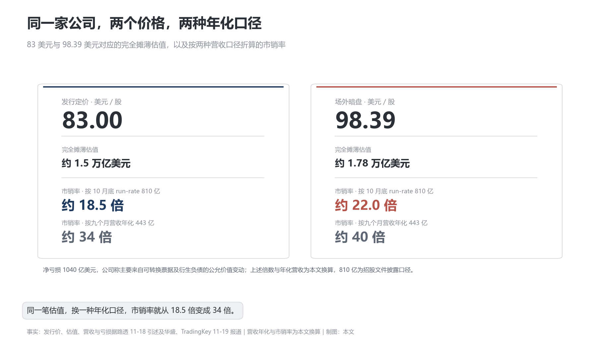

# 83 美元定价，暗盘已喊到 98 美元：Anthropic 史上最大 IPO，首日溢价有多少是虚火？

11 月 18 日美东收盘后，Anthropic 把发行价定在 83 美元。11 月 12 日那份招股文件写的区间，是 70 到 78 美元。

比上限高 6.4%。路透称发行规模也有所扩大。

今晚（美东 11 月 19 日）挂牌，代码 ANT。8.25 亿股按 83 美元算，公开募资约 685 亿美元；叠加 260 亿美元同步私募配售，合计约 945 亿美元，超过 SpaceX 今年 6 月那次含超额配售的约 860 亿美元。按完全摊薄基础，估值约 1.5 万亿美元——比 5 月私募轮的 9650 亿高出五成多。

而场外，Hyperliquid 上追踪它的永续合约现在报 98.39 美元。

## 一、83 是一个决定，98.39 是一个位置

83 那边有簿记、有配售名单、有 8.25 亿股的签字，还有 260 亿美元跟投的私募配售，都按发行价认购。

98.39 是一个位置，一条曲线的当前点。

华盛通 11 月 11 日的报道说，这个合约上线初期曾报 138 美元，随后在 110—120 美元震荡，上周一度跌破 94 美元，之后反弹。

138 → 94 → 98.39。二十来天，同一家公司的"影子股价"跌掉三成再爬回来一点，而它的营收、客户、算力合同一件都没变。

## 二、那 18% 买的是排队位置

承销商往上抬了 6%，场外还想再加 18%。

场外合约的特征很具体：标的不是股票本身，参与者少，没有连续竞价，一笔大单就能推走价格。

在这里，价格只回答一个问题：谁能先拿到一点货。

"货"有多紧，认购端有答案：订单总额逼近 5000 亿美元，约为公开募资额 685 亿的 7 倍。这不是"愿不愿意买"，是"分不分得到"。

所以那 18% 买的是排队位置，不是公司价值。

反过来说：如果 98 是共识，83 就不会定在 83。承销商握着全部订单簿，他们看到的需求，和场外喊的价格，差了 18%。这个差值本身就是分歧的证据——不是 83 定低了，是有一批钱愿意为抢先付溢价。

## 三、20% 的散户

招股阶段的口径是散户配售约 10% 到 15%。最终上限提到 20%。传统 IPO 通常是 5% 到 10%。

翻倍。这条安排表面上叫"照顾小投资者"，落到盘面上是另一回事：首日手里有货、又最容易在十分钟内做出决定的那部分人，变多了。

机构拿货带锁定期和内部风控，减仓要走流程。散户没有流程。

而这一次，"货不够"还有另一层：5000 亿订单对 685 亿募资，落到每个账户手里的量本来就少。总量变大、人均变小。

首日那个涨幅，跟市销率是 18 倍还是 34 倍，没关系。

## 四、332 亿、1040 亿，和两个市销率

截至 9 月 30 日的九个月，营收 332.4 亿美元，同比增长约 1200%。净亏损 1040 亿美元。

亏损是营收的三倍多。公司说，绝大部分来自可转换票据及衍生负债的公允价值变动——估值涨，这部分负债的账面成本就跟着涨，亏在账上，不是现金流出。

所以拿 1040 亿说"九个月烧掉一千亿"，是读错了表。该看经营口径：三季度经营亏损 5.67 亿美元，二季度还有 9.74 亿经营利润。这个转向比那 1040 亿更值得留意。

按九个月营收年化，是 443 亿，1.5 万亿对应约 34 倍市销率。可公司自己在招股文件里写的是：截至 10 月底，年化收入运行规模 810 亿美元，比 9 月底又多了 100 亿。按 810 亿算，同一笔估值只有 18.5 倍。

34 倍和 18.5 倍，同一家公司，同一天，同一个价格。

它说明这家公司的收入曲线陡到任何"年化"都失真：用九个月的旧数会算贵，用单月的最新数会算便宜。

## 写在最后

83 美元是确定的。它背后有招股书、有配售名单、有 945 亿的融资额。

98.39 不是。它是一句"我愿意先付"，而且这句话二十天里改过好几次口。

今晚开盘，两件事会同时被回答：价格站不站得住 98，站住之后有没有人接。前者几小时有答案，后者要等第一批解禁。

**定价是确定的，但"首日价格"和"合理价格"之间的距离，要等挂牌后才有人来量。**

如果你今晚看到它开在 98 以上，先别把这当成 1.5 万亿的确认。那只是又一批人，愿意先付。

---

*事实来源：定价 83 美元、高于 70—78 美元区间上限约 6.4%、发行规模有所扩大，据路透社 2026 年 11 月 18 日引述知情人士（财闻、星岛、华盛通等转述）；8.25 亿股（新发约 8.014 亿股、老股东出售 2360 万股）、公开募资约 685 亿美元、叠加 260 亿美元私募配售合计约 945 亿美元、绿鞋最多追加 1.2375 亿股、完全摊薄估值约 1.5 万亿美元、5 月私募轮 9650 亿美元，据财闻 11 月 19 日汇总及 21 世纪经济报道 11 月 11 日报道；SpaceX 6 月 IPO 含超额配售募资约 860 亿美元（21 世纪经济报道记 862.5 亿、TradingKey 记 857 亿，本文取约数）。场外 98.39 美元为 Hyperliquid 永续合约报价、较 83 美元溢价超 18%，据 TradingKey 11 月 19 日；该合约上线初期曾报 138 美元、一度跌破 94 美元，据华盛通 11 月 11 日。认购总额逼近 5000 亿美元、散户配售上限 20%、传统 IPO 通常 5%—10%，据华盛 11 月 19 日早报与 TradingKey；招股阶段散户比例约 10%—15%，据 21 世纪经济报道 11 月 11 日。截至 9 月 30 日九个月营收 332.4 亿美元、同比约 +1200%、净亏损 1040 亿美元且主要来自可转换票据及衍生负债公允价值变动、三季度营收 169.6 亿美元环比 +47%、三季度经营亏损 5.67 亿美元，据招股文件及华盛 11 月 19 日、TradingKey 报道；二季度经营利润 9.74 亿美元、三季度净亏损 233 亿美元，据东方财富、搜狐财经 11 月 3 日报道。文中"九个月营收年化约 443 亿美元 → 约 34 倍 / 40 倍市销率""按 810 亿美元 run-rate → 约 18.5 倍 / 22.0 倍市销率""98.39 美元对应估值约 1.78 万亿美元"为本文按上述数字换算，非公司或承销商口径；"场外价格回答的是稀缺性而非估值""18% 的缺口是分歧的证据""首日涨幅的一部分来自筹码结构""收入曲线陡到任何年化都失真"等为作者判断，非当事方表述。*
