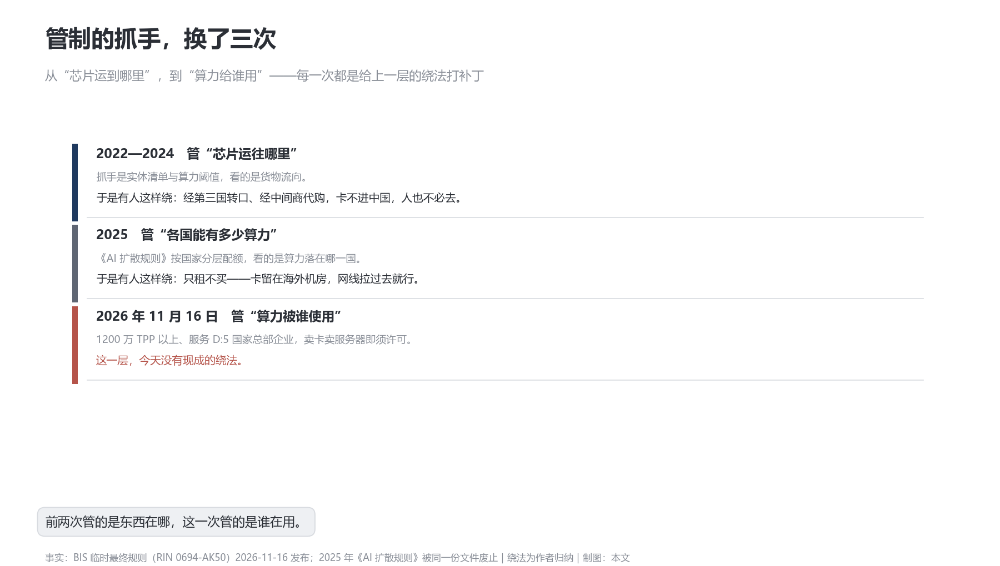
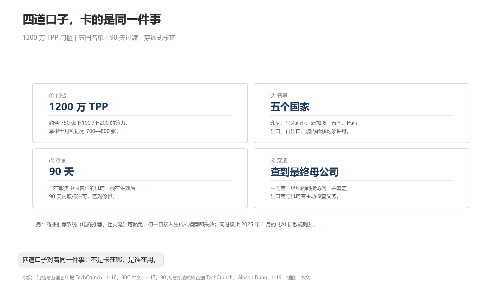
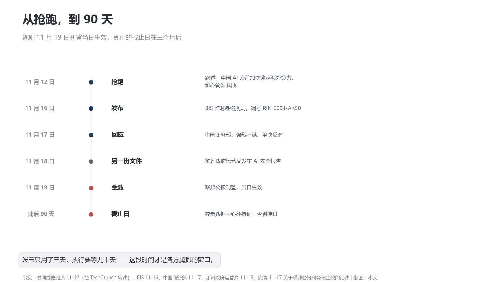

# 美国新规封堵海外数据中心远程用芯片：算力管制升级，中国大模型公司承压？

11 月 16 日，美国商务部工业与安全局（BIS）发布临时最终规则，编号 RIN 0694-AK50，标题很直白：《解决先进半导体远程访问问题》。

今天（11 月 19 日）它在联邦公报刊登，当日生效。

同一天，Anthropic 在纳斯达克挂牌，版面都被那条占了。但这条规则改的不是一笔交易的价格，而是一家公司还能不能拿到算力。

## 一、管的东西换了

过去四年，美国管的是"芯片运到哪里"：实体清单、算力阈值、最终用途核查，抓手全是货物流向。

于是有了那套绕法：卡不进中国，就进第三国机房；人不出境，网线过去。芯片没到中国，算力已经被中国公司用上了。

新规补的就是这一层。按 BIS 的写法，只要一个数据中心——或任何能提供超过 1200 万 TPP 算力的网络——向总部或最终母公司位于 D:5 国家（中国、俄罗斯、伊朗、朝鲜等）的企业提供算力，往这个机房卖芯片、卖服务器，就得先拿许可。

它没限定地点。机房在美国、欧洲还是东南亚，都算。

TrendForce 的概括是：规则把芯片许可绑到了算力使用者身上，管制越过了出货目的地。Bernstein 被信报引述得更直接：新规封住了此前最重要的漏洞，管制重心正从限制芯片出货转向限制算力能力本身。

## 二、四道口子

规则不长，四道口子卡得很实。

门槛：1200 万 TPP，约合 750 张 H100/H200，摩根士丹利记 700 到 800 张。

名单：印尼、马来西亚、新加坡、泰国、巴西。往这五国出口、再出口或境内转移先进芯片和服务器，原则上都要许可，理由是"转运风险高于正常水平"。这五处，正是这几年最顺手的中转站。

存量：已在服务中国客户的机房，生效后 90 天内必须拿到许可，否则以后一颗新卡都别想买。

穿透：不是让客户签张"我不是中国企业"就完事，要查到最终母公司；经中间商、经纪的间接访问也覆盖。多家律所提醒，出口商和机房现在有主动核查客户股权的义务。

## 三、谁疼，谁受益

短期最疼的是三类。

大模型公司。海外租卡收紧，同等规模的训练成本要往上走，周期要重排。摩根士丹利把这条规则对中国互联网 AI 产业的整体判断定为"偏负面"。

云厂商。手里有中国客户的海外机房，90 天内要么办证、要么清退，合规成本就落在这 90 天里。

东南亚数据中心。马来西亚方面表示，当地 117 个项目须遵守新规——而这些项目当初的卖点之一，恰恰是"离中国近、不受管"。

受益在另一头。中信证券留了前提：短期先进制程需求凸显，但流片限制同步收紧，反而可能压制国产算力的整体供给；中期才轮到 HBM 和先进封装的突破。**订单不等于能力**——管制把需求推过来，能不能接住看良率和产能。

## 四、同一周，加州在写另一份文件

11 月 18 日，加州政府运营局发布 85 页报告《AI Safety in 2026 and Beyond》，建议对最大的前沿模型开发商设强制安全标准、由持牌第三方独立验证、州政府在灾难性风险出现时有权紧急关停。

这是建议，不是法律，回应的是 9 月 18 日一份州长行政令。

和 BIS 那条放一起看，两边管的是两件事：一边管算力能不能流到谁手里，一边管模型跑起来之后谁负责。前者是出口管制，后者是产品安全。方向一致——算力正在从商业问题变成治理问题。

## 写在最后

这条规则的特别之处，不在它列了几个国家，而在它换了计量的东西。

以前计量货物：多少颗芯片、多少算力参数、运到哪个口岸。现在计量服务：谁在用、用了多少、用到什么量级。

**芯片可以停在境外，机房可以开在第三国，但只要那台机器在替一家中国公司干活，它就被算作一次出口。**

生效是今天。真正的截止日在 90 天后。

---

*事实来源：美国商务部工业与安全局（BIS）于 2026 年 11 月 16 日发布临时最终规则，编号 RIN 0694-AK50，标题《解决先进半导体远程访问问题》，由财政部与国家安全委员会指导制定（BIS 新闻稿、TechCrunch 11 月 16 日报道）。1200 万 TPP 门槛约合 750 张 H100/H200（TechCrunch），摩根士丹利记为 700—800 张；管制对象为总部或最终母公司位于 D:5 国家（含中国、俄罗斯、伊朗、朝鲜等）的企业，覆盖经中间商与经纪的间接访问，出口商与数据中心运营方须主动核查客户股权结构；印尼、马来西亚、新加坡、泰国、巴西五国出口、再出口与境内转移先进芯片及服务器须许可，输往美国总部企业不适用；存量业务须在生效后 90 天内取得许可；商业推荐系统豁免、接入生成式即失效；同一份文件废止 2025 年 1 月的《AI 扩散规则》——以上据 TechCrunch 11 月 16 日、BBC 中文 11 月 17 日、Gibson Dunn 11 月 19 日分析。联邦公报文件号 2026-23529、11 月 19 日刊登并当日生效，据虎嗅 11 月 17 日报道。中国商务部 11 月 17 日回应"强烈不满、坚决反对"，据联合早报 11 月 17 日。Bernstein 关于"封堵最重要的漏洞、管制重心从限制芯片出货转向限制算力能力本身、利空中国大模型公司与云厂商、利好本土半导体产业链关键公司"的判断，据信报引述；TrendForce 关于"芯片许可绑定算力使用者、管制越过出货目的地"的表述，据其 11 月 17 日研究摘要。摩根士丹利"对中国互联网 AI 产业偏负面"的判断及 TPP 口径，据 AASTOCKS 转引其 11 月 16 日报告。中信证券关于国产算力"短期需求凸显但流片限制收紧、中期看 HBM 与先进封装突破"的判断，据其 11 月 18 日点评（新浪财经转载）。马来西亚 117 个数据中心项目须遵守新规，据云头条 11 月 19 日。路透 11 月 12 日关于中国 AI 公司加快锁定海外算力的报道，经 TechCrunch 转述。加州政府运营局 11 月 18 日发布 85 页报告《AI Safety in 2026 and Beyond》，联合州应急服务办公室与四名外部专家撰写，建议强制前沿模型安全标准、持牌第三方独立验证与紧急关停权，属建议非法律，回应 9 月 18 日州长行政令——据报告原文及多家媒体 11 月 18 日报道。文中"管制抓手换了三次"及"绕法"的归纳、"订单不等于能力""算力从商业问题变成治理问题"等为作者判断，非当事方表述。*
