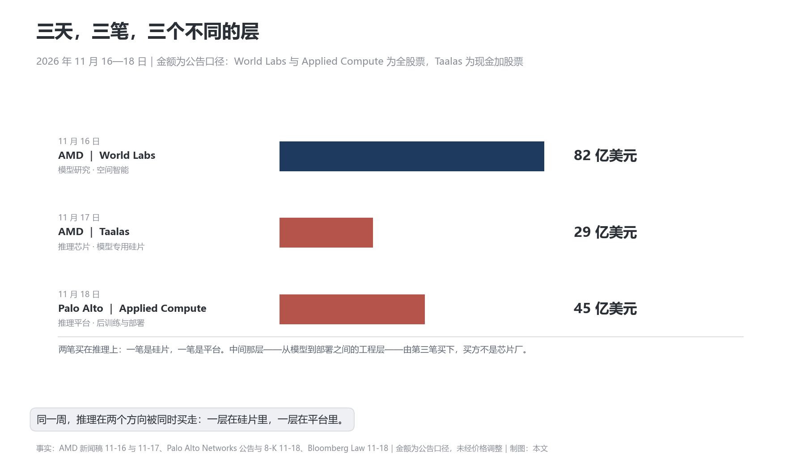
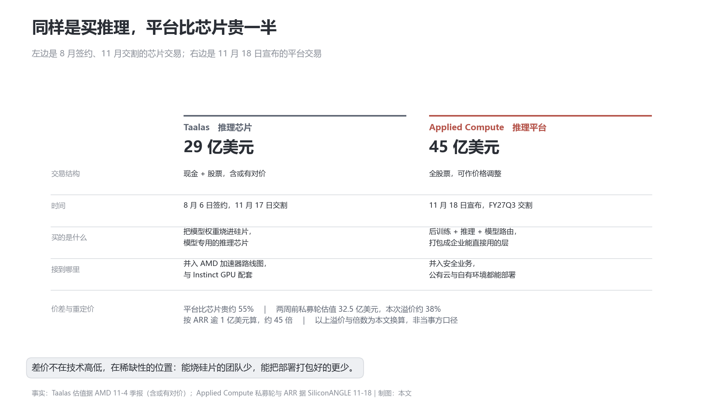
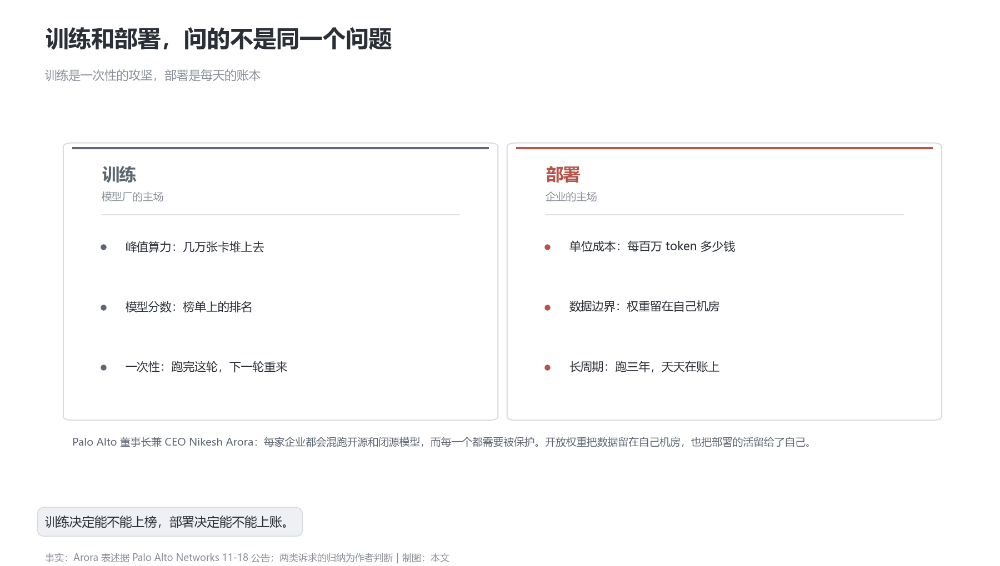

# 45 亿美元买推理平台，AMD 再补推理芯片：AI 竞争开始拼"推理谁更便宜、更可控"

11 月 16 日到 18 日，三天，三笔交易。

11 月 16 日，AMD 完成对 World Labs 的收购，82 亿美元全股票，李飞飞出任执行副总裁兼首席科学家。11 月 17 日，AMD 完成对 Taalas 的收购，把这家多伦多公司的推理硅片并进加速器路线图。11 月 18 日，Palo Alto Networks 宣布以 45 亿美元全股票收购 Applied Compute。

后两笔都落在推理上。一笔在芯片层，一笔在平台层。

## 一、一笔买模型，两笔买推理

Taalas 做的事很激进：把训练好的模型权重直接烧进硅片，用可编程性换吞吐和内存开销。它的芯片是"模型专用"的，不是通用 GPU。

这笔交易 8 月 6 日就签了。11 月 4 日的季报把它估在约 29 亿美元——现金加股票、含或有对价，11 月 17 日交割。

Applied Compute 更年轻。2025 年由三位前 OpenAI 研究员创立，做开放权重模型的后训练和推理，自带自动扩缩的推理引擎和一个叫 Shift-1 的模型路由。客户里有微软和 DoorDash，年化经常性收入过了 1 亿美元。

45 亿美元，全股票。

## 二、差价在"层"，不在技术

买"怎么把模型跑起来"的平台，比买"用什么跑"的芯片，贵了 55%。

这个价差不是市场失灵。它标的是稀缺性的位置：能烧模型专用硅片的团队全球没几家，但能把后训练、推理、路由、权限打包成企业能直接用的东西，同样稀缺，客户面还更宽。

Applied Compute 的定价还有一层。11 月初它刚完成 3.5 亿美元融资，估值 32.5 亿；两周后卖身 45 亿，溢价约 38%。按 1 亿美元 ARR 算，45 倍。

## 三、企业为什么开始自己跑模型

Palo Alto 董事长兼 CEO Nikesh Arora 的说法是：每家企业都会混跑开源和闭源模型，而每一个都需要被保护。

这句话把逻辑说清楚了。过去两年，企业用 AI 的方式是调 API：模型在别人机房，数据出去，结果回来。便宜、快，但有两个绕不过去的问题——数据出境，以及出了事谁负责。

开放权重换了个解法：权重下载到自己机房，用自家数据后训练，推理也在自己环境里跑。代价是剩下的事全得自己干——怎么跑快、跑省、跑得安全。

这正是 Applied Compute 卖的东西。按 Palo Alto 的说法，目前没有大型厂商在"安全地交付这些模型"。

也解释了买方为什么是它。Palo Alto 本来就在管企业的网络边界和访问策略；当模型开始跑在企业自己的机房里，这些模型的调用、权重、输出，天然落在它熟悉的管辖范围内。买推理平台，是把这个新入口接进已有的边界。

## 四、AMD 两端都买了，中间那层没买

AMD 这三天值得单独看。World Labs 买的是模型研究，Taalas 买的是推理硅片，两个交割只隔一天。

但从模型到部署之间的那层工程能力，AMD 没买。

这恰好是 Palo Alto 花 45 亿补的。同一周里，芯片厂往上游补，安全厂往中间补，两家补的不是同一个缺口。

## 写在最后

竞争重心的迁移，不是"训练不重要了"，是训练之外多了一道账。

训练决定能不能上榜，部署决定能不能上账。前者一次性，后者每一天都在发生。当企业开始自己跑开源模型，账单从"调用费"变成"电费 + 运维 + 合规"，省下来的每一分钱都进自己的报表。

**所以这一周最贵的不是那颗芯片，是那个让芯片好好干活的平台。**

---

*事实来源：AMD 于 2026 年 9 月 28 日宣布、11 月 16 日完成对 World Labs 的收购，约 82 亿美元全股票（约 1500 万股），李飞飞出任执行副总裁兼首席科学家（AMD 新闻稿、Yahoo Finance 11 月 16 日、WSJ 与 CNBC 9 月 28 日）。AMD 于 8 月 6 日签署、11 月 17 日完成对 Taalas 的收购；Taalas 2023 年成立于多伦多，将训练好的模型权重硬写入硅片，属模型专用推理芯片；该交易在 AMD 11 月 4 日季报中估值约 29 亿美元（现金加股票、含或有对价）；技术并入加速器路线图并与 Instinct GPU 配套（AMD 新闻稿、Unite.AI 11 月 17 日、CNBC 8 月 6 日）。Palo Alto Networks 于 11 月 18 日宣布以 45 亿美元全股票收购 Applied Compute，预计于 FY2027 第三财季（截至 2027 年 4 月 30 日）交割；Applied Compute 2025 年由前 OpenAI 研究员 Yash Patil、Rhythm Garg、Linden Li 创立，提供开放权重模型的后训练与推理平台，含自动扩缩推理引擎与 Shift-1 模型路由；客户含微软与 DoorDash；11 月初以 32.5 亿美元估值完成 3.5 亿美元融资，ARR 逾 1 亿美元（Palo Alto Networks 公告与 8-K 11 月 18 日、SiliconANGLE 11 月 18 日、Bloomberg Law 11 月 18 日、Latham & Watkins 11 月 18 日）。Arora"每家企业都会混跑开源和闭源模型、每一个都需要被保护"及"目前没有大型厂商在安全地交付这些模型"的表述，据 Palo Alto Networks 11 月 18 日公告。文中"平台比芯片贵约 55%""本次溢价约 38%""约 45 倍 ARR"为本文按上述金额换算，非当事方或投行口径；"差价标的是稀缺性的位置""买方为什么是它""芯片厂往上补、安全厂往中间补""训练决定能不能上榜、部署决定能不能上账"等为作者判断，非当事方表述。另需说明：素材原稿称 AMD 收购 Taalas 是在 World Labs"之后"为推理补拼图，实际 Taalas 于 8 月 6 日签约、早于 World Labs 的 9 月 28 日，仅交割日晚一天；且 World Labs 属空间智能模型研究，不属推理方向。本文按公告时序改写。*
