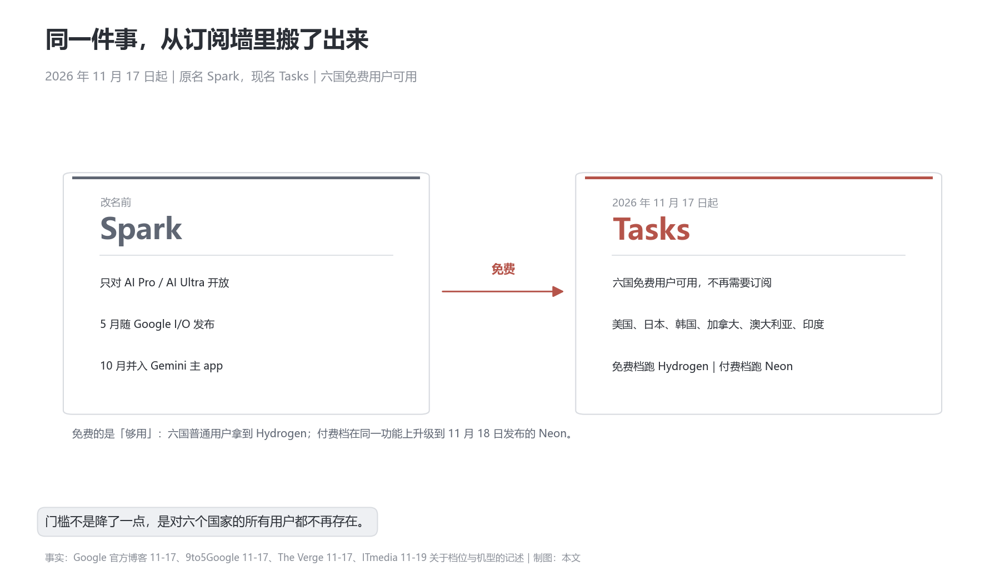
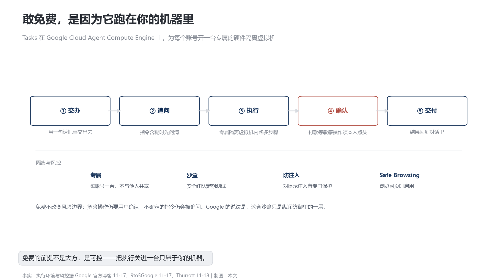
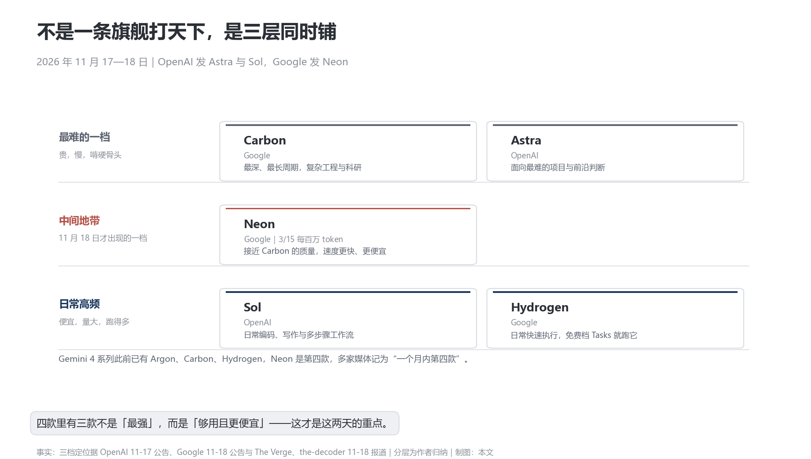

# 谷歌把 AI 代理免费开放六国：原本付费的能力，现在普通用户直接能用

11 月 17 日，谷歌把 Gemini 里的代理功能 Spark 改名为 Tasks，同时做了一个更实际的动作：向美国、日本、韩国、加拿大、澳大利亚、印度六个国家的免费用户开放。

此前，这个功能只对 AI Pro 和 AI Ultra 订阅者开放。

同一天，OpenAI 发布 GPT-6.2 的两个型号，Astra 和 Sol。第二天，谷歌又发了 Gemini 4 Neon。

三件事挤在 48 小时里，指向同一个方向。

## 一、动的是门槛，不是价格

把两件事分开看会更清楚：改名是包装，免费是实质。

代理类产品过去两年的卖法，是把它摆在订阅的最高一档——你付更多钱，才解锁"能替你把事做完"的能力。Tasks 这一步，等于把这一档直接拆到免费层。

但免费不等于给同样的东西。免费用户跑的是 Gemini 4 Hydrogen；AI Pro 和 Ultra 用户在同一功能上跑的是 11 月 18 日刚发的 Neon。

换句话说，谷歌把代理拆成两层：**够用的那层免费，更强的那层继续卖钱。**

这比"全免费"更值得注意。它意味着代理不再是差异化卖点，而是获客入口——先把人教会"把事交给 AI"，再在需要更强模型时收钱。

## 二、敢免费的底气，是它跑在你自己的机器里

代理要替你打电话、登录账号、下单付款。这些动作出错，代价比在聊天框里说错话大得多。

Tasks 的做法是：每件事都在 Google Cloud Agent Compute Engine 上跑，为每个账号开一台**专属、不与他人共享的硬件隔离虚拟机**。沙盒由安全红队定期测试，带有针对提示注入的保护，浏览网页时启用 Safe Browsing。

敏感操作要你本人点头。指令含糊时，它会先追问。

这套东西不是新发明，但它解释了"免费"为什么敢这么做：成本可控，风险也可控。按谷歌自己的说法，这套沙盒只是纵深防御里的一层。

## 三、两天四款，铺的是层不是旗舰

如果只看单点，这两天的模型都不算"最强"。

OpenAI 的两款分工很清楚：Astra 啃最难的项目，Sol 跑日常编码、写作和多步骤工作流。官方强调的不是分数，而是"用更少的输出 token 完成任务"——这直接关系到账单。

谷歌的 Neon 定位更直白：Carbon 的质量、Flash 的速度。API 定价每百万 token 输入 3 美元、输出 15 美元，在 Gemini app 里取代 3.1 Pro。

而它是 Gemini 4 系列的第四款——前面还有 Argon、Carbon、Hydrogen，多家媒体记为"一个月内第四款"。

这个节奏说明的不是"又发了一个模型"，而是产品线在按成本和场景切层：最难的一档、日常高频的一档、以及刚刚出现的中间档。

## 四、对代理赛道意味着什么

三件事。

第一，付费代理产品承压。当"能替你办事"在六个国家变成免费功能，任何单独收费的代理工具都得回答一个问题：你比它强在哪，值多少钱。

第二，用户习惯被提前教育。代理类产品最大的成本从来不是模型，是让普通人相信"可以把事交出去"。谷歌用免费换的，就是这个信任的规模。

第三，竞争指标换了。以前比的是谁先做出来，现在比的是谁能把成本压到可以免费一直跑，同时把风险关在笼子里。

## 写在最后

免费不是慈善，是重新划边界。

**当"能替你把事做完"从付费卖点变成基础功能，真正被卖的就不再是能力本身，而是能力的上限、速度和可控性。**

六个国家只是第一批。谷歌说美国先上"高级功能"，其他市场随后。剩下的问题是：这一层免费之后，下一层还能卖多久。

---

*事实来源：谷歌 2026 年 11 月 17 日把 Gemini Spark 更名为 Tasks，向美国、日本、韩国、加拿大、澳大利亚、印度六国的免费用户开放，此前该功能需订阅 AI Pro 或 AI Ultra（Google 官方博客、9to5Google 11 月 17 日、The Verge 11 月 17 日、Thurrott 11 月 18 日、Android Central 11 月 18 日）。免费档运行 Gemini 4 Hydrogen；AI Pro 与 AI Ultra 档运行 11 月 18 日发布的 Gemini 4 Neon（ITmedia 11 月 19 日）。Tasks 在 Google Cloud Agent Compute Engine 上运行，为每个账号提供专属、不与他人共享的硬件隔离虚拟机，沙盒由安全红队定期测试，带提示注入防护，浏览网页时启用 Safe Browsing，敏感操作需用户确认，指令含糊时会追问；美国先行推出"高级功能"，其他市场随后（9to5Google 11 月 17 日、Thurrott 11 月 18 日、Google 官方博客）。"最好的助手了解你、帮你把事情做完"与"目标是为用户省时省钱"为谷歌 AI 产品副总裁 Josh Woodward 在官方博客中的表述。OpenAI 于 11 月 17 日发布 GPT-6.2 Astra 与 GPT-6.2 Sol：Astra 面向最难的项目与前沿判断，Sol 面向日常编码、写作与多步骤工作流且成本更低；两者进入 ChatGPT Work、Codex 与 API，同日上线 Amazon Bedrock，覆盖 Plus、Pro、Business、Enterprise、Edu 用户；官方强调两者能以更少的输出 token 完成复杂任务（OpenAI 官方公告、9to5Mac 11 月 17 日、AWS 11 月 17 日、OpenAI 模型文档）。谷歌 11 月 18 日发布 Gemini 4 Neon，定位为"Carbon 的质量、Flash 的速度"，介于 Carbon 与 Hydrogen 之间，API 定价每百万 token 输入 3 美元、输出 15 美元，在 Gemini app 内取代 3.1 Pro；Gemini 4 系列此前已有 Argon、Carbon、Hydrogen，Neon 为第四款，多家媒体记为"一个月内第四款"（Google 官方博客、9to5Google 11 月 18 日、The Verge 11 月 18 日、the-decoder 11 月 18 日、VentureBeat 11 月 18 日）。文中"代理从卖点变获客入口""竞争指标从做没做出来转向成本与可控性"等为作者判断，非当事方表述。另需说明：素材原稿称 Tasks 基于 Gemini 4 Hydrogen、Gemini 4 系列为"七周内第四款"；实际 Hydrogen 只对应免费档，AI Pro 与 Ultra 档为 Neon，且多家媒体记为"一个月内第四款"。本文按公告口径改写。*
