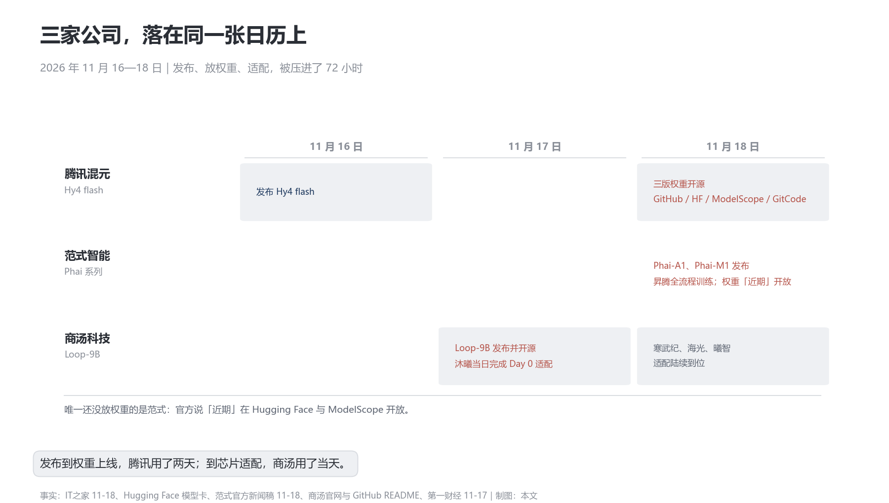
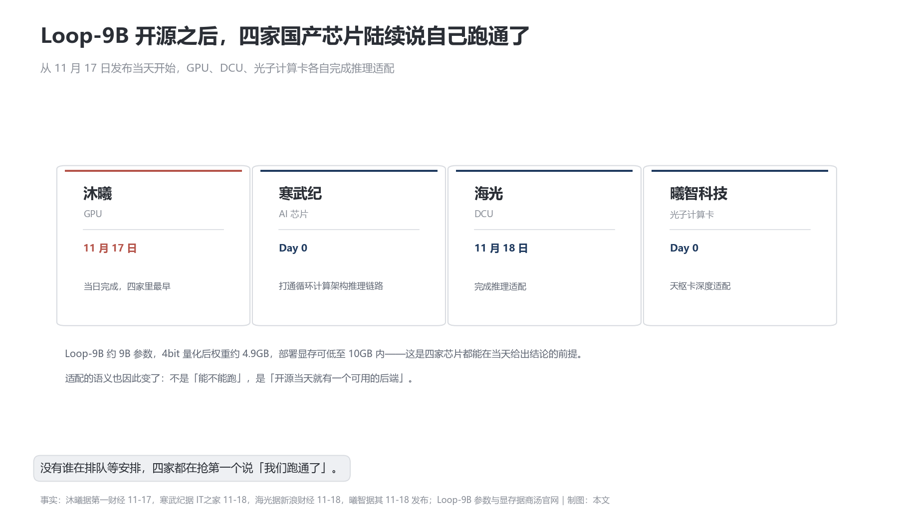
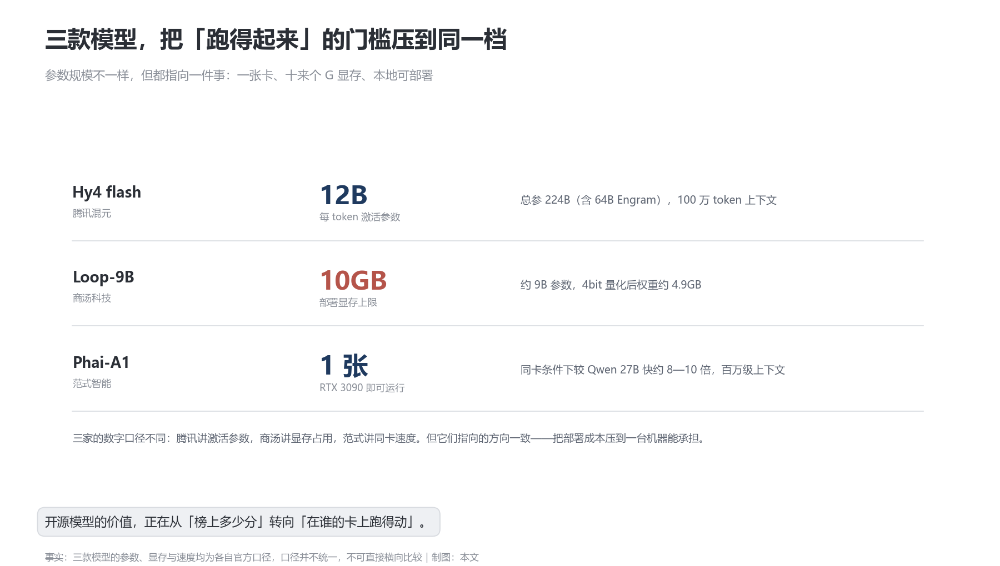

# 腾讯、范式、商汤同日开源：国产大模型开始"发布即适配国产算力"

11 月 16 日到 18 日，三天，三家公司。

腾讯混元 16 日发布 Hy4 flash，18 日把三个版本的权重放了出来：Hy4 flash、Hy4 flash-FP8、Hy4 flash Base，GitHub、Hugging Face、ModelScope、GitCode 都能下。

商汤 17 日发布 SenseNova Loop-9B，当天就开源了权重。同一天，沐曦宣布完成 Day 0 适配。

范式智能 18 日发布 Phai-A1 和 Phai-M1，两款都在华为昇腾上完成了全流程训练。权重，官方说"近期"在 Hugging Face 和 ModelScope 开放。

三件事挤进 72 小时。共同点不在参数，在节奏。

## 一、日历被压紧了

过去开源一个模型，流程是：发布、造势、几周后放权重、再等社区适配。

这次不是。腾讯从发布到放权重用了两天，商汤是当天，范式把"即将开放"直接写进了发布稿。

看着只是变快，其实是预期管理变了：权重什么时候到，从"等通知"变成"看日历"。用户不必猜，厂商也不敢拖。

## 二、Day 0 已经不是新闻，是默认动作

Loop-9B 开源之后，四家国产芯片陆续说自己跑通了。

沐曦 17 日当天完成，是四家里最早的。寒武纪 Day 0 完成，特别提到打通了新型循环计算架构的推理链路——Loop-9B 用 Loop 结构复用层参数，这套结构在常规推理链路上不是现成的，能当天打通，说明适配是提前做的。海光 DCU 18 日完成。曦智科技的天枢光子计算卡也做了 Day 0 深度适配。

常见说法是"沐曦和海光完成适配"。实际是四家，而且横跨 GPU、AI 芯片、DCU 和光子计算卡四种形态。

这才是有意思的地方：不是某一家动作快，是整条国产算力链把"开源当天给结论"当成了标准动作。

## 三、训练侧也在换

前两条说的是推理。范式这次动的是训练。

Phai-A1 和 Phai-M1 都在昇腾平台上完成全流程训练优化。这不是"能在昇腾上跑"，是"用昇腾训出来的"。

代价和收益都写在数字里。Phai-A1 支持原生百万级上下文，单张 RTX 3090 就能跑，官方称同卡条件下比 Qwen 27B 快 8 到 10 倍。Phai-M1 面向真人影视，约 3 分钟出 15 秒 720P。

腾讯那边，Hy4 flash 总参 224B，但每个 token 只激活 12B，同样支持百万 token 上下文。商汤 Loop-9B 更极端：约 9B 参数，4bit 量化后权重约 4.9GB，部署显存能压到 10GB 以内。

三家的数字口径不一样，不能直接比。但方向一致：把部署成本压到一台机器能承担。

## 四、但开源不等于免费

有一点得说清楚。

Hy4 flash 的许可证不是 Apache。小规模研究和试用没问题，做大规模模型服务要另取授权。

所以"发布即适配"降低的是技术门槛，不是商业门槛。权重能下载，不等于能拿去卖服务。这条边界在热闹里最容易被忽略。

## 写在最后

这三天的真正变化，不是又多了几个开源模型，是"适配"这件事的位置变了。

以前是模型开源之后，芯片厂商去追。现在是模型还没放权重，适配方案已经在路上；模型放出来的当天，四家同时给出可用的后端。

**开源模型的竞争力，正在从"榜上多少分"，转向"在谁的卡上、以什么成本跑得动"。**

这句话对国产算力是机会，对模型公司是约束：你不仅要训得好，还得让别人在你的权重上省得下钱。

---

*事实来源：腾讯混元 Hy4 flash 于 2026 年 11 月 16 日发布，11 月 18 日开源三个权重——Hy4 flash（指令微调）、Hy4 flash-FP8（8 位量化）、Hy4 flash Base（预训练基础），可在 GitHub、Hugging Face、ModelScope、GitCode 下载；总参 224B（含 64B Engram），每 token 激活 12B，支持多模态输入与 100 万 token 上下文；官方称正在加速开源 Hy4（IT之家 11 月 18 日、Hugging Face 模型卡、腾讯新闻 11 月 18 日）。范式智能（原第四范式，6682.HK）11 月 18 日发布 Phai-A1 与 Phai-M1：Phai-A1 为通用语言模型，支持原生百万级上下文，可单张 RTX 3090 本地部署，官方称同卡条件下较 Qwen 27B 快约 8—10 倍；Phai-M1 面向真人影视场景，约 3 分钟生成 15 秒 720P 视频；两款均在华为昇腾平台完成全流程国产算力训练优化；官方口径为"近期将在 Hugging Face 与 ModelScope 开放权重"，截至发稿权重尚未上线（范式官方新闻稿 11 月 18 日、极客公园 11 月 18 日、量子位 11 月 19 日、第一财经 11 月 18 日）。商汤 SenseNova Loop-9B 于 11 月 17 日发布并开源权重，采用 Loop 结构复用层参数并结合流形约束超连接，约 9B 参数，4bit 量化后权重约 4.9GB、部署显存可低至 10GB 内；11 月 18 日补充 AWQ 与 GGUF 权重（商汤官网、GitHub README、第一财经 11 月 17 日）。Day 0 与首日适配：沐曦 11 月 17 日率先完成（第一财经 11 月 17 日）、寒武纪 Day 0 完成并打通新型循环计算架构推理链路（IT之家 11 月 18 日）、海光 DCU 11 月 18 日完成（新浪财经 11 月 18 日）、曦智科技天枢光电智能计算卡 Day 0 深度适配（曦智科技 11 月 18 日）。Hy4 flash 许可证非 Apache、大规模模型服务需另取授权，据其模型卡与 NewToken 11 月 18 日的整理。文中"预期管理从等通知变成看日历""整条国产算力链把开源当天给结论当成标准动作""适配降低的是技术门槛不是商业门槛"等为作者判断，非当事方表述。另需说明：素材原稿称"三家同日开源"，实际腾讯 11 月 18 日放权重、商汤 11 月 17 日发布即开源、范式 11 月 18 日发布但权重"近期"开放；素材称 Loop-9B 由"沐曦和海光 DCU"完成适配，实际另有寒武纪与曦智科技两家。*
