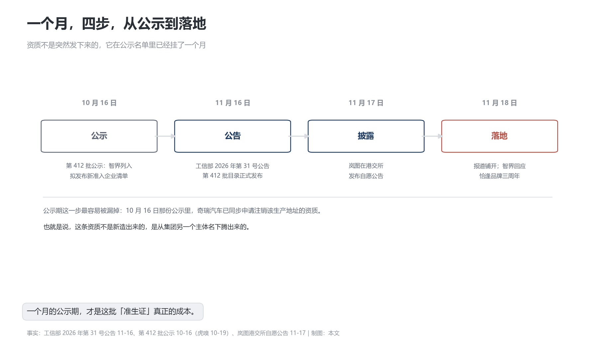
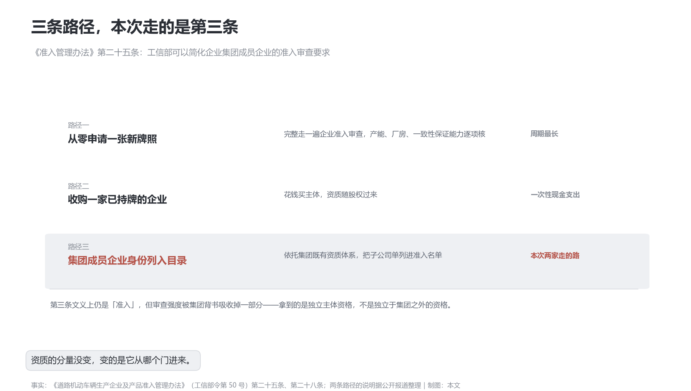
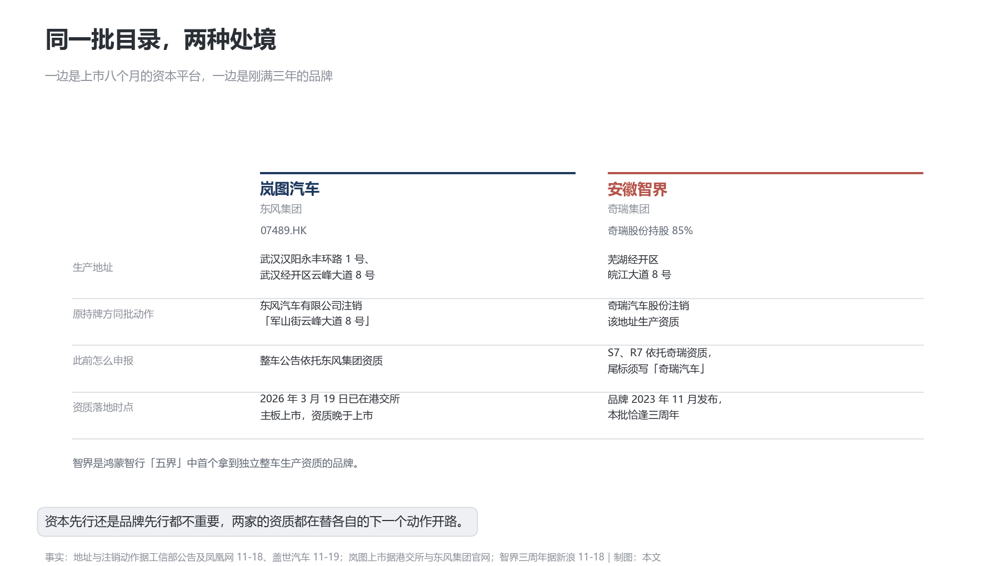

# 岚图与智界同日"转正"：生产资质是挪过来的，不是新发的

11 月 16 日，工信部发布 2026 年第 31 号公告，公布第 412 批《道路机动车辆生产企业及产品》目录。

里面两条：同意东风集团增加成员企业岚图汽车科技股份有限公司，同意奇瑞集团增加成员企业安徽智界新能源汽车有限公司。

两张"准生证"。但要说清楚，这张证不是新印的。

## 一、这批不是新增资质，是平移

多数报道的日期是 11 月 18 日，那其实是传播高峰。公告发布是 16 日，岚图当晚在港交所发了自愿公告。再往前一个月，10 月 16 日的第 412 批公示里，这两家的名字已经挂着了。

公示那一版里有一句很容易被略过：智界被列入"拟发布新准入车辆生产企业"清单的同一份文件中，**奇瑞汽车股份有限公司申请注销该生产地址的资质**。

岚图这边类似：东风汽车有限公司同期注销"武汉经开区军山街云峰大道 8 号"，而岚图的生产地址里，武汉经开区云峰大道 8 号赫然在列。

同一个厂址，一边注销、一边列入。这批目录里发生的是**资质主体的平移**，不是资质总量的增加。

## 二、两家走的其实是同一条路

有说法认为两家"获取方式出现分化"。看公告原文，这个分化不成立——都是"集团增加成员企业"，同一个口子。

分化的位置在别处：在这条口子和另外两条路之间。

《办法》是工信部 50 号令，2019 年 6 月施行。第二十五条写得很直接：鼓励企业集团化管理，**工信部可以简化其成员企业的准入审查要求**。"可以简化"四个字，是这条路径的全部价值。

从零申请新牌照，要逐项核产能、厂房、一致性保证能力；收购持牌企业，要付一次性现金；而借成员企业身份列入，审查强度被集团背书吸收掉一部分。代价是：拿到的是独立主体资格，不是独立于集团之外的资格。

## 三、两家为什么现在要这张纸

岚图今年 3 月 19 日以介绍方式在港交所主板挂牌，07489.HK，"央国企高端新能源汽车第一股"，东风集团股份同步私有化退市。也就是说，岚图先上了市，八个月后才拿到这张纸。一个独立上市公司，产品公告却挂在母公司名下，说不太通。

智界反过来。品牌 2023 年 11 月发布，到这一批正好三年。此前 S7、R7 都依托奇瑞资质申报，车尾铭牌必须写"奇瑞汽车"；资质落地后，新车可以直接以安徽智界为主体申报，用智界自己的标识。它还是鸿蒙智行"五界"里第一个拿到独立整车生产资质的品牌。

## 四、法人合一之后

这张纸真正改的，是责任的落点。

以前智界的车出了问题，公告主体是奇瑞；岚图的车出了问题，公告主体是东风。消费者看到的是品牌，法规看到的是另一家公司。

资质平移之后，两头对上了。对企业是约束——质量责任没法再往集团推；对监管是便利——查一家公司就够。

## 写在最后

"同日转正"这个说法要拆开看。

**它不是两家新公司拿到了入场券，是两个已经存在的品牌，把自己的名字写在了原本属于集团的那张纸上。**

真正值得记的不是这一天，是背后那条路：集团化管理机制让资质可以在集团内部挪动，不用重新排队。这条路 2019 年就铺好了。现在开始有人走，说明子公司独立到这个程度，已经不只是品牌层面的事。

---

*事实来源：工信部 2026 年 11 月 16 日发布 2026 年第 31 号公告，公布《道路机动车辆生产企业及产品》（第 412 批）目录，同意东风集团增加成员企业岚图汽车科技股份有限公司、同意奇瑞集团增加成员企业安徽智界新能源汽车有限公司；岚图生产地址为湖北省武汉市汉阳区永丰环路 1 号与武汉经开区云峰大道 8 号，智界生产地址为芜湖经开区皖江大道 8 号、备注"奇瑞集团成员企业"（工信部公告、36氪 11 月 18 日、凤凰网 11 月 18 日、盖世汽车 11 月 19 日）。第 412 批公示期为 10 月 16 日，公示中智界列入"拟发布新准入车辆生产企业"清单，同份文件中奇瑞汽车股份有限公司申请注销该地址生产资质（虎嗅 10 月 19 日）；东风汽车有限公司同期注销"武汉经开区军山街云峰大道 8 号"（EET-China 11 月 18 日）。《道路机动车辆生产企业及产品准入管理办法》为工信部 2018 年第 50 号令，2019 年 6 月 1 日施行，第二十五条鼓励企业集团化管理并规定工信部可以简化成员企业的准入审查要求，第二十八条允许委托加工生产（中国政府网、人民网 2018 年 12 月解读）。岚图汽车 2026 年 3 月 19 日以介绍方式在港交所主板挂牌（07489.HK），为"央国企高端新能源汽车第一股"，东风集团股份同步私有化退市（东风汽车集团官网、新华网 3 月 19 日）；岚图 11 月 17 日晚在港交所发布自愿公告确认取得准入资格（观点网 11 月 17 日）。智界品牌 2023 年 11 月发布、S7 于 2023 年 11 月 28 日上市，2026 年 11 月恰逢品牌三周年；安徽智界由奇瑞股份持股 85%、芜湖瑞启与芜湖瑞联各持 7.5%；此前 S7、R7 依托奇瑞资质申报、车尾铭牌须标"奇瑞汽车"；智界为鸿蒙智行"五界"中首个取得独立整车生产资质的品牌（新华网 2023 年 11 月 28 日、新浪 11 月 18 日、盖世汽车 11 月 19 日、IT之家 11 月 18 日）。文中"这批目录是资质主体平移而非资质新增""两家走的是同一路径而非分化""资质真正改的是责任落点"等为作者判断，非当事方表述。另需说明：素材原稿称"11 月 18 日，工信部第 412 批目录确认"，实际公告发布日为 11 月 16 日，11 月 18 日为媒体报道高峰；素材称岚图与智界"获取方式出现分化"，按公告文本与《办法》第二十五条，两家均为"集团增加成员企业"路径，属同一机制，分化的位置在集团化管理路径与"从零申请""收购持牌企业"之间。*
