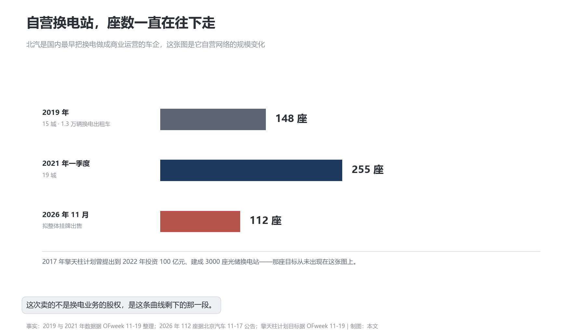
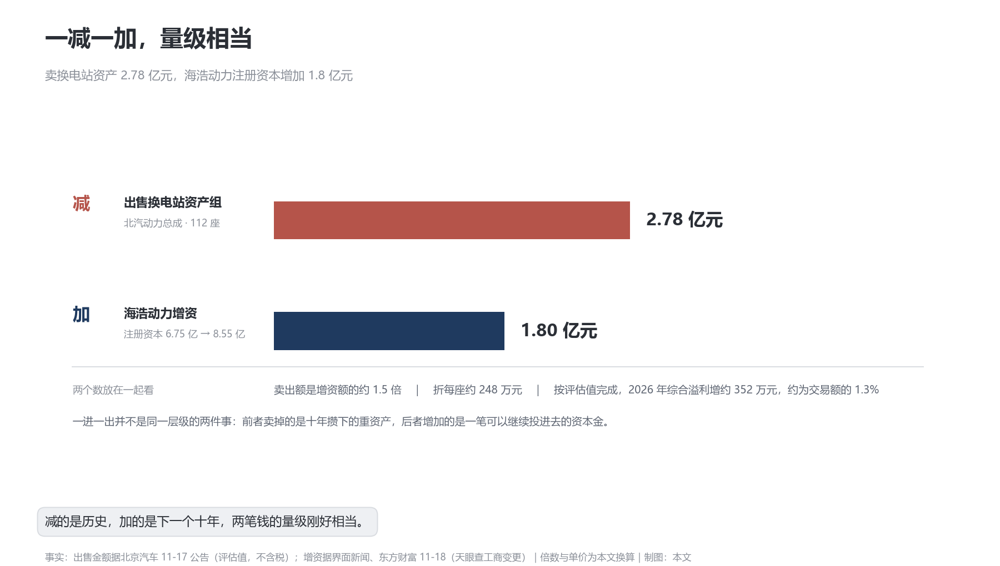
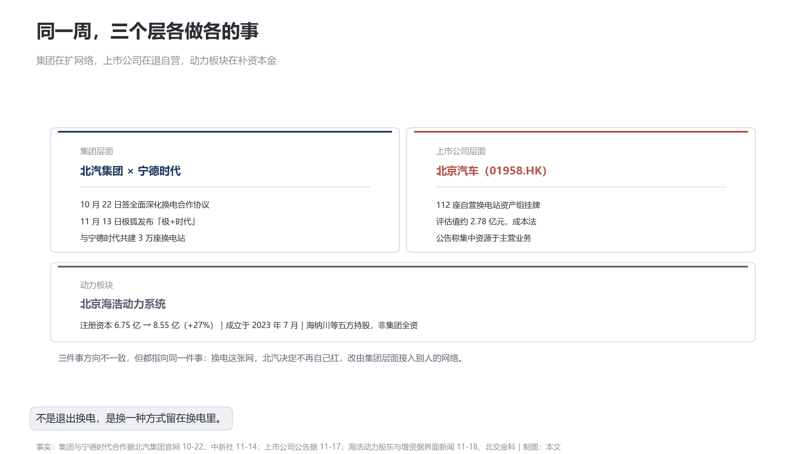

# 北汽卖换电站，海浩动力增资：一减一加，减的是一段历史

11 月 17 日晚间，北京汽车（01958.HK）在港交所发了一份公告，标题是"可能须予披露交易"。

内容：全资附属北汽动力总成拟通过北京产权交易所公开挂牌竞价，转让与 **112 座换电站**相关的资产组组合——存货、固定资产、在建工程、无形资产。

评估基准日 2026 年 9 月 30 日，账面价值约 2.74 亿元，**成本法评估值约 2.78 亿元**（不含税），增值 1.54%。挂牌价不低于这个数，11 月底前提交披露公告，意向受让方尚不明确，协议未签。

若年内按评估值完成，扣除交易成本后，2026 年综合溢利增加约 **352 万元**。对 2.78 亿元的交易额，是 1.3%。

## 一、这不是部分处置，是曲线的收尾

多数解读把它说成"剥离非核心重资产"。往历史里翻一层，会更清楚这是什么。

北汽是国内最早把换电做成商业运营的车企：2015 年底交付首批 200 辆 EU220 换电出租车，2016 年联合中石化、奥动建首批 10 座站，2017 年发布擎天柱计划——到 2022 年投资 100 亿元、建成 3000 座光储换电站。

走出来的曲线是：2019 年 15 城 148 座；2021 年一季度 19 城 255 座；到这次挂牌，112 座。

3000 座的目标从未出现在这条曲线上，从 255 到 112 也没有专门公告解释。

所以这次卖的不是"一块非核心资产"，是**这张自营网络剩下来的那一段**。而且卖的是资产组，不是换电运营主体的股权——买家拿到的是站、设备、在建工程和无形资产的组合，不是一个能继续经营的换电公司。

## 二、一减一加，量级刚好相当

另一件事：海浩动力注册资本从约 6.75 亿元增至约 8.55 亿元，增幅约 27%。两个数需要摆正。

一是量级：卖 2.78 亿、增 1.8 亿，同一个量级。

二是性质：海浩动力不是北汽集团全资。它成立于 2023 年 7 月，股东是海纳川、嘉兴湾北科创、北京市绿色能源和低碳产业投资基金、北京市先进制造和智能装备产业投资基金、浩夫尔动力总成国际公司五方。这次是**增资扩股**，北交金科 9 月 14 日就挂了项目，不是集团单方面注钱。

三是时间：这是天眼查的工商变更，11 月 18 日被报道，与 11 月 17 日那份公告并非同日。

尽管有这些修正，方向性的判断站得住：一边把重资产换成现金，一边把资本金补进动力系统。前者是退出，后者是准备继续投。

## 三、三个层，三种动作

**集团层面在扩。** 10 月 22 日与宁德时代签全面深化换电合作协议，11 月 13 日极狐发布"极+时代"，宣布将与宁德时代**共建 3 万座换电站**，两年覆盖全国全部城市。截至 9 月底，宁德时代巧克力换电已建成超 2500 座、覆盖 31 省 200 城。

**上市公司层面在退。** 112 座自营站整体上架，公告理由是"集中资源于主营业务，释放投入非核心资产的资本"。

**动力板块在补。** 海浩动力增资 1.8 亿，做电机、电控这些。

三件事看着矛盾，逻辑上通：**北汽没有退出换电，只是决定不再自己建网络。**

集团层面接入宁德时代已经铺开的 2500 座，比自己攒 112 座划算。上市公司把这批重资产变现，报表轻一点，专注整车。动力系统拿到的 1.8 亿，投的是车本身。

## 四、市场没把它读成利好

11 月 18 日，北京汽车报 0.53 港元，跌 1.85%，盘中最低 0.525 港元，创上市以来新低。

原因不难找：2.78 亿元回款对一家整车上市公司不算大，352 万元的利润贡献接近于零，而"卖掉自营换电站"这个动作本身，传递的是"这条路线我们自己跑不动"。

## 写在最后

公告写的是"集中资源于主营业务"。这句话没错，但它省略了前半句：**先承认这块不再是主营业务。**

北汽在换电上投了十年。一减一加里，减的那笔标价 2.78 亿，加的那笔 1.8 亿。数字相近，含义差很远：一个把过去折现，一个给未来下注。而前者能不能卖出去，公告写得很清楚——意向受让方尚不明确。

---

*事实来源：北京汽车（01958.HK）2026 年 11 月 17 日晚间在港交所发布"可能须予披露交易"公告，全资附属公司北京汽车动力总成有限公司拟通过北京产权交易所公开挂牌竞价方式，转让与 112 座换电站相关的资产组组合，包括与该等换电站运营有关的存货、固定资产、在建工程及无形资产；挂牌价格不低于经备案的评估值约 2.78 亿元（不含税），评估基准日为 2026 年 9 月 30 日，目标资产未经审核账面价值约 2.74 亿元，采用成本法评估，增值约 1.54%；北汽动力总成拟于 2026 年 11 月底前提交资产转让披露公告，意向受让方尚不明确，尚未签署资产交易协议；若可能出售事项于 2026 年按评估值完成，扣除相关交易成本后预计集团 2026 年综合溢利增加约人民币 352 万元，所得款项拟用于支持运营发展（公告、观点网 11 月 17 日、东方财富 11 月 17 日、证券日报 11 月 18 日、环球网 11 月 17 日）。出售标的为资产组组合而非换电运营主体股权，据证券日报 11 月 18 日、环球网 11 月 17 日。北汽自营换电网络规模：2015 年底交付首批 200 辆 EU220 换电出租车，2016 年联合中石化、奥动新能源建成首批 10 座充换电站，2017 年发布擎天柱计划提出到 2022 年投资 100 亿元、建成 3000 座光储换电站，2019 年在 15 城运营 1.3 万辆换电出租车、建站 148 座，2021 年一季度达 19 城 255 座（OFweek 11 月 19 日整理）。北汽集团与宁德时代 10 月 22 日签署全面深化换电业务合作协议，双方将共建百万辆级换电生态；11 月 13 日极狐发布"极+时代"全民换电生态，宣布将与宁德时代共建 3 万座换电站、两年覆盖全国全部城市；截至 2026 年 9 月底宁德时代巧克力换电已建成超 2500 座、覆盖 31 省 200 城（北汽集团官网 10 月 22 日、中新社 11 月 14 日、新浪财经 11 月 14 日）。北京海浩动力系统有限公司注册资本由约 6.75 亿元增至约 8.55 亿元、增幅约 27%，成立于 2023 年 7 月，法定代表人为金勋，经营范围为汽车零部件及配件制造、汽车零部件研发、电机制造等，股东为北京海纳川汽车部件股份有限公司、嘉兴湾北科创发展集团有限公司、北京市绿色能源和低碳产业投资基金（有限合伙）、北京市先进制造和智能装备产业投资基金（有限合伙）、浩夫尔动力总成国际公司五方（界面新闻 11 月 18 日、东方财富 11 月 18 日，据天眼查工商变更信息）；北交金科于 2026 年 9 月 14 日挂出该增资项目。北京汽车 11 月 18 日报 0.53 港元、跌 1.85%，盘中最低 0.525 港元，创上市以来新低（财华社 11 月 18 日）。文中"2.78 亿 / 112 座 ≈ 248 万元 / 座""卖出额约为增资额 1.5 倍""352 万元约占交易额 1.3%"为本文按上述数字换算，非当事方口径；"这次卖的是自营网络的收尾而非部分处置""北汽没有退出换电，只是决定不再自己建网络""市场读成这条路线自己跑不动"等为作者判断，非当事方表述。另需说明：素材原稿称海浩动力为"北汽集团旗下"公司并由集团"增资"，实际该公司为海纳川等五方共同持股，本次为增资扩股、北交所项目 9 月中旬已挂牌；素材称两项动作"同日"发生，实际出售公告为 11 月 17 日晚间、海浩动力工商变更于 11 月 18 日经媒体报道；素材未提及北汽自营换电站座数在此前数年的持续下降，本文据公开报道补入。*