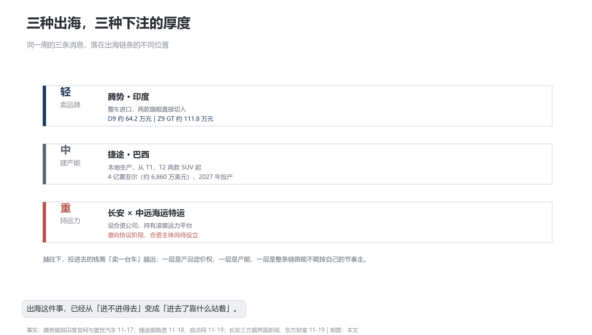
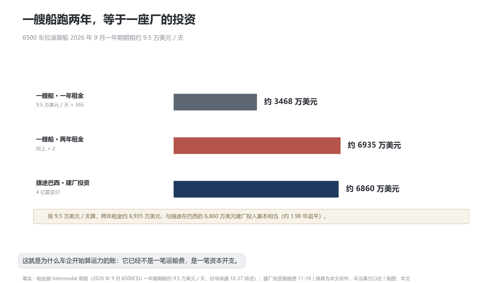
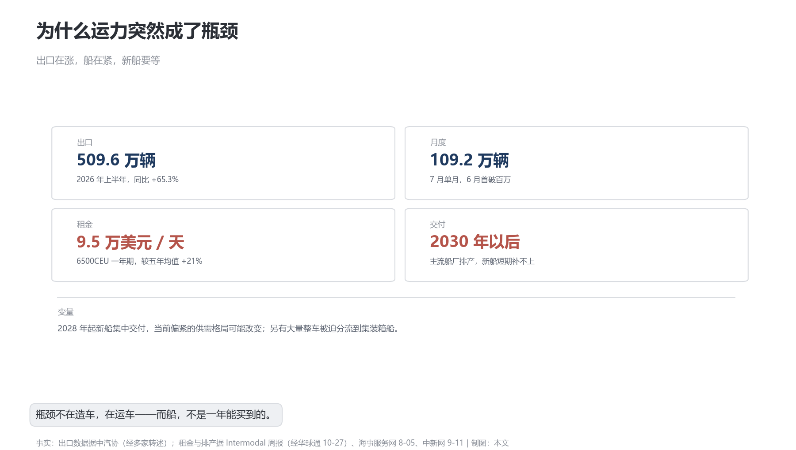

# 腾势进印度、捷途在巴西建厂、长安买船：出海开始往三个不同的方向下注

这一周有三条出海消息，分别落在链条的不同位置。

11 月 13 日，腾势在孟买办了品牌发布会，进入印度市场，首批两款车：D9 和 Z9 GT。11 月 18 日，捷途宣布明年在巴西启动本地生产。11 月 16 日，长安汽车、长安民生物流与中远海运特运在重庆签了合资合作意向协议，要做滚装运力平台。

三条消息看着都是出海。但它们投的不是同一种东西。

## 一、腾势：卖的是定价权

先把日期摆正。腾势进入印度是**11 月 13 日**（当地时间，孟买），11 月 17 日对外宣布，11 月 18 日是媒体集中报道日。

两款车都是**整车进口**。D9 起售价 900 万卢比，约 64.2 万元人民币；Z9 GT 1568 万卢比，约 111.8 万元。

这个价位在印度是豪华车区间。腾势没有建厂、没有本地供应链，靠的是把车运过去、按进口车卖高价。这条路最轻，赌的是品牌能不能撑住溢价。

印度此前不是中国高端新能源的重点目的地——市场大、关税高，风险不小。腾势拿两款旗舰直接进去，等于跳过"先走容易的市场"这一步。

## 二、捷途：卖的是规模

同样先正日期：捷途是**11 月 18 日（周三）**宣布的，不是 19 日。

内容比素材复杂。4 亿雷亚尔（约 6860 万美元）投在巴西，从 T1、T2 两款 SUV 开始本地生产，明年启动，厂址选在里约热内卢州（具体地址尚未确认）。

关键是这句：**这 4 亿是在此前已宣布的同等规模投资之外追加的**。

还有一组数字素材没提：捷途今年刚进巴西，已卖出超 8000 辆、推出六款车型。进市场第一年就追加投资建厂，这不是"先出口、再建厂"的老节奏。

两家放一起看：腾势是进口卖高价，捷途是本地化换规模。一个赌单车利润，一个赌市场占有率。

## 三、长安：买的是运力

第三条最不像新闻，但可能最重要。

长安汽车、长安民生物流与中远海运特运 11 月 16 日在重庆签约，计划研究设立合资公司，搭建汽车滚装运力平台，打通整车海外运输、航线运营、海外码头配套。

需要说清楚两点。第一，这是**意向协议**，合资主体尚未设立。第二，中远海运特运与长安民生物流 2023 年 7 月就在太仓成立过汽车供应链合资公司，这次是在原有关系上往前推一步，不是从零开始。

为什么要动这一步？

到 2026 年上半年，中国汽车出口 509.6 万辆，同比增 65.3%；1—7 月 639.9 万辆，6 月单月首破百万、7 月 109.2 万辆。

船跟不上。6500 车位滚装船的一年期期租，2026 年 9 月约 **9.5 万美元一天**，比当年均值高 43%。主流船厂排产已到 2030 年以后。

算一笔账：9.5 万美元一天，一年约 3468 万美元，两年约 6935 万美元。

捷途在巴西的建厂投资是 6860 万美元。

**一艘船两年的租金，和一座海外工厂的投资，是同一个量级。**

这就是为什么车企开始自己持有运力。租船是运营费用，一年一付、随行就市；持有运力是资本开支，一次性投进去，换来的是十年可用。当租船成本逼近建厂成本，外包就不再是最优解。

## 四、三级台阶

三条消息摊开，是出海的三级台阶：

**卖产品**——进口、定价、赚品牌溢价。轻，但天花板由关税和购买力决定。

**建产能**——本地组装、绕开关税、换市场规模。中，但要压资金、要管供应链。

**持运力**——自己掌握船和航线。重，但这层决定前两层能不能按自己的节奏走。

## 写在最后

出海这件事，评判标准变了。

以前看的是"进了几个国家""发了几个品牌"。现在要看的是：进去了靠什么站着——是靠一个高价标签，靠一座工厂，还是靠一支船队。

**产品能赢一次，产能能赢几年，运力决定你能不能一直赢。**

三条里最不显眼的那条——重庆一间会议室里的意向协议——可能是真正的分水岭。

---

*事实来源：腾势（DENZA，比亚迪集团旗下）于当地时间 2026 年 11 月 13 日在孟买举行品牌发布活动、正式进入印度市场，首批推出七座纯电 MPV 腾势 D9 与纯电猎装车腾势 Z9 GT，均以整车进口方式进入；D9 起售价 900 万印度卢比（约合人民币 64.2 万元），Z9 GT 起售价 1,568 万印度卢比（约合人民币 111.8 万元）；11 月 17 日对外宣布，11 月 18 日为媒体集中报道日（腾势印度官网、盖世汽车 11 月 17 日、IT之家 11 月 17 日、观察者网 11 月 18 日、动点科技 11 月 18 日）。捷途（Jetour，奇瑞集团旗下）于 2026 年 11 月 18 日宣布明年将在巴西启动本地生产，从 T1 与 T2 两款 SUV 开始，投资 4 亿雷亚尔（约 6,860 万至 6,900 万美元），为在此前已宣布的同等规模投资之外的追加投入；厂址选在里约热内卢州，具体地址尚未确认；捷途今年进入巴西市场，已售出超 8,000 辆、推出六款车型（路透 11 月 18 日、工商时报 11 月 19 日、观点网 11 月 19 日、AASTOCKS 11 月 18 日、Folha 11 月 18 日）。长安汽车、长安民生物流与中远海运特运于 2026 年 11 月 16 日在重庆签署合资合作意向协议，计划研究设立合资公司、打造汽车滚装运力平台，打通整车海外运输、航线运营、海外码头配套等环节；签约在中远海运集团西南区域总部揭牌仪式上完成，属重庆推进西部陆海新通道、支持渝车出海的重点项目；该协议为意向协议，合资主体尚待设立；中远海运特运与长安民生物流曾于 2023 年 7 月 17 日在江苏太仓成立汽车供应链合资公司（界面新闻 11 月 19 日、东方财富 11 月 19 日、凤凰网 11 月 19 日、中华航运网 2023 年 7 月 18 日）。滚装运力背景：2026 年上半年中国汽车出口 509.6 万辆、同比增 65.3%，1—7 月累计 639.9 万辆、同比增 53.7%，6 月单月首破百万辆、7 月 109.2 万辆；6500 车位（CEU）滚装船一年期期租租金 2026 年 9 月约 9.5 万美元／天，较当年均值高 43%、较五年均值高 21%；主流船厂排产已到 2030 年以后；2028 年起新船集中交付，供需格局可能改变；大量整车被迫分流至集装箱船（中国汽车工业协会数据经多家转述、Intermodal 周报经华球通 10 月 27 日转述、海事服务网 8 月 5 日、中新网 9 月 11 日）。文中"9.5 万美元／天 × 365 ≈ 3,468 万美元／年／艘""两年约 6,935 万美元""与捷途巴西 6,860 万美元建厂投入约 1.98 年追平"为本文换算，非当事方口径；"三条消息投的不是同一种东西""一艘船两年租金与一座海外工厂投资同量级""本次是原有合作关系往前推一步"等为作者判断，非当事方表述。另需说明：素材原稿称腾势"11 月 18 日正式登陆印度市场"，实际进入市场为当地时间 11 月 13 日、11 月 17 日对外宣布，11 月 18 日为媒体报道日；素材称捷途"11 月 19 日宣布"，实际为 11 月 18 日；素材未提及腾势两款车以整车进口方式进入及其印度售价，亦未提及捷途今年已在巴西售出超 8,000 辆；素材称长安三方"11 月 16 日签署合资合作意向协议"，日期正确，但未说明该协议为意向性质、合资主体尚待设立，亦未提及三方此前的合作基础。*