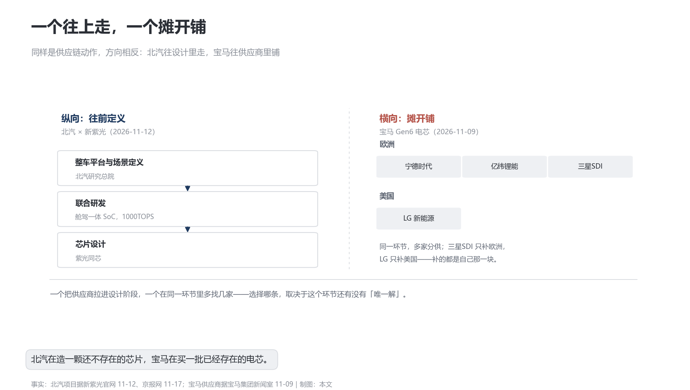
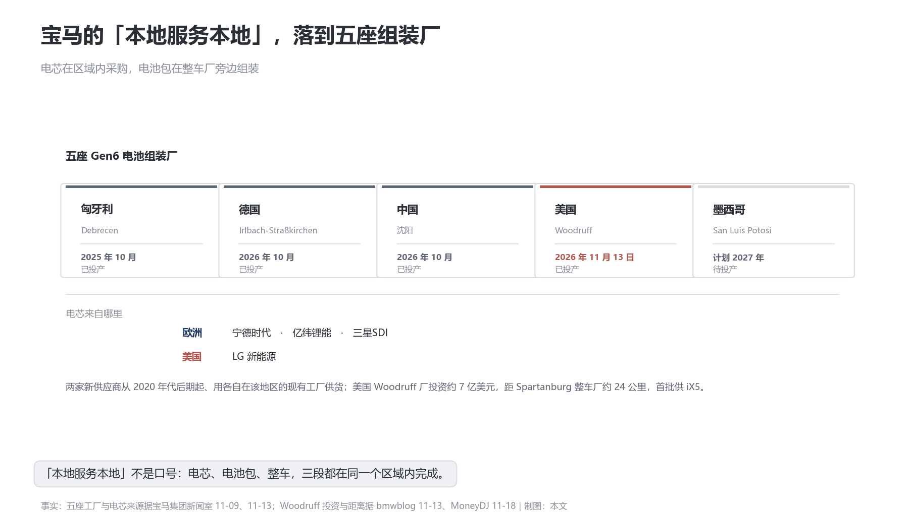
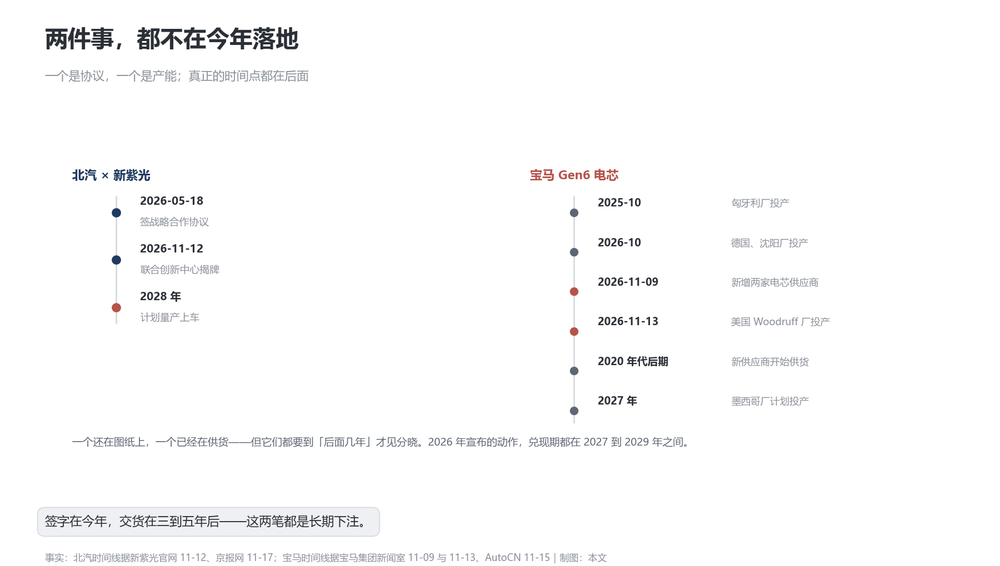

# 北汽去定义一颗芯片，宝马再多找两家电芯：方向相反的两个供应链动作

11 月 12 日，新紫光集团与北汽集团在北京为联合创新中心揭牌。同一天，紫光同芯与北汽研究总院签了战略合作协议，要做一颗车规级舱驾一体 SoC，单颗算力目标 **1000TOPS**。

11 月 9 日，宝马集团宣布为第六代高压电池新增两家电芯供应商：三星SDI 和 LG 新能源。

两家企业的动作都在供应链上，但方向正好相反。

## 一、北汽往设计里走

1000TOPS 单颗，一颗同时承载智能驾驶、智能座舱和底盘控制，目标是把车上几个域控制器合并成一个，降硬件成本、降功耗。

时间点要说清：**计划 2028 年量产上车**。这是两年多以后的事。

分工也清楚。北汽研究总院出整车平台和场景定义——什么场景要多少算力、哪些任务必须实时、安全冗余怎么留；紫光同芯出芯片设计和车规工艺，它原来在安全芯片领域有长期积累。

这不是"采购一颗现成 SoC"。双方从架构层面联合定义，等于把整车厂的位置往前挪了一格：从"提需求、选供应商"，变成"参与定义产品"。

合作还有前情。今年 5 月 18 日两家就签了战略合作协议，11 月揭牌是落地推进。除这颗主力芯片，双方还要做中央计算平台、底盘域控、下一代座舱芯片，后续延伸到商用车。

## 二、宝马往供应商里铺

第六代（Gen6）高压电池原本在欧洲用宁德时代和亿纬锂能。现在加上三星SDI。美国那边由 LG 新能源供货。

这里有个细节容易读错：**不是两家新供应商都同时在欧洲和美国供货**。三星SDI 补欧洲，LG 补美国，各用自己在该地区已有的工厂，从 2020 年代后期开始供。

宝马采购董事 Nicolai Martin 的说法是"尽可能本地化"，高压电池采购与质量负责人 Hendrik Lang 用的是三个词：高韧性、灵活性、成本竞争力。

宝马是在同一环节里增加供应商数量，前提是这些供应商都已经能做出这个规格的电芯。

## 三、"本地服务本地"落到五座厂

这条原则不只管采购，还管组装。

Gen6 高压电池在五座新建工厂组装，都在整车厂附近：德国 Irlbach-Straßkirchen、匈牙利 Debrecen、中国沈阳、美国 Woodruff、墨西哥 San Luis Potosí。

进度不一：匈牙利厂 2025 年 10 月投产，德国和中国沈阳厂 2026 年 10 月投产，美国 Woodruff 厂 2026 年 11 月 13 日开业，墨西哥厂计划 2027 年。

Woodruff 值得单说：投资约 7 亿美元，约 100 万平方英尺，300 多名员工、250 台机器人，距 Spartanburg 整车厂约 24 公里，首批供应全新 iX5。它是五座厂里第四座量产的。

## 四、为什么方向相反

这两件事放一起，能看出一条判断标准：**这个环节是不是已经有了"唯一解"。**

舱驾一体 1000TOPS 的芯片，市场上没有现成的、能直接买到的产品。没有唯一解，就只能自己下场，和芯片厂一起把它造出来。所以北汽必须往前移。

Gen6 电芯是另一回事。三星SDI、LG、宁德时代、亿纬锂能都能做，技术路线收敛、规格可定。既然有多家能供，最优策略就是分散——多找几家、就近配套，谁出问题都不至于停线。

**环节还没商品化，就纵向绑定；已经商品化了，就横向分散。**

## 五、都有兑现期

这两个动作都不在今年见效。

北汽的芯片要等 2028 年量产上车，中间隔着设计、流片、验证、整车集成。宝马的新供应商是 2020 年代后期开始供货，11 月的宣布只是定点。

2026 年这一周签下的，是两张时间表。

## 写在最后

芯片和电芯，是车上价值最高的两个零部件，也是两种完全不同的供应链难题。

一个难在"没人做过"，你得进去和它一起做；一个难在"太多人能做"，你得想办法不被任何一家绑住。

**北汽在造一颗还不存在的芯片，宝马在买一批已经存在的电芯。**

同样是往上游走，一个走向定义权，一个走向安全边际。

---

*事实来源：2026 年 11 月 12 日，新紫光集团与北汽集团在北京举行联合创新中心揭牌暨深化合作签约仪式，新紫光集团董事长李滨与北汽集团党委书记、董事长张建勇共同揭牌；双方今年 5 月 18 日已签战略合作协议；仪式上新紫光旗下紫光同芯与北汽旗下北汽研究总院签署战略合作协议，围绕先进车规工艺舱驾一体 SoC 芯片开展联合研发，单颗算力目标 1000TOPS，计划 2028 年实现量产上车，一颗芯片同时承载智能驾驶、智能座舱与底盘控制计算任务以减少域控制器数量；合作还覆盖 SoC 芯片、舱驾控域控、智能座舱、智能底盘域控，并计划延伸到中央计算平台、下一代座舱芯片与商用车领域（新紫光集团官网、紫光同芯官网、京报网 11 月 17 日、36氪 11 月 13 日、NE时代 11 月 17 日）。2026 年 11 月 9 日，宝马集团宣布为第六代（Gen6）高压电池新增电芯供应商：三星SDI 供欧洲、LG 新能源供美国，两家从各自在该地区的现有工厂供货、时间从 2020 年代后期开始；欧洲电芯来源为宁德时代、亿纬锂能与三星SDI，美国为 LG 新能源；「local for local」原则从供应商网络贯穿至 Gen6 高压电池组装，组装在宝马于整车厂附近新建的五座工厂进行——德国 Irlbach-Straßkirchen、匈牙利 Debrecen、中国沈阳、美国 Woodruff、墨西哥 San Luis Potosí；宝马集团负责采购与供应商网络的董事会成员 Nicolai Martin、高压电池采购与质量负责人 Hendrik Lang 的相关表述见官方通稿（宝马集团新闻室 11 月 9 日、electrive 11 月 9 日、Korea Herald 11 月 10 日、Battery-News 11 月 10 日）。美国 Woodruff 工厂 2026 年 11 月 13 日开业投产，投资约 7 亿美元（2022 年 10 月宣布，属 17 亿美元美国电动化投资的一部分），约 100 万平方英尺、300 多名员工、250 台机器人，距 Spartanburg 整车厂约 24 公里，首批供应全新 iX5；该厂是五座 Gen6 电池厂中第四座量产，匈牙利 Debrecen 厂 2025 年 10 月投产，德国 Irlbach-Straßkirchen 与中国沈阳厂 2026 年 10 月投产，墨西哥 San Luis Potosí 厂计划 2027 年（宝马集团新闻室 11 月 13 日、bmwblog 11 月 13 日、WSPA 11 月 13 日、MoneyDJ 11 月 18 日、AutoCN 11 月 15 日）。文中"环节未商品化则纵向绑定、已商品化则横向分散""北汽在造一颗还不存在的芯片，宝马在买一批已经存在的电芯"等为作者判断，非当事方表述。另需说明：素材称两家新供应商"通过各自在欧洲和美国的现有工厂供应电芯"，易被读成两家在两地都供货，实际为三星SDI 供欧洲、LG 新能源供美国的分工；素材未提及北汽项目 2028 年量产上车的时间点，该时间点直接决定此事的性质属长周期布局而非近期兑现；素材未提及宝马五座电池组装厂的具体分布与美国 Woodruff 厂 11 月 13 日投产的进度，本文据官方通稿补入。*