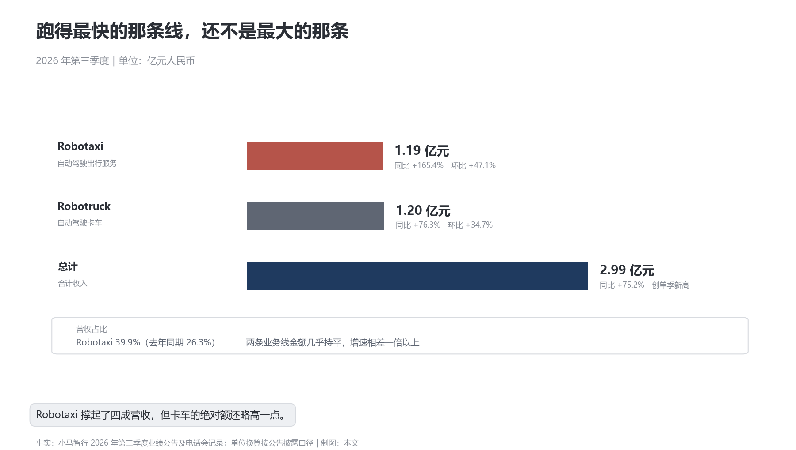
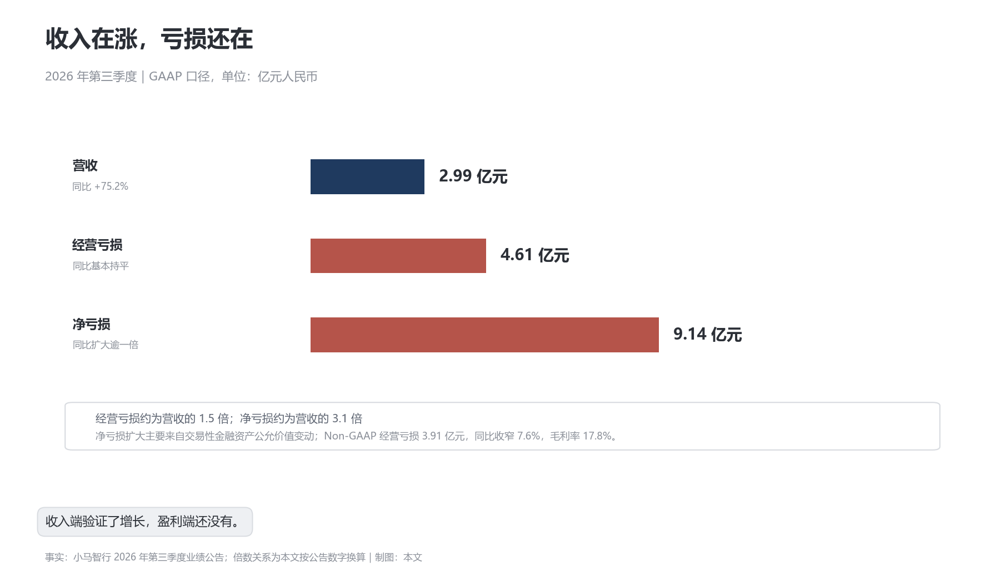
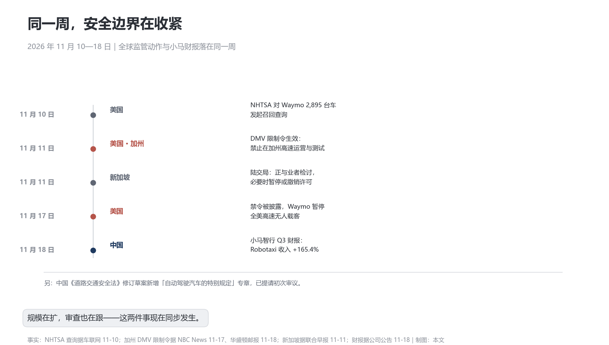

# 小马智行 Q3：Robotaxi 收入翻了倍，但同一周 Waymo 被赶下高速

11 月 18 日晚间，小马智行（02026.HK）发布 2026 年第三季度财报。

总收入 2.99 亿元，同比增 75.2%，环比增 23.1%，创上市以来单季新高。其中最受关注的自动驾驶出行服务（Robotaxi）收入 1.19 亿元，同比增 **165.4%**，环比增 47.1%，占总收入比重从去年同期的 26.3% 升到 **39.9%**。

同一周，加州车辆管理局的一道限制令被媒体披露：Waymo 不得在加州任何高速公路上运营或测试无人车。Waymo 随后暂停了全美高速公路的无人载客服务。

两条消息放在一起，才是这一周 Robotaxi 的真实状态。

## 一、财报说了什么

增速确实是硬的。乘客车费收入同比增长接近 400%，说明增长来自真实载客，不是一次性项目。

覆盖范围也在扩。广州原分开的市中心城区与南沙区两个运营区已连通，形成超 **1000 平方公里**的相连运营区——公司说接近旧金山面积九倍。杭州、重庆、珠海横琴启动部署，上海浦东新区新获许可的无人车纳入持续示范运营。

海外在推进伦敦、曼彻斯特等欧洲城市；9 月在克罗地亚萨格勒布启动欧洲首个全无人驾驶载客服务。

车队截至 9 月 30 日达 **2768 台**，比二季度末的 1975 台增加 793 台，全年目标 3500 台。

## 二、财报没强调的部分

有两件事值得放在旁边看。

**第一，Robotruck 还是最大的收入来源。** 本季 Robotruck 收入 1.20 亿元，同比增 76.3%——比 Robotaxi 的 1.19 亿元还略高一点。"Robotaxi 撑起四成营收"没错，但它和卡车业务目前是并驾齐驱，不是一枝独秀。

**第二，亏损没有跟着收入一起改善。** GAAP 经营亏损 4.61 亿元，同比基本持平；GAAP 净亏损 9.14 亿元，同比扩大逾一倍——这一项主要来自交易性金融资产公允价值变动，不是经营层面的恶化。

毛利率 17.8%；Non-GAAP 经营亏损 3.91 亿元，同比收窄 7.6%。

收窄 7.6% 是进步，但方向要看清：**经营亏损仍大于营收**。港股 11 月 18 日收报 31.78 港元，连续第二个交易日创上市新低。

## 三、同一周，安全边界在收紧

标题里那半句，来自这一周全球发生的事。

11 月 11 日，加州 DMV 的限制令生效，理由是"对公共安全的紧迫危险"。这道命令六天后才被媒体发现。触发它的两起事件**都没有造成碰撞和伤亡**——加州方面的处理逻辑指向整改失效：同类错误在召回和软件更新之后又出现了。

11 月 10 日，NHTSA 对 Waymo 2895 台搭载第五代自动驾驶系统的车辆发起召回查询，核查校车避让软件的修复是否真的生效。

11 月 11 日，新加坡陆交局就 11 月 5 日两起自驾车险情表态：正与业者检讨，必要时暂停或撤销运营许可。

中国这边是另一条路。《道路交通安全法》修订草案新增"自动驾驶汽车的特别规定"专章，已提请全国人大常委会初次审议。

## 四、两条线的关系

这两件事不是巧合，是同一件事的两面。

Robotaxi 的规模扩张靠什么？更多城市、更大运营区、更多车辆。而这三样东西，每一项都在扩大监管的暴露面——车越多、跑得越远、接触的复杂路况越多，"零事故"就越难维持。

加州这次的处理尤其值得注意：**没出事，也要停。** 理由不是这次撞了什么，而是"上次让你改的，你没改好"。这把标准从"结果"移到了"过程"——从"你不能撞人"变成"你必须证明修复是有效的"。

## 写在最后

小马这份财报确实提供了第一份可量化的验证：Robotaxi 的收入增速、占比、车队规模、运营面积，都有了可对照的数字。素材说的"从理论测算走向可观测数据"，在收入端成立。

但完整地看，这一周给出的信息是双面的：

**收入在证明这套模式能赚钱，监管在提醒这套模式还没被证明安全。**

对 Robotaxi 来说，这两件事必须同时成立。规模可以靠资本堆出来，安全边界只能靠一次次不出错挣回来——而后者，不随融资额增长。

---

*事实来源：小马智行（Pony.ai，02026.HK）于 2026 年 11 月 18 日晚间公布 2026 年第三季度未经审计业绩：总收入 4460 万美元（约人民币 2.99 亿元），同比增 75.2%、环比增 23.1%；自动驾驶出行服务收入 1780 万美元（约 1.19 亿元），同比增 165.4%、环比增 47.1%，占总收入 39.9%（去年同期 26.3%）；Robotruck 收入 1.20 亿元，同比增 76.3%、环比增 34.7%；毛利 5310 万元、同比增 69.5%，毛利率 17.8%；GAAP 经营亏损约 4.61 亿元、同比基本持平，Non-GAAP 经营亏损约 3.91 亿元、同比收窄 7.6%；GAAP 净亏损 9.14 亿元、同比扩大逾一倍，主要来自交易性金融资产公允价值变动亏损，Non-GAAP 净亏损约 3.28 亿元、同比收窄 13.9%；乘客车费收入同比增长接近 400%（公司业绩公告与三季度电话会记录、第一财经 11 月 18 日、澎湃新闻 11 月 18 日、新浪财经 11 月 18 日、AutoCN 11 月 19 日、OFweek 11 月 19 日）。截至 2026 年 9 月 30 日 Robotaxi 车队 2768 台（二季度末 1975 台，单季增 793 台），全年目标 3500 台；广州原市中心城区与南沙区两个独立运营区域已连通为覆盖超 1000 平方公里的相连运营区域，公司称接近旧金山市面积九倍；上海浦东新区新获许可无人驾驶车辆纳入持续示范运营；杭州、重庆、珠海横琴启动部署；海外向伦敦、曼彻斯特等欧洲城市扩张，9 月在克罗地亚萨格勒布启动欧洲首个全无人驾驶载客服务（业绩公告、电话会记录、新浪财经 11 月 18 日）。港股 11 月 18 日收报 31.78 港元，连续第二个交易日创上市新低（AutoCN 11 月 19 日）。加州车辆管理局（DMV）限制令 11 月 11 日生效，禁止 Waymo 在加州任何高速公路运营或测试无人车，理由为"对公共安全的紧迫危险"，该命令六天后才被媒体披露；Waymo 随后暂停全美高速公路无人载客服务；两起触发事件均未造成碰撞与伤亡，加州方面的处理指向整改失效（NBC News 11 月 17 日、华盛顿邮报 11 月 18 日、OFweek 11 月 19 日）。NHTSA 于 11 月 10 日针对 Waymo 2895 台搭载第五代自动驾驶系统的车辆发起召回查询（RQ26006），核查校车避让软件修复是否生效（车联网 11 月 10 日）。新加坡 11 月 5 日两辆自驾车在榜鹅一带分别差点撞上行人和车辆，陆交局 11 月 11 日表示正与业者检讨、必要时暂停或撤销运营许可（联合早报 11 月 11 日）。中国《道路交通安全法》修订草案新增"自动驾驶汽车的特别规定"专章，已提请十四届全国人大常委会第二十四次会议初次审议（中国人大网 11 月 10 日）。文中"经营亏损约为营收的 1.5 倍、净亏损约为营收的 3.1 倍"为本文按公告数字换算，非公司口径；"Robotaxi 与 Robotruck 目前并驾齐驱""监管标准从结果移向过程""规模可以靠资本堆出来，安全边界只能靠不出错挣回来"等为作者判断，非当事方表述。另需说明：素材仅提供财报数据，标题中"安全边界同时收紧"所指的监管动作未在素材正文中体现，本文据公开报道补入同期发生的加州 DMV 限制令、NHTSA 召回查询、新加坡陆交局表态与中国道交法修订草案；素材未提及 Robotruck 收入（1.20 亿元）略高于 Robotaxi（1.19 亿元），亦未提及净亏损扩大与毛利率水平。*