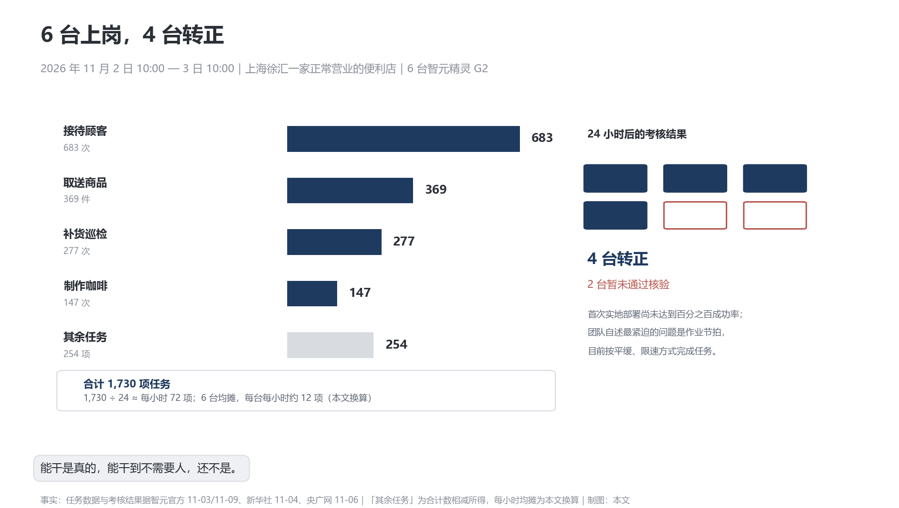
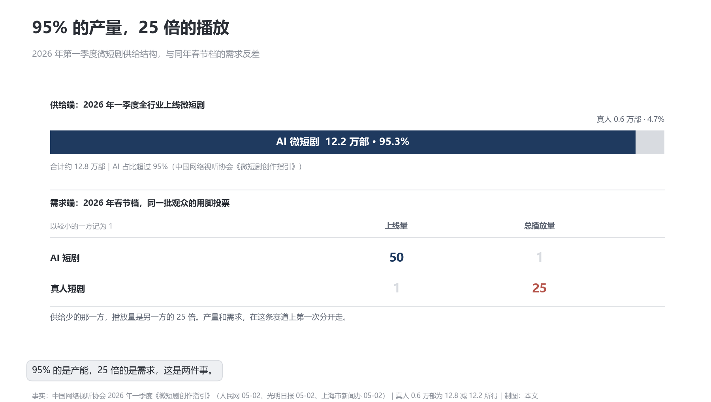
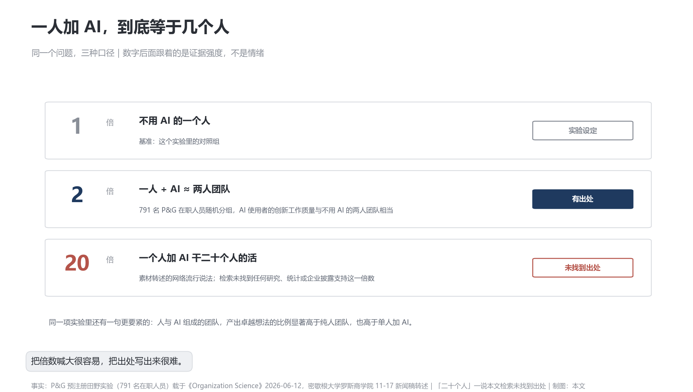

# 机器这么能干，那半句是真的

11 月 2 日上午 10 点，上海徐汇一家正常营业的便利店里，6 台智元精灵 G2 人形机器人开始上班。迎宾、取货、补货、做咖啡、收银、擦桌子，连续 24 小时，门店照常营业，顾客照常进店。

24 小时下来，它们累计完成 1730 项任务：接待顾客 683 次，取送商品 369 件，补货巡检 277 次，制作咖啡 147 次。直播有超过 200 万人围观。

素材里的这半句，是真的。

## 一、但考核结果，素材没写

6 台里，4 台"转正"，2 台暂未通过核验。

团队自己的说法更值得记下来：首次实地部署尚未达到百分之百成功率；当前最紧迫的问题是作业节拍，也就是速度；出于安全考虑，机器人目前按平缓、限速的方式完成任务。

把这两句和 1730 摆在一起看：能干是真的，能干到不需要人，还不是。1730 除以 24 小时，约每小时 72 项；6 台均摊，每台每小时 12 项。这个节拍放进一家 24 小时便利店的高峰时段，还得有人兜底。

## 二、被漏掉的另一半证据

素材说，2026 年一季度上线的微短剧里，AI 生成占比超过 95%。这条我核了，属实：全行业约 12.8 万部，其中 AI 微短剧约 12.2 万部。

但同一份《微短剧创作指引》里还有一句，素材没引：以 2026 年春节档为例，真人剧上线量约为 AI 剧的五十分之一，总播放量却是 AI 剧的 25 倍。

供给端 95% 是 AI，需求端 25 倍在人这边。这两句话必须一起说。只说前一句，"机器这么能干"就成了半张图。

横店是这张图的下半部分。摄影棚空置率逼近八成，短剧开机量同比下降 82.5%，大量"横漂"转去做景区 NPC。机器确实端走了产能，但没端走观众。

## 三、"二十个人"这句话，没有出处

素材里还有一句在网上流传很广的话："一个人加 AI 干二十个人的活。"

我查了，没找到任何研究、统计或企业披露支持这个倍数。

能找到硬证据的是另一项研究。宝洁做过一次预注册田野实验，791 名在职专业人员随机分组，结论是：用 AI 的个人，创新工作质量与不用 AI 的两人团队相当。是两个人，不是二十个人。

同一项研究还有一句更要紧的：人与 AI 组成的团队，产出卓越想法的比例显著高于纯人团队，也高于单人加 AI。

这句话把问题问反了。真正该问的不是"一个人能顶几个人"，而是"人和 AI 一起，能不能做出一个人或一台机器都做不出的东西"。

## 四、所以，努力还有意义吗

回到开头那句话。

机器能干，是真的。它一天做 1730 项任务，不喊累，不要加班费。这一半必须承认，不承认就是自我安慰。

但"这么能干"这四个字里，掺了三样东西：被省略的失败率，被省略的需求端，和被夸大的倍数。把这三样剔掉，剩下的才是这一周真正发生的事——

**产能已经过剩，判断力仍然稀缺。**

95% 的产量换不来 25 倍的播放，说明观众要的不是更多，是更好。791 人的实验说明，AI 把人从执行里解放出来之后，值钱的是那个人提的问题、下的判断、认的账。6 台机器人 4 台转正，说明连"能不能干活"都还要一台一台考。

所以努力的意义没有消失，只是换了地方。过去努力是把事做完，现在努力是知道该做什么事，以及做完之后敢不敢签字。

机器负责把答案变便宜，人负责决定问什么问题。后者目前还没有被替代的迹象。

---

*事实来源：2026 年 11 月 2 日 10 时至 3 日 10 时，6 台智元（AGIBOT）精灵 G2 人形机器人在上海徐汇区一家正常营业的好德便利店连续工作 24 小时，分任迎宾、取货打包、巡检补货、制作咖啡、收银出餐与清洁桌面，门店照常营业、顾客照常进店；24 小时内累计完成 1730 项任务，其中接待顾客 683 次、取送商品 369 件、补货巡检 277 次、制作咖啡 147 次；直播全网超 200 万人观看；6 台机器人中 4 台通过"转正"考核、2 台暂未通过核验（智元官方 11 月 3 日、11 月 9 日，新华社 11 月 4 日，央广网 11 月 6 日，羊城派 11 月 4 日，深圳新闻网 11 月 4 日）。团队自述"首次实地部署尚未达到百分之百成功率""当前最紧迫的问题是作业节拍""暂以平缓、限速方式完成任务"，出自央广网 11 月 6 日对算法专家王溯恺、智元具身研究中心副总裁任广辉的采访。中国网络视听协会 2026 年第一季度《微短剧创作指引》：全行业上线微短剧约 12.8 万部，其中 AI 微短剧约 12.2 万部、占比超过 95%；同一份指引载明，以 2026 年春节档为例，真人剧上线量约为 AI 剧的五十分之一，总播放量达到 AI 剧的 25 倍（人民网 5 月 2 日、光明日报 5 月 2 日、上海市人民政府新闻办公室 5 月 2 日、中国网络视听节目服务协会 8 月 13 日）。横店摄影棚空置率逼近八成、短剧开机量同比下降 82.5%、大量"横漂"转型景区 NPC（财新 11 月 3 日、21 经济网 8 月 21 日、齐鲁晚报 11 月 12 日、网易 10 月 2 日）。宝洁（Procter & Gamble）预注册田野实验：791 名在职专业人员随机分配至单独作业、双人团队、以及其中一方配备生成式 AI 的条件，结果显示使用 AI 的个人其创新工作质量与不使用 AI 的两人团队相当，而"人 + AI"团队产出卓越想法的可能性显著更高（Dell'Acqua、Lakhani、Mollick 等，《Organization Science》2026 年 6 月 12 日在线发表；密歇根大学罗斯商学院 11 月 17 日新闻稿）。文中"1730 ÷ 24 ≈ 每小时 72 项、6 台均摊每台每小时约 12 项""真人 0.6 万部为 12.8 减 12.2 所得"为本文换算，非当事方口径；"产能已经过剩，判断力仍然稀缺""机器负责把答案变便宜，人负责决定问什么问题""过去努力是把事做完，现在努力是知道该做什么事"等为作者判断，非当事方表述。另需说明：素材称"一个人加 AI 干二十个人的活"，本文检索未找到任何研究、统计或企业披露支持这一倍数，故标为"未找到出处"；素材称"无人驾驶出行服务已覆盖全球 28 座城市"，经核为百度萝卜快跑单一企业的数据（新华网 8 月 21 日），非行业总量，故未采用；素材引述的"中国人民大学新闻学院调研发现数字分身只能复刻标准化、显性化的表层工作能力"一说，本文仅见二手转述、未见调研原文，故未采用。素材原文为潮新闻 2026 年 11 月 18 日评论《机器这么能干，个人努力还有什么意义？》（特约评论员贾祥敏）。*
