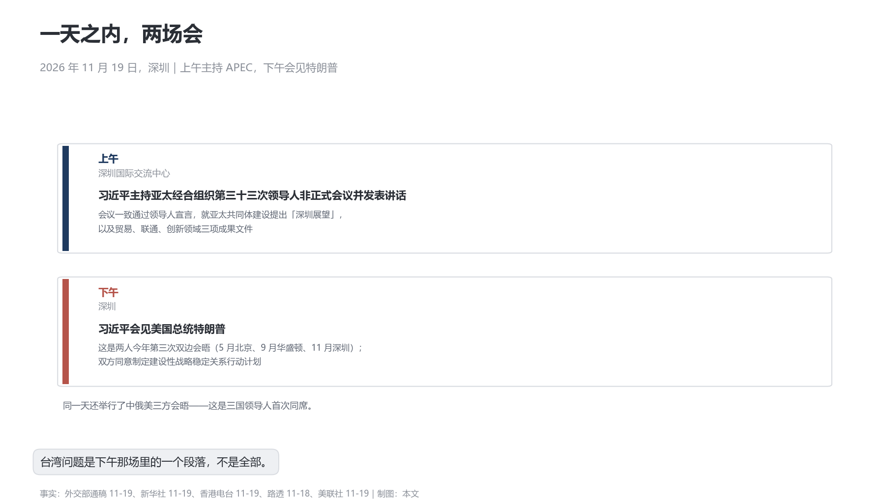
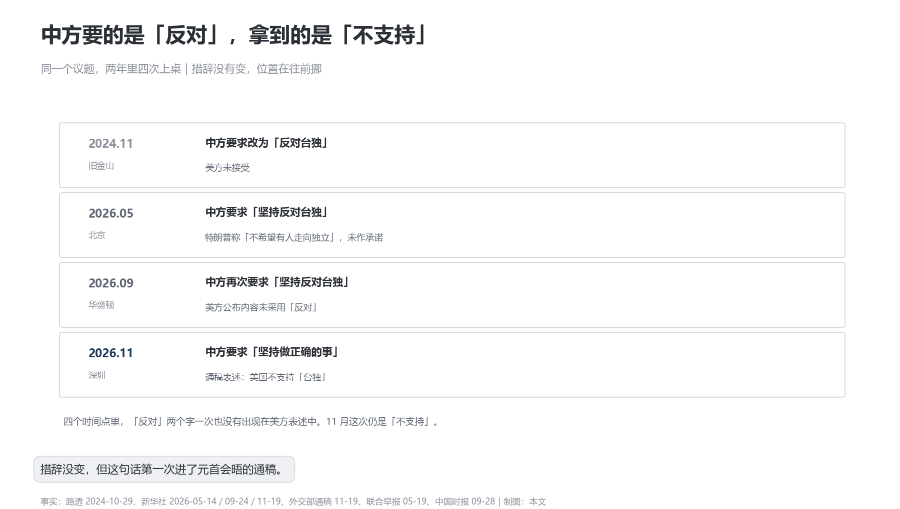
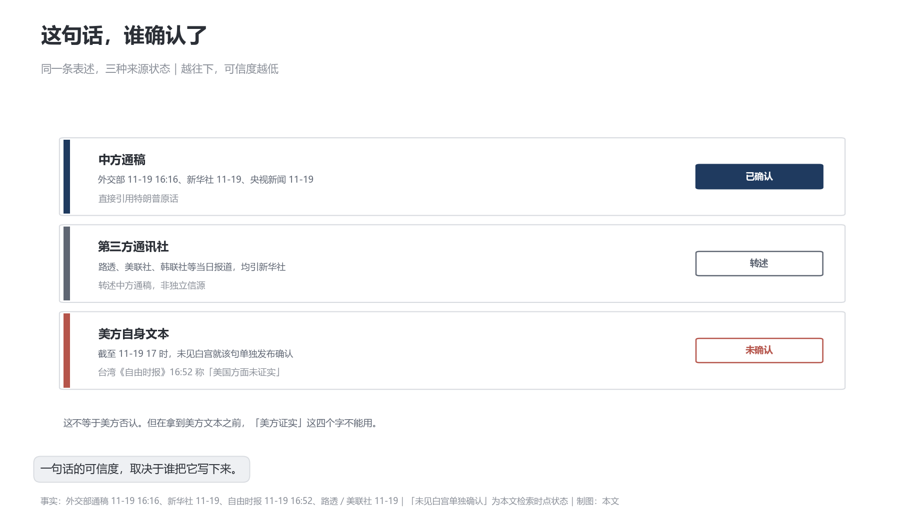

# 特朗普说"不支持台独"，这五个字中方要了两年

11 月 19 日下午，深圳。国家主席习近平会见来华出席亚太经合组织第三十三次领导人非正式会议的美国总统特朗普。

这是两人今年第三次双边会晤。5 月北京，9 月华盛顿，11 月深圳。半年内三次面对面，中美关系史上没有过。

会晤中，特朗普说了一句话："美国不支持'台独'。"

这句话被大量转发。但它既不是新的，也不是全部的。

## 一、先看这一天到底发生了什么

11 月 19 日上午，习近平在深圳国际交流中心主持亚太经合组织第三十三次领导人非正式会议，发表题为《建设亚太共同体，续写"亚太奇迹"新篇章》的讲话。会议一致通过 2026 年领导人宣言，就亚太共同体建设提出"深圳展望"，以及贸易、联通、创新领域三项成果文件。

下午才是习特会。同一天还举行了中俄美三方会晤——三国领导人首次同席。

把台湾问题放进这个日程里看：它是下午那场会晤里的一个段落，不是这一天的主题。这个位置很重要，后面会说。

## 二、"不支持"这三个字，美方用了很多年

需要说清楚一件事：**"不支持台独"是美方长期以来的标准表述，不是这次新给的。**

2024 年 11 月旧金山会晤，中方要求美方把"不支持台独"改成"反对台独"，美方没有接受。2026 年 5 月北京会晤，习近平要求美方"坚持反对'台独'的正确立场"；特朗普会后接受福克斯新闻采访时说"不希望看到有人走向独立"，但没有作出承诺。9 月华盛顿会晤，中方再次提出同样要求，美方公布的内容里仍然没有"反对"两个字。

11 月 19 日这次，通稿里写的还是"不支持"。

四次上桌，中方要的措辞一次都没拿到。这是事实的一半。

## 三、另一半：这句话第一次进了元首会晤的通稿

但也不能说这次什么都没有。

过去几次，美方对台湾问题的表态往往出现在会后采访、或者由驻华大使转述。这一次，"美国不支持'台独'"被直接写进了中美元首会晤的中方通稿，紧跟着"建交 40 多年来，美中关系取得显著进展"。

同时，习近平在台湾问题上的措辞变了。5 月是"处理不好，两国就会碰撞甚至冲突"，9 月是"坚持反对'台独'的正确立场"，这次是"美方要坚持做正确的事，避免中美关系出现大的波折"。

从"碰撞冲突"到"避免大的波折"，语气是收的。从要求"反对"到只说"做正确的事"，要求也是收的。

**两边都在往中间挪，但都没挪到自己想要的位置。**

## 四、还有一件事得说清楚

截至本文写作时，我没有找到白宫就"美国不支持'台独'"这一句单独发布的确认文本。台湾《自由时报》当天 16:52 的报道标题直接写的是"美国方面未证实"。

这不等于美方否认。元首会晤的通稿由东道主发布是惯例，美方未单独发声也常见。但在拿到美方文本之前，"美方证实"这四个字不能用。

## 写在最后

回到素材那句话。

"特朗普公开表态称美国不支持'台独'"——这句话本身没错，通稿里确实这么写。但如果只停在这里，会得出两个错误结论：一是以为美方立场有了突破，二是以为台湾问题在这次会晤里占了很大分量。

实际情况是：措辞没变，位置往前挪了一点，美方还没自己确认。

外交上的进展通常就是这样——不是一句话翻盘，是一个词一个词地挪。中方要了两年"反对"，拿到的是第四次"不支持"。这次的区别只在于，它被写进了通稿，而且是在第三次元首会晤、三国领导人同席的场合。

**判断一次会晤，不看说了什么好话，看哪句话是新的、谁说的、写在哪。**

---

*事实来源：2026 年 11 月 19 日下午，国家主席习近平在深圳会见来华出席亚太经合组织领导人非正式会议的美国总统特朗普；特朗普表示"建交 40 多年来，美中关系取得显著进展……美国不支持'台独'。祝贺中方成功举办亚太经合组织领导人非正式会议"；习近平就台湾问题表示"美方要坚持做正确的事，避免中美关系出现大的波折"；双方同意制定建设性战略稳定关系行动计划（外交部通稿 11 月 19 日 16:16、新华社 11 月 19 日、央视新闻 11 月 19 日、第一财经 11 月 19 日）。同日上午，习近平在深圳国际交流中心主持亚太经合组织第三十三次领导人非正式会议并发表题为《建设亚太共同体，续写"亚太奇迹"新篇章》的讲话，会议一致通过 2026 年领导人宣言，就亚太共同体建设提出"深圳展望"及贸易、联通、创新领域三项成果文件（新华社 11 月 19 日、外交部 11 月 19 日、香港电台 11 月 19 日、金十数据 11 月 19 日引外交部发言人郭嘉昆）。同日举行中俄美三方会晤（路透 11 月 18 日、美联社 11 月 19 日、半岛电视台 11 月 19 日）。措辞沿革：美方长期官方表述为"不支持台独"；2024 年 11 月旧金山会晤中方要求改为"反对台独"、美方未接受（路透社 2024 年 10 月 29 日独家，多家转述）；2026 年 5 月北京会晤习近平要求美方"坚持反对'台独'的正确立场"，特朗普会后接受福克斯新闻采访称"不希望看到有人走向独立"、未作承诺，美国驻华大使庞德伟 5 月 18 日称特朗普当面向习近平表明美国不支持台湾独立（新华社 5 月 14 日、联合早报 5 月 19 日、BBC 中文 5 月 17 日）；2026 年 9 月华盛顿会晤习近平再次提出同一要求，美方公布内容未采用"反对"表述（新华社 9 月 24 日、中国时报 9 月 28 日分析）。美方确认状态：截至本文写作时（2026 年 11 月 19 日 17 时前后），未见白宫就"美国不支持'台独'"一句单独发布确认文本；台湾《自由时报》11 月 19 日 16:52 报道称"美国方面未证实"（自由时报 11 月 19 日）。文中"四次上桌""措辞没变、位置往前挪""两边都在往中间挪""判断一次会晤，不看说了什么好话，看哪句话是新的、谁说的、写在哪"等为作者判断，非当事方表述。另需说明：素材称"特朗普公开表态称美国不支持'台独'"，与外交部通稿一致，但素材未说明该表述系美方长期立场、非本次新增，亦未提及 2024 年 11 月以来中方持续要求将"不支持"改为"反对"而未果的经过，以及美方尚未单独确认该句；素材称"建交 40 多年来"为特朗普原话，本文照引。*

*本文所引"两年"指中方自 2024 年 11 月旧金山会晤起持续提出"反对台独"要求至 2026 年 11 月，约两年；非精确时长表述。*
