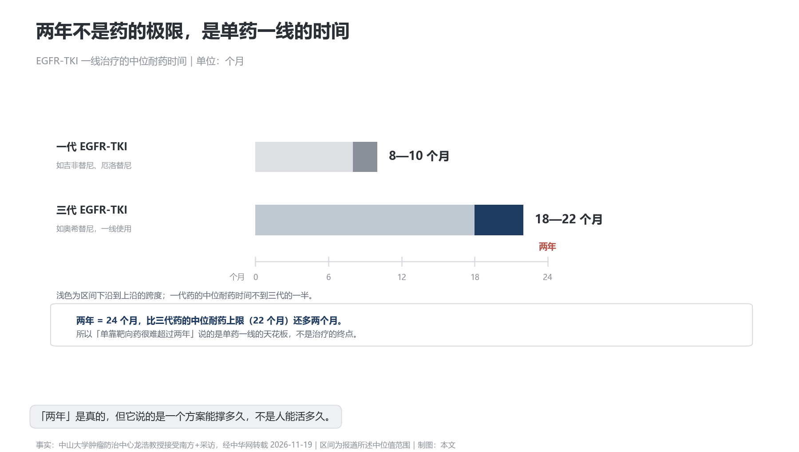
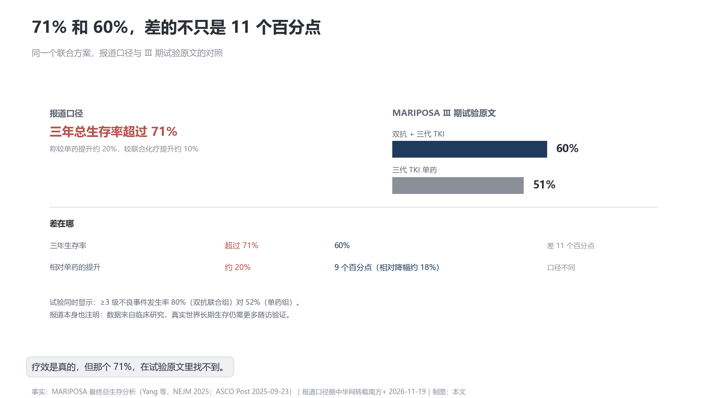
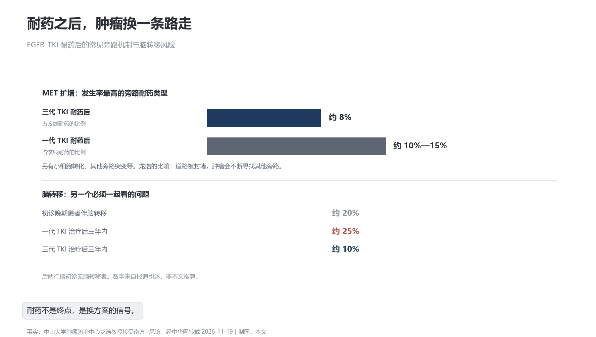

# 肺癌靶向药难逃"两年之困"？这半句是真的

11 月是国际肺癌关注月。国家癌症中心的数据显示，2024 年我国肺癌新发病例超过 117 万，仍是发病首位。

中山大学肿瘤防治中心胸外科主任医师龙浩接受南方+采访时说了句话，被做成了标题："单靠靶向药，能维持的时间很难超过两年。"

这句话，我核了。是真的。

但同一篇报道里，还有一组数字对不上。

## 一、"两年"是怎么算出来的

龙浩给的是两个区间：一代 EGFR-TKI 的中位耐药时间约 8—10 个月；三代 EGFR-TKI 一线使用后，中位耐药时间大多在 18—22 个月。

两年是 24 个月。比三代药的上限还多两个月。

所以"很难超过两年"不是随口一说，是把三代药最好的情况再往上放宽，得出的一个上限。一代药更短，不到三代的一半。

这里有个容易被读错的地方：**"两年"说的是一个方案能撑多久，不是人能活多久。** 耐药不等于没药可用，它意味着要换方案。报道里也写了，本世纪初晚期肺癌 5 年生存率不足 5%，现在部分晚期患者已突破 50%。

## 二、那组对不上的数字

报道说，EGFR/MET 双抗联合三代 EGFR-TKI 的一线方案，"三年总生存率超过 71%，较三代 EGFR-TKI 单药提升约 20%，较三代 EGFR-TKI 联合化疗提升约 10%"。

这个方案对应的关键试验是 MARIPOSA。我查了它的最终总生存分析（Yang 等，NEJM 2025）：中位随访 37.8 个月，**3 年总生存率双抗联合组 60%，奥希替尼单药组 51%**，风险比 0.75。

60% 对 71%，差 11 个百分点。按百分点算，两组是 9 个百分点之差（60% 对 51%），相对降幅约 18%——不是"提升约 20%"。

疗效是真的，统计学显著也是真的。但"71%"这个数字，在试验原文里找不到。

还有一件事报道没放在一起说：同一试验里，双抗联合组的 3 级及以上不良事件发生率是 80%，单药组 52%。获益和代价要一起看。

## 三、耐药之后，肿瘤换一条路

龙浩有个比喻很准：道路被封堵，肿瘤会不断寻找其他旁路，"按下葫芦浮起瓢"。

最常见的旁路是 MET 扩增。三代 TKI 耐药后发生率约 8%，一代耐药后约 10%—15%。此外还有小细胞转化、其他旁路突变。

所以耐药后第一件事不是换药，是搞清楚为什么耐药。有报道过一个案例：患者一代药耐药后自行换成三代药，结果病情加重，后来做基因检测才发现是 MET 扩增，匹配上对应药物才稳定下来。

脑转移是另一条线。初诊晚期患者约 20% 伴脑转移；初诊没有的，一代药治疗后三年内约 25% 会出现，三代药可降到约 10%。

## 写在最后

回到标题那个问句。

"两年之困"这四个字，说对了一半：单药一线确实难超两年，这是真实的天花板，不该被粉饰。

但它容易被读成"只能活两年"，那是误读。真正该记住的是另外三件事——

**第一，耐药不是终点，是换方案的信号。** 关键是耐药后做检测、找机制，而不是凭感觉换药。

**第二，新药的数据要回到试验原文去核。** 71% 和 60% 的差别，不是小数点问题，是报道口径和试验口径的差别。

**第三，任何方案都有代价。** 80% 对 52% 的 3 级不良事件发生率，是选择时必须放上秤的另一端。

报道本身也注明了：上述数据来自临床研究，真实世界长期生存仍需更多随访验证。这句话，比任何一个百分比都值得记住。

---

*事实来源：国家癌症中心 2024 年中国恶性肿瘤流行情况：全年新发癌症约 515.06 万例，肺癌为发病首位，年新发约 117—118 万例（《中华肿瘤杂志》2026 年发布；Cancer incidence and mortality in China, 2024）。中山大学肿瘤防治中心胸外科主任医师龙浩接受南方+采访，经中华网 2026 年 11 月 19 日 16:10 转载，原题《肺癌靶向药难逃"两年之困"？双抗联合靶向瞄准耐药旁路》：一代 EGFR-TKI 中位耐药时间约 8—10 个月，三代 EGFR-TKI 一线使用后中位耐药时间大多在 18—22 个月，"单靠靶向药，能维持的时间很难超过两年"；MET 扩增为发生率最高的旁路耐药类型，三代 TKI 耐药后约 8%、一代耐药后约 10%—15%；初诊晚期肺癌患者约 20% 伴脑转移，初诊无脑转移者一代 TKI 治疗后三年内脑转移发生率约 25%、三代可降至约 10%；本世纪初晚期肺癌 5 年生存率不足 5%，现部分晚期患者 5 年生存率已突破 50%；低剂量螺旋 CT 筛查已证实可降低 20% 肺癌死亡率；门诊晚期患者占比由约三分之二降至约三分之一。该报道称 EGFR/MET 双抗联合三代 EGFR-TKI 一线方案"三年总生存率超过 71%，较三代 EGFR-TKI 单药提升约 20%，较三代 EGFR-TKI 联合化疗提升约 10%"，并注明数据来自临床研究、真实世界长期生存仍需更多随访验证。经核 MARIPOSA Ⅲ 期试验最终总生存分析（Yang 等，NEJM 2025；ASCO Post 2025 年 9 月 23 日报道）：中位随访 37.8 个月，3 年总生存率 amivantamab+lazertinib 组 60%、奥希替尼组 51%（HR=0.75，95%CI 0.61—0.92，P=0.005），中位 OS 未达到 vs 36.7 个月；≥3 级不良事件发生率 80% vs 52%。文中"两年 = 24 个月，比三代药上限 22 个月多两个月""60% 与 71% 相差 11 个百分点、按百分点计两组相差 9 个百分点（60% 对 51%）、相对降幅约 18%"为本文换算，非当事方口径；"耐药不是终点，是换方案的信号""新药数据要回到试验原文去核""任何方案都有代价"等为作者判断，非当事方表述。另需说明：素材标题中的"两年之困"经核成立，但报道所引"三年总生存率超过 71%"与 MARIPOSA 试验原文（60%）不一致，本文已标出；文中提及的"患者自行换药后病情加重、后经基因检测确认 MET 扩增"案例出自福建卫生报 2026 年 9 月 17 日报道，非本次素材内容。本文不构成任何诊疗建议，具体用药请遵医嘱。*
