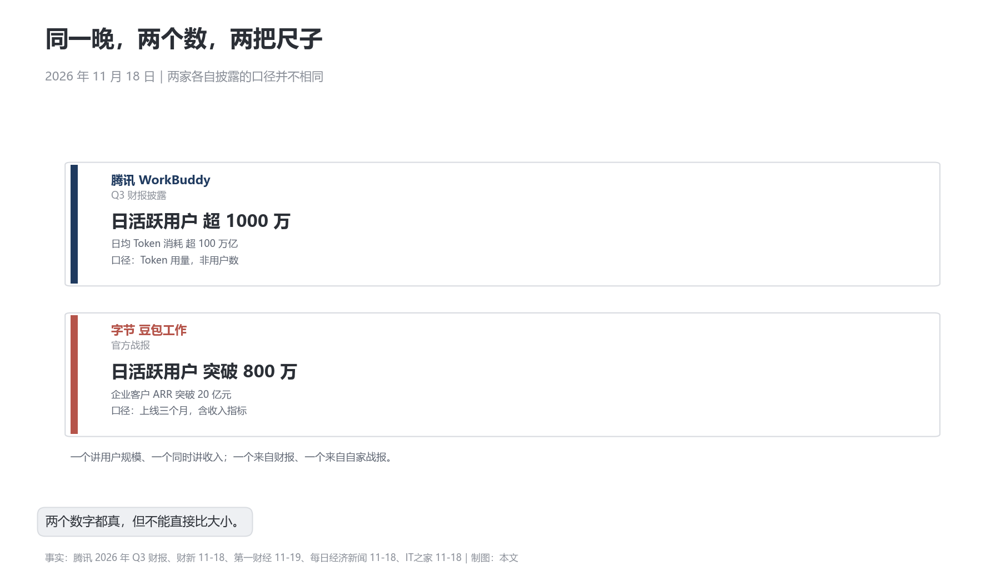
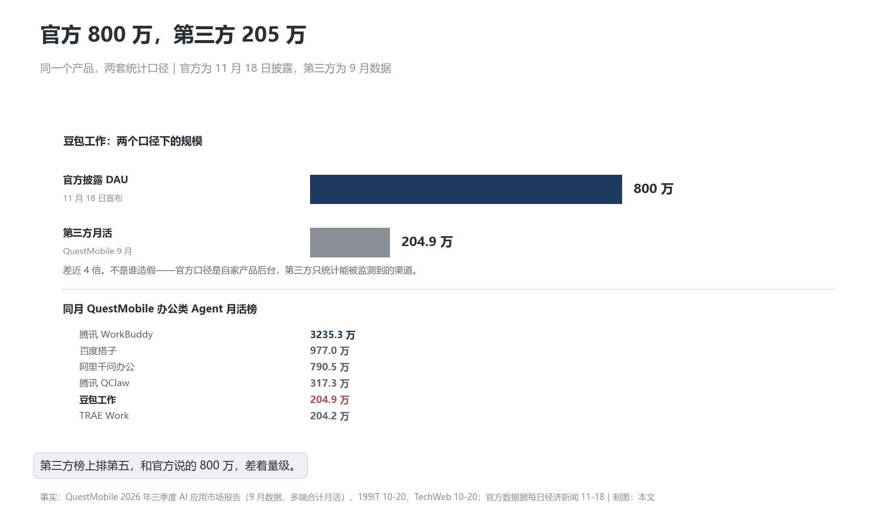
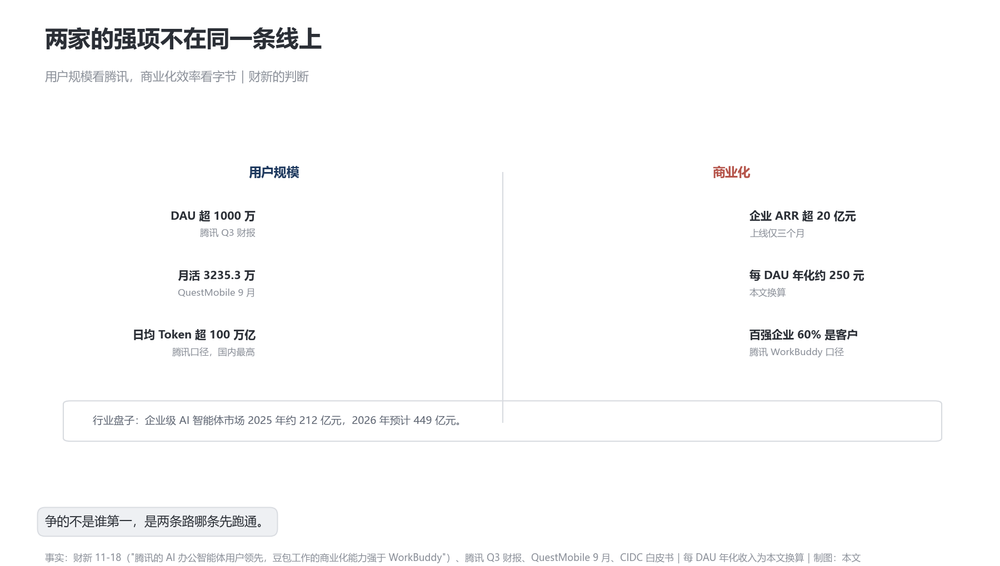

# 豆包 800 万和 WorkBuddy 1000 万，不是一个口径的数

11 月 18 日晚上，腾讯和字节先后披露了自家 AI 办公产品的用户数据。

腾讯在 Q3 财报里写：截至 11 月初，WorkBuddy 日活跃用户超过 1000 万，日均 Token 消耗超过 100 万亿。

几个小时后，字节宣布：豆包工作上线三个月，日活跃用户突破 800 万，企业客户年度经常性收入（ARR）突破 20 亿元。

当晚就有大量报道把这两个数字并排放在标题里，读起来像一场贴身肉搏。但它们不是同一把尺子量出来的。

## 一、先说清楚这两个数各自是什么

WorkBuddy 的 1000 万来自腾讯财报——这是上市公司财报口径，有审计约束，可信度相对高。

豆包工作的 800 万来自自家战报——海报、官方宣布。不是财报，没有第三方审计。

再看指标本身。腾讯强调的其实是另一个数：按大模型 Token 消耗量算，WorkBuddy 是国内用量最高的 AI 产品。1000 万 DAU 是配套披露的。字节这边，除了 800 万 DAU，还给了一个收入指标：企业 ARR 20 亿元。

一个讲规模，一个规模加收入。一个来自财报，一个来自战报。

## 二、更值得看的是第三方数据

财新在当晚的报道里加了一句判断，很关键：**腾讯的 AI 办公智能体用户领先，豆包工作的商业化能力强于 WorkBuddy。**

这句话的后半句有据可查。腾讯总裁刘炽平在分析师会上说，WorkBuddy 最近七天收入按年化折算超过 5 亿美元——约 35 亿元人民币。单看绝对值，是豆包工作 20 亿元 ARR 的 1.7 倍。

但算法不一样。腾讯用的是"最近七天年化"，字节用的是"年度经常性收入"。第一财经在报道里提醒了一句：月度是最短的合理年化周期，季度则更稳定。七天年化，样本确实短。

那用户规模呢？看第三方就更有意思了。

QuestMobile 2026 年 9 月的数据显示，办公类 Agent 月活榜上，WorkBuddy 3235.3 万排第一，豆包工作 204.9 万排第五。

同一个产品，官方说 800 万，第三方测出 205 万。

这不是谁造假。官方口径是自家产品后台，能统计到全部入口；第三方只统计能被监测到的渠道。QuestMobile 那份榜单是把 App、网页、PC 客户端合并算的，但仍有覆盖不到的部分。

只是这两个数放在一起，说明一件事：**在 AI 办公这个赛道上，"用户数"目前还没有统一的计量标准。**

## 三、所以真正的分野在哪

把数字摆开看，两家的强项其实不在同一条线上。

腾讯赢在触达。WorkBuddy 背后是微信、企业微信、腾讯会议的入口网络，DAU 和 Token 消耗量都是这个网络的产物。刘炽平还披露，中国百强企业已有 60% 成为 WorkBuddy 客户。

字节赢在转化。豆包工作上线三个月做出 20 亿元 ARR，按 800 万 DAU 粗算，每个日活用户一年贡献约 250 元。这个效率不低。

而整个盘子还在长。企业级 AI 智能体市场 2025 年约 212 亿元，2026 年预计 449 亿元，2029 年有望突破 3320 亿元。现在争的不是存量，是谁先找到能规模复制的路径。

## 写在最后

回到素材那句话："标志进入实战期。"

这句话我认同一半。两家愿意在同一天晚上主动晒数据，确实说明这个市场从"讲故事"走到了"交成绩"——以前没人敢公开 DAU，现在敢了。

但"实战期"的真正标志，不是谁的数字更大，而是这些数字开始能被同一把尺子量。

现在还不能。一个用财报口径，一个用战报口径；一个讲 DAU，一个讲 ARR；一个七天年化，一个年度经常性。第一财经那句话说得克制：一时的 DAU 或 ARR 数据仅具备参考意义。

**等哪天两家的数字能在同一张表上直接比，那才是真的实战期。**

---

*事实来源：2026 年 11 月 18 日晚间，腾讯控股（00700.HK）在 2026 年第三季度财报中披露，截至 11 月初 WorkBuddy 日活跃用户数超过 1000 万，日均 Token 消耗量超过 100 万亿，按大模型 Token 消耗量口径为国内用量最高的 AI 产品（腾讯 Q3 财报、财新 11 月 18 日 22:45、第一财经 11 月 19 日、界面新闻 11 月 19 日）。腾讯总裁刘炽平在当晚分析师会披露：WorkBuddy 最近七天收入按年化折算超过 5 亿美元，是腾讯会议的两倍以上，三季度收入是二季度的 5 倍以上，中国百强企业已有 60% 成为其客户（新浪科技 11 月 18 日、界面新闻 11 月 19 日）。字节跳动随后宣布，豆包工作上线三个月，日活跃用户数突破 800 万，企业客户年度经常性收入（ARR）突破 20 亿元；豆包工作于 2026 年 8 月 25 日正式发布，为豆包面向生产力场景的 Agent 产品，11 月 16 日上线"工作台"功能，首批覆盖金融、医疗、教育、创意设计等 21 个专业场景，此前已接入 Kimi、GLM、DeepSeek 等第三方模型（每日经济新闻 11 月 18 日、第一财经 11 月 18 日、IT之家 11 月 18 日、新华网 8 月 25 日、环球网 11 月 18 日）。财新 11 月 18 日报道判断："腾讯的 AI 办公智能体用户领先，豆包工作的商业化能力强于 WorkBuddy。"QuestMobile 2026 年 9 月办公类 Agent 月活数据：WorkBuddy 3235.3 万、百度搭子 977.0 万、千问办公 790.5 万、腾讯 QClaw 317.3 万、豆包工作 204.9 万、TRAE Work 204.2 万，该统计将 App、网页端、PC 客户端等不同渠道活跃用户合并计算（QuestMobile 2026 年三季度 AI 应用市场报告、199IT 10 月 20 日、TechWeb 10 月 20 日）。第一财经 11 月 19 日提示"一时的 DAU 或 ARR 数据仅具备参考意义"，并指出月度是最短的合理年化周期、季度更稳定。行业规模：中国企业级 AI 智能体市场 2025 年约 212 亿元，2026 年预计增至 449 亿元，2029 年有望突破 3320 亿元（中国通信工业协会数据中心委员会《2026 中国企业级 AI 智能体产业白皮书》，经第一财经 6 月 9 日、界面新闻 6 月 9 日、南京软件大会 6 月 26 日转述）。文中"5 亿美元按 1 美元≈7.1 元折算约 35 亿元人民币""35 亿 ÷ 20 亿 ≈ 1.7 倍""20 亿元 ÷ 800 万 DAU ≈ 每 DAU 年化约 250 元"为本文换算，非当事方口径；"腾讯赢在触达、字节赢在转化""真正的实战期标志是数字能被同一把尺子量"等为作者判断，非当事方表述。另需说明：素材称"字节与腾讯披露 AI 办公数据，豆包 DAU 破 800 万，WorkBuddy 超 1000 万，标志进入实战期"，两个数字均属实，但素材未说明二者口径不同——WorkBuddy 数据出自腾讯 Q3 财报、豆包工作数据出自字节官方战报；亦未提及 QuestMobile 9 月第三方口径下豆包工作月活仅 204.9 万、与官方 800 万相差约 4 倍，以及财新"用户看腾讯、商业化看字节"的判断和第一财经对单期数据"仅具参考意义"的提示。*

*本文所引"实战期"为素材原话，非当事方官方定性。*
