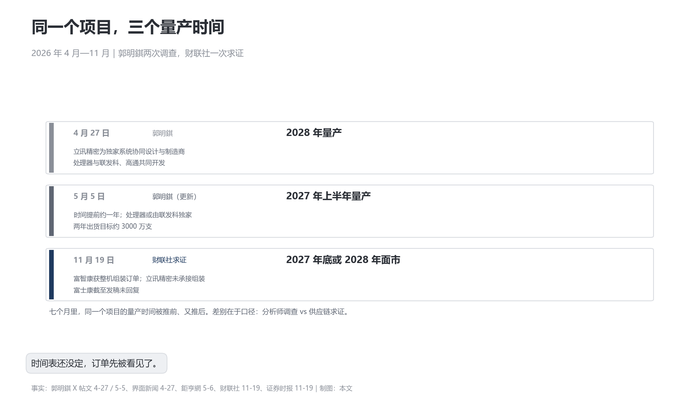
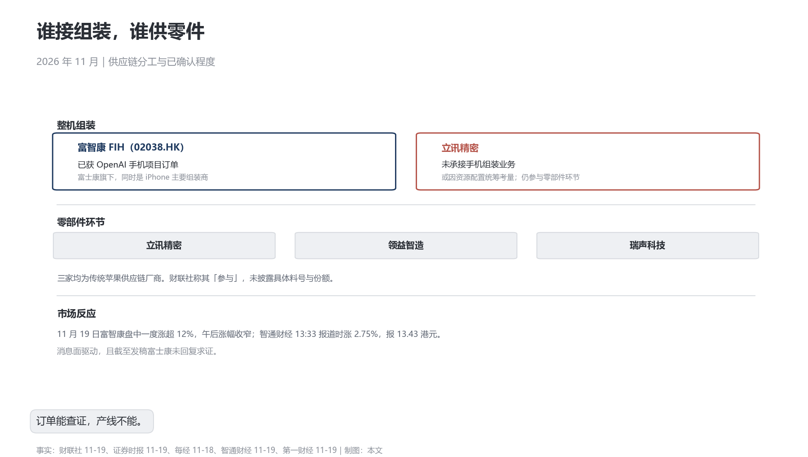
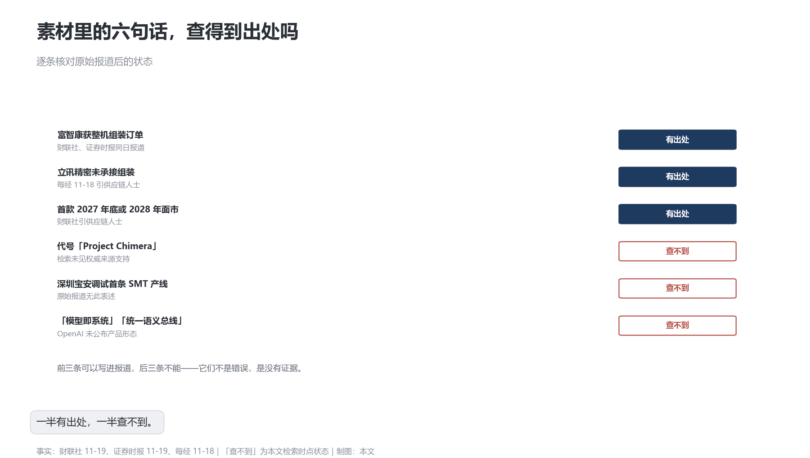

# OpenAI 手机的三个日期，和一条查不到的产线

11 月 19 日，财联社从消费电子核心供应链人士处得到一条消息：OpenAI 即将进军手机市场，首款产品有望在 2027 年底或 2028 年面市。

同一时间，证券时报也独家报道了同一件事，表述几乎一致。

供应链的答案很清楚：富士康旗下富智康（FIH，02038.HK）已获得 OpenAI 手机项目订单，将参与整机组装。立讯精密、领益智造、瑞声科技等传统果链厂商参与零部件环节。

但当天的传播里，混进了不少查不到出处的东西。

## 一、先说一个被漏掉的时间线

很多人以为这是新消息。其实这个项目已经传了七个月，而且量产时间改过两次。

4 月 27 日，天风国际分析师郭明錤首次披露：OpenAI 正与联发科、高通合作开发手机处理器，立讯精密为独家系统协同设计与制造商，预计 2028 年量产。消息当天立讯精密股价一度涨停。

5 月 5 日，他更新了调查：量产目标提前到 2027 年上半年，处理器可能改由联发科独家供应，两年出货目标约 3000 万支。

11 月 19 日，财联社的口径是：2027 年底或 2028 年面市。

七个月里，时间被推前，又被推后。这不是谁在说谎——分析师调查和供应链求证本来就是两种口径，前者看规划，后者看排产。

但素材只取了最后一条，把一个反复变动的进度，写成了确定的时间表。

## 二、真正的新变化在组装环节

这次消息里最实的一条，是立讯精密的角色变了。

4 月郭明錤说它是"独家系统协同设计及制造合作伙伴"。11 月 18 日晚间，每日经济新闻从供应链人士处获悉：立讯精密目前与 OpenAI 有多个产品的全面合作，但因资源配置的统筹考量，未承接手机组装业务。

接盘的是富智康。而富士康同时是苹果 iPhone 的主要组装商。

这个细节比"OpenAI 要做手机"更有信息量：一家做 AI 模型的公司，找的是给 iPhone 代工的那条产线。

市场的反应也很快。11 月 19 日富智康盘中一度涨超 12%，午后涨幅收窄，智通财经 13:33 报道时涨 2.75%，报 13.43 港元。

注意，截至发稿，富士康没有回复求证。订单是"据报"，不是"确认"。

## 三、查不到出处的那些

素材里最吸引人的几段，我逐条查了。

**"Project Chimera"**——检索没有找到任何权威来源，能证明这是 OpenAI 手机项目的内部代号。这个代号在公开信息里指向别的项目，和手机项目没有可靠关联。

**"富士康深圳宝安基地已开始调试首条 AI 手机 SMT 生产线"**——财联社和证券时报的原文里都没有这句话。原始报道明确写着"相关产品方案、订单规模及量产安排，仍有待进一步获悉"。

**"模型即系统""统一语义总线""取消应用抽屉"**——这些产品架构描述，原始报道没有披露，OpenAI 官方也没有公布产品形态。

这些不是错误，是没有证据。区别很重要：错误可以纠正，没有证据的说法连纠正的对象都没有。

## 写在最后

OpenAI 做手机这件事，大概率是真的。订单、供应商、时间窗口，都指向一个正在推进的项目。

但"AI 定义手机""溶解生态护城河""2027-2028 军备竞赛"这些判断，目前都建立在同一个前提上——这台手机真的会按现在说的时间做出来。

而这个时间表，七个月里已经改过两次。

**供应链的消息可以写，产品形态的想象先放一放。** 等到 OpenAI 自己开口，或者产线上真的下来第一台机器，再谈"重构人机交互"也不迟。

---

*事实来源：2026 年 11 月 19 日 12:56，财联社记者王碧微从消费电子核心供应链人士处获悉，OpenAI 即将进军手机市场，首款产品有望在 2027 年底或 2028 年面市；富士康旗下富智康（FIH，02038.HK）已获得 OpenAI 手机项目订单，将参与相关产品的整机组装；零部件等其他环节亦有立讯精密、领益智造、瑞声科技等多家传统果链厂商参与；财联社已向富士康求证，截至发稿未获回复（财联社 11 月 19 日）。同日证券时报/人民财讯独家报道同一消息，表述一致，并称"相关产品方案、订单规模及量产安排，仍有待进一步获悉"（证券时报 11 月 19 日）。2026 年 11 月 18 日晚间，每日经济新闻记者从供应链人士处获悉，立讯精密目前与 OpenAI 有多个产品的全面合作，或因资源配置的统筹考量未承接手机组装业务（每日经济新闻 11 月 18 日）。时间线：2026 年 4 月 27 日，天风国际分析师郭明錤发布产业调查，称 OpenAI 正与联发科、高通合作开发手机处理器，立讯精密为独家系统协同设计与制造商，预计 2028 年量产，规格与供应商最终拍板预计在 2026 年底至 2027 年一季度完成；消息当日立讯精密股价一度涨停、收涨逾 9% 至 71.97 元/股（郭明錤 X 帖文；界面新闻 4 月 27 日、IT之家 4 月 27 日、科创板日报 4 月 27 日、工商时报 4 月 28 日、21 经济网 4 月 28 日）。2026 年 5 月 5 日，郭明錤更新调查，量产目标提前至 2027 年上半年，处理器或由联发科独家取得（基于天玑 9600 客制化版本，台积电 N2P），2027 与 2028 两年合计出货目标约 3000 万支（郭明錤 X 帖文；鉅亨網 5 月 6 日、TechNews 5 月 5 日、NOWnews 5 月 5 日、环球网 5 月 6 日）。股价：11 月 19 日富智康（02038.HK）盘中一度涨超 12%，午后涨幅收窄，智通财经 13:33 报道时涨 2.75% 报 13.43 港元（新浪财经 11 月 19 日、智通财经 11 月 19 日、经济观察网 11 月 19 日、第一财经 11 月 19 日）。文中"七个月"指 2026 年 4 月 27 日至 11 月 19 日，为本文换算；"分析师调查看规划、供应链求证看排产"等为作者判断，非当事方表述。另需说明：素材称"截至 2026 年 11 月 19 日，OpenAI 进军智能手机市场的相关供应链消息已经得到多家权威消费电子行业媒体确认"，与事实基本相符（财联社、证券时报同日报道），但素材中"Project Chimera"为项目代号、"富士康深圳宝安基地已开始调试首条 AI 手机 SMT 生产线"、"模型即系统""统一语义总线""取消应用抽屉"等表述，经检索未见权威来源支持，原始报道亦无对应内容，本文未采用并已逐条标注；素材称"产品预计 2028 年量产"系引用郭明錤 4 月口径，未反映其 5 月已将量产目标提前至 2027 年上半年，本文补入该更新。本文不构成任何投资建议。*
