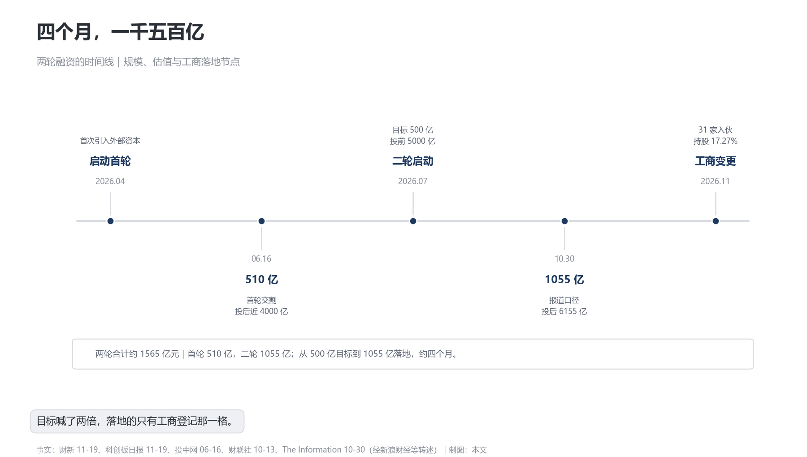
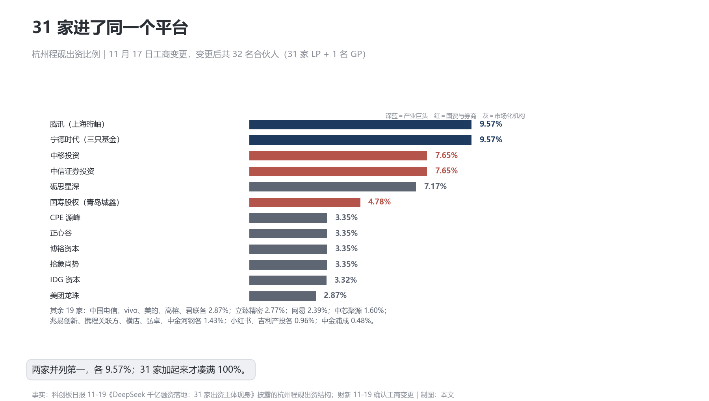
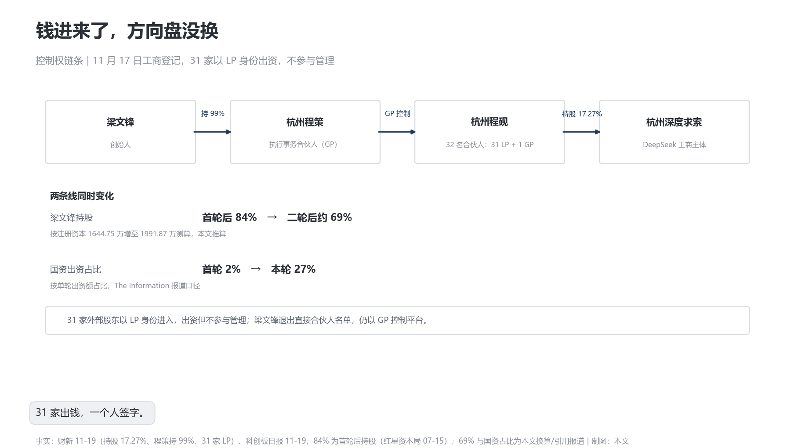

# 1055 亿进了工商登记，方向盘还在一个人手里

11 月 17 日，DeepSeek 的工商主体杭州深度求索完成了一次工商变更：注册资本从 1644.75 万元增至 1991.87 万元，增幅 21.1%；新增股东杭州程砚企业管理咨询合伙企业（有限合伙），持股约 17.27%。

财新和《科创板日报》在 11 月 19 日先后报道了这件事，标题都用了"千亿融资落地"。这一次，"落地"落的是工商登记那一格——也是整条消息里唯一能被独立核实的一格。

## 一、钱先进了一个合伙平台，没有直接进公司

同日完成变更的还有杭州程砚。这个平台的注册资本从 0.6 万元增至约 34.39 亿元，新增 31 家有限合伙人，变更后共 32 名合伙人；执行事务合伙人仍是杭州程策商务咨询有限公司。

31 家就是这一轮的外部出资方。腾讯旗下上海珩岫、宁德时代三只基金合计，出资比例都是 9.5653%，并列第一。中移投资、中信证券投资各 7.6522%；砺思星深 7.1740%；国寿股权相关主体 4.7826%；CPE 源峰、正心谷、博裕、拾象各 3.3479%；IDG 3.3236%；美团龙珠、中国电信、vivo、美的、高榕、君联各 2.8696%。

用一个平台装 31 家，是有讲究的：DeepSeek 的股东名册上只多出"杭州程砚"一个名字，而不是 31 个；出资方的钱在同一层归集，主体股权不被切碎。

## 二、1055 亿是媒体口径，公司一个字没说

金额出自 The Information 10 月 30 日的报道：第二轮 1055 亿元，投后估值 6155 亿元，近 30 家投资方，国资出资占比 27%（首轮 2%）。腾讯本轮 100 亿元、两轮合计 200 亿元；宁德时代本轮 100 亿元；梁文锋本人再出 20 亿元。

财新 11 月 19 日的稿子只写了工商变更，没有确认这个金额。DeepSeek 至今没有发布任何公告。

工商登记能核到的只有三样：平台拿了 17.27% 的股权、登记注册资本 34.39 亿元、31 家入伙。用 17.27% 和媒体估值倒推，17.27%×6155 亿≈1063 亿，和 1055 亿对得上——这是目前最硬的一条交叉验证。

有两处要小心。第一，34.39 亿元不等于融资额：登记注册资本只反映合伙人认缴，和平台实际投出去的钱不是一回事，拿它去除 1055 亿，会得出一个差 30 倍的错结论。第二，投前 5000 亿加 1055 亿等于 6055 亿，不是报道里的 6155 亿——5000 亿是 9 月投资人会议上的口径，6155 亿是 10 月底成交后的口径，中间隔着一个季度。

## 三、钱进来了，方向盘没换

梁文锋这次退出了杭州程砚的直接合伙人名单，但他持有杭州程策 99% 的股权，程策是杭州程砚的执行事务合伙人。31 家以 LP 身份出钱，不参与管理；方向由 GP 定。

按注册资本摊薄测算，他的持股从首轮后的 84% 降到约 69%（本文推算，未计其他股权变动）。三分之二还多，控制权没有悬念。

## 四、IPO 这条线比融资慢

9 月 9 日，21 世纪经济报道从知情人士处确认：中信证券已进场尽调，但双方尚未签订正式上市辅导协议；记者当时在浙江证监局官网查不到辅导备案。按辅导期不少于三个月的规定，9 月备案才赶得上年内递交申请。

9 月 21 日，原高瓴合伙人严文韬到岗出任 CFO，结束了这家公司三年的 CFO 空缺。

到 11 月 19 日，公开报道里仍是"计划年内启动上市流程"，没有出现辅导验收或申报被受理的消息。

## 写在最后

"千亿融资落地"这句话，准确的说法是：钱通过一个由创始人控制的合伙平台进了公司，31 家出资方的名字第一次出现在工商登记里。

金额、估值、时间表，目前还都是媒体口径，公司没有确认过其中任何一个数字。

融资落地是确定的。上市落地，还不是。

---

*事实来源：2026 年 11 月 17 日，杭州深度求索人工智能基础技术研究有限公司完成工商变更，注册资本由 1644.75 万元增至 1991.87 万元（增幅 21.1%），新增股东杭州程砚企业管理咨询合伙企业（有限合伙），持股约 17.27%；同日杭州程砚注册资本由 0.6 万元增至约 34.39 亿元，新增 31 家有限合伙人，变更后共 32 名合伙人，杭州程策商务咨询有限公司仍任执行事务合伙人，梁文锋退出杭州程砚直接合伙人名单但持有杭州程策 99% 股权（财新网 11 月 19 日 17:17《DeepSeek 完成工商变更 千亿融资落地》、科创板日报 11 月 19 日 12:44）。杭州程砚出资结构：腾讯旗下上海珩岫 9.5653%，宁德时代厦门时代怡远、厦门时代深远、福建时代泽远三只基金合计 9.5653%（4.9198%+4.4410%+0.2045%），中移投资控股、中信证券投资各 7.6522%，天津砺思星深 7.1740%，青岛城鑫致达 4.7826%，CPE 源峰、正心谷、博裕、拾象各 3.3479%，IDG 3.3236%，美团龙珠、中国电信、vivo、美的、高榕、君联各 2.8696%，立臻精密 2.7739%，网易 2.3913%，中芯聚源 1.5974%，兆易创新、上海科慧（携程关联）、横店柏晖、嘉兴弘卓、中金河钢各 1.4348%，小红书、吉利产投各 0.9565%，中金浦成 0.4783%（科创板日报 11 月 19 日）。融资规模 1055 亿元、投后估值 6155 亿元、近 30 家投资方、国资出资占比 27%（首轮 2%）、腾讯本轮 100 亿元（两轮合计 200 亿元）、宁德时代本轮 100 亿元（两轮合计 150 亿元）、梁文锋本轮再出资 20 亿元、国家人工智能产业投资基金 10 亿元、中国移动与中信证券各 80 亿元、中国电信/中金/国寿 20 亿至 80 亿元、长鑫存储/中芯国际/vivo/美团/美的/立讯/吉利/携程/小红书单家 10 亿至 30 亿元，均出自 The Information 10 月 30 日报道，经新浪财经、CNMO、观点网、通信世界网、PANews 等转述（截至发稿 DeepSeek 未发布官方公告）。首轮：2026 年 6 月 16 日完成，约 510 亿元，投后估值近 4000 亿元，梁文锋个人出资约 200 亿元、腾讯约 100 亿元、宁德时代体系约 50 亿元、网易/京东/砺思/IDG 各约 30 亿元（投中网 6 月 16 日、投资界 6 月 16 日、企查查数据经凤凰网 6 月 18 日转述）；首轮后梁文锋持股 84%（红星资本局 7 月 15 日）。二轮：7 月中旬启动，初始目标 500 亿元，10 月中旬两度上调至约 1000 亿元，投前估值约 5000 亿元（财联社 10 月 13 日、WSJ 与彭博 10 月 22 日）。IPO：中信证券 9 月 9 日已进场尽职调查、尚未签订正式上市辅导协议，当时浙江证监局官网查不到辅导备案，按规定辅导期不少于三个月（21 世纪经济报道 9 月 9 日）；严文韬 9 月 21 日到岗任 CFO（路透社 9 月 14 日、华尔街见闻 9 月 22 日）。本文换算与推算：510+1055≈1565 亿元；17.27%×6155 亿元≈1063 亿元（用于与 1055 亿元交叉验证）；5000+1055=6055 亿元，与报道的投后 6155 亿元相差 100 亿元；84%×（1644.75÷1991.87）≈69%，为二轮后持股的粗略推算，未计其他股权变动；上述换算非当事方口径。"钱先进了平台""方向盘没换""融资落地是确定的、上市落地还不是"等为作者判断，非当事方表述。另需说明：本文素材为百度搜索"DeepSeek 千亿融资落地"的结果页，其中多数为转载稿；核对原文后，可核实的事实是 11 月 17 日的工商变更，而"1055 亿元""6155 亿元"仍为媒体口径，公司未确认；部分转载稿把杭州程砚约 34.39 亿元的登记注册资本误写为"约 343.9 亿元"，与工商登记的"343897.9 万元"换算结果不符，本文按 34.39 亿元处理。*

*文中"17.27%""31 家""99%"等均为工商登记口径；"1055 亿元""6155 亿元""27%"等为媒体报道口径。两类数字不能混用。*
