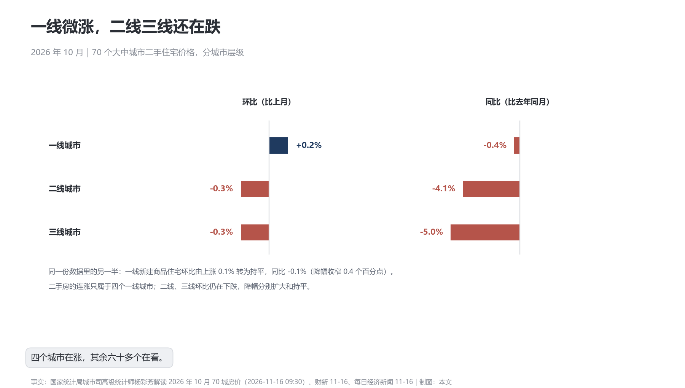
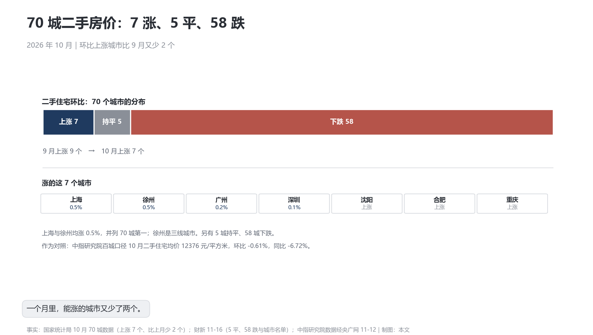
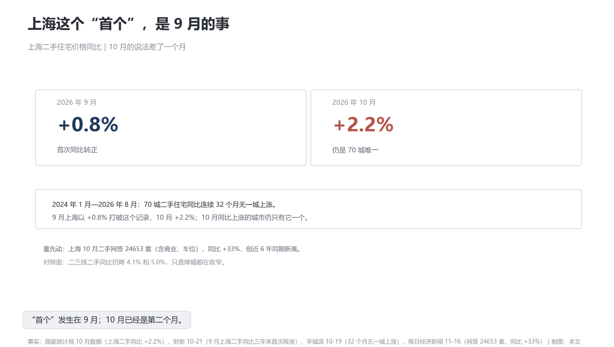

# 一线二手房连涨 8 个月，70 城里还有 58 个在跌

11 月 16 日，国家统计局发布 2026 年 10 月 70 个大中城市房价数据。一线城市二手住宅销售价格环比上涨 0.2%，涨幅与上月相同，自今年 3 月以来连续第 8 个月上涨。

同一份数据里，70 个城市中二手住宅环比上涨的只有 7 个，比 9 月少了 2 个；5 个持平，58 个下跌。

"连涨 8 个月"是真的，"房价在涨"不是。

## 一、这句话的主语是四个城市

0.2% 是一线四城的加权结果：上海涨 0.5%，广州涨 0.2%，深圳涨 0.1%，北京持平。

同一份统计里，新房已经掉头：一线新建商品住宅环比由上月的上涨 0.1% 转为持平，北京环比下降 0.1%；二线、三线新房分别下降 0.1% 和 0.2%。

二手房的二线、三线也不好看：环比都下降 0.3%，其中二线的降幅比上月还扩大了 0.1 个百分点。

所以"连涨 8 个月"描述的是四个城市的二手房，不是 70 个城市，也不是新房。

## 二、7 涨、5 平、58 跌

10 月二手住宅环比上涨的 7 个城市是：上海、广州、深圳、沈阳、合肥、重庆、徐州。上海和徐州都涨 0.5%，并列第一——徐州是三线城市。

下跌的 58 个，占了 70 城的八成多。9 月上涨城市还有 9 个，一个月里少了 2 个。

换一套样本，结论更冷。中指研究院的百城口径显示，10 月百城二手住宅均价 12376 元/平方米，环比跌 0.61%，跌幅比 9 月还扩大 0.01 个百分点；同比跌 6.72%；100 个城市里只有 1 个环比上涨。

70 城和 100 城是两套样本，不能直接比大小，但方向一致：价格修复是点状的。

## 三、上海这个"首个"，是 9 月的事

素材里有一句需要校正："上海成为全国首个二手房价格同比上涨城市。"

准确的时间点是 9 月。2024 年 1 月到 2026 年 8 月，70 城二手住宅同比连续 32 个月没有一个城市上涨；9 月上海以同比上涨 0.8% 打破这个记录，成为首个转正的城市。

10 月上海同比上涨 2.2%，仍然是 70 城里唯一一个同比上涨的。所以 10 月的上海是"唯一"，不是"首个"——首个发生在 9 月，晚一个月写，就错了一个月。

另外两个细节值得记住：沈阳是二线城市里第一个二手房价同比止跌的；上海 10 月二手网签 24653 套（含商业、车位），同比涨 33%，创近 6 年同期新高。

## 四、量在价先

价格还在磨，成交量已经回来了。1—10 月全国二手房交易网签面积 67971 万平方米，同比增长 11.4%，增幅比前 9 个月扩大 0.7 个百分点；10 月单月二手网签同比涨 18.9%，也是自 3 月以来连续第 8 个月同比增长。

挂牌量在减。据普睿数智云监测，4 个一线城市 9 月末挂牌量合计 41.18 万套，比 4 月末减少 1.35 万套，四个城市全部回落。

财新给的解释比较克制：业主降低出售预期，价格回调让此前观望的需求得以释放，成交量因此率先改善，但未必意味着价格已经具备持续回升的动力。

## 写在最后

10 月这组数据里，三件事同时成立：涨的是一线四城的二手房价，跌的是 58 个城市的二手房价，改善的是一二三线的同比降幅。

"连续 8 个月上涨"适合当标题，"房价稳了"不适合当结论。

接下来值得盯的是两个数：70 城里上涨城市的个数——现在是 7 个，还在减少；二手房的成交量——还在增加。价格要跟上，得先看到前一个数字掉头。

---

*事实来源：2026 年 11 月 16 日 09:30，国家统计局城市司高级统计师杨彩芳解读 2026 年 10 月份商品住宅销售价格变动情况：一线城市二手住宅销售价格环比上涨 0.2%（涨幅与上月相同），其中上海、广州、深圳分别上涨 0.5%、0.2%、0.1%，北京持平；二线、三线二手住宅环比均下降 0.3%（二线降幅扩大 0.1 个百分点，三线与上月相同）；一线二手住宅同比降 0.4%（降幅收窄 1.1 个百分点），北京、广州、深圳分别降 1.5%、1.8%、0.5%，上海涨 2.2%；二线、三线二手同比分别降 4.1%、5.0%，降幅均收窄 0.4 个百分点；一线新建商品住宅环比由上涨 0.1% 转为持平（上海 +0.2%、深圳 +0.1%、广州持平、北京 -0.1%），同比降 0.1%；二线、三线新房环比分别降 0.1%、0.2%，同比分别降 2.0%、3.6%；70 城中新建商品住宅环比上涨城市 14 个（比上月减少 3 个），二手住宅环比上涨城市 7 个（比上月减少 2 个）（国家统计局解读稿，2026-11-16）。二手住宅环比上涨的 7 个城市为上海、广州、深圳、沈阳、合肥、重庆、徐州，上海与徐州均涨 0.5% 居首；另有 5 个持平、58 个下跌；前 10 个月全国二手房交易网签面积 67971 万平方米，同比增长 11.4%，增幅较前 9 个月扩大 0.7 个百分点（财新网 11-16；网签面积原始数据来自住房和城乡建设部）。“自今年 3 月以来连续 8 个月环比上涨”见每日经济新闻 11-16；9 月二手住宅环比上涨城市为 9 个（羊城派 10-19）。上海二手住宅同比首次转正发生在 2026 年 9 月，同比涨 0.8%，此前 2024 年 1 月至 2026 年 8 月，70 城二手住宅同比连续 32 个月无一城市上涨；10 月上海同比涨 2.2%，仍是 70 城中唯一同比上涨的城市，沈阳为二线城市中首个同比止跌的城市（财新网 10-21《9 月上海二手房价三年来首次同比转涨》、羊城派 10-19、每日经济新闻 11-16）。上海 10 月二手网签 24653 套（含商业、车位），环比涨 10.9%、同比涨 33%，创近 6 年同期新高；自 3 月以来连续 8 个月在 2.3 万套以上（网上房地产数据，经每日经济新闻 11-16）。中指研究院：2026 年 10 月百城二手住宅平均价格 12376 元/平方米，环比下跌 0.61%（跌幅较 9 月扩大 0.01 个百分点），同比下跌 6.72%，100 城中 1 城环比上涨、98 城下跌、1 城持平（央广网 11-12）。10 月单月全国二手房网签同比涨 18.9%，为 3 月以来连续第 8 个月同比增长；4 个一线城市 9 月末二手挂牌量合计 41.18 万套，较 4 月末减少 1.35 万套（广东省城规院住房政策研究中心首席研究员李宇嘉、普睿数智云监测数据，均经每日经济新闻 11-16 转述）。本文换算与判断：“58 个占 70 城的八成多”“价格修复是点状的”“连涨适合当标题、房价稳了不适合当结论”等为作者表述，非当事方口径；70 城与中指百城为两套不同样本，不可直接比较。另需说明：本文素材称“10 月一线二手住宅环比上涨 0.2%、连续 8 个月上涨，上海成为全国首个二手房价格同比上涨城市”，前两句属实；但“首个”的时点在 9 月而非 10 月——上海 9 月二手住宅同比已转正（+0.8%），是 2024 年 1 月以来首个同比上涨的城市，10 月（+2.2%）是第二个同比上涨的月份、也是当月 70 城中唯一一个。*

*文中"环比"指比上月，"同比"指比去年同月；70 城为 4 个一线、31 个二线、35 个三线城市，由国家统计局按月发布。*
