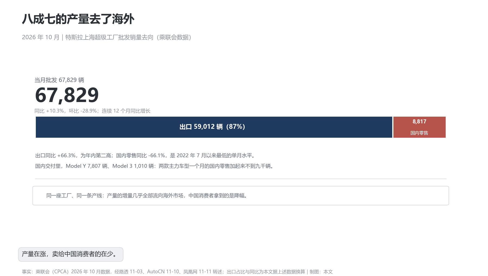
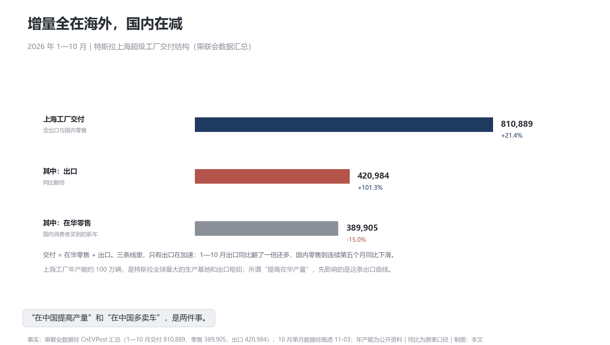
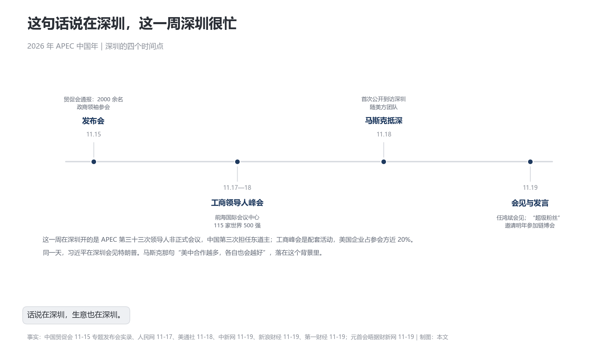

# "我是中国的超级粉丝"，后半句是继续提高产量

11 月 19 日，深圳。中国贸促会会长任鸿斌会见特斯拉 CEO 埃隆·马斯克。

马斯克说："我是中国的超级粉丝。"他说中国很酷，一直鼓励世界各地的人们来中国走走，亲眼看看那些了不起的地方；他还说，美中合作越多，各自也会越好。

同一场会见里，他还有一句更实的：特斯拉会继续在中国提高产量。

前三句是形容词，最后一句是动词。素材里的话都能对上原文，值得往下看的，是这句动词落在一个什么位置上。

## 一、车在中国造，越来越多的车卖到国外

乘联会数据：10 月特斯拉中国批发 67,829 辆，同比涨 10.3%，环比降 28.9%。拆开看，上海工厂出口 59,012 辆，占批发的 87%；国内零售 8,817 辆，同比降 66.1%，是 2022 年 7 月以来最低的单月水平，也是国产化以来最差的 10 月。

8,817 辆是什么概念：Model Y 7,807 辆，Model 3 1,010 辆。两款在售车型加起来不到九千辆，这是 2022 年 7 月以来国内零售首次跌破一万辆，也是连续第五个月同比下滑。

出口那边是另一个样子：59,012 辆，同比涨 66.3%，为年内第二高。

## 二、把前十个月摊开看

1—10 月，上海工厂累计交付 810,889 辆，同比涨 21.4%。其中在华零售 389,905 辆，同比降 15.0%；出口 420,984 辆，同比涨 101.3%。

出口已经超过国内零售。这座年产能约 100 万辆的工厂，事实上从"给中国市场供货"变成了"给全球供货、顺带卖中国"。今年上半年，上海工厂交付近 46.8 万辆，同比涨 28.4%。

这也解释了"继续提高产量"这句话的重量：它主要不是说给中国消费者听的，是说给产线和船期听的。

## 三、这句话说在一个什么场合

11 月 17—18 日，APEC 工商领导人峰会在深圳前海国际会议中心举行，中国贸促会主办，主题"共促繁荣，共赢未来"。2000 余名政商界领袖到场，其中 115 家《财富》世界 500 强企业；美国企业是东道主以外规模最大的参会方，占比近 20%。这是 APEC 第三十三次领导人非正式会议的配套活动，也是中国第三次担任 APEC 东道主。

马斯克 18 日抵达深圳，这是他首次公开到访深圳；据中新网报道，他此行是随美方团队到访。19 日除了会见，他还远程连线了在美国奥斯汀举行的 TomorrowX Summit，说的还是"我是中国的粉丝，我总是鼓励人们来中国走走"。他在社交平台上写，所谓"修昔底德陷阱"是可以避免的。

同一天，习近平在深圳会见特朗普。

## 写在最后

央视的标题用了"再次推荐"——这四个字说明，这句话不是第一次说。

"超级粉丝"能换来多少订单，10 月的零售数字已经回答了；"继续提高产量"能带来多少投资，还要看接下来的产能安排——据报道，马斯克在会见中没有给出增产的具体目标和时间表。

所以这句话的分量不在形容词。在它后面跟着的那半个句子。

---

*事实来源：2026 年 11 月 19 日，美国特斯拉公司首席执行官埃隆·马斯克在深圳说"我是中国的超级粉丝"，并称"中国很酷。我一直鼓励世界各地的人们来中国走走，亲眼看看中国这些了不起的地方。这里有不可思议的城市、不可思议的自然风光，还有像兵马俑这样的世界奇迹""美中合作越多，各自也会越好"；中国贸促会会长任鸿斌当天在深圳会见马斯克（新华社 11 月 19 日 13:18 电稿，京报网、光明网、香港文汇报同源转载；央视新闻客户端同日稿，央广网 14:51 转载，标题为《马斯克 APEC 再次推荐！"我是中国的超级粉丝"》）。央视财经报道，马斯克表示特斯拉会继续在中国提高产量，并称其点赞中国铁路系统、推荐上海、北京、西安，建议体验京沪高铁效率；这是他首次公开到访深圳（新浪财经 11 月 19 日转央视财经）。中新网 11 月 19 日报道，马斯克 2026 年 APEC 会议期间随美方团队到访深圳，并远程连线在美国得克萨斯州奥斯汀举行的 TomorrowX Summit，称"我是中国的粉丝，我总是鼓励人们来中国走走"。马斯克在社交平台称"修昔底德陷阱"能够被避免（新浪财经 11 月 19 日）。中国贸促会会长邀请马斯克明年参加中国国际供应链促进博览会（第一财经 11 月 19 日 17:22）。APEC 背景：2026 年为 APEC 中国年，中国第三次担任东道主；APEC 第三十三次领导人非正式会议在深圳举行；工商领导人峰会 11 月 17—18 日在深圳前海国际会议中心举办，由中国贸促会主办，主题"共促繁荣，共赢未来"，20 余个经济体 2000 余名政商界领袖参会，含 115 家《财富》世界 500 强企业，美国企业占参会方近 20%（中国贸促会 11 月 15 日专题新闻发布会实录、人民网深圳 11 月 17 日、美通社 11 月 18 日、中国政府网 11 月 16 日）。11 月 19 日习近平在深圳会见特朗普（财新网 11 月 19 日）。特斯拉数据（乘联会 CPCA）：2026 年 10 月中国批发销量 67,829 辆，同比 +10.3%、环比 -28.9%；其中上海工厂出口 59,012 辆，同比 +66.3%，占批发 87%；国内零售 8,817 辆，同比 -66.1%，为 2022 年 7 月以来最低，连续第五个月同比下滑，首次跌破一万辆，其中国内交付 Model Y 7,807 辆、Model 3 1,010 辆（乘联会数据，经路透社 11 月 3 日、AutoCN 11 月 10 日、凤凰网 11 月 11 日转述）。1—10 月上海工厂交付 810,889 辆（同比 +21.4%），其中在华零售 389,905 辆（同比 -15.0%）、出口 420,984 辆（同比 +101.3%），交付＝零售＋出口（乘联会数据经 CnEVPost 汇总）。上海超级工厂年产能约 100 万辆、为特斯拉最大生产基地与出口枢纽（公开资料）；2026 年上半年交付近 46.8 万辆，同比 +28.4%（动点科技 11 月 19 日）。本文判断："前三句是形容词，最后一句是动词""主要不是说给中国消费者听，是说给产线和船期听""分量不在形容词"等为作者表述，非当事方口径；出口占比 87%、出口超过国内零售、年化等为本文据上述数据换算。另需说明：素材称"马斯克在深圳表示'我是中国的超级粉丝'，称中国很酷、鼓励世界各地的人们来中国走走，并指出美中合作越多各自也会越好；同日中国贸促会会长任鸿斌在深圳会见马斯克"，四处表述均与新华社、央视原稿一致，未作改动；本文补充的是这场会见发生的地点背景（APEC 工商领导人峰会所在的深圳）与同期的产销数据，以及"会继续在中国提高产量"这一句素材未收录的表态。*

*文中"批发销量"指工厂出货给经销商与出口的总量，"零售"指在中国市场交付给消费者的数量，两个口径不可直接相加比较月度增速。*
