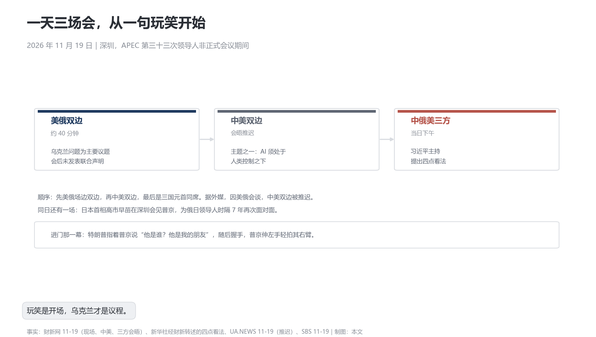
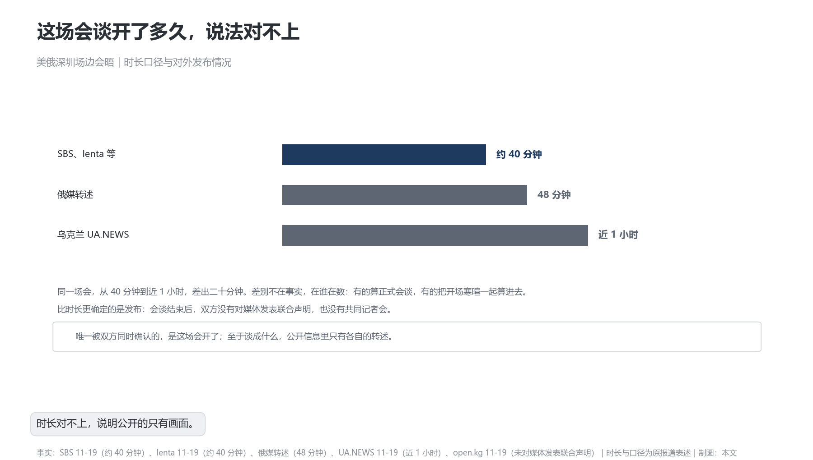
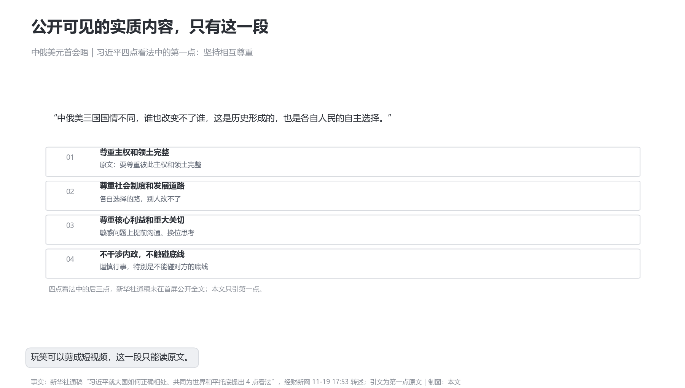

# 一句"他是谁"之后，四十分钟谈的是乌克兰

11 月 19 日，深圳。来华出席 APEC 第三十三次领导人非正式会议的美国总统特朗普，与俄罗斯总统普京在场边见了面。

画面先到。身着蓝色领带的特朗普走进布置着美俄两国国旗的房间，伸出右手指向系深红色领带的普京，笑着说："他是谁？他是我的朋友。"随后两人握手，普京同时伸出左手，轻拍了一下特朗普的右臂。特朗普说"很高兴见到你"，又凑近普京的右耳低声说了句什么。

素材里写的"笑着打趣""友好寒暄、握手致意"，与现场视频一致。

## 一、玩笑出现在什么位置

这不是峰会的正式环节，是一场场边双边。当天下午，习近平在深圳同普京、特朗普举行中俄美元首会晤。

顺序是：先美俄双边，再中美双边，最后三国元首同席。据外媒报道，因为美俄这场会谈，原定的中美双边被推迟。美方随行人员里，有国务卿鲁比奥和财长贝森特。

## 二、玩笑之后，谈的是乌克兰

财新当天报道的标题写得很直：乌克兰问题成主要议题。

特朗普在开场部分说，两人相识已久，这次会晤"或许能促成许多美好的事物，或者至少是一个良好的开端"。韩国的 SBS 注意到，普京"心情很好"。

会谈结束后，双方没有对媒体发表联合声明，也没有共同记者会。

时长则各说各话：SBS 和 lenta 等称约 40 分钟，俄媒转述为 48 分钟，乌克兰的 UA.NEWS 称近一小时。同一场会，从 40 分钟到近 60 分钟，差出二十分钟——差别不在事实，在谁在数：有的只算正式会谈，有的把开场寒暄一起算进去。

## 三、当天真正有文本的，是下午那一场

中俄美元首会晤上，习近平就大国如何正确相处、共同为世界和平托底提出四点看法。公开可见的第一点是"坚持相互尊重"：

"中俄美三国国情不同，谁也改变不了谁，这是历史形成的，也是各自人民的自主选择。"接下来是几句具体要求：尊重彼此主权和领土完整，尊重各自选择的社会制度和发展道路，尊重彼此核心利益和重大关切；坚持不干涉别国内政，在涉及对方的重大敏感问题上提前沟通、换位思考、谨慎行事，特别是不能触碰对方的底线。

同一天还有两场：习近平会见特朗普，主题之一被概括为"中美应确保人工智能始终处于人类控制之下"；日本首相高市早苗也在深圳见了普京，这是俄日领导人时隔 7 年再次面对面。

## 写在最后

一句玩笑能上标题，因为它便宜、清楚、有人笑。

一场会谈有没有成果，要看有没有文本。美俄这场，公开信息里没有联合声明，也没有共同记者会，能核到的只有时长、开场几句话和几张照片。

"他是谁"回答的是关系——这是我的朋友。乌克兰的答案不在那四十分钟里，也不在这句话里。

---

*事实来源：2026 年 11 月 19 日，来华出席 APEC 第三十三次领导人非正式会议的美国总统特朗普与俄罗斯总统普京在深圳举行会晤。现场视频显示，身着蓝色领带的特朗普步入布置着美俄两国国旗的房间，伸出右手指向身着深红色领带的普京，面带笑容说道"他是谁？他是我的朋友"；随后握手，普京同时伸出左手轻拍特朗普右臂；特朗普说"很高兴见到你"并靠近普京右耳耳语（财新网 11 月 19 日 16:25《特朗普普京在深圳会晤 乌克兰问题成主要议题》；澎湃新闻 11 月 19 日 15:16 同题短视频；TVB 无线新闻 11 月 19 日 12:32 现场报道）。特朗普称两人相识已久，此次会晤"或许能促成许多美好的事物，或者至少是一个良好的开端"（凤凰网，经新浪新闻 11 月 19 日转载）；美方随行包括国务卿鲁比奥、财长贝森特（lenta 11 月 19 日）。会谈时长：韩国 SBS 与 lenta 等称约 40 分钟，俄媒转述为 48 分钟，乌克兰 UA.NEWS 称近一小时并称因美俄会谈中美双边会晤推迟（SBS 11 月 19 日、lenta 11 月 19 日、bankingnews 11 月 19 日转述俄媒、UA.NEWS 11 月 19 日）；会后双方未对媒体发表联合声明（open.kg 11 月 19 日）。当日下午，国家主席习近平在深圳同普京、特朗普举行中俄美元首会晤，就大国如何正确相处、共同为世界和平托底提出 4 点看法，第一点为"坚持相互尊重"，内容包括"中俄美三国国情不同，谁也改变不了谁……""要尊重彼此主权和领土完整，尊重各自选择的社会制度和发展道路，尊重彼此核心利益和重大关切""要坚持不干涉别国内政……特别是不能触碰对方的底线"（新华社通稿，经财新网 11 月 19 日 17:53 转述；后三点通稿首屏未全文公开，本文只引第一点）。同日习近平会见特朗普，主题之一为"中美应确保人工智能始终处于人类控制之下"；日本首相高市早苗在深圳会见普京，为俄日领导人时隔 7 年再次面对面（财新网 11 月 19 日）。本文判断："玩笑便宜、清楚、有人笑""有没有成果要看有没有文本""'他是谁'回答的是关系"等为作者表述，非当事方口径。另需说明：素材称特朗普"打趣问道'这是谁？'随即表示'这是我的朋友'"，现场报道与视频转述的中文多为"他是谁？他是我的朋友"，指代对象同为普京、意思一致，本文按现场报道的"他是谁"行文；素材未提及当日下午的中俄美元首会晤、中美双边会晤与美俄会谈后的发布情况，这三项为本文补充。*

*文中会谈时长均为各家媒体表述，非双方官方口径；"没有联合声明"指未对媒体发表联合声明，不等于没有其他形式的沟通。*
