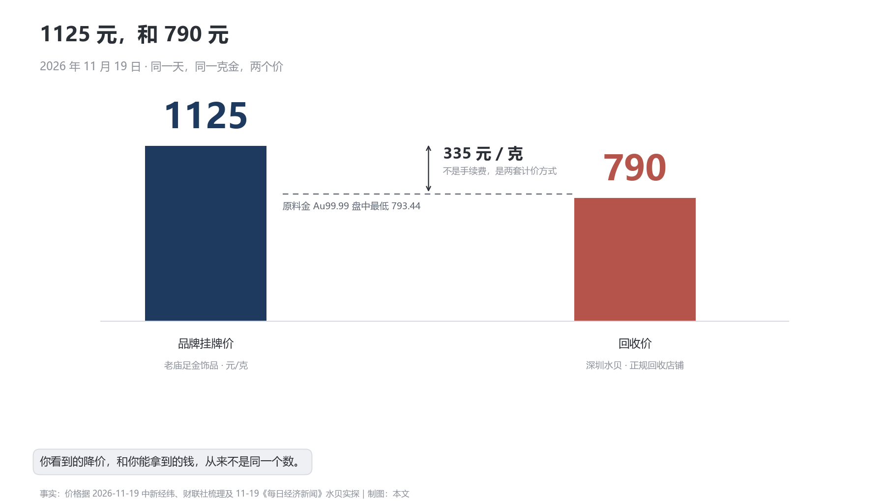
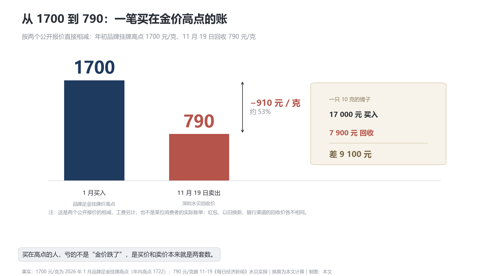
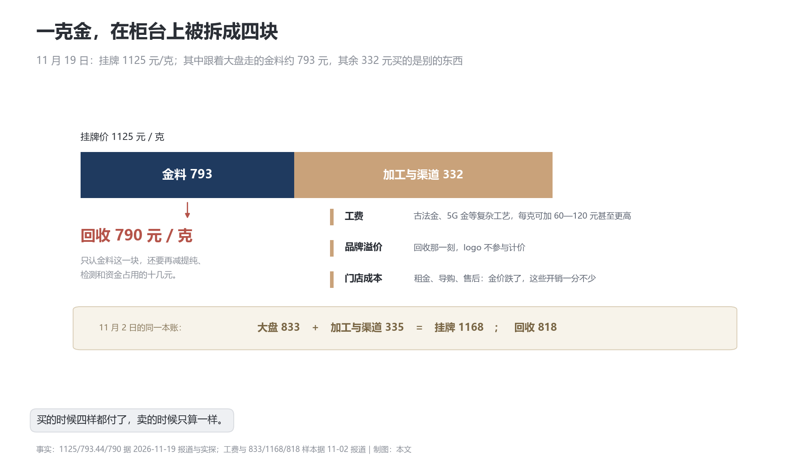

# 1125 元挂牌，790 元回收：同一克金，两个价

11 月 19 日，老庙黄金足金饰品挂牌 1125 元一克。同一天上午，深圳水贝，一家回收店的报价是 790 元一克。几分钟后再问，789。

同一克金子，柜台和秤上差 335 元。

今年 1 月底，一线品牌足金挂牌价普遍站上 1700 元一克。那时买一只 10 克的镯子，按 1700 算是 17000 元；11 月 19 日按 790 变现，拿回 7900 元。差 9100 元，工费还没算进去。

## 一、跌的是挂牌价

11 月 19 日是品牌金饰连续第 8 个交易日下跌。老庙报 1125 元，较年内高点 1722 元跌 597 元，回撤接近 35%；老凤祥、周大福都报 1132 元，较高点分别跌 581 元、574 元。

国际金价当天一度跌破 3700 美元/盎司，最低 3693.17 美元，创 2025 年 9 月以来新低。上海金 Au99.99 开盘 810 元，盘中最低 793.44 元，跌破 800 元关口。

第二天（11 月 20 日）又跌一轮：老庙 1080 元，老凤祥 1090 元，周大福 1088 元，全线跌破 1100 元。

这些说的都是"买"的价。

## 二、1700 买进，790 卖出

一只 10 克的镯子，1 月按 1700 元一克买入，花 17000 元；11 月 19 日按 790 元一克回收，拿回 7900 元。差 9100 元。

这里面有两层。一层是金价本身跌了：1 月底现货黄金见顶 5598.75 美元/盎司，11 月 19 日盘中最低 3693.17 美元，跌幅超过三成。这一层，走哪个渠道都躲不掉。

另一层是买入价里那些非金料的部分，在回收那一刻归零。

## 三、回收只认金料

回收的算法只有一条：当日大盘价 × 实测纯度 × 实际克重，再减服务费。11 月 19 日水贝的 790 元就是这么来的——比 Au99.99 的 793.44 元还低几块钱，那是回收商的费用和风险。

而 1125 元的挂牌价里，除了金料还有三样：工费（古法金、5G 金等复杂工艺每克可加 60 到 120 元甚至更高）、品牌溢价（回收时 logo 不参与计价）、门店成本（租金、导购、售后，金价跌了这些开销一分不少）。

买的时候四样都付了，卖的时候只算一样。

渠道不同，结果也不同。品牌金店做回收，报价通常比水贝高，但要扣损耗和手续费：周大福官方页面显示的回收服务金价约 814 元一克，自有品牌旧金每克扣 20 到 30 元损耗，非本品牌 28 到 35 元，另收回收总额 5% 左右手续费；老凤祥自有金每克扣 25 到 30 元，外品牌 30 到 35 元，手续费约 8%。银行基本只回收本行卖出的投资金条，首饰金多数不受理。

所以"能拿回多少"，取决于走哪个渠道，不只看当天金价。

## 四、回收价自己也在跌

杭州一位做黄金回收的店主算过：9 月 8 日回收价还是 938 元一克，到 11 月 19 日跌破 800，两个多月跌了 148 元。一只 50 克的镯子，光这一段就差 7400 元。

这个数容易被读成"买入卖出的差"，其实它只是回收价自己的跌幅，还没算买的时候付的工费和溢价。

## 写在最后

11 月 12 日，上金所 Au99.99 收 851.33 元，足金 999 主流回收价落在 840 到 850 元。一周之后，水贝报 790。不是哪一家店在压价，是大盘自己在往下走。

"金价跌了多少"和"你亏了多少"是两个问题。挂牌价跌 597 元，说的是标签；回收价从 938 掉到 790，说的是你手里的东西。

不劝买，也不劝卖。只留一个问题：你家里那只镯子，买的时候多少钱一克，现在拿去回收能拿回多少一克——这两个数，你都知道吗？

---

*事实来源：2026 年 11 月 19 日老庙黄金足金饰品报 1125 元/克（较前一日跌 25 元），较年内高点 1722 元/克跌 597 元、回撤接近 35%；老凤祥报 1132 元/克（8 日跌 104 元，较高点跌 581 元）、周大福报 1132 元/克（8 日跌 107 元，较高点跌 574 元）；国内品牌金饰价格连续第 8 个交易日下跌（中新经纬梳理，经中华网 11-19 转述；界面新闻 11-19《金饰克价跌至1125元》）。同日伦敦现货黄金一度跌破 3700 美元/盎司，最低 3693.17 美元，为 2025 年 9 月以来 14 个月新低；上海黄金交易所 Au99.99 开盘 810.0 元/克、盘中最低 793.44 元/克；深圳水贝市场屏幕挂牌价 959 元/克（含税）、实际购买 847 元/克、回收 790 元/克，数分钟后报 789 元/克，可付定金锁价（《每日经济新闻》2026-11-20 水贝实探，记者潘婷）。11 月 20 日老庙 1080 元/克（跌 52 元）、周生生 1089 元/克（跌 43 元）、周大福 1088 元/克（跌 44 元）、老凤祥 1090 元/克（跌 42 元），整体区间下移至 1080—1090 元/克（财联社 11-20）。2026 年 1 月底一线品牌足金饰品挂牌价普遍站上 1700 元/克，现货黄金 1 月 29 日见顶 5598.75 美元/盎司（《每日经济新闻》2026-11-01、2026-11-20）；周生生 1 月 29 日年内高点 1708 元/克（九派新闻转长江日报 11-16）。回收计价公式与品牌金店扣项（周大福回收服务金价约 814 元/克、自有品牌旧金每克扣 20—30 元、非本品牌 28—35 元、另收回收总额约 5% 手续费；老凤祥自有金每克扣 25—30 元、外品牌 30—35 元、手续费约 8%；银行回购主要面向本行投资金条）见腾讯新闻 2026-11-14《年初1700元/克买的金饰，现在变现每克为何只拿回约849元？》。杭州回收店主"9 月 8 日回收价 938 元/克、2 个多月跌至 800 元以下，50 克手镯相差 7000 多元"见新重庆-重庆晨报 2026-11-20（转潮新闻）。11 月 12 日上金所 Au99.99 收 851.33 元/克、足金 999 主流回收价 840—850 元/克见腾讯新闻 2026-11-12。本文换算："10 克按 1700 买入 17000 元、按 790 回收 7900 元、差 9100 元""1125 与 790 相差 335 元""(938−790)×50≈7400 元"均为两个公开报价的直接相减或相乘，工费另计，不代表任何一位消费者的实际账单；红包、以旧换新、银行渠道的回收价与扣项各不相同。需说明：原始素材中"1700 元/克买入、840 元变现，10 克相差 3640 元"一句数字不成立——1700 与 840 相差 860 元/克，10 克应为 8600 元；3640 元实出自另一组报价（11 月 3 日周大福足金挂牌 1185 元/克、回收参考价 821 元/克，10 克相差 3640 元，见澎湃新闻 2026-11-08 转开屏新闻昆明走访），两组报价被混算。另，"840—850 元回收"对应的是 11 月 12 日前后行情，至 11 月 19 日水贝回收已降至 790 元/克，本文按核实后的同期数据并列，未沿用素材的跨日期组合。*

*文中"回撤"指较年内最高点的跌幅；金饰挂牌价为品牌足金饰品零售报价，含工费与品牌溢价，与上海金 Au99.99 原料价不是同一口径。*
