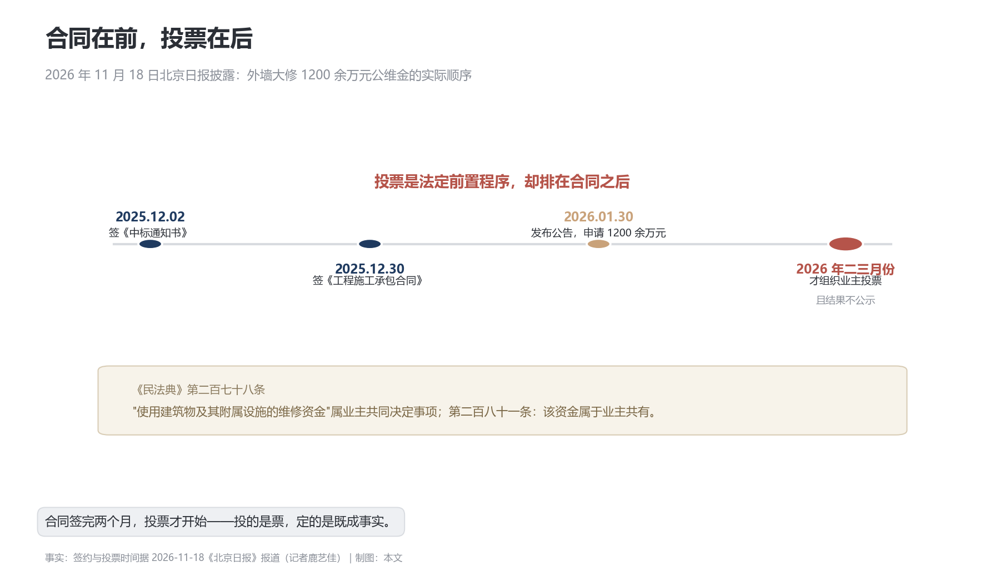
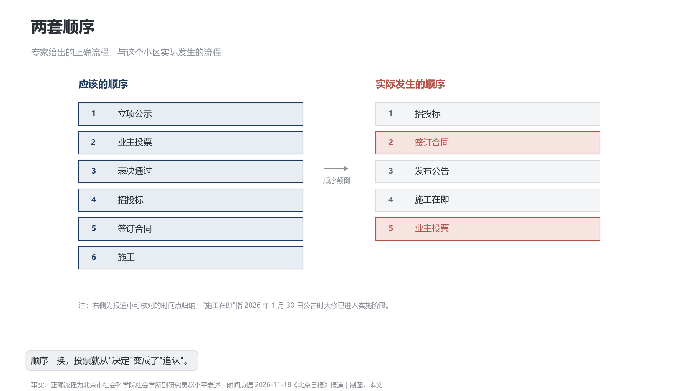
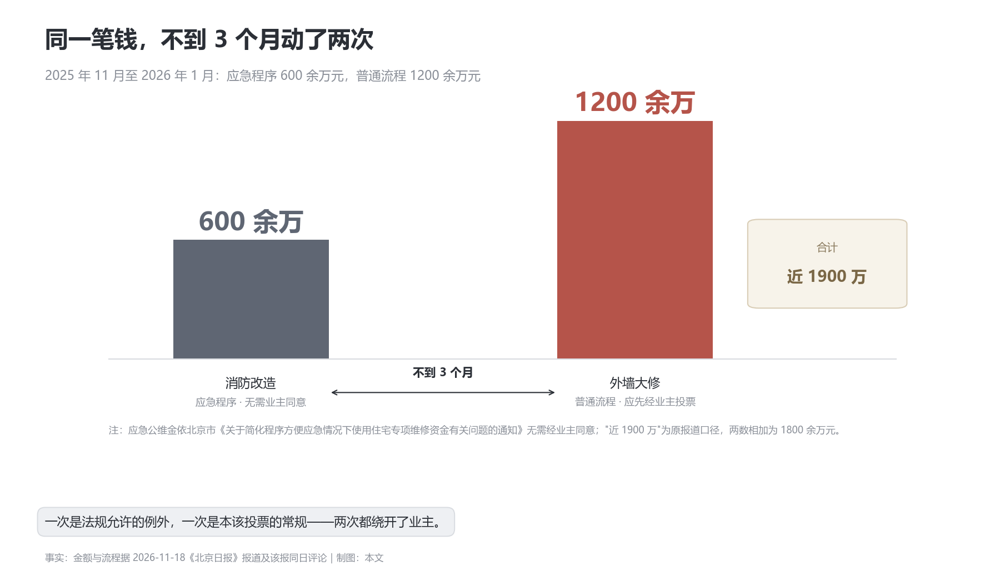

# 投票还没开始，合同已经签完了

北京昌平，融泽嘉园中6号院。

2026年1月30日，物业发布公告，申请1200多万元住宅专项维修资金，做外墙大修。走的是普通流程——按规定必须先经业主投票同意。

但业主通过信息公开拿到的材料显示：2025年12月2日签了《中标通知书》，12月30日签了《工程施工承包合同》。

组织投票的时间是2026年二三月份。合同在前，投票在后。

## 一、外墙早就掉了

小区2014年、2015年陆续入住。业主回忆，2017年前后墙皮就开始开裂脱落，物业每次修修补补。

记者到现场时大修正在进行。未修的楼体上，墙皮大面积脱落：有的整片掉下，数十块保温板暴露在外；有的一面墙脱落七八处。

入住十来年，掉皮近十年，2026年才大修。

## 二、投票是法定前置程序

北京市社会科学院社会学所副研究员赵小平说，根据《民法典》和《北京市物业管理条例》，使用住宅专项维修资金必须经业主共同决定，门槛是"双三分之二参与、双过半同意"。

《民法典》第二百七十八条把"使用建筑物及其附属设施的维修资金"列为业主共同决定事项；第二百八十一条规定，这笔钱属于业主共有，经业主共同决定才能动用。

正确顺序是：立项公示、业主投票、表决通过、招投标、签订合同、施工。物业做的是：招投标、签合同、施工在即、然后投票。

赵小平把这叫做"程序倒置"，"既不合法也不合理"——"等于把民主决策变成'橡皮图章'。"

## 三、投票结果不公示

物业承认，投票是2026年二三月份通过入户、电话或短信征询的，但"投票结果不公示"。

业主想知道票数够不够，只能自己去申请信息公开——最终是几名业主辗转申请才拿到。

## 四、同一笔钱，三个月动了两次

2025年11月，物业提出消防系统维修，拟支取600余万元，走应急程序。按北京市相关规定，应急公维金无需经业主同意。

业主当时就反对。有人在群里追问责任，群随后被解散。属地开了两次协调会，业主两次提出先厘清消防设施为什么瘫痪、想看维保记录——第二次协调会的第二天，施工材料运进了小区。

那份《消防设施维修施工通知》的日程是：2024年9月启动招标，2025年5月选定施工单位，8月至10月完成监理、施工合同签订及审核。公告张贴时间是2025年11月1日。先招标，先签约，再公告。

赵小平对应急程序留了余地：不需业主同意，不代表业主没有知情权和话语权。

两次加起来，不到3个月，动了近1900万元。

## 五、审核环节的那道缝

昌平区住建委的解释是：应急公维金不需征询业主意见；普通公维金需要征询，住建部门审核投票结果是否达到法定比例再批复——但不掌握签约与投票的时间顺序，也不审核合同的合法性。

审批看的是"票够不够"，不看"票在合同之前还是之后"。

北京日报的评论问得更透：如果投票没通过，违约损失由谁承担？

## 写在最后

业主并不反对修外墙。他们争的是两件事：责任——如果问题出在物业维护或开发商质量，为什么用业主的钱全额买单；程序——钱是业主共有的，决定权该在业主手里，不是合同签完后补一张票。

公维金是每个有房的人都交过的钱。它躺在专户里，平时没人看得见，动的时候往往已经动完了。

所以留一个问题：你家小区的公维金，上一次动用是什么时候，公示过吗，你投过票吗——还是只在楼道里看到了一张公告？

---

*事实来源：2026年11月18日北京日报客户端《不到3个月，物业花了业主近1900万，融泽嘉园中6号院业主质疑物业动用公维金太随意》（记者鹿艺佳）。外墙：2026年1月30日物业发布公告申请住宅专项维修资金开展住宅楼外墙大修，《专项维修资金支取汇总表》显示支取超过1200万元；2025年12月2日物业与施工单位签署外墙维修工程《中标通知书》，12月30日签署《工程施工承包合同》，组织业主投票时间为2026年二三月份（物业工作人员承认），投票结果不公示，业主经申请政府信息公开取得投票材料。消防：2025年11月物业提出消防系统维修拟支取600余万元、启动应急使用程序；2025年11月1日张贴《商品房住宅专项维修资金应急使用公告》；楼道内《融泽嘉园龙域中路6号院消防设施维修施工通知》落款2026年1月17日，载明2024年9月启动招标、2025年5月公开招标选定施工单位、同年8月至10月完成监理合同与施工合同签订及审核；2026年上半年消防改造完工。小区2014年、2015年陆续入住，2017年前后墙皮开始开裂脱落。昌平区住建委：应急公维金不需征询业主意见；普通公维金需征询业主意见，住建部门审核投票结果是否达到法定比例，但不掌握签合同与组织投票的时间顺序、不审核合同合法性（该委工作人员答复）。专家意见均出自北京市社会科学院社会学所副研究员赵小平，包括"双三分之二参与、双过半同意"门槛、"立项公示—业主投票—表决通过—招投标—签订合同—施工"的正确流程、先签合同后投票属"程序倒置""既不合法也不合理""把民主决策变成橡皮图章"，以及"不需业主同意，不代表业主没有知情权和话语权"。法律依据：《中华人民共和国民法典》第二百七十八条（下列事项由业主共同决定，第五项为"使用建筑物及其附属设施的维修资金"；业主共同决定事项应当由专有部分面积占比三分之二以上的业主且人数占比三分之二以上的业主参与表决，决定该条第六项至第八项事项应经参与表决专有部分面积四分之三以上且参与表决人数四分之三以上同意，决定其他事项应经参与表决专有部分面积过半数且参与表决人数过半数同意）、第二百八十一条（维修资金属于业主共有，经业主共同决定可用于电梯、屋顶、外墙、无障碍设施等共有部分的维修、更新和改造，筹集使用情况应当定期公布）；北京市《关于简化程序方便应急情况下使用住宅专项维修资金有关问题的通知》（应急公维金申请无需经业主同意）。北京日报2026年11月18日评论《公维金不是糊涂账，物业调用岂能自说自话先斩后奏》提出"如若投票未通过，合同违约带来的损失又由谁承担""住建部门审核投票结果，但不掌握物业签订合同与组织投票的时间顺序，不审核合同的合法性"。本文换算与判断："合同在前、投票在后"为按签约日期（2025年12月30日）与投票时间（2026年二三月份）对照得出；"不到3个月，动了近1900万元"沿用原报道表述——外墙1200余万元与消防600余万元两笔相加为1800余万元，报道以"近1900万"概括，本文未另行改写该口径。文中"先招标、先签约、再公告"指消防改造的公告张贴时间（2025年11月1日）晚于其招标（2024年9月启动）与合同签订（2025年8月至10月）完成时间。*

*文中"公维金"为住宅专项维修资金的通行简称；"应急程序"与"普通申请流程"是两条不同的资金申请通道，前者依北京市上述通知无需业主同意，后者须经业主共同决定。*
