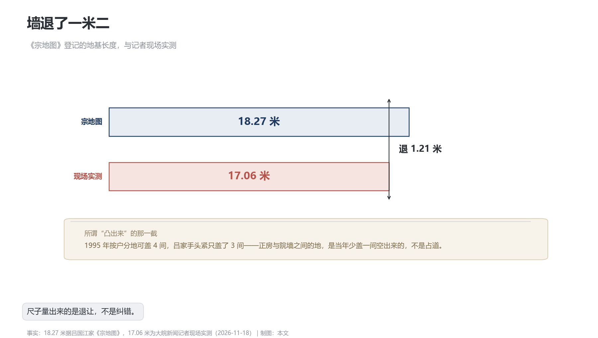
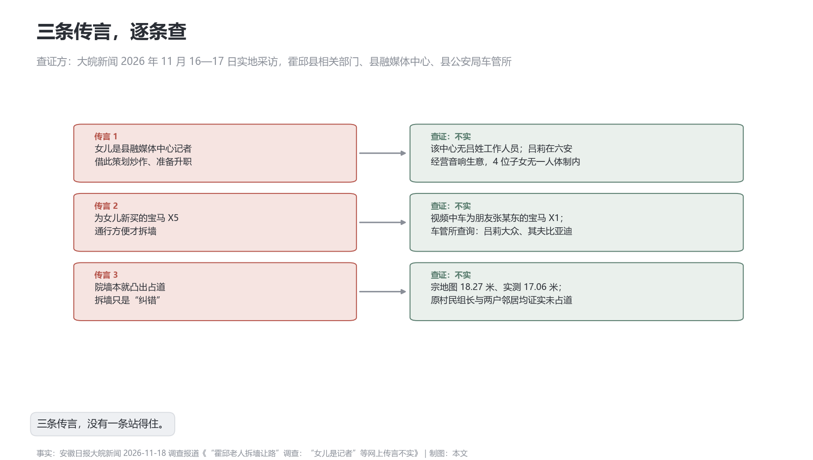
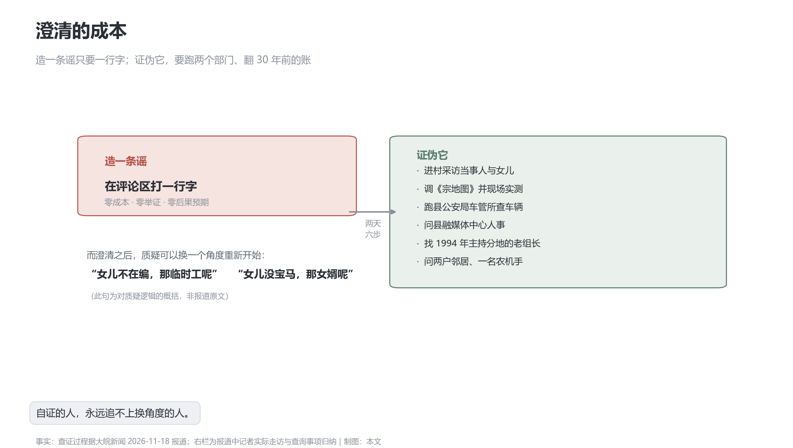

# 拆了一米墙，然后花十几天证明自己没有宝马

安徽六安霍邱县石店镇宽店村草楼组，74岁的吕国江把自家院墙往里退了一米多。

巷子原来两米多宽，退完变成三米多，旋耕机、收割机能开进去了。视频发到网上，点赞超过20万，有人说这是"当代六尺巷"。

然后风向就变了。

有人说他女儿是县融媒体中心记者，这事是她策划的，为了升副主任；有人说他家新买了宝马X5，车太宽进不来才拆墙；还有人说他家院墙本来就凸出来占了公家的路。

## 一、三条传言，逐条查

大皖新闻记者11月16日进村，17日去了县融媒体中心和车管所。

**女儿是记者？** 霍邱县融媒体中心答复：吕莉不是该中心记者，近期没有人事变动，中心甚至没有吕姓工作人员。吕莉自己在六安市区做音响生意。县相关部门调查确认，吕国江4位子女无一人体制内工作。

**宝马X5？** 吕莉说，视频里那辆宝马是朋友张某东的车，宝马X1。今年8月朋友喝了酒，她帮忙代驾，拍了一段视频发出去，被人当成了她自己的车。在车管所现场查询：吕莉名下只有一辆大众，丈夫名下是一辆比亚迪。县相关部门确认，4位子女名下均无宝马车。

**先占道后让路？** 这一条查得最细。《宗地图》上，吕家地基长18.27米；记者现场实测，如今是17.06米，墙确实往里退了1.21米。至于"凸出来"的那截，吕国江的解释是：当年按户分宅基地，家家都有盖4间房的地，1995年他家手头紧只盖了3间，正房与院墙之间那块地是当初少盖一间"空"出来的。

旁证齐全。1994年主持分地的原村民组组长胡保发确认，吕家西侧那条是"户路"，并未占道；邻居张福传、张国传都说两家过道从没变动过；农机手周海如说，以前走村里干道常剐蹭墙体，现在能改走这条道了。

## 二、拆墙这件事本身

墙是2025年10月拆的，秋收时节。拆完，吕家自己出钱把路面硬化，接上原来的过道；为了方便会车，又把屋后菜地一角也硬化了。

值得注意的是：这条路不是吕家唯一的进出通道；拆墙前的宽度，也足够吕莉的私家车通过。

也就是说，这堵墙对他家没有妨碍。拆，是给别人让的。

## 三、代价

传言起来之后，吕莉的账号后台收到一两千条私信。她跟记者说："有人一上来就质问，有人直接出言辱骂。有时陌生电话打进来，直接开骂。"

"这几天，我都睡不着。"

她父亲看着那些话，想不通——想做点好事，为什么挨骂。吕莉只好不让他看手机。针对不实传言，她已经报警；石店派出所证实已开展调查。

## 四、真正让人不舒服的地方

新民周刊的评论里有一句话说得准：如果能对"正面"反复思量，为什么对"反面"就不能保有同样的谨慎？

一个老人拆墙，很多人的第一反应不是"这人真好"，而是"肯定有猫腻"。于是查他女儿、查他家车、查他家地基。查完三样，全不实。

澄清是有成本的。记者跑两天，查宗地图、跑车管所、找二十多年前主持分地的老组长，才把三条传言按下去。而造一条谣，只需在评论区打一行字。

更麻烦的是，这套逻辑没有终点。今天澄清了女儿不是记者，明天可以问"那是不是临时工"；澄清了没有宝马，明天可以问"那女婿呢"。自证的人永远追不上质疑的人。

## 写在最后

吕国江74岁，当了50多年党员。他的说法很朴素：大家种庄稼不容易，巷子宽点方便进出，没什么好计较的。

倒是我们该想一想：下一次刷到老人拆墙让路、让出车位、扶起一个人的视频，你的第一反应是先点赞，还是先等他"自证清白"？

每个做好事的人，都要先备好材料证明自己不图什么，愿意做的人只会越来越少。

---

*事实来源：安徽日报大皖新闻2026年11月18日调查报道《"霍邱老人拆墙让路"调查："女儿是记者"等网上传言不实》（记者韩喻、张楠、李常宝），经京报网、观察者网等转载。核心事实：吕国江74岁，安徽六安霍邱县石店镇宽店村草楼组人，老房与院墙建于1995年；2025年10月秋收期间主动拆墙内退一米多，将巷道由两米多拓宽至三米多，并自费硬化路面、硬化屋后菜地一角以便会车；其女吕莉发布视频后点赞超20万，随后出现"女儿是县融媒体中心记者并借此炒作升职""为女儿新购宝马X5通行而拆墙""吕家先占道后让路"三类传言。查证情况：霍邱县融媒体中心答复吕莉非该中心记者、近期无人事变动、中心无吕姓工作人员；县相关部门确认吕莉在六安市区经营音响生意，吕国江4位子女无一人体制内工作；吕莉称视频中宝马车系朋友张某东所有的宝马X1，2026年8月代驾时所拍，霍邱县公安局车辆和驾驶人管理所现场查询显示吕莉名下仅一辆大众牌私家车、夫妇名下均无宝马，县相关部门确认4位子女名下均无宝马车；吕国江家《宗地图》显示地基长18.27米，记者现场实测17.06米、围墙内退1.21米，原草楼村民组组长胡保发（72岁，1994年参与宅基地划分）确认吕家未占道、西侧为"户路"，邻居张福传与张国传均称两家过道从未变动，农机手周海如称拆墙后路面拓宽可改走该道；石店镇政府与宽店村相关负责人表示2024年9月村里对该片村组道路硬化，吕家西南角菜地系拆墙后自行硬化，并非占道。网暴与报警：吕莉称账号后台收到一两千条私信，有质问、辱骂及陌生电话骚扰，"这几天我都睡不着"，其父因看到传言而郁闷，她已就不实传言报警；石店派出所证实已开展调查（观察者网转澎湃新闻）。评论观点"如果能对'正面'反复思量，那为什么对'反面'就不能保有同样的谨慎"出自新民周刊2026年11月19日《"74岁老人拆墙让路被质疑"，真相大白！网络"吃瓜"的底线在哪里？》（作者菲尼克斯）。吕国江"当了50多年党员""大家种庄稼不容易，巷子宽点方便进出，没什么好计较的"等表述据南国早报2026年11月18日评论转述及大皖新闻报道。本文判断与说明：视频发布日存在两种表述（大皖新闻记为11月9日，新民周刊记为11月6日），本文未采用具体日期；素材所称"澄清后仍有网友变换角度继续质疑（女儿不在编那临时工呢、女儿没宝马那女婿呢）"一句，未在公开报道中找到对应原文，本文未作为已发生事实引用，仅作为对质疑逻辑的概括性讨论。文中"这条路不是吕家唯一进出通道""拆墙前宽度足够私家车通过"据吕莉向大皖新闻记者的陈述；"墙对自家没有妨碍"为作者据此作出的判断。*

*文中"户路"指供行人或架子车进出的宅间通道，与作为通行干道的"机耕路"不同；《宗地图》为宅基地权属宗地附图，载明宗地界址与边长。*
