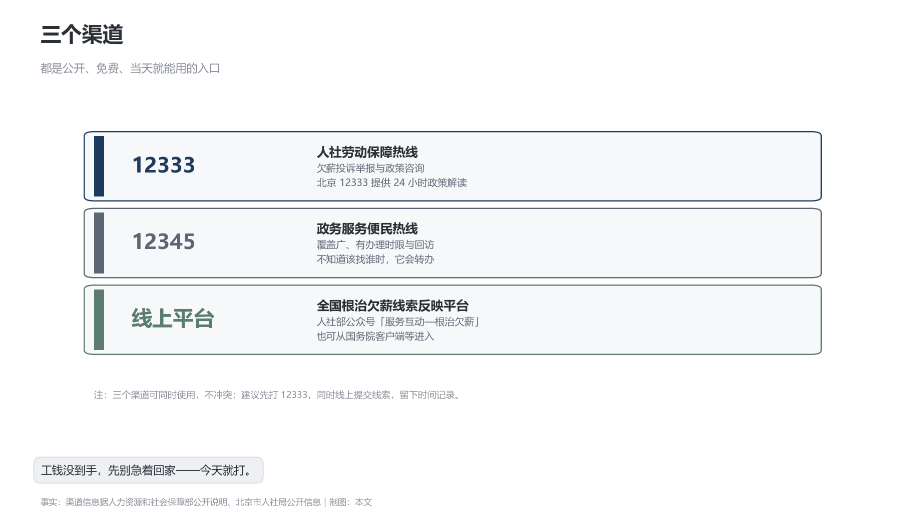
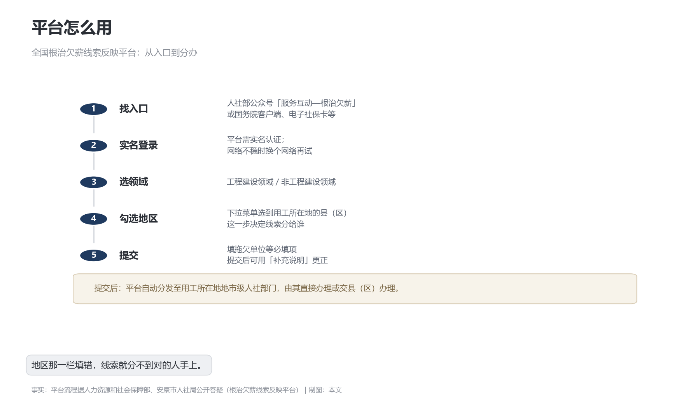
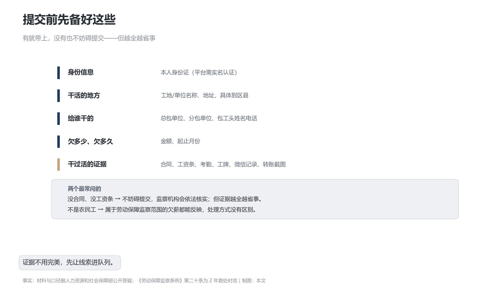

# 年底拿不到工钱，这三个渠道今天就能用

11月18日，2026年治理欠薪冬季行动动员部署视频会开了。会议要求里有一句很实在：织密预警排查网络，畅通欠薪反映渠道，对查实的欠薪线索实行倒查追责。

北京走得更前。11月15日，2026年"安薪北京"冬季行动已经启动，20多个部门联动，盯着工程建设、环卫、保安这些劳动密集型行业，也盯着政府和国企项目。目标写得很明确：查实的欠薪案件，2027年春节前全部实质性化解、动态清零。

政策在动。但如果你或者家里人现在就卡在"干完活拿不到钱"这一步，更需要的不是会议内容，是三个号码和入口。

## 一、12333：人社的劳动保障热线

这是人社系统的统一服务电话，欠薪投诉举报和政策咨询都走这条线。北京12333提供24小时政策解读和咨询。

打过去怎么说？把四件事说清楚：在哪个工地或单位干的活、给谁干的（总包还是分包、包工头叫什么）、欠多少、欠了多久。有合同、工资条、考勤记录、微信转账记录的，先说手上有这些。

## 二、12345：政务热线

12345是政务服务便民热线，欠薪属于它受理的范围。它的好处是覆盖面广、有办理时限和回访机制，而且对"该谁管"不明确的情况，它会转办。

如果你不确定该找哪个部门，或者打了12333没下文，打12345是合理的一步。同样，说清时间、地点、单位、金额。

## 三、"全国根治欠薪线索反映平台"

这个平台2020年12月14日开通，是专门归集欠薪线索的。

入口有几条：**人社部官方微信公众号**，在"服务互动"里选"根治欠薪"；也可以从**国务院客户端**、新华网、电子社保卡等渠道进。

进去之后要实名登录，选"工程建设领域"或"非工程建设领域"，填拖欠单位等必填信息，提交。下拉菜单里要勾选用工所在地的具体县（区）——这一步别填错，线索会按这个分发。

平台收到线索后，自动分发到用工所在地的地市级人社部门，由它直接办或交给县区办。

## 四、几个容易踩的坑

**没合同能不能反映？** 能。人社部门的答复是：没有劳动合同或工资条，不妨碍提交线索，监察机构会依法核实处理。但能证明你在那儿干过活的材料，越多越好。

**只有农民工能用吗？** 不是。属于劳动保障监察范围的欠薪都可以，城镇户籍劳动者被单位拖欠工资同样能提交，处理方式没有区别。

**奖金、补助算不算？** 要看具体性质，得具体分析。核实确属工资且被拖欠的，依法处理。

**有时效吗？** 有。《劳动保障监察条例》规定，违法行为在2年内未被发现、也未被举报投诉的，不再查处；有连续或继续状态的，从行为终了之日起算。所以拖着不反映，是有代价的。

**填错了怎么办？** 提交前可以反复改；提交后发现错了，在那条线索下选"补充说明"，随时可填，没有次数限制。

**个人信息会不会泄露？** 规定要求为举报人保密，姓名、电话、身份证号不得擅自对外发布或披露。

## 写在最后

冬季行动的时间表是到2027年春节前。这句话对个人的意义是：现在提交的线索，还在这一轮排查和化解的盘子里面。

腊月二十九再打，线索进不了队列，人也要回家过年了。

所以，如果你自己或者家里人年底的工钱还没结，今天就打，别等。

---

*事实来源：2026年11月18日，国务院就业促进和劳动保护工作领导小组办公室召开2026年治理欠薪冬季行动动员部署视频会，国务院就业促进和劳动保护工作领导小组副组长、人力资源社会保障部部长王晓萍出席并讲话；会议要求"织密预警排查网络，畅通欠薪反映渠道，全面归集各类线索""对查实的欠薪线索实行倒查追责，压紧压实总包单位工资支付责任""加强劳动保障监察执法……保持对恶意欠薪违法行为高压态势"（中国组织人事报2026-11-19，经京报网转载）。2026年"安薪北京"冬季行动：北京市就业促进和劳动保护工作领导小组近日部署，人社、国资、住建、交通、公检法等20多个部门协同联动，聚焦工程建设、环卫、保安等劳动密集型行业，聚焦政府、国企项目，推进查实的欠薪案件在2027年春节前全部实质性化解、动态清零；不按要求整改的一律立案查处，限期责改不改的予以处罚（新华社2026-11-15，记者陈旭）。渠道：12333为全国人力资源和社会保障服务电话，北京12333提供24小时政策解读和咨询，欠薪可拨打投诉举报（北京市人社局公开信息）。12345为政务服务便民热线。"全国根治欠薪线索反映平台"于2020年12月14日开通，可通过人力资源社会保障部官方微信公众号"服务互动—根治欠薪"登录，该平台已同步加载到国务院客户端、新华网及电子社保卡等平台；提交时需在下拉菜单勾选用工所在地具体县（区），平台收到线索后自动分发至用工所在地地市级人社部门，由其直接处理或交相应县（区）人社部门处理；实名认证登录，可选工程建设领域或非工程建设领域（人力资源和社会保障部、安康市人社局《使用根治欠薪线索反映平台有疑惑？解答来了》）。平台相关口径：属于劳动保障监察范围的欠薪问题均可反映，不局限于农民工群体，城镇户籍劳动者被拖欠工资同样适用且处理方式无区别；无劳动合同或工资条不妨碍提交线索；奖金、补助是否属于工资需具体分析，经核实确属工资且被拖欠的依法处理；《劳动保障监察条例》第二十条规定违法行为在2年内未被发现、也未被举报投诉的不再查处，有连续或继续状态的自行为了结之日起计算；提交前可重复修改，提交后可通过"补充说明"更正，无次数限制；依据《关于实施〈劳动保障监察条例〉若干规定》第十一条，劳动保障监察机构应为举报人保密，姓名、电话、身份证号等信息不得擅自对外发布或披露。本文说明：原始素材表述为"国务院客户端小程序'根治欠薪线索反映'"，据人社部门公开说明，该平台主入口为人社部官方微信公众号"服务互动—根治欠薪"，国务院客户端为同步加载渠道之一，平台正式名称为"全国根治欠薪线索反映平台"，本文按此口径表述；文中"腊月二十九"为对临近春节的时间比喻，非具体日期。*

*文中"动态清零"指对查实的欠薪案件在春节前全部实质性化解，与疫情防控语境下的同名词无关。*
