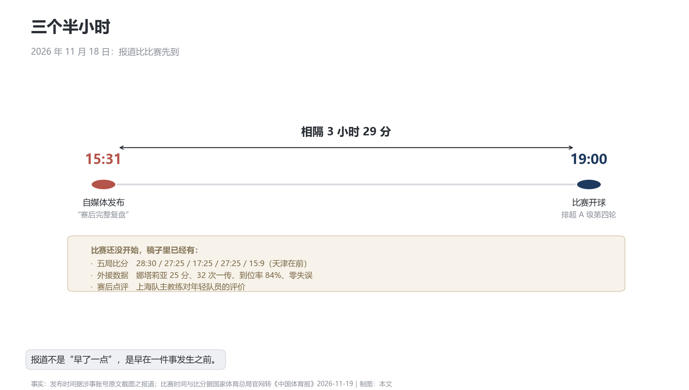
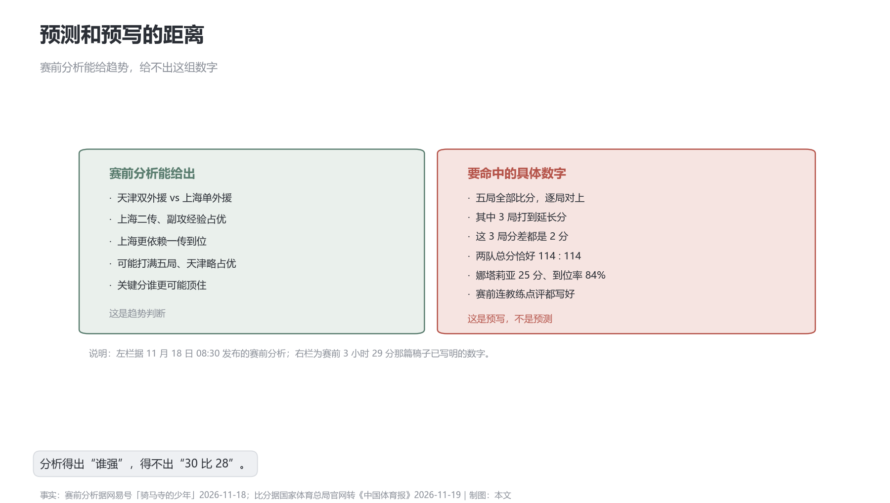
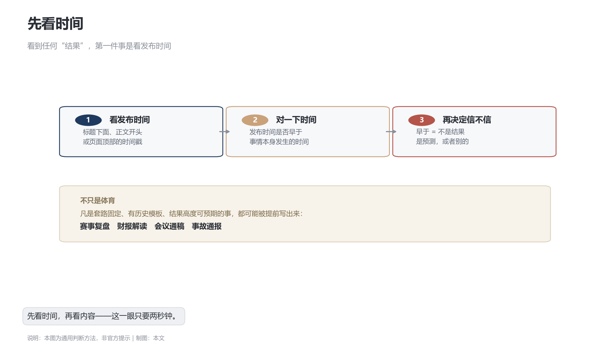

# 比赛还没开打，赛后报道已经发出来了

11月18日晚上19点，天津女排客场打上海女排。

当天下午15点31分，一篇写这场比赛的自媒体文章已经发出。五局比分、外援得分、战术复盘、上海队主教练的赛后点评，一样不少。

距离开球，还有3小时29分钟。

## 一、这场比赛有多难猜

先看结果。天津3比2胜，五局比分（天津在前）：28比30、27比25、17比25、27比25、15比9。

这组数字有几个地方值得停一下。

**五局里有三局打到延长分。**第一局30比28，第二局和第四局都是27比25——排球一局25分制，必须净胜2分才能结束。一场比赛出现三局延长分，本身就少见。

**这三局的分差全部是2分。**一分都不能偏。

**两队总得分完全相等：114比114。**天津赢了比赛，总分和上海一模一样。

还有走势。上海先赢第一局，天津扳平；上海再赢第三局，大比分2比1领先、手握赛点；天津连扳第四局和决胜局。这是一条"先落后、再翻盘、打满五局"的完整曲线。

## 二、赛前能算出什么

赛前不是没人分析。恰恰相反，那几天关于这场球的稿子很多。

11月18日早上8点30分，就有一篇赛前分析发出：天津双外援（娜塔莉亚、法布里斯），上海单外援（沃隆科娃）；上海二传许晓婷经验强于天津的朱航霆；上海副攻高意、陈厚羽能力占优；天津接应法布里斯不接一传、只管2号位强攻。

这些判断是专业的，事后看也基本应验——上海拦网确实打出优势，第三局就是靠网口压制拉开的分差。

但"分析"能给的是**趋势**：谁一传更稳、谁拦网更强、关键分谁更可能顶住。它给不出**数字**：给不出30比28，给不出三局延长分，更给不出两队总分恰好114平。

一场势均力敌的比赛，赛前说"可能打满五局、天津略占优"，这是判断；说"第一局30比28、第二局27比25、第四局27比25"，这是另一回事。

## 三、那篇稿子的问题在哪

现在回到那篇15点31分的文章。

它写对了比分。报道称，文中标注的娜塔莉亚25分、32次一传、到位率84%、零失误，与赛后官方技术统计"几乎可以忽略不计"；连上海队主教练那段"年轻队员敢打敢拼，但关键分处理上尚显稚嫩"的赛后点评，也提前出现在文中。

关于它怎么来的，公开报道给过一个解释：账号把两队过往的经典五局大战整理成模板，改改年份就发；恰好这次真实走势和模板重合，于是成了"提前预知"。

这个解释经不起推敲。模板可以套出"打满五局、天津3比2"，套不出三局延长分且分差都是2分，套不出总分114平，更套不出"84%到位率、零失误"这种精确到个位的数据。如果真是巧合，这个巧合的精度高得不像巧合。

至于"AI批量生成"的说法，我没有找到任何公开信源支持，原始报道里一次都没提AI。所以这里只能停在一句：**能确认的是它提前发布了、且内容与结果高度吻合；至于怎么做到的，至今没有可信解释。**

截至11月19日，排超官方和两家俱乐部都没有就此事发声，那篇稿子也还挂在那里。

## 四、这件事真正提醒的是什么

体育比赛有个好处：结果是可以被独立核验的。比分错了，第二天就有人指出来。

但也正因为结果确定、套路固定、又有大量历史素材，它成了"提前生产内容"最方便的领域。一场焦点战，赛前备好三五个版本的稿子，等结果出来挑一个发——这做法在内容行业里存在已久，只是过去靠人写、成本高，现在门槛低了。

麻烦在于，读者很难分辨。那篇稿子如果晚发三个半小时，它就是一篇合格甚至优秀的赛后复盘：比分对、数据全、点评到位。它唯一的问题，是时间戳。

所以判断成本最低的办法，不是去核每一条数据，而是先看一个东西：**发布时间**。

比事情发生还早的"结果"，不是结果。

---

*事实来源：比赛事实据国家体育总局官网转载《中国体育报》2026年11月19日报道《女排联赛第四轮战罢 天津队客胜上海保持不败》（作者苏畅）：2026-2027中国女排超级联赛A级第四轮，11月18日晚间进行，天津渤海银行女排客场3比2战胜上海光明优倍女排，五局比分依次为（天津在前）28比30、27比25、17比25、27比25、15比9，即上海胜第一、三局，天津胜第二、四、五局；报道载上海以30比28拿下首局、天津27比25扳回、上海25比17再胜、天津27比25还以颜色、决胜局天津15比9。提前发布事实据搜狐号"搞笑体育扛把子"2026年11月19日文章：2026年11月18日下午15点31分，一篇标注天津女排客场击败上海女排的赛后完整复盘文章在某自媒体账号发布，此时原定19点开打的比赛距开赛还有至少三个半小时；该文写明五局全部比分、核心外援得分数据、两队战术博弈细节及上海女排主教练赛后公开点评；文中称娜塔莉亚25分、32次一传到位率84%、零失误的技术统计与赛后官方发布的技术统计差距"几乎可以忽略不计"；并称截至11月19日，排超官方、两队俱乐部均未就此发布公开声明，涉事自媒体发布的提前赛报内容暂未被平台标注违规或下架。该报道对成因的解释为：账号将过往同对阵、同类型经典战例整理成模板，赛后修改年份、微调球员数据以快速产出内容；11月10日前后有非权威体育直播站点提前上线一条标注11月18日15点30分开赛的"天津对阵上海玄天鸟"虚构CBA赛事预告，11月18日15点30分这些站点更新该虚构赛事完场信息（标注86比77），一分钟后涉事账号发布津沪女排赛后报道。赛前分析据网易号"骑马寺的少年"2026年11月18日08:30《排超联赛：上海女排vs天津谁能赢？沃隆科娃压力大，朱航霆关键》：天津为娜塔莉亚、法布里斯双外援，上海仅沃隆科娃单外援；许晓婷比赛经验与传球稳定性好于朱航霆；上海副攻高意、陈厚羽能力优于天津；法布里斯为不接一传的强力接应，上海对一传依赖度更高。本文计算与判断：五局比分为（天津在前）28:30、27:25、17:25、27:25、15:9，其中第一、二、四局最高分为30、27、27，均超过25分且分差为2分，属延长分；天津各局得分合计114、上海各局得分合计114，两队总得分相等；上述统计为本文据公开比分相加得出。本文未采用"AI批量生成"及"提前虚构内容占比超过60%"等说法——经检索，公开报道中无相应表述或数据支撑，原始报道全文未提及AI。另需说明：原始素材称比赛日期为11月19日、19点开赛，经核为国家体育总局与《中国体育报》所载11月18日晚间进行，本文按11月18日表述；素材称"CBA俱乐部杯此前也出现过把未开赛赛程当完赛结果发布的同类乌龙"，本文未采用，因未检索到可核实的对应报道。*

*文中"延长分"指排球一局中双方战至24平后需净胜2分才能结束的局面；"到位率"为一传技术统计指标。*
