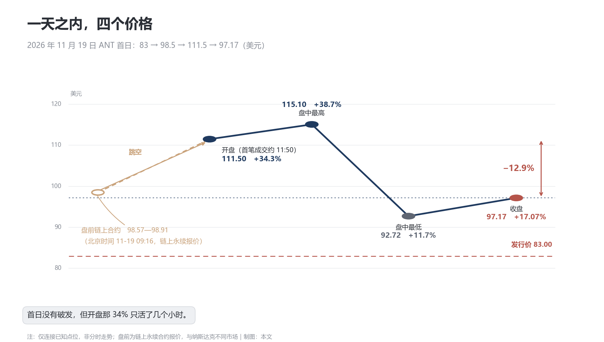
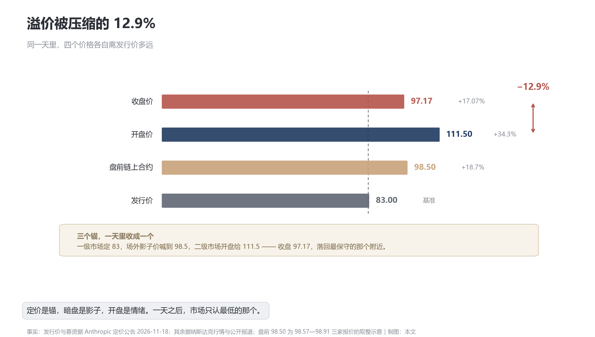
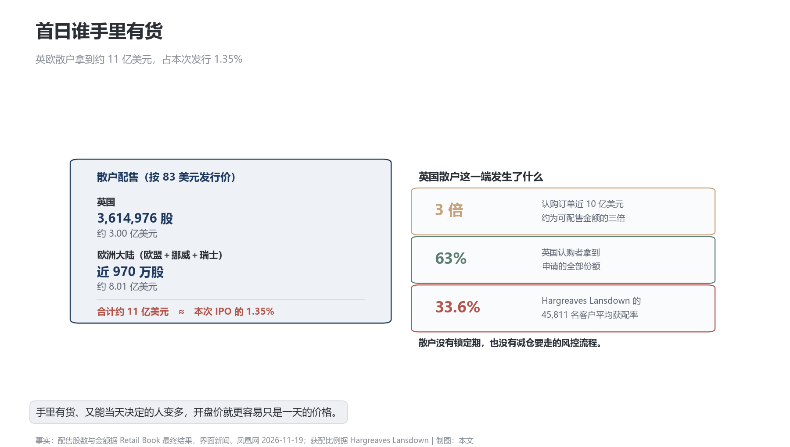

# 开盘 111.5 美元、收盘 97.17 美元：Anthropic 首日没破发，但溢价一天被压缩了 12.9%

美东时间 11 月 19 日，Anthropic（Nasdaq：ANT）挂牌。

发行价 83 美元。开盘 111.50 美元，涨 34.3%。盘中最高 115.10 美元，涨幅 38.7%，按完全稀释股本算市值短暂越过 2 万亿美元。然后一路往下，最低 92.72 美元，收盘 97.17 美元。从开盘到收盘回落 12.9%，从最高点算跌掉 15.6%。

没有破发——收盘比发行价高 17.07%。真正值得看的是：**开盘那 34%，为什么只活了几个小时。**

## 一、一天里有四个价格

**83 美元**是一级市场定的，本身已经抬过一次：招股书区间原为 70 到 78 美元，最终比上限高 6.4%；发行规模从 8.25 亿股扩到 9.8 亿股，募资 813.4 亿美元，超过 SpaceX 6 月的 750 亿美元，是史上最大 IPO。

**98 美元上下**是场外的影子价。北京时间 11 月 19 日上午 9 点 16 分，币安上的 ANT 合约报 98.80 美元，OKX 98.91，Hyperliquid 上 TradeXYZ 报 98.57。这是链上永续合约，标的是"一股大概值多少"，不是股票本身——但它是当时唯一在连续交易的价格。

**111.50 美元**是二级市场给的第一口价。纳斯达克当天延迟开盘，撮合期间指示性开盘价被上调过数次，首笔成交到美东上午 11 点 50 分才出现，距开市铃响已两个多小时。它不是一瞬间的情绪，是反复上调后的成交价。

**97.17 美元**是收盘价，也是当天真正的结算。

## 二、收盘落回 98 附近

把四个数排一下：83 → 98.5 → 111.5 → 97.17。

发行价是锚，由簿记和配售名单决定；场外合约是影子，回答"谁愿意先付多少"；开盘价是情绪，由当天的买单决定，最容易过头。一天之内，市场把这三个价格收成了一个——收在最保守的那个附近，不是发行价，也不是开盘价，而是场外已经交易了好几天的那个价。

反过来说也成立：如果 111.5 是共识，场外不会只喊到 98.5。开盘价与场外价之间那 13% 的缺口，本身就说明开盘那一下里有多少是"当天必须买到"的钱。

还有一层：当天大盘在跌——标普 500 连跌六个交易日，道指跌破 5 万点，VIX 一度冲到近 29 点。有分析认为，不少投资者此前把准备买 Anthropic 的钱临时放在纳指 100 相关基金和期货上，开盘后卖出换仓；开盘那口价，也吃到了这批钱。

情绪进来得快，出去得也快。这就是 12.9% 的来源。

## 三、谁手里有货

这次 IPO 有个不太常见的安排：向英国和欧洲大陆的散户卖了一批股票。按监管文件，英国散户获配 3,614,976 股，欧盟、挪威、瑞士的散户获配近 970 万股。按 83 美元算，两地合计约 11 亿美元，占本次发行的 1.35%。

关键不是"散户多"，而是**这批货没有锁定期**。机构拿货带锁定和风控流程，减仓要走流程；散户没有流程，看到 115 美元，当天就能决定卖不卖。

首日成交 8.396 亿股（CNBC 口径），接近本次发行 9.8 亿股的 86%。换手充分，意味着当天进场的人当天就能走：开盘定在 111.5，是因为那一刻买的人多；收盘回到 97.17，是因为那天买的人里，愿意拿到第二天的没那么多。

## 四、首日解决的是融资，不是单位经济

这次 IPO 加同步私募配售，一共拿到约 1073 亿美元。招股书里同时躺着一组数字：截至 9 月 30 日，已签下的采购与租赁承诺合计约 9009 亿美元，其中约 4516 亿美元预计 2030 年底前支出，未来 12 个月内到期的约 707 亿美元。对照截至 10 月底约 810 亿美元的年化收入运行规模，未来一年的固定支出相当于年化收入的 87%。

这不是说明天要还 9009 亿——那是跨越近二十年的合同义务，部分还带条件。但它说明：**上市解决"钱从哪来"，不解决"钱花出去之后收入能不能追上"。**

首日 12.9% 的回落，在这个背景下很正常。市场一天之内把三种判断重新对齐，对齐到"大概值 1.27 万亿美元"（按已发行股份算）或"1.8 万亿美元"（按完全稀释股本算）。

真正被转移到二级市场的，不是"值不值 2 万亿"，而是**从今天起，这个问题每天都要被回答一次**。

首日没破发，说明 83 站得住；冲 34% 又吐回去一半多，说明 111.5 站不住。两句话都对。

---

*事实来源：发行价 83 美元、发行 9.8 亿股、募资 813.4 亿美元、定价高于 70—78 美元区间上限，据 Anthropic 官方 2026-11-18 定价公告及第一财经、澎湃新闻；开盘价 111.50 美元（+34.3%）、首笔成交约美东 11:50、撮合期间指示性开盘价数次上调，据日经中文网 2026-11-20、虎嗅（PANews 转载）2026-11-19；盘中最高 115.10 美元（+38.7%）、最低 92.72 美元，据信报财经新闻 2026-11-19 及 Unite.AI 引纳斯达克市场记录；收盘 97.17 美元（+17.07%）、较开盘回落约 12.9%，据纳斯达克行情数据，澎湃新闻、第一财经、CNBC 2026-11-19 交叉一致；成交量 8.396 亿股据 CNBC（澎湃转述），Wind 口径 8.46 亿股据每日经济新闻 2026-11-20；收盘市值约 1.272 万亿美元（已发行股本）、约 1.8 万亿美元（完全稀释）据澎湃新闻、财新网；同步私募配售 260 亿美元、合计约 1073 亿美元据第一财经、凤凰网；盘前链上合约报价（币安 98.80、OKX 98.91、Hyperliquid TradeXYZ 98.57 美元，北京时间 2026-11-19 09:16）据 AiCoin 2026-11-19；散户配售英国 3,614,976 股约 3 亿美元、欧洲大陆近 970 万股约 8.01 亿美元、合计约 11 亿美元占本次发行 1.35%，据 Retail Book 最终配售结果、界面新闻、凤凰网 2026-11-19（英国认购订单近 10 亿美元约为可配售额三倍、约 63% 英国认购者获全额、Hargreaves Lansdown 45,811 名客户人均申购 6,661 英镑及获配 33.6%，见配图三）；SpaceX 上市首日成交 5.22 亿股、Anthropic 当日 13:30 成交量超 6 亿股，据第一财经；三大指数当日跌幅、标普六连跌、道指跌破 5 万点、VIX 一度近 29 点，据第一财经、信报；9009 亿美元采购与租赁承诺、4516 亿美元 2030 年底前支出、707 亿美元 12 个月内到期、截至 10 月底 810 亿美元年化收入运行规模，据 Anthropic 修订版 S-1/A（2026-11-10）及彭博社、同花顺财经 2026-11-13 报道。本文计算：97.17 ÷ 111.50 − 1 = −12.85%（文中取 12.9%）；97.17 ÷ 115.10 − 1 = −15.6%；111.50 ÷ 83 − 1 = +34.34%；98.5 ÷ 83 − 1 ≈ +18.7%；111.5 ÷ 98.5 − 1 ≈ +13.2%；8.396 ÷ 9.8 ≈ 86%。文中"收盘价几乎正好落在场外影子价上""12.9% 的回落是市场把三种判断重新对齐""首日交易把定价问题从一级市场转移到二级市场的日常"等为作者判断，非当事方表述。原始素材称"回落约 12.8%"，按 97.17/111.50 计算为 12.85%，本文取 12.9%；素材称"盘中最高 115.10 对应市值突破 2 万亿"，据公开报道为"短暂越过 2 万亿"；素材未提及盘中最低 92.72 美元、延迟开盘两个多小时、VIX 冲高、9009 亿美元算力承诺等细节，本文据公开信源补入。*

*文中"年化收入运行规模"（ARR）指把某一时期收入按全年折算，不是已实现营收；"完全稀释"指计入全部可转换工具与期权后的股本口径。*
