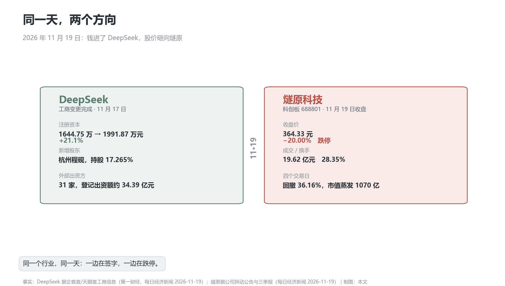
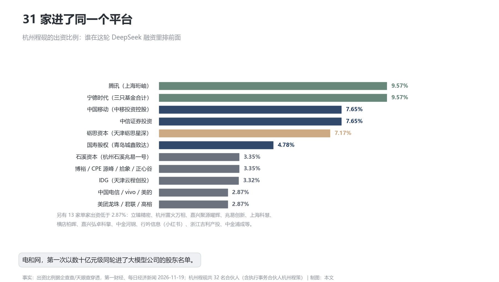
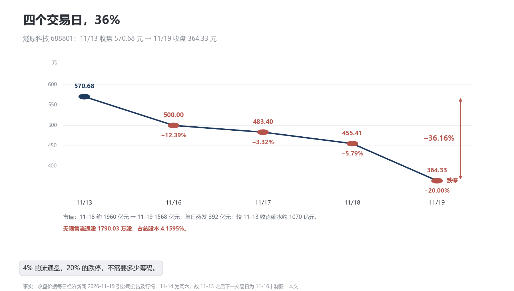

# DeepSeek 千亿融资落地，燧原同日 20cm 跌停：国产算力同一天冰火两重天

11 月 19 日，国产算力两条新闻撞在一起。

一条是 DeepSeek 工商变更落定：主体杭州深度求索注册资本从 1644.75 万元增至 1991.87 万元，增幅 21.1%，新增股东杭州程砚企业管理咨询合伙企业，持股 17.265%。这个平台背后是 31 家外部出资方，登记出资额从 0.6 万元增至约 34.39 亿元。

另一条是燧原科技（SH688801）20cm 跌停，收 364.33 元，成交 19.62 亿元，换手 28.35%。同日沐曦跌超 13%，摩尔线程跌近 9%。

一个在签字，一个在跌停。

## 一、31 家进的是同一个平台

杭州程砚的 32 名合伙人里，除执行事务合伙人杭州程策，其余 31 家即本轮外部股东。腾讯旗下上海珩岫与宁德时代三只基金各持 9.5653%，并列第一；中移投资控股、中信证券投资各 7.6522%，砺思资本 7.1740%，国寿股权 4.7826%（完整名单见图二）。

值得注意的是结构，不是金额。

**电和网第一次进来了。** 中国移动、中国电信以数十亿元级同轮参投一家大模型公司。算力扩张卡在电力、网络接入两个物理约束上，把决策方放进股东名单，等于把外部谈判成本内部化。

**宁德时代也进来了。** 电池、储能、数据中心供电是另一条物理约束。加上美的、立讯、vivo 这些终端制造方，名单覆盖了"算力从哪来、算出来给谁用"的完整链路。

而钱进的是同一个 SPV，GP 是梁文锋持股 99% 的杭州程策。31 家出钱，方向盘还在一个人手里。

## 二、同一天，燧原跌了 20%

触发点是一则传闻。11 月 18 日晚市场流传"三星开始穿透严查代工"，19 日相关"小作文"扩散。真实背景是美国 BIS 在 11 月 16 日更新规定，要求 14nm 及更先进制程的晶圆代工需获 BIS 审批，代工厂须做客户合规性自查。上海证券报向晶圆代工、芯片设计公司多方求证后指出，**三星严查代工的传闻不准确**——三星目前并无相关文件。

传闻不准确，跌停是真的。

燧原当晚发布异动公告：11 月 17、18、19 三个交易日收盘价跌幅偏离值累计超 30%，属异常波动；公司称在手订单充沛，正与多家国内半导体产业伙伴合作，打造基于国产供应链的云端 AI 芯片产品。公告同时提示了一个关键数字：无限售流通股 1790.03 万股，占总股本 **4.1595%**。

## 三、4% 的流通盘

燧原 9 月 11 日登陆科创板，发行价 142.18 元。11 月 13 日盘中最高 613 元，收盘 570.68 元。然后四个交易日连跌：16 日 −12.39%、17 日 −3.32%、18 日 −5.79%、19 日 −20.00%，累计回撤 36.16%。市值从 18 日的约 1960 亿元降到 1568 亿元，单日蒸发 392 亿元。

4% 的流通盘意味着很小的卖压就能砸出很大的跌幅，价格里的共识其实很薄。基本面并不难看：前三季度营收 23.32 亿元，同比增长 331.74%；第三季度单季 12.12 亿元，增长 395.34%，超过上半年总和；归母净利润仍亏 7.54 亿元，但在收窄。

基本面在改善，股价却因一则被证伪的传闻跌了 20%。两件事同时成立，问题在定价机制，不在经营。

## 四、交付期不等于估值稳定期

浙商证券测算，2029 年中国通用 GPU 市场规模将达 7153 亿元，其中国产通用 GPU 2221 亿元，2025—2029 年复合增速 91.4%。同期"四小龙"三季报确实集体跨过单季十亿收入：摩尔线程 32.89 亿元、单季扣非首次转正；沐曦 28.24 亿元、扣非扭亏 2.59 亿元；燧原 23.32 亿元。

行业叙事已经从"能不能做出来"变成"能不能交付"。但这一天说明另一件事：**交付期不等于估值稳定期。**

DeepSeek 那一端，钱和资源通过股东结构锁定——电、网、终端、场景一次性装进一个平台，锁七年，上市后再加五年。不确定性被提前消化。

燧原这一端，不确定性还在每天被定价。订单是不是真的、供应链会不会断、下季度能不能继续翻倍，这些问题没有一年期的答案，但股价每天都要给一个。

一端用股权结构换确定性，一端用每日波动承担不确定性。传闻被证伪了，20% 的跌幅没有还回来——市场愿意相信增长，但不愿为不确定性付溢价，至少在它变成财报上的数字之前。

---

*事实来源：DeepSeek 工商变更（注册资本 1644.7496 万元 → 1991.8707 万元、增幅 21.1%、新增股东杭州程砚持股 17.265%、杭州程砚登记出资额 0.6 万元 → 约 34.39 亿元、32 名合伙人含执行事务合伙人杭州程策、各出资方持股比例）据企查查/天眼查工商信息穿透，第一财经、每日经济新闻 2026-11-19 报道；杭州程策由梁文锋持股 99% 据第一财经。融资总额 1055 亿元、投后估值 6155 亿元为 The Information 引知情人士的媒体口径，DeepSeek 官方未就金额与估值作出回应，故本文未采用。燧原科技（SH688801）11 月 19 日收 364.33 元、跌 20%、成交 19.62 亿元、换手 28.35%、三个交易日跌幅偏离值累计超 30%、公告称在手订单充沛、无限售流通股 1790.0325 万股占总股本 4.1595%、前三季度营收 23.32 亿元（+331.74%）、第三季度 12.12 亿元（+395.34%）、归母净利润亏损 7.54 亿元、研发投入 9.89 亿元占营收 42.40%、发行价 142.18 元、9 月 11 日上市，据公司《股票交易异常波动公告》与 2026 年三季报，每日经济新闻 2026-11-19 报道；11 月 13 日盘中最高 613 元、收盘 570.68 元，16/17/18 日分别跌 12.39%/3.32%/5.79%、四日累计回撤 36.16%、市值 1960 亿 → 1568 亿元、单日蒸发 392 亿元、较高点缩水约 1070 亿元，据每日经济新闻据行情数据测算。沐曦股份跌超 13%、摩尔线程跌近 9%、壁仞科技跌超 5%，据 21 世纪经济报道 2026-11-19 引 21 财经雷达。"三星穿透严查代工"传闻不准确、美国 BIS 11 月 16 日更新规定要求 14nm 及更先进制程代工需 BIS 审批、代工厂须做客户合规性自查，据上海证券报求证，新浪财经、21 世纪经济报道 2026-11-19 转述。2029 年中国通用 GPU 市场 7153 亿元、国产通用 GPU 2221 亿元、2025—2029 年复合增速 91.4%，据浙商证券《2026 国产 GPU 芯片行业深度》研报。摩尔线程前三季度营收 32.89 亿元（+319.15%）及单季扣非首次转正、沐曦 28.24 亿元（+128.45%）及扣非 2.59 亿元扭亏，据各公司 2026 年三季报。本文计算：570.68 → 364.33 为 −36.16%；1960 − 1568 = 392 亿元。文中"电和网第一次以数十亿元级同轮进入大模型公司股东名单""不确定性被提前消化""交付期不等于估值稳定期""问题出在定价机制而非经营"等为作者判断，非当事方表述。原始素材称"新增股东杭州程砚、注册资本增幅 21.1%"经核属实；素材未提及燧原 4.1595% 的流通股占比、四日累计回撤 36.16%、单日市值蒸发 392 亿元、BIS 11 月 16 日新规这一真实背景，本文据公开信源补入；素材中"沐曦股份、摩尔线程同步大幅下挫"经核为跌超 13%、跌近 9%。*

*文中"SPV"指特殊目的载体，本轮 31 家外部出资方通过杭州程砚这一有限合伙平台间接持有 DeepSeek 股权；"20cm"指科创板 20% 的日涨跌幅限制。*
