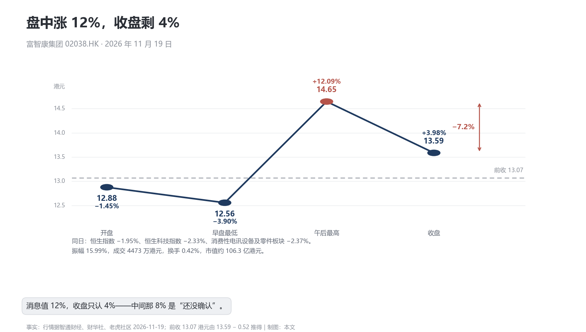
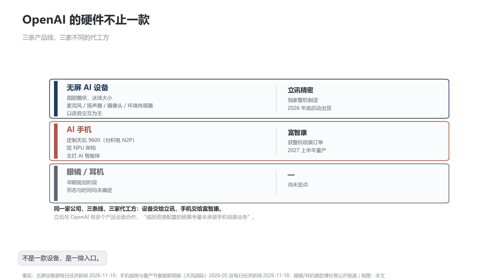
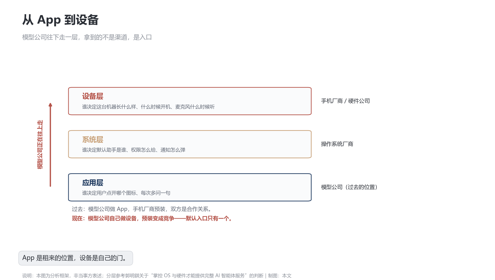

# 富智康拿下 OpenAI 手机组装订单：模型公司不做 App 了，开始抢手机入口？

11 月 19 日，证券时报从供应链获悉：富士康旗下富智康集团（02038.HK）已获 OpenAI 手机项目订单，将参与整机组装。

富智康午后直线拉升。当天低开 12.88 港元，早盘最低 12.56，午后最高 14.65 港元（涨 12.09%），收 13.59 港元（涨 3.98%）。振幅 15.99%，成交 4473 万港元。

## 一、12% 到 4% 之间那 8%

消息中午出来，价格几十分钟内冲到 +12%，然后用整个下午慢慢吐掉，收在 +4%。这不是"利好兑现"，是"利好打折"——市场先按"OpenAI 要做手机"给了溢价，再用一个下午重估这句话。

两个细节支撑这种打折。

**公告缺席。** 按港股惯例，足以影响股价的重大合同通常以公告落地。截至当天，富智康未在港交所披露易就这笔订单刊发公告或澄清，OpenAI 与鸿海方面也无官方确认。消息停留在"媒体引述供应链人士"这一层。

**口径留了余地。** 报道写明：产品方案、订单规模及量产安排，仍有待进一步获悉。市场知道的是"有人在替 OpenAI 组装一台手机"，不知道的是"多少台、什么时候、多少钱"。

12% 是对前者的定价，4% 是对后者的定价。

## 二、OpenAI 的硬件不止一款

**第一款不是手机。** OpenAI 首款 AI 端侧硬件预计 2026 年底启动出货，立讯精密独家承担整机制造并供应核心零部件。形态是 Jony Ive 团队设计的甜甜圈状无屏设备，冰球大小，集成麦克风、扬声器、摄像头和环境传感器，定价传闻 300 到 400 美元。

**手机是另一条线。** 富智康拿到的是整机组装。郭明錤此前披露，这款 AI 智能体手机量产目标已从 2028 年提前到 2027 年上半年，联发科有望独家供应基于天玑 9600 的定制芯片（台积电 N2P），2027 至 2028 年合计出货预期约 3000 万部。眼镜和耳机还在规划中。

值得注意的是立讯的位置。11 月 18 日晚，每日经济新闻从供应链人士处获悉，立讯精密与 OpenAI 有多个产品的全面合作，"或因资源配置的统筹考量未承接手机组装业务"。一家代工厂做不了全部，订单分给了第二家——反过来读，就是 OpenAI 的硬件清单比外界以为的长。

## 三、为什么非要自己做设备

郭明錤给过三条理由，两条说得很直白：只有充分掌控操作系统与硬件，才能提供完整的 AI 智能体服务；手机能持续获取用户所处的实时状态，为智能体提供上下文。翻译成一句话：**App 拿不到的东西，设备能拿到。**

装在手机里的 App，知道用户点了什么、搜了什么。它不知道用户此刻在哪、在见谁、周围有没有声音。这些恰恰是智能体最需要的上下文。而获取这些，需要麦克风常开、传感器常开、系统权限一路放行——App 求不来，设备天生就有。

还有一层更硬的：**默认入口只有一个。** 过去厂商预装 AI 助手、模型公司付钱或分成，模型公司是租客，房东随时能换人，也能在同一位置放自家助手。自己做设备，就是从租客变成房东——代价是管供应链、良率、渠道、售后，好处是那个位置从此归自己。

## 四、这条路的代价

OpenAI 至今没发布过任何一款消费硬件。它在这件事上的全部资产，是一支四百多人的硬件团队、一次 65 亿美元收购（io Products）、和一堆供应链传闻。第一款产品还没出货，手机要等到 2027 年。

更现实的问题是：**用户为什么要多带一台设备？** 如果手机上的 ChatGPT 已经够用，一台专门的 AI 手机提供的增量是什么？如果答案是"更深的系统权限和更强的端侧算力"，那它卖的其实不是 AI，是硬件体验——这恰恰是苹果最擅长、也最难被绕开的地方。

所以这条新闻的分量不在富智康那天涨了几个点，在于它确认了一件事：**模型公司已经不满足于待在应用层。** 走通了，手机行业的合作格局要重写；走不通，这笔订单就只是一次代工产能的重新分配。而现在能确定的只有"订单存在"——连规模都还不知道。

---

*事实来源：富智康获 OpenAI 手机项目订单、参与整机组装、富士康为苹果 iPhone 主要组装商、产品方案与订单规模及量产安排待确认，据证券时报 2026-11-19，第一财经、联合早报转述。富智康当日行情（低开 12.88 港元、早盘最低 12.56 跌 3.90%、午后最高 14.65 涨 12.09%、收 13.59 涨 3.98%、成交 4473 万港元、振幅 15.99%、换手 0.42%、市值约 106.3 亿港元）及同日恒指 −1.95%、恒生科技 −2.33%、消费性电讯设备及零件板块 −2.37%，据智通财经、财华社、老虎社区 2026-11-19；前收 13.07 港元由 13.59 − 0.52 推得。富智康未在港交所披露易就该订单刊发公告或澄清、OpenAI 与鸿海无官方确认，据财华社 2026-11-19。OpenAI 首款 AI 端侧硬件 2026 年底启动出货、立讯精密独家承担整机制造并供应核心零部件、甜甜圈状无屏设备形态、300—400 美元定价传闻，据每日经济新闻 2026-11-19。立讯精密"或因资源配置的统筹考量未承接手机组装业务"，据每日经济新闻 2026-11-18 引供应链人士。AI 智能体手机量产目标由 2028 年提前至 2027 年上半年、联发科有望独家供应基于天玑 9600 的定制芯片（台积电 N2P）、2027—2028 合计出货约 3000 万部、做手机的三条理由，据郭明錤（天风国际）2026 年 5 月供应链调查，每日经济新闻 2026-11-18 转述。OpenAI 以约 65 亿美元收购 io Products、硬件团队超 400 人、Jony Ive 与 LoveFrom 参与设计，据 OpenAI 2025 年公开信息及《财富》2026 年 7 月报道。本文计算：14.65 → 13.59 为 −7.2%；13.59 ÷ 13.07 − 1 = +3.98%。文中"12% 是对消息的定价、4% 是对不确定性的定价""模型公司从租客变成房东""App 拿不到的东西设备能拿到"等为作者判断，非当事方表述。原始素材称"富智康午后港股一度涨超 9%"，经核当日盘中最高涨幅为 12.09%、收盘 +3.98%，本文按实际区间表述；素材称"OpenAI 首款 AI 端侧硬件可能在年底启动出货、立讯精密承担整机制造"，经核属实，并补充该产品为无屏设备而非手机、手机为另一条产品线这一关键区分；素材未提及富智康未刊发公告、郭明錤的 2027 上半年量产与 3000 万部出货预期、立讯未承接手机组装业务的原因，本文据公开信源补入。*

*文中"端侧"指 AI 推理在本地设备完成而非全部上传云端；"AI 智能体手机"指以智能体（Agent）为核心交互、而非以 App 图标为入口的手机形态。*
