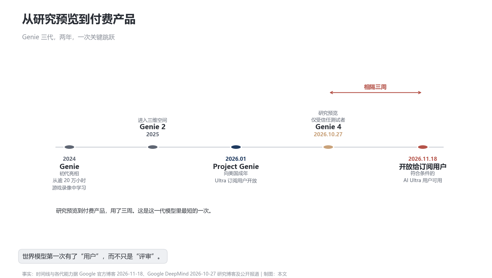
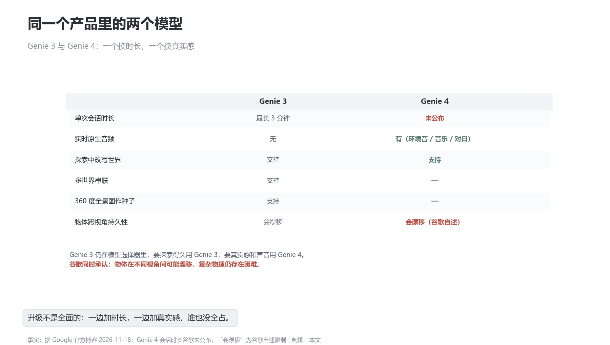
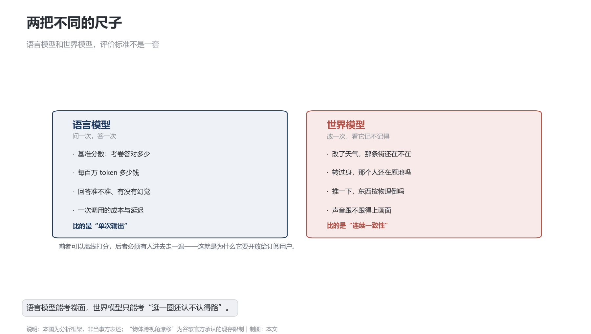

# 谷歌 Genie 4 开放给订阅用户：世界模型不再只是演示，能实时改天气、召唤角色

11 月 18 日，谷歌把 Genie 4 世界模型开放给了符合条件的 Google AI Ultra 订阅用户。

这件事的分量不在"新模型"，在于"新用户"。Genie 4 于 10 月 27 日以研究预览形式发布，当时只给受信任测试者用。三周后，它进了一个每月 199.99 美元的付费订阅。AI Pro 用户可以在同一页面加入候补名单。

从演示视频到可交互产品，世界模型跨过了这道门槛。

## 一、能改什么

Genie 4 的核心变化是"探索中改写"。

你在浏览器里走进一个生成的世界，走着走着输入一句提示词，就能换天气、引入一个角色、改变正在发生的事——不用退出重来。谷歌称这是它迄今最逼真、交互性最强的世界模型。

第二个变化是声音。这是 Genie 系列第一次给画面配上实时原生音频：风声、脚步声、背景音乐，还有随场景事件作出反应的角色对白。此前几代只有画面。

第三个变化是配套：一个对话式辅助创作智能体，一个社区画廊。画廊里可以发布自己造的世界，也可以拿别人的世界继续改。

谷歌说 Genie 4 改进了人物移动方式和物体对物理力量的响应。但这些效果来自它自己的演示，目前没有独立测试。

## 二、升级不是全面的

有个细节容易被忽略：Genie 3 没有下线，还留在模型选择器里。

而且 Genie 3 这次也升级了——单次会话从 60 秒延长到最长 3 分钟，支持把多个世界串成更长的旅程，还能用 360 度全景图当作新世界的种子。

Genie 4 的单次会话时长，谷歌没有公布。

于是产品里出现了一个奇怪的分工：要探索得久，用 Genie 3；要真实感和声音，用 Genie 4。一边加时长，一边加真实感，谁也没全占。

谷歌自己也把话说得很清楚：物体在不同视角之间可能漂移或改变，复杂物理仍存在困难，生成的语音或文字也可能不准确。相机延迟、实时音频精度、长期场景稳定性都还没解决。它仍把 Genie 3 和 Genie 4 称作前沿研究阶段模型。

所有生成的视频和音频都带 SynthID 水印，输入输出都过安全筛查。

## 三、为什么必须开放给用户

语言模型好不好，可以离线打分：一张考卷，答对多少；一次调用，花多少钱。这些都能脱离用户测出来。

世界模型不行。它的价值在于"连续性"——你改了天气，那条街还在不在？转过身，刚才那个人还在原地吗？推一下桌子，东西按物理规律倒吗？声音跟不跟得上画面？

这些问题没有标准答案，只能让人进去走一遍。

所以"开放给订阅用户"这个动作，本质上是在收集一种数据：人在环中探索的行为。哪里会穿模、哪个角度会漂移、什么指令会让世界崩掉——这些是跑分跑不出来的。

Genie 4 短期不产生直接收入。199.99 美元的订阅费覆盖的是整个 AI Ultra 套餐，摊不到这个模型头上。但它买回来的东西，比收入更值钱。

## 四、离什么最近

世界模型和机器人仿真、自动驾驶场景生成、游戏内容生产之间的距离，比语言模型短得多。

一个能实时生成、实时改写的物理世界，最直接的用途不是给人玩，是给机器练。机器人要在仿真里摔几百万次才学会走路，自动驾驶要在虚拟路口跑几十万公里才敢上路——过去这些场景靠人工建模，成本高、覆盖窄。如果能用一句话生成并随时改动，训练数据的供给方式就变了。游戏行业同理：关卡设计、场景预演、玩法原型，以后可能变成"描述一下"。

这三件事今天都还没发生。Genie 4 现在能做的，是让你在一个不太稳定的世界里走三分钟，然后发现某个墙角穿模了。

但方向是清楚的：语言模型的竞争在比谁的分数高，世界模型的竞争在比谁的世界更站得住。前者已经卷到小数点后两位，后者才刚开场。

---

*事实来源：Genie 4 于 2026-11-18 通过 Project Genie 向符合条件的 Google AI Ultra 订阅用户开放、Google AI Pro 用户可加入候补名单、探索中实时改写环境（改天气、引入角色、调整事件走向）、首次加入实时原生音频（环境音/音乐/角色对白）、新增对话式创作智能体与社区画廊，据 Google 官方博客 2026-11-18（Google DeepMind 产品经理 Diego Rivas 与 Google Labs 的 Pavan Kumar 署名）及 HIMIAO 视界、ChainCatcher、Unite.AI 转述。Genie 4 于 2026-10-27 以研究预览形式面向受信任测试者发布，据 Google DeepMind 研究博客 2026-10-27 及 The Verge 2026-11-18。Genie 3 单次会话由 60 秒延长至最长 3 分钟、支持多世界串联与 360 度全景图作种子、Genie 3 保留在模型选择器中、Genie 4 会话时长未公布、谷歌自述物体跨视角漂移与复杂物理困难、语音文字可能不准确、仍称前沿研究阶段模型、SynthID 水印与安全筛查、含在每月 199.99 美元的 AI Ultra 订阅中、Genie 于 2024 年亮相且初代从逾 20 万小时游戏录像学习、Genie 2 进入三维、Project Genie 于 2026 年 1 月向美国成年 Ultra 订阅用户开放，据 Google 官方博客 2026-11-18 及 ChainCatcher 2026-11-19 引 Decrypt 报道。本文说明：原始素材称"迄今最逼真、最具交互性"为谷歌自身表述，相关效果来自其自家演示、尚无独立测试证据，本文按"谷歌称"处理并明确标注；素材未提及 Genie 3 的并存与升级、Genie 4 会话时长未公布、谷歌自述的漂移与物理限制、SynthID 水印、199.99 美元订阅价格，本文据公开信源补入。文中"世界模型的竞争在比谁的世界更站得住""开放订阅用户本质是在收集人在环中的探索行为""世界模型离机器人仿真与自动驾驶场景生成更近"等为作者判断，非当事方表述。*

*文中"世界模型"指能预测并生成环境下一帧画面与声音的模型，与按规则计算的游戏引擎不同；"人在环中"指人在交互过程中实时参与、其行为构成模型评估与改进的数据来源。*
