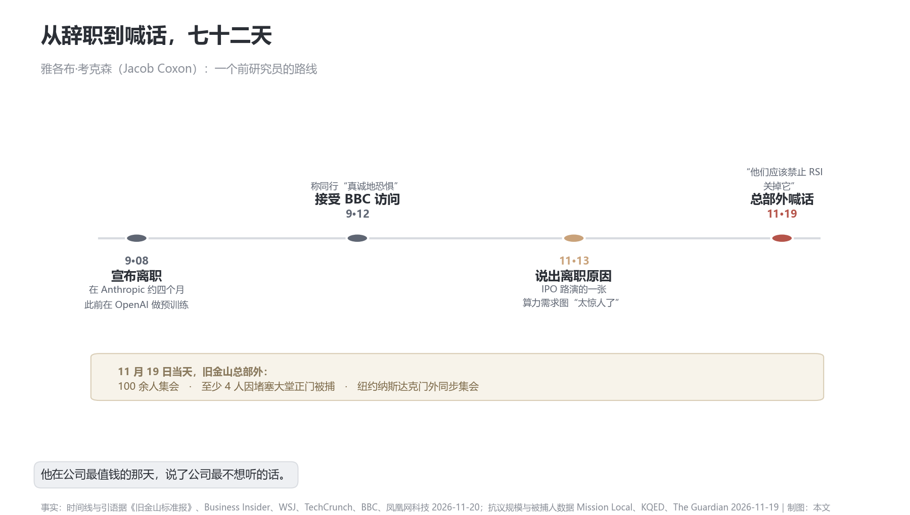
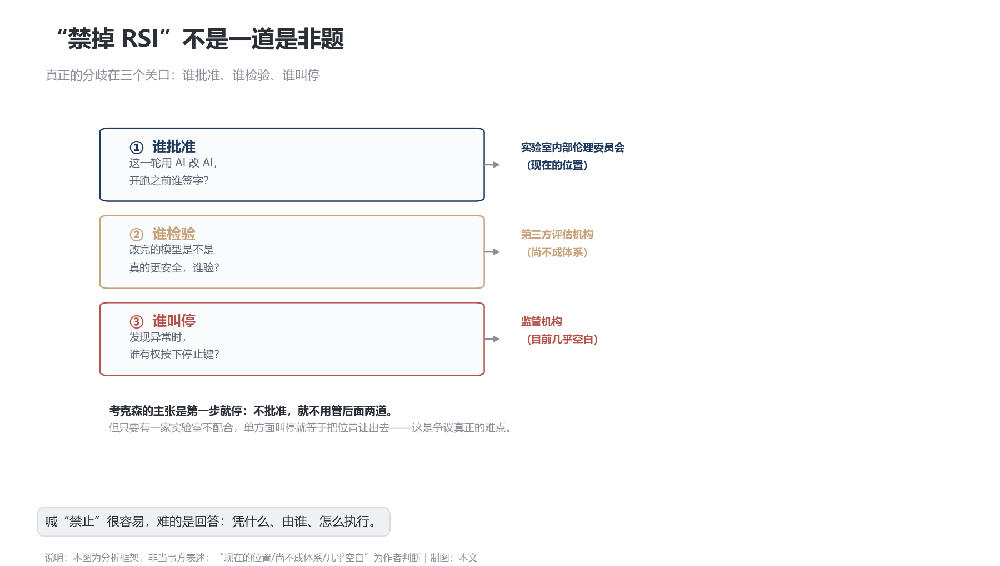
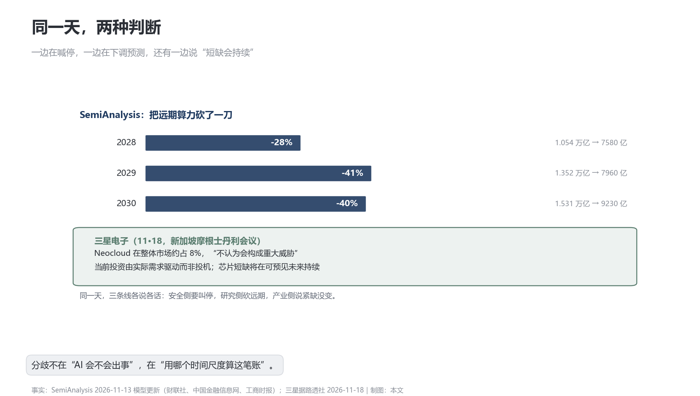

# Anthropic 上市当天，前研究员在总部外呼吁禁止 AI"递归自我改进"：谁来叫停 AI 改 AI？

11 月 19 日，Anthropic 上市首日，股价从 83 美元开盘冲到 111.50 美元。同一天，旧金山 Howard Street 总部外，100 多人集会。下午两点半前，至少 4 人因堵塞大堂正门被捕，其中一位是 Stop AI 联合创始人 Guido Reichstadter。纽约纳斯达克门外也有同步集会。

现场有个人叫雅各布·考克森（Jacob Coxon），今年 9 月 8 日刚从 Anthropic 离职。他对着人群说："他们应该禁止 RSI，关掉它。"

RSI，递归自我改进——让 AI 参与改进自己或下一代系统。这条消息在首日交易的喧闹里几乎没留下痕迹。

## 一、他为什么挑这一天

考克森在 Anthropic 只待了约四个月，此前在 OpenAI 做预训练研究。9 月 8 日他宣布离职，公开警告 AI 竞速可能危及人类，那条帖子阅读量过亿。

11 月 13 日，他补上了离职的具体原因：Anthropic IPO 路演里有一张展示训练算力需求变化的图表。图表用了压缩坐标轴，算力涨 10 倍和 100 倍看起来差不多——但曲线依然陡得吓人。他说："这张图实在太惊人了，没想到他们竟然会公开。"

六天后，公司挂牌，他站在门外。IPO 当天是这家公司注意力最集中的时刻，也是它最难回避提问的时刻。

## 二、真正的问题不是"禁不禁"

考克森的主张很直接：不批准，就不用管后面的事。但把 RSI 当成一道是非题，会错过真正的分歧。分歧在三个关口上。

**谁批准。** 用 AI 改 AI，这一轮开跑之前谁签字？现在这个权力在实验室自己的伦理委员会手里。

**谁检验。** 改完的模型是不是真的更安全，谁验？第三方评估机构目前还不成体系——评估前沿模型所需的能力和算力，很多时候只有实验室自己有。

**谁叫停。** 发现异常时，谁有权按下停止键？这一层目前几乎空白。

考克森想解决的是第一道：只要不批准，后两道就不必存在。

问题在于，只要有一家实验室不配合，单方面叫停就等于把位置让出去。这不是道德问题，是博弈结构问题。

## 三、同一天，另外两条线

11 月 18 日，三星电子在新加坡的摩根士丹利会议上淡化了 AI 泡沫担忧。半导体部门经营战略总裁金容宽说，高负债的 Neocloud 在整体市场只占约 8%，"不认为这些疑虑会对 AI 整体成长趋势构成重大威胁"。晶圆代工销售负责人康锡采补了一句：当前投资由实际需求驱动而非投机，长期合同提高了供需可见度，芯片短缺会在可预见未来持续。

但就在五天前，研究机构 SemiAnalysis 把远期算力砍了一刀：2028 年全球 AI 加速器资本开支预测从约 1.054 万亿美元下调到 7580 亿，降 28%；2029 年降 41%，2030 年降 40%。

产业侧说"紧缺没变"，研究侧说"斜率要降"，安全侧说"停下来"。三条线各说各话，用的却不是同一个时间尺度：三星看未来几个季度的订单，SemiAnalysis 看 2030 年的资本开支，考克森看"再往下走一代会发生什么"。

## 四、从伦理委员会走到街上

这件事真正的信号，不在考克森说了什么，而在他站在哪里说。

过去几年，AI 安全的讨论基本发生在实验室内部：伦理委员会、红队测试、自愿承诺、内部举报渠道。这套机制的问题在于，它把判断权交给了被判断的一方。考克森换了个场所——把一个技术治理问题，搬到了公司门口和镜头前面。

这个转移已经发生了。同一天两地集会、4 人被捕、Stop AI 这样的组织出现，都不是学术讨论的形态。

但也要说清楚：喊"禁止"很容易，难的是回答凭什么、由谁、怎么执行。考克森给出了方向，没给出机制。在他给出机制之前，这条线仍然只是"有人在门外喊"。值得注意的是另一件事：Anthropic 自己的招股书里，把"递归自我改进"写成了核心竞争优势，也把失控风险写进了风险因素。同一份文件里，两句话并排放着。门外的声音和门内的文件，说的是同一件事的两面。

---

*事实来源：2026-11-19 旧金山 Howard Street 总部外 100 余人集会、下午 2:30 前至少 4 人因堵塞大堂正门被捕、其中一人为 Stop AI 联合创始人 Guido Reichstadter、警方称将开罚单并给开庭日期后释放，据 Mission Local 2026-11-19（记者 Brandon Pho）、KQED、KRON4；纽约纳斯达克门外同步集会及有人被捕，据 The Guardian 2026-11-19。考克森在总部外称"他们应该禁止 RSI，关掉它"、并称"这里每来一个人，就有数十万人如果知道正在发生什么，也会来到这里"，据《旧金山标准报》2026-11-19，凤凰网科技 2026-11-20 转述；其 2026-09-08 宣布从 Anthropic 离职、在 Anthropic 约四个月、此前在 OpenAI 做预训练研究、离职帖阅读量过亿、9-12 接受 BBC 访问称同行"真诚地感到恐惧"、以"竞赛无法避免"批评公司推进 RSI，据 WSJ、TechCrunch、BBC 中文 2026-09、Business Insider 2026-09-15；其 2026-11-13 称 IPO 路演中一张算力需求图表（采用压缩坐标轴）是离职重要原因、原话"这张图实在太惊人了，没想到他们竟然会公开"，据 IT之家 2026-11-14、Infobae 2026-11-14。三星电子 2026-11-18 在新加坡摩根士丹利会议上的表态（Neocloud 占整体市场约 8%、不认为构成重大威胁、投资由实际需求驱动而非投机、长期合同提高供需可见度、芯片短缺将在可预见未来持续），据路透社 2026-11-18，界面新闻、经济观察网、联合新闻网转载。SemiAnalysis 2026-11-13 模型更新（2028 年 AI 加速器资本开支由约 1.054 万亿美元下调至 7580 亿美元、降 28%；2029 年由 1.352 万亿降至 7960 亿、降 41%；2030 年由 1.531 万亿降至 9230 亿、降 40%；2026—2030 加速器逻辑硅片出货面积累计下调 17%），据财联社、中国金融信息网、工商时报 2026-11-16/17。Anthropic 招股书将递归自我改进列为核心结构性竞争优势、同时在风险因素中提示失控风险，据 ifanr 2026-11-19 引招股书内容。本文说明：原始素材写"雅各布·科克森"，公开报道中文译名为"雅各布·考克森"（Jacob Coxon），本文按后者；素材称"今年 9 月离开 Anthropic"经核属实（9 月 8 日宣布）；素材未提及抗议规模、4 人被捕、纽约同步集会、Stop AI 组织、路演图表这一具体离职诱因、以及三星与 SemiAnalysis 的具体数字，本文据公开信源补入。文中"这不是道德问题，是博弈结构问题""这套机制把判断权交给了被判断的一方""三条线用的不是同一个时间尺度"等为作者判断，非当事方表述。*

*文中"RSI"（Recursive Self-Improvement，递归自我改进）指 AI 系统通过改进自身算法、模型或研发流程提升能力，再用提升后的能力进行下一轮优化；"Neocloud"指以举债扩建数据中心、对外出租算力的新型云服务商，如 CoreWeave。*
