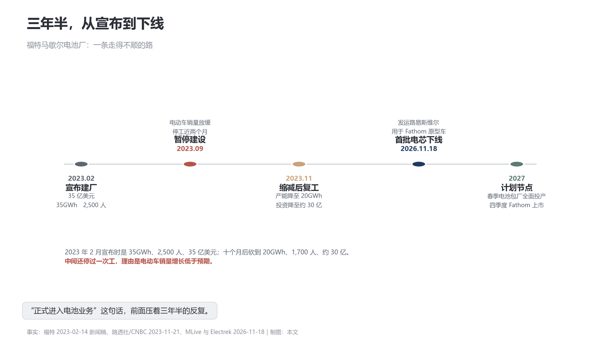
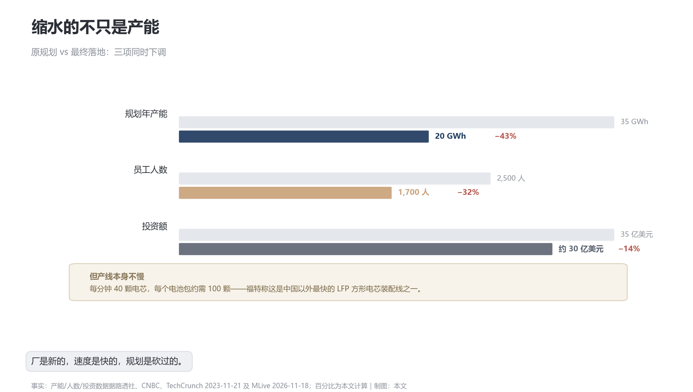
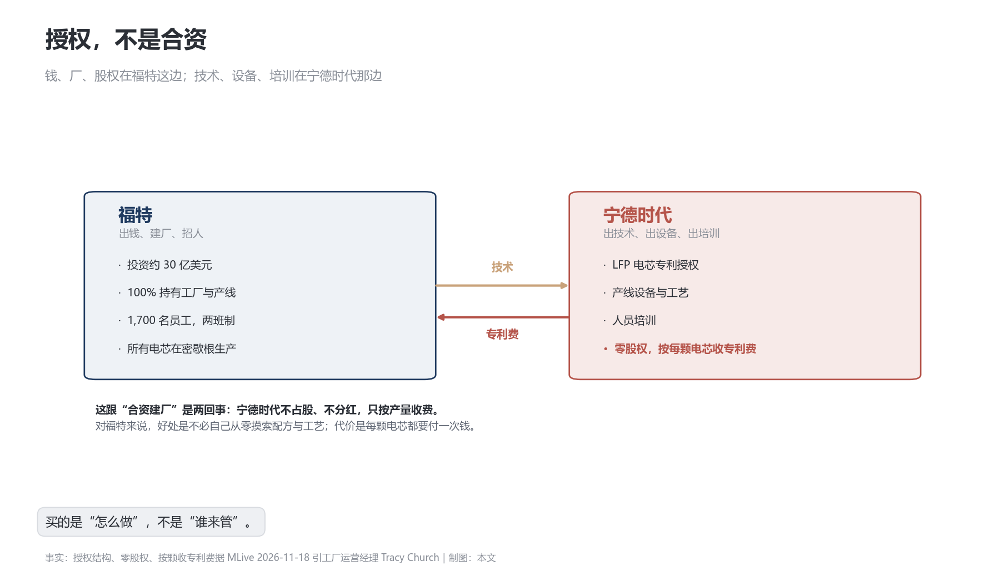

# 福特官宣进入电池业务，技术却来自宁德时代授权：美国制造开始接受"中国技术底座"？

11 月 18 日，福特在密歇根州马歇尔宣布：BlueOval Battery Park 的首批磷酸铁锂（LFP）方形电芯已下线，正在发运肯塔基州路易斯维尔装配厂，装到 Fathom 电动皮卡的原型车和验证车上。

CEO 吉姆·法利说了一句话："福特正式进入了电池业务领域。"

但同一条新闻里还有半句更重要：**这些电芯的技术，来自宁德时代授权。**

## 一、授权，不是合资

先把关系说清楚，因为它跟很多人以为的不一样。

福特出钱建厂、100% 持有工厂和产线、招 1,700 名员工。宁德时代出技术、出设备、出培训，但**零股权**——它不占这个厂的股，也不参与分红。福特按每颗电芯向宁德时代支付专利费，比例未披露。

工厂运营经理 Tracy Church 解释得很直白：福特想快速拿到想要的化学体系和形态，"那就去找一个已经在做、而且是全世界做得最好的人。那就是宁德时代。"

福特先进开发项目副总裁艾伦·克拉克的说法更实在：如果希望在美国生产价格亲民的电动车，就必须尽快实现，而宁德时代是"向我们提供这项技术、帮助我们掌握 LFP 电芯生产方法的最佳供应商"。

买的是"怎么做"，不是"谁来管"。这个区别很重要——它意味着福特拿到的是一条能自己运转的产线，而不是长期供应依赖。代价是每颗电芯都要付一次钱。

## 二、这条路走了三年半，而且砍过一刀

官宣的语气很轻快，时间线不轻快。

2023 年 2 月福特宣布建厂：35 亿美元、35GWh、2,500 人。2023 年 9 月，因为电动车销量增长低于预期，福特暂停建设近两个月。11 月复工，但规模砍了：产能降到 20GWh，员工降到 1,700 人，投资降到约 30 亿美元。

**产能少了 43%。** 不是素材里说的"一半"，是 35 降到 20。这期间它还挨过政治压力——多位美国国会议员质疑它使用中国技术。

但产线本身不慢：每分钟 40 颗电芯，每个电池包约需 100 颗。福特称这是中国以外最快的 LFP 方形电芯装配线之一。质量控制上用 AI 视觉识别实时挑缺陷，目标是把缺陷率按"十亿颗"而不是"百万颗"来统计。

另一个节点容易被忽略：电芯虽然下线了，**电池包工厂要到 2027 年春季才全面投产**。现在只是小批量供样。
## 三、方形电芯和 28,350 美元

Fathom 是福特新 UEV 平台的首款车，计划 2027 年四季度推出。

起售价已经公布：**28,350 美元**（标准续航版），2027 年初开启预订。不是"目标低于 3 万美元"，是具体数字。

这个价格怎么来的？一部分答案在电芯形态上。Fathom 用的是方形（prismatic）电芯，可以直接嵌进底盘布局，让电池包承担一部分车身结构功能，省掉一层结构件，也省掉一部分重量和成本。

LFP 本身的优势也在这：不用镍、不用钴，材料便宜，循环寿命还更长。MLive 采访的工程师说这批电池预期寿命 15 到 20 年。

## 四、真正要验的是什么

把这件事放到更大的图里看。欧洲车企在电池上普遍走多源分散路线——同时签几家供应商，谁便宜用谁，谁也不深度绑定。美国车企这次走的是另一条：直接把中国电池技术引进来，在自己国土上生产。

这是一种务实组合。它绕开了"要不要用中国电池"这个政治问题，换成了"用中国的图纸、美国的工厂、美国的工人"。密歇根州州长惠特默在现场的说法是，这是"在美国本土竞争并战胜中国"的方式。

但真正要验证的不是这条路线对不对，是**Fathom 能不能兑现 28,350 美元**。因为 20GWh 的产能，按每包约 100 颗电芯算，大概够装二十多万辆车。这个规模撑不起一个全新的电动车平台——福特需要 Fathom 卖得好，才有理由把产能扩回去。

而那 43% 的削减，本身就是市场给过的答案：2023 年福特认为卖不了那么多。三年后它把第一批电芯装上了原型车，但那个判断还没有被推翻。

---

*事实来源：2026-11-18 福特宣布密歇根州马歇尔 BlueOval Battery Park Michigan 首批 LFP 方形电芯下线并发运肯塔基州路易斯维尔装配厂、用于 Fathom 原型车与验证车、福特称系美国车企首次为主流消费车型供应本土生产 LFP 电芯、电池包工厂 2027 年春季全面投产，据 MLive 2026-11-18（记者 Ryan Boldrey，引工厂运营经理 Tracy Church、工艺工程师 Austin Evans、密歇根州州长 Gretchen Whitmer）、Electrek 2026-11-18、UPI 2026-11-18、Automotive World、CNBC 2026-11-18。技术来自宁德时代授权、宁德时代零股权、福特按每颗电芯支付未披露比例专利费、宁德时代提供技术设备与培训但所有电芯在密歇根生产、Church"去找一个已经在做而且全世界做得最好的人"表述，据 MLive 2026-11-18。艾伦·克拉克（Ford 先进开发项目副总裁、UEV 平台负责人）关于"在美国生产价格亲民的电动车就必须尽快实现、宁德时代是最佳供应商"的表述，据 Electrek 2026-11-18。吉姆·法利"福特正式进入电池业务"及 Fathom 2027 年四季度推出、起售价低于 3 万美元，据福特 2026 年三季度财报电话会及 Electrek、MLive。起售价 28,350 美元（标准续航版）、2027 年初开启预订，据 MLive 2026-11-18 及 Electrek 2026-08-06。工厂投资约 30 亿美元、200 万平方英尺、年产能约 20GWh、1,700 名员工、每分钟 40 颗电芯、每个电池包约需 100 颗、AI 视觉质检、缺陷率按十亿颗统计、方形电芯直接融入底盘并承担部分车身结构功能、电池预期寿命 15—20 年，据 MLive 与 Electrek 2026-11-18。2023-02-14 福特宣布建厂（35 亿美元、35GWh、2,500 人、2026 年投产）、2023-09 因电动车销量放缓暂停建设、2023-11-21 缩减规模后复工（产能降 43% 至 20GWh、员工降至 1,700、投资降至约 30 亿美元）、曾遭美国国会议员质疑使用中国技术，据福特 2023-02-14 新闻稿、路透社/CNBC/TechCrunch 2023-11-21、MLive 2026-11-18 回顾。本文计算：35 → 20GWh 为 −42.9%（文中取 43%）；2,500 → 1,700 人为 −32%；35 → 30 亿美元为 −14.3%；20GWh ÷（100 颗/包 × 约 0.08kWh/颗）为量级估算，文中仅作"二十多万辆"的粗略表述，非福特口径。本文说明：原始素材称"产能规划较早些时候少了一半"，经核为削减约 43%，本文按实际比例；素材称"起售价目标低于 3 万美元"，经核福特已公布具体起售价 28,350 美元；素材未提及宁德时代零股权与按颗收专利费、电池包工厂 2027 年春季才全面投产、2023 年曾暂停建设近两个月、曾遭国会议员质疑，本文据公开信源补入。文中"买的是怎么做不是谁来管""这条路绕开了政治问题换成了中国图纸美国工厂""43% 的削减本身就是市场给过的答案"等为作者判断，非当事方表述。*

*文中"LFP"指磷酸铁锂，不使用镍钴的正极材料路线；"方形电芯"（prismatic）指硬壳方形封装，与圆柱、软包并列的三种主流形态之一；"GWh"为吉瓦时，电池产能常用单位。*
