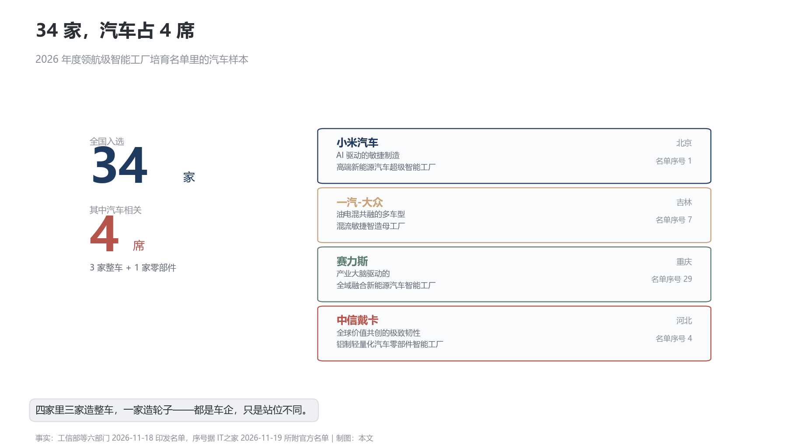
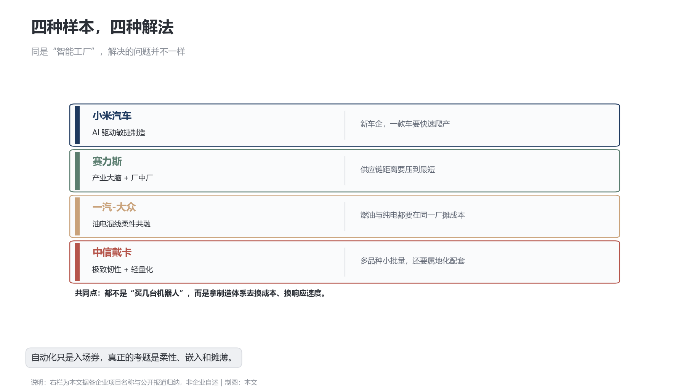
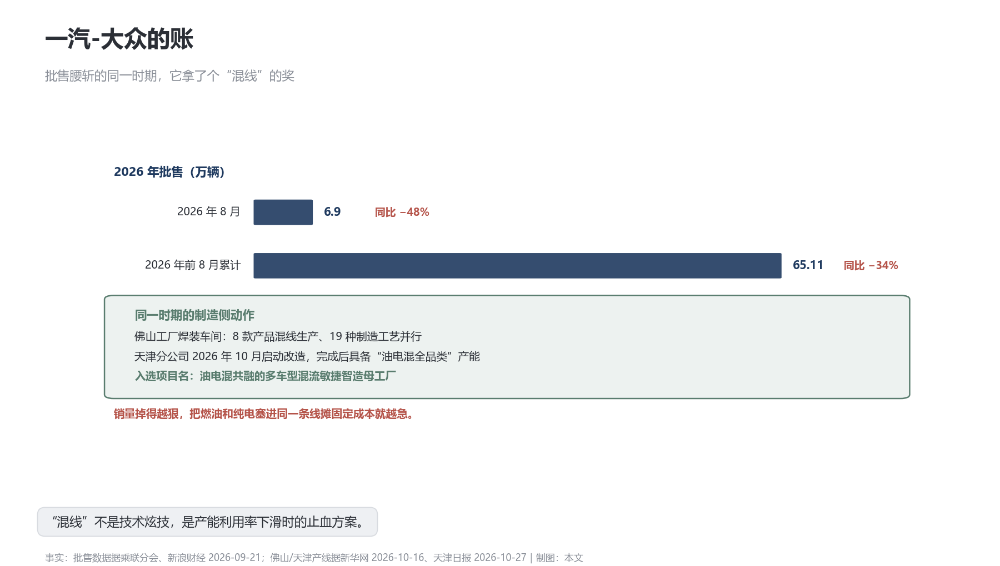

# 34 家领航级智能工厂公布，汽车占 4 席：3000 台机器人背后，车圈制造开始卷"厂中厂"

11 月 18 日，工信部等六部门印发 2026 年度领航级智能工厂培育名单，共 34 家入选。第二天在 2026 世界智能制造大会上正式公布。

领航级是智能工厂梯度培育体系的最高层级，下面依次是基础级、先进级、卓越级。

34 家里，汽车相关占 4 席：小米汽车、一汽-大众、赛力斯、中信戴卡。三家整车加一家零部件。

整体数据也不弱：这 34 家全员劳动生产率平均提升 34.4%，生产效率平均提升 19.3%，累计带动近 4000 家企业协同升级。覆盖 20 个省区市，还首次纳入了医药和服装企业。

## 一、四种样本，四种解法

四家入选项目的名字，其实已经各自交代了要解决什么问题。

**小米汽车**："AI 驱动的敏捷制造高端新能源汽车超级智能工厂"。新车企，一款车要快速爬产，AI 在这里主要解决响应速度。

**赛力斯**："产业大脑驱动的全域融合新能源汽车智能工厂"。超 3000 台机器人协同作业，关键工序 100% 自动化，质量检测也 100% 自动化。

**一汽-大众**："油电混共融的多车型混流敏捷智造母工厂"。关键词是"混流"——燃油车和纯电车在同一条线上生产。

**中信戴卡**："全球价值共创的极致韧性铝制轻量化汽车零部件智能工厂"。唯一的零部件企业，全球最大的铝车轮供应商。

## 二、赛力斯的"厂中厂"

四家里最值得拆的是赛力斯，因为它把供应链直接搬进了厂区。

宁德时代的两条 CTP 2.0 电池包产线就建在赛力斯超级工厂里，2025 年 6 月 30 日投产。这是宁德时代在重庆的第一个基地，也是它第一次用"厂中厂"模式。今年 10 月双方又签了长期协议扩建二期，一二期合计规划产能超过 20GWh。

好处很直接：省掉中间仓储和物流环节。工厂还落地了"工厂自动驾驶测试"——车辆从下线检测到入库，全程无人化作业，2026 年 5 月 27 日发布会上演示过。

**这套东西的本质，是把"供应商"变成"邻居"。** 距离缩短带来的不只是运费，还有响应时间。

## 三、一汽-大众的账，反过来看

一汽-大众这个奖，要放在它今年的处境里看。

2026 年 8 月，一汽-大众批售 6.9 万辆，同比下滑 48%；前 8 个月累计批售 65.11 万辆，同比降近 34%。大众在华前三季度交付 137.9 万辆，同比降 30.2%。

就在这个背景下，它拿了一个"混流"的奖。

佛山工厂焊装车间：8 款产品混线生产、19 种制造工艺并行。天津分公司 2026 年 10 月启动改造，完成后具备"油电混全品类"生产能力。

**混线的意义不在技术，在成本。** 产能利用率下滑时，固定成本不会跟着下滑——厂房、设备、人员的折旧和开销一分不少。把燃油和纯电塞进同一条线，等于用同一套固定资产摊更多车型，把单位成本压下来。

这是合资车企在过渡期最现实的一招：不赌哪条路线赢，两条都留着，用一条线摊。

## 四、真正的变化在"厂"之外

把四家放在一起看，会发现一个共同点：它们比拼的都不是"自动化程度"。

机器人数量、自动化率这些指标，十年前就在比。今天能进领航级，靠的是另外三样东西。

**一是柔性。** 一条线能生产多少种产品。一汽-大众的 8 款混线、19 种工艺并行，比"100% 自动化"更难。

**二是嵌入。** 供应链能不能进到厂区里。赛力斯的厂中厂，把电池产线变成隔壁车间。

**三是摊薄。** 制造体系能不能帮企业把固定成本压下去。这一条在销量下滑时尤其值钱。

所以"智能工厂"这个词的含义变了。它不再是一个车间的技术水平，而是一家企业用制造体系换成本、换响应速度的综合能力。

34 家里 4 席是汽车，这个比例不算高。但这 4 家恰好把当下车圈的四种活法摆齐了：新势力抢速度，供应链拼距离，合资守存量，零部件做韧性。

---

*事实来源：2026 年度领航级智能工厂培育名单由工业和信息化部、国家发展改革委、财政部、国务院国资委、市场监管总局、国家数据局六部门于 2026-11-17 印发（工信厅联通装函〔2026〕562 号）、11-18 官网发布、11-19 在 2026 世界智能制造大会公布，共 34 家；领航级为智能工厂梯度培育体系最高层级，其下依次为基础级、先进级、卓越级，据工信部官网、经济参考报、IT之家 2026-11-19。名单中汽车相关 4 家及项目名称、所在地、名单序号（小米汽车 1、中信戴卡 4、一汽-大众 7、赛力斯 29），据 IT之家 2026-11-19 所附官方名单、汽车之家 2026-10-28。34 家全员劳动生产率平均提升 34.4%、生产效率平均提升 19.3%、累计带动近 4000 家企业协同升级、覆盖 20 个省区市、首次纳入医药与服装企业，据经济参考报、IT之家 2026-11-19。赛力斯超级工厂超 3000 台机器人协同作业、关键工序 100% 自动化、质量检测 100% 自动化、万吨级超级智能压铸单元、AI 视觉检测、产业大脑将订单拆解颗粒度从"周"压缩到"小时"，据新华网 2026-09-28、赛力斯官网、澎湃新闻 2026-11-20。宁德时代两条 CTP 2.0 电池包产线 2025-06-30 在赛力斯超级工厂投产、系宁德时代在渝首个基地及首次采用"厂中厂"模式、2026-10-10 签长期协议扩建二期（年规划 10—12GWh、一二期合计超 20GWh），据宁德时代官网、赛力斯官网。"工厂自动驾驶测试"新模式（车辆从下线检测到入库全程无人化）于 2026-05-27 鸿蒙智行问界 M9 系列新品发布会由赛力斯汽车总裁何利扬宣布，据一页电车 2026-06-03、中国日报网 2026-06-01、希鸥网 2026-11-19。一汽-大众 2026 年 8 月批售 6.9 万辆同比降 48%、前 8 个月累计批售 65.11 万辆同比降近 34%，据乘联分会数据、新浪财经 2026-09-21；大众在华前三季度交付 137.9 万辆同比降 30.2%，据钛媒体 2026-10-13；佛山工厂焊装车间 8 款产品混线、19 种制造工艺并行，据新华网 2026-10-16；天津分公司 2026-10 启动改造、完成后具备"油电混全品类"产能，据天津日报 2026-10-27。中信戴卡为全球最大铝车轮和铝制底盘零部件供应商、2026 全球汽车零部件供应商百强第 36 位，据中信戴卡公开资料、世铝网 2026-11-19。本文说明：多数媒体报道称"3 家车企入选"，系因中信戴卡为零部件企业；按"汽车相关"口径为 4 席，本文采用后者并标注构成。素材未提及 34 家整体效率数据、赛力斯厂中厂的投产与扩产时间、一汽-大众的销量下滑幅度、佛山与天津的具体产线能力，本文据公开信源补入。文中"混线的意义不在技术在成本""这套东西的本质是把供应商变成邻居""智能工厂的含义变了"等为作者判断，非当事方表述。*

*文中"领航级"指智能工厂梯度培育体系四级中最高一级；"混流生产"指不同车型、不同动力形式在同一条产线上按订单切换生产；"厂中厂"指核心供应商将产线直接建在整车厂园区内。*
