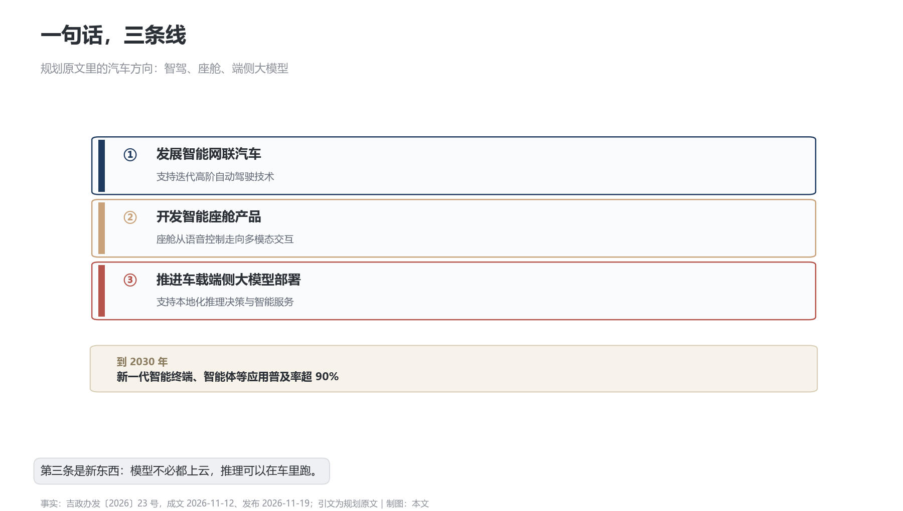
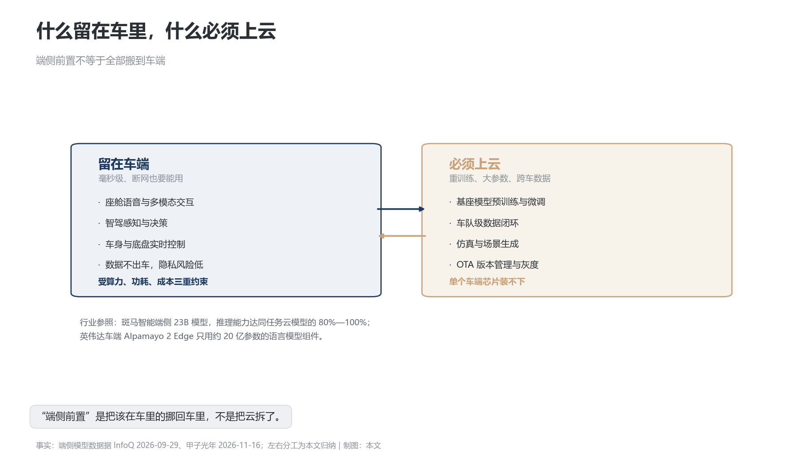
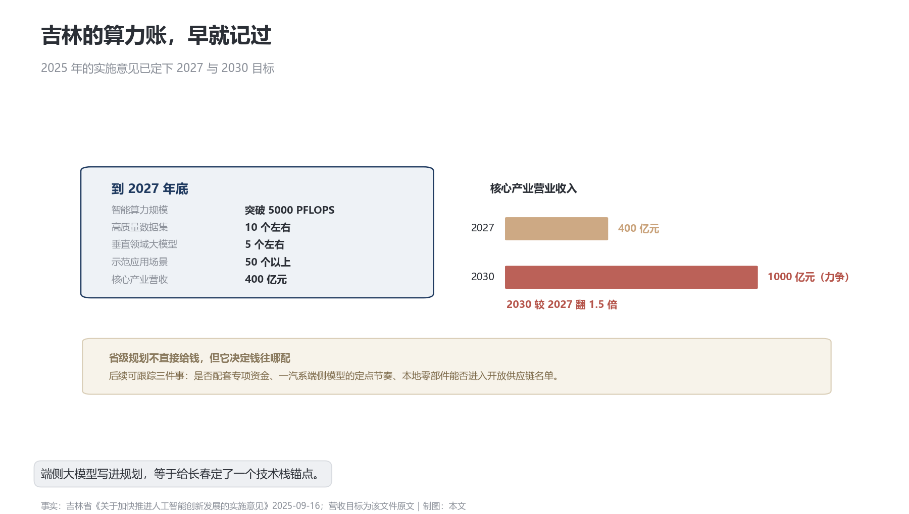

# 吉林把"车载端侧大模型"写进省级规划：座舱和智驾的决策，开始往车端挪

11 月 19 日，吉林省政府办公厅印发《吉林省"人工智能+"发展"十五五"规划》（吉政办发〔2026〕23 号，成文日期 11 月 12 日）。

汽车是其中分量最重的方向。规划在"培育智能消费新产品"一节里写道：

> 发展智能网联汽车，支持迭代高阶自动驾驶技术，开发智能座舱产品，推进车载端侧大模型部署，支持本地化推理决策与智能服务。

这句话不长，但它是省级规划文件里明确写出"车载端侧大模型"的一次。

## 一、这句话的技术含义

拆开看是三条线并进：智驾迭代、座舱产品、端侧大模型部署。前两条行业说了多年，第三条是新的。

"推进车载端侧大模型部署，支持本地化推理决策"——翻成白话就是：**模型不必全部跑在云上，座舱和智驾的判断可以在车里做完。**

这件事在技术上早就开始了。斑马智能今年发布的端侧 23B 全模态模型 AutoOmni 2.0，用 MoE 架构绕开车规芯片的算力和内存限制，端侧推理能力达同任务云模型的 80% 到 100%。英伟达面向车端部署的 Alpamayo 2 Edge，语言模型组件只用约 20 亿参数——而它给云端离线用的 Super 版本是 340 亿参数。

二十亿对三百四十亿，说明端侧不是把云模型整个搬下来，是重新设计一个能在车里跑的版本。

**端侧前置的真实含义，是把该在车里做的挪回车里，不是把云拆了。** 毫秒级的感知与决策、断网也要能用的座舱交互、数据不出车的隐私要求——这些留在车端。基座模型预训练、车队级数据闭环、仿真场景生成、OTA 灰度——这些还得在云上。

## 二、为什么是吉林

吉林在汽车产业版图里的分量集中在长春。一汽总部在那里，还有一整套零部件配套体系。把"车载端侧大模型"写进省级规划，等于给本地整车厂和一级供应商的智能化改造提供了政策依据，也暗示未来的省级资源可能往车端算力和模型部署倾斜。

规划里还有两句配套的话：鼓励龙头企业向中小企业开放供应链与创新平台资源；引导人工智能领军企业在吉林设立区域总部、研发中心与高端制造基地。连起来读是一个很典型的产业政策结构——**用龙头企业的技术路线带动本地配套升级，同时招商引资把外部能力引进来。**

## 三、吉林的账早就记过

这不是吉林第一次在 AI 上定目标。2025 年 9 月 16 日发布的《关于加快推进人工智能创新发展的实施意见》写得很具体：到 2027 年底，全省智能算力规模突破 5000 PFLOPS，形成 10 个左右高质量数据集、5 个左右垂直领域大模型，打造 50 个以上高价值示范应用场景，核心产业营业收入达 400 亿元，到 2030 年底力争突破 1000 亿元。

这份规划里的 2030 年目标则是另一套口径："人工智能+"全面深化拓展，新一代智能终端、智能体等应用普及率超 90%。

一个是产业规模，一个是应用普及率。两套指标放在一起，能看出吉林的思路：**不追求做最大的模型，追求让 AI 尽可能多地被用起来。**## 四、规划只是起点

需要冷静看待的是，省级规划属方向性文件，不构成强制约束，也不直接带来资金。真正值得跟踪的是三件事：是否配套专项资金、一汽系端侧模型的定点节奏、本地零部件能否进入"开放供应链与平台资源"的具体名单。

对车规级芯片、边缘计算域控、端侧模型优化这几类企业来说，这是一个可对接的方向信号——但信号不等于订单。规划的分量在于，它把一条还在演进中的技术路线，提前固化成了一个省的产业方向。长春由此获得一个技术栈锚点：**以后谈智能网联汽车，不只谈整车和电池，还要谈车里的那颗芯片和那个模型。**

---

*事实来源：《吉林省"人工智能+"发展"十五五"规划》由吉林省人民政府办公厅印发，发文字号吉政办发〔2026〕23 号，成文日期 2026 年 11 月 12 日，发布日期 2026 年 11 月 19 日，据吉林省政府信息公开专栏原文。"发展智能网联汽车，支持迭代高阶自动驾驶技术，开发智能座舱产品，推进车载端侧大模型部署，支持本地化推理决策与智能服务"及"鼓励龙头企业向中小企业开放供应链与创新平台资源""引导人工智能领军企业在吉林设立区域总部、研发中心与高端制造基地"为规划原文，据吉林省政府信息公开专栏、第一财经、界面新闻、观点网 2026-11-19 转述。"到 2030 年，'人工智能+'全面深化拓展，新一代智能终端、智能体等应用普及率超 90%"为规划原文，据第一财经 2026-11-19。吉林省《关于加快推进人工智能创新发展的实施意见》（2025-09-16）提出到 2027 年底全省智能算力规模突破 5000 PFLOPS、形成 10 个左右高质量数据集和 5 个左右垂直领域大模型、打造 50 个以上高价值示范应用场景、核心产业营业收入达 400 亿元、到 2030 年底力争突破 1000 亿元，据吉林省政府信息公开专栏原文。斑马智能端侧 23B 全模态大模型 AutoOmni 2.0-23B-A3B 采用 MoE 架构、端侧推理能力达同任务云模型的 80%—100%，据 InfoQ 2026-09-29。英伟达面向车端部署的 Alpamayo 2 Edge 采用约 20 亿参数的语言模型组件、此前推出的 Alpamayo 2 Super 为 340 亿参数用于离线教师与数据生成，据甲子光年 2026-11-16 引英伟达技术博客。本文计算：1000 ÷ 400 = 2.5，即 2030 年目标较 2027 年增长 1.5 倍。本文说明：原始素材称"11 月 19 日印发"，经核 11 月 19 日为发布日期，成文日期为 11 月 12 日，本文按"印发/发布"分别标注；素材未提及 2025 年 9 月那份实施意见的具体算力与营收目标、斑马智能与英伟达的端侧模型参数对照、规划中"开放供应链"与"设立区域总部"两句，本文据公开信源补入。文中"端侧前置的真实含义是把该在车里做的挪回车里""不追求做最大的模型，追求让 AI 尽可能多地被用起来""长春获得了一个技术栈锚点"等为作者判断，非当事方表述。*

*文中"端侧"指模型推理在本地设备完成，不依赖云端；"MoE"指混合专家架构，通过稀疏激活降低单次推理的计算量；"PFLOPS"为每秒千万亿次浮点运算，算力规模单位。*
