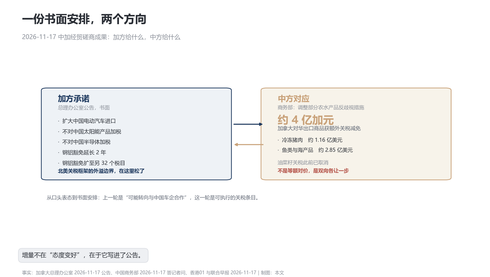
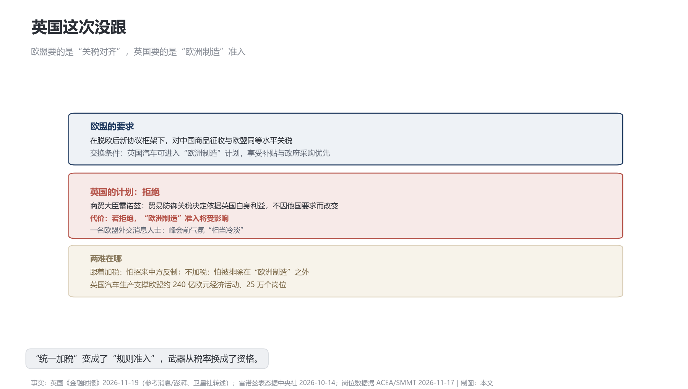
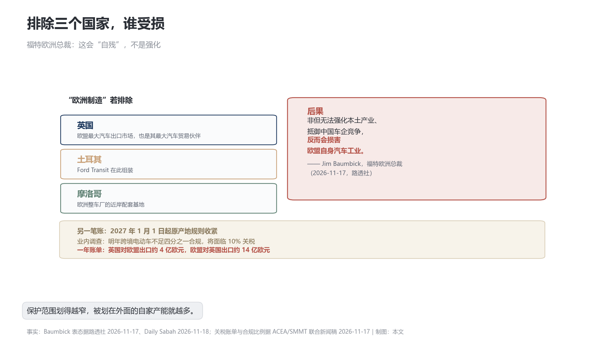

# 加拿大书面承诺扩大中国电动车进口，英国拒绝跟进欧盟加税：贸易壁垒开始"碎片化"

11 月 17 日，深圳 APEC 期间，习近平会见加拿大总理卡尼，这是两人一年内第三次会面。同一天，加拿大总理办公室发了公告：将部分中国钢铝产品的关税减免延长两年，减免范围扩大到另外 32 个关税税目；承诺不对中国太阳能产品和半导体加税；扩大中国电动汽车进口。

中方对约 4 亿加元的加拿大对华出口商品提供额外关税减免——冷冻猪肉约 1.16 亿美元，鱼类和海产品约 2.85 亿美元。

## 一、增量在"书面"两个字

上一轮关于加拿大的消息是口头表态——总理说"可能转向与中国车企合作"。那是信号。这一次是可执行的关税条目：哪个税目、延长几年、扩到多少项。区别在于后者要履行国内程序，会被写进海关系统。

加拿大在**半导体和太阳能**上承诺不加税，同时**扩大电动车进口**。这三个恰好是美国关税框架里最敏感的品类。美国搭的框架，在加拿大这个方向上出现了明确松动。

## 二、英国那边，反过来

欧洲的分化更直接。11 月 20 日，英欧峰会在布鲁塞尔举行，计划签署经济伙伴关系协议。据英国《金融时报》报道，欧盟要求英国在脱欧后新协议框架下，对中国商品征收与欧盟同等水平的关税——作为交换，英国汽车可以进入"欧洲制造"计划，享受补贴和政府采购优先。

英国计划拒绝。商贸大臣雷诺兹的表态一直很一致："当我们就与欧盟有关的贸易防御关税做出决定时，都是基于英国自身利益，而不是基于其他国家提出了这样的要求。"

代价也摆在那儿：如果拒绝，"欧洲制造"准入将受影响。一名欧盟外交消息人士对《金融时报》说，峰会前气氛"相当冷淡"。

**注意这里武器换了。** 过去是"加多少税"，现在是"给不给资格"。关税是价格工具，准入是身份工具，更难谈——因为它不设数值，只设门槛。

## 三、福特欧洲总裁说了句实话

11 月 17 日，福特欧洲总裁 Jim Baumbick 公开警告：如果欧盟把英国、土耳其、摩洛哥排除在"欧洲制造"模式之外，非但无法强化本土产业、抵御中国车企竞争，反而会损害欧盟自身汽车工业。

他举的例子是 Ford Transit——这款车在土耳其组装，按现行提案可能拿不到"欧洲制造"资格。这个警告的分量在于说话的人：福特是 ACEA 成员，是欧洲本土车企，不是中国车企，也不是贸易鹰派。法国《汽车杂志》把他的用词译得更直白：这是"自残"。

同一周，ACEA 和英国 SMMT 发了联合声明，把另一笔账算了出来：2027 年 1 月 1 日起，英欧贸易协定下更严的原产地规则生效，业内调查显示明年跨境电动车不足四分之一能合规，将被征收 10% 关税。仅 2027 年一年，账单约合英国对欧盟出口 4 亿欧元、欧盟对英国出口 14 亿欧元。英欧汽车年贸易额约 800 亿欧元。

## 四、保护范围越窄，附带损伤越大

把两条线放在一起，能看到同一个困境：**保护工具设计得越精确，被划在外面的自家产能就越多。**
加拿大要卖农产品、要维持与最大贸易伙伴之一的关系，于是选择"扩大进口 + 换农产品出口"。英国的汽车业深度嵌在欧盟供应链里，跟着加税等于给自己的出口加成本。欧盟想保护本土制造，但"欧洲制造"划得越窄，福特在土耳其的工厂就越可能被自己的规则挡在门外。

这不是谁对谁错，是工具的结构性缺陷：**当产业已经跨国整合，任何以国界为单位的保护措施，都会切到自己人。** 所以"统一阵线"这个词越来越难用：加拿大书面松了口，英国公开拒了，法德还在要求英国对齐。同一套关税框架，在不同国家算出的是不同的账。

---

*事实来源：2026-11-17 深圳 APEC 期间习近平会见加拿大总理卡尼（一年内第三次会面）、加拿大总理办公室同日发布公告，据联合早报 2026-11-17、香港01 2026-11-17。加方承诺（部分中国钢铝产品关税减免延长两年、减免范围扩大至另外 32 个关税税目、不对中国太阳能产品和半导体加税、扩大中国电动汽车进口），据加拿大总理办公室公告，中国产业经济信息网 2026-11-20 转述。中方对约 4 亿加元加拿大对华出口商品提供额外关税减免（冷冻猪肉约 1.16 亿美元、鱼类与海产品约 2.85 亿美元），据香港01 2026-11-17 引加拿大总理办公室；商务部 2026-11-17 答记者问表述为"进一步调整对加方部分农水产品采取的反歧视措施"，并确认双方同意将初步联合安排相关豁免措施延长 2 年、加方进一步扩大对中国钢铝产品豁免范围。背景（加拿大前政府曾对中国电动车征 100% 关税、中方对油菜籽反制、2026 年 1 月卡尼访华后加方以低关税允许少量中国电动车进入、中方取消油菜籽关税），据纽约时报中文网 2026-11-18。2026-11-20 英欧峰会在布鲁塞尔举行、欧盟要求英国对中国商品征收与欧盟同等水平关税、英国计划拒绝、若拒绝"欧洲制造"准入受影响、欧盟外交消息人士称气氛"相当冷淡"，据英国《金融时报》，参考消息/澎湃 2026-11-19、俄罗斯卫星通讯社 2026-11-19 转述。雷诺兹表态，据中央社 2026-10-14、联合早报 2026-10-21。Jim Baumbick（福特欧洲总裁）2026-11-17 关于排除英国、土耳其、摩洛哥将损害欧盟自身汽车工业、以在土耳其组装的 Ford Transit 为例，据路透社 2026-11-17、Daily Sabah 2026-11-18；"自残"（automutilation）用词据法国《汽车杂志》（journalauto）2026-11-18。ACEA 与 SMMT 2026-11-17 联合声明（英欧汽车年贸易额约 800 亿欧元、2027-01-01 起 TCA 更严原产地规则生效、业内调查显示明年跨境电动车不足四分之一合规并将面临 10% 关税、2027 年账单约 UK→EU 4 亿欧元与 EU→UK 14 亿欧元、英国汽车生产支撑欧盟约 240 亿欧元经济活动与 25 万个岗位），据 ACEA 官网新闻稿 2026-11-17。本文说明：原始素材称"中方新增对每年价值 4 亿加元的加拿大农产品出口给予关税减免"作为"对等安排"，经核 4 亿加元为中方减免所覆盖的加方对华出口规模（含冷冻猪肉与鱼类海产品），加方对应动作是延长钢铝豁免并扩围，二者并非等额对价，本文按双向安排并列呈现；素材未提及油菜籽关税此前已取消、ACEA/SMMT 的 2027 年关税账单与合规比例、英国汽车业支撑欧盟 25 万个岗位，本文据公开信源补入。文中"信号和安排的区别在于后者要履行国内程序""武器从税率换成了资格""保护范围越窄被划在外面的自家产能越多"等为作者判断，非当事方表述。*

*文中"欧洲制造"（Made in Europe）指欧盟拟议的 Industrial Accelerator Act 中关于本地含量与补贴、政府采购资格的规定；"原产地规则"指英欧贸易与合作协定（TCA）中对产品本地增值比例的要求。*
