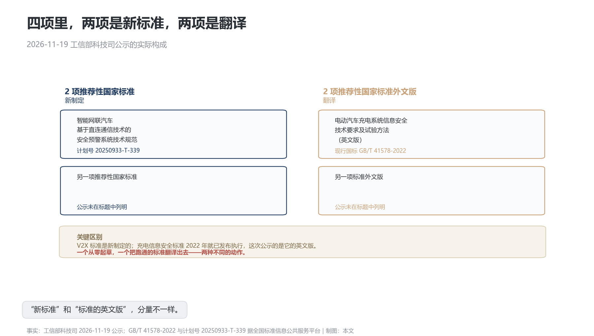
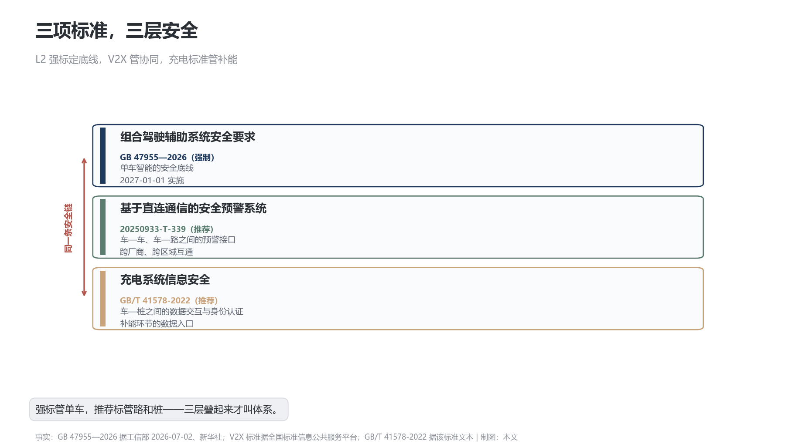
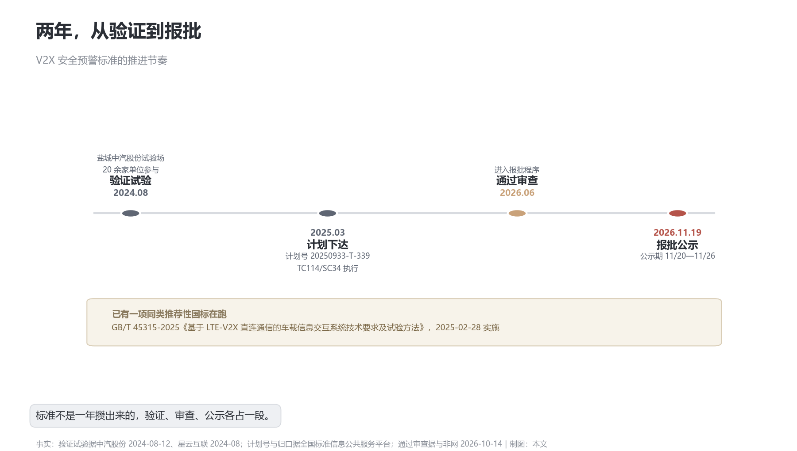

# V2X 安全预警、充电信息安全国标报批，外文版同步公示：中国智能汽车标准开始"向外走"

11 月 19 日，工信部科技司发布公示：相关标准化技术组织已完成《智能网联汽车 基于直连通信技术的安全预警系统技术规范》等 2 项推荐性国家标准、《电动汽车充电系统信息安全技术要求及试验方法》等 2 项推荐性国家标准外文版的编制工作，公开征求报批意见。公示期 11 月 20 日至 26 日。

国标报批不稀奇，一年到头都在报。这次值得看的是那个"外文版"。

## 一、四项里，两项是新标准，两项是翻译

先把构成说清楚，因为这里有个容易混的地方。

《智能网联汽车 基于直连通信技术的安全预警系统技术规范》是**新制定**的推荐性国标，计划号 20250933-T-339，由全国汽车标准化技术委员会智能网联汽车分会（TC114/SC34）执行。

而《电动汽车充电系统信息安全技术要求及试验方法》——它是**现行国标 GB/T 41578-2022**，2022 年就发布了。这次公示的是它的**英文版**，不是新标准。

一个从零起草，一个把已经跑通的标准翻译出去。这两种动作的分量完全不同。

## 二、V2X 和充电信息安全，各管一段

再看这两项各自管什么。

**V2X 安全预警**管的是车与车、车与路之间的预警接口。它把交叉路口碰撞预警、左转辅助、闯红灯预警、前方车辆切出这些场景的交互方式统一到一套规范里。路侧单元（RSU）、车载单元（OBU）和预警应用供应商按同一套语言说话，跨厂商、跨区域互通的门槛才会降下来。

**充电信息安全**管的是车与桩之间的数据交互。充电过程涉及身份认证、数据传输、支付结算，桩端一旦成为数据入口，它的安全等级就直接关系整车和用户数据。随着充电网络扩张和车网互动（V2G）推进，这条边界只会越来越重要。

这两项和此前的 L2 强标是什么关系？GB 47955—2026《智能网联汽车 组合驾驶辅助系统安全要求》是**强制性**国标，2026 年 6 月 27 日批准发布，2027 年 1 月 1 日实施，管的是单车智能的安全底线。

强标管单车，V2X 推荐标管路，充电标准管桩。三层叠起来，才叫体系。

## 三、外文版为什么是信号

现在回到那个"外文版"。

中国每年发布的国标很多，但同步出外文版的比例不高。出外文版通常意味着一件事：这套规则希望被境外读到、被引用、被拿来对接。

标准输出这件事，路径和产品出口不一样。产品出口要过别人的认证，标准输出是让别人按你的规则做认证。前者是被动合规，后者是主动定义。

当然，这只是一个前置动作。公示外文版离"国际互认"还有很长的路——要经过国际标准组织的程序，要有关键市场的采纳意愿，要有实际的产品按这套标准做出来并卖出去。

但方向是清楚的：**先把标准翻译出去，是争取话语权的第一步。**

## 四、标准不是一年攒出来的

V2X 这项标准的推进节奏，能说明标准工作的真实成本。

2024 年 8 月，标准验证试验在中汽股份盐城试验场做完，20 余家整车企业、检测机构和 RSU 供应商参与，测了交叉路口碰撞预警、左转辅助、闯红灯预警、前方车辆切出、前方侧向车道异常车辆等 V2I 和 V2V 场景。

2025 年 3 月，计划正式下达。2026 年 6 月通过审查，进入报批程序。2026 年 11 月 19 日公示。

两年多，从验证到报批。

而这只是推荐性标准。强制性标准（比如 GB 47955—2026）的周期更长，涉及的技术验证和产业协调也更复杂。

所以看标准新闻，别只看"发布"那一天。真正决定一项标准能不能落地的，是它前面那两年——验证试验做了没有、多少家企业参与、测试场景覆盖够不够。

---

*事实来源：2026-11-19 14:21 工信部科技司发布《关于公开征求〈智能网联汽车 基于直连通信技术的安全预警系统技术规范〉等 2 项国家标准和 2 项国家标准外文版报批意见的公示》，公示时间 2026-11-20 至 2026-11-26，据工信部官网科技司公示原文。《电动汽车充电系统信息安全技术要求及试验方法》为现行国家标准 GB/T 41578-2022（英文名 Technical requirements and test methods for cybersecurity of electric vehicle charging system），此次公示为其外文版，据全国标准信息公共服务平台。V2X 标准计划号 20250933-T-339、由 TC114（全国汽车标准化技术委员会）归口、TC114/SC34（智能网联汽车分会）执行、主管部门工业和信息化部、主要起草单位含中国汽车技术研究中心有限公司与安徽江淮汽车集团股份有限公司等，据全国标准信息公共服务平台。2024-08-05 至 09 标准验证试验在中汽研汽车试验场股份有限公司（中汽股份）长三角（盐城）智能网联汽车试验场开展、20 余家整车企业/检测机构/RSU 供应商参与、测试交叉路口碰撞预警与左转辅助、闯红灯预警、前方车辆切出、前方侧向车道异常车辆等 V2I 与 V2V 场景，据中汽股份 2024-08-12、星云互联 2024-08。2026 年 6 月通过审查，据与非网 2026-10-14。GB 47955—2026《智能网联汽车 组合驾驶辅助系统安全要求》于 2026-06-27 由国家市场监督管理总局、国家标准化管理委员会批准发布、拟于 2027-01-01 实施、针对基础单车道/基础多车道/领航驾驶辅助三类系统分别提出要求，据工信部 2026-07-02、新华社 2026-07-02。GB/T 45315-2025《基于 LTE-V2X 直连通信的车载信息交互系统技术要求及试验方法》于 2025-02-28 实施，据全国标准信息公共服务平台。本文说明：原始素材将《电动汽车充电系统信息安全技术要求及试验方法》外文版与 V2X 标准并列表述为"报批"，易被误读为两者均为新标准；经核前者为 2022 年已发布现行标准的外文版，本文明确区分。素材未提及 V2X 标准计划号、归口单位、2024 年验证试验、2026 年 6 月通过审查、GB/T 45315-2025 已实施，本文据公开信源补入。公示标题所列"2 项国家标准"与"2 项国家标准外文版"中，除文中点名的两项外，其余各一项未在公示标题中列明名称，本文未作推测。文中"标准输出是让别人按你的规则做认证""看标准新闻别只看发布那一天"等为作者判断，非官方表述。*

*文中"V2X"指车与外界的信息交换（Vehicle to Everything），含车—车（V2V）、车—路（V2I）、车—云等；"直连通信"指车辆与路侧设备之间不经基站的直接通信，LTE-V2X 为其主流技术路线；"推荐性国家标准"指自愿采用、一经合同或法规引用即具约束力的国标，区别于强制性国标（GB）。*
