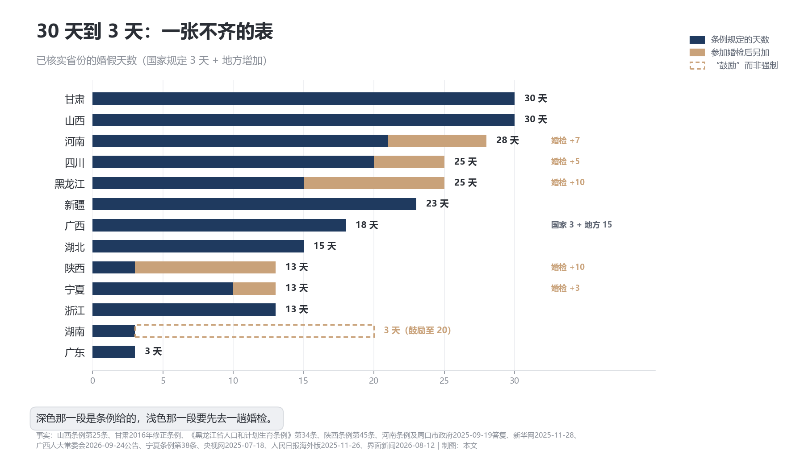
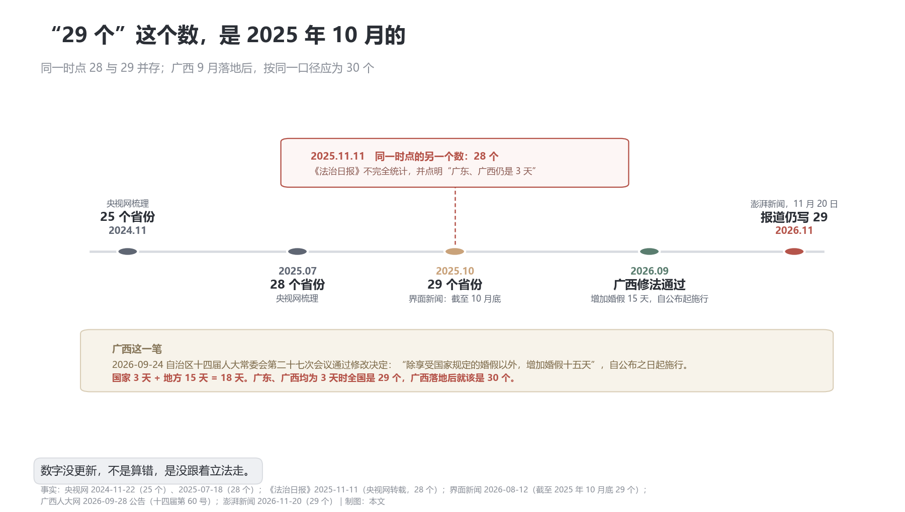
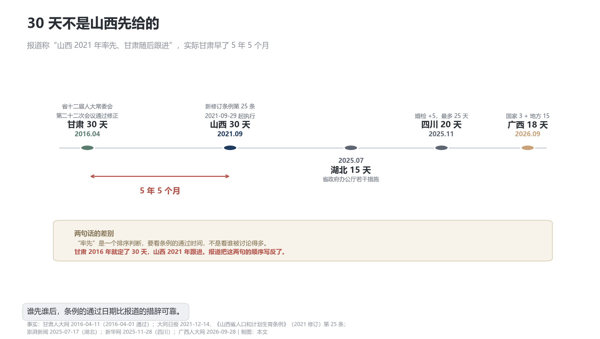

# 婚假最长 30 天，但"29 个省"这个数对不上

11 月 20 日，一条消息被反复转载：全国已有 29 个省区市完成婚假延长的地方立法或政策修订，山西、甘肃以 30 天居首，河南、四川、黑龙江叠加婚检奖励后可达 25 至 28 天。

三个数字，两个得加限定条件。

## 一、"29 个"，同一时点有人数出 28

先把口径摆出来。

2024 年 11 月，央视网梳理是 25 个省份；2025 年 7 月，同一家是 28 个。2025 年 11 月 11 日，《法治日报》不完全统计仍是 28 个，并且点明"还未调整婚假时长的广东、广西仍是 3 天"。而在界面新闻 2026 年 8 月的报道里，写的是"截至 2025 年 10 月底，全国已有 29 个省份延长婚假"。

同一时点，28 和 29 并存。

然后是更要紧的一处。广西 2026 年 9 月 24 日已经完成修法。广西壮族自治区人大常委会公告（十四届第 60 号）写明：在《广西壮族自治区人口和计划生育条例》第二十七条增加一款——"依法办理结婚登记的夫妻，除享受国家规定的婚假以外，增加婚假十五天"，自公布之日起施行，9 月 28 日公布。按国家 3 天加地方 15 天，广西婚假 18 天。

那么，广东、广西都还是 3 天的时候，全国是 29 个；广西落地之后，这个数应当变成 30 个。11 月 20 日的消息仍写 29，用的是广西修法之前的统计。

这里要说清：29 出自"据不完全统计"，本身留了余地。但它至少在时间线上没跟上——两个月前刚有一个省完成了立法。

## 二、30 天不是山西先给的

原话说"山西 2021 年率先将婚假延长至 30 天，甘肃随后跟进"。顺序反了。

山西：2021 年 9 月 29 日起执行新修订的《山西省人口和计划生育条例》，第二十五条写明"依法办理结婚登记的夫妻可以享受婚假三十日"。

甘肃：2016 年 4 月 1 日，甘肃省十二届人大常委会第二十二次会议通过修正版《甘肃省人口与计划生育条例》，婚假 30 天。这条在甘肃人大网 2016 年 4 月 11 日的立法动态里有记录，标题直接写着"婚假30天，女方产假180天、男方护理假30天"。

甘肃比山西早 5 年 5 个月。

## 三、25 到 28 天，要先去一趟婚检

"可达 25 至 28 天"里的"可达"，是一道条件。

河南：国家规定的 3 天，加条例增加的 18 天，是 21 天；参加婚前医学检查再增加 7 天，最多 28 天。周口市人社局 2025 年 9 月 19 日的答复与中新网 2016 年的报道口径一致。

四川：2025 年 11 月修法，婚假从 5 天延长到 20 天，自愿参加婚检再增加 5 天，最多 25 天（新华网 2025 年 11 月 28 日）。

黑龙江：婚假 15 日，参加婚前医学检查增加 10 日，最多 25 日（《黑龙江省人口和计划生育条例》第三十四条）。

三道算式都是加法，但加号前面那段才是默认值。不做婚检，河南 21 天，四川 20 天，黑龙江 15 天。

## 四、假期在变长，登记数在回落

放假这件事，最后要落在登记数上看。

2025 年，全国结婚登记 676.5 万对，比上年增加 10.8%（民政部《2025 年民政事业发展统计公报》，2026 年 9 月 30 日公布）。

2026 年上半年 327.5 万对。2025 年同期是 353.9 万对。少了 26.4 万对，降 7.5%。

一年增，半年减。婚假能解释的部分有限：它只是众多变量里的一个，而且多数省份的加假发生在 2025 年之前。

## 写在最后

婚假天数不是全国统一的数，是一省一条的立法题。要查自己能休几天，只有一条路：翻本省人口与计划生育条例里写婚假的那一条，看它后面有没有"参加婚前医学检查的，增加×天"这半句。

至于"29 个省"——它取决于你查的是哪一年、哪一家媒体的统计。

---

*事实来源：2026-11-20 澎湃新闻《全国多地延长婚假，山西、甘肃以30天居首；河南、四川、黑龙江叠加婚检奖励后可达25至28天；广西增加15天，再婚（含离婚后复婚）也可享受》原文表述为"据不完全统计，全国已有29个省区市完成婚假延长的地方立法或政策修订"，并称"山西2021年率先将婚假延长至30天，甘肃随后跟进"、"四川在2025年11月将婚假从5天延长至20天，参加婚检再增5天"、"广西在今年9月增加15天婚假"。省级统计口径：央视网 2024-11-22《25省份延长婚假 山西、甘肃30天为全国最长》；央视网 2025-07-18《28省份明确：婚假延长，最长30天！》；《法治日报》2025-11-11（经央视网转载）"目前已有28个省份明确延长婚假""还未调整婚假时长的广东、广西仍是3天"；界面新闻 2026-08-12《2026年上半年结婚登记327.5万对，离婚登记138.3万对》"截至2025年10月底，全国已有29个省份延长婚假……河南、黑龙江规定，参加婚检分别额外增加7天、10天，最长婚假分别可达到28天、25天；新疆婚假为23天"；21世纪经济报道 2025-06-10"全国已有27个省份延长婚假"。广西：广西人大网 2026-09-28 公布《广西壮族自治区人民代表大会常务委员会关于修改〈广西壮族自治区人口和计划生育条例〉的决定》，2026-09-24 自治区十四届人大常委会第二十七次会议通过，"在第二十七条增加一款，作为第一款：'依法办理结婚登记的夫妻，除享受国家规定的婚假以外，增加婚假十五天'""本决定自公布之日起施行"。山西：《山西省人口和计划生育条例》（2021 年修订）第二十五条"依法办理结婚登记的夫妻可以享受婚假三十日"，2021-09-29 起执行，据大同日报 2021-12-14、条例全文（0797cx 转载）。甘肃：甘肃人大网 2016-04-11《婚假30天，女方产假180天、男方护理假30天 修正版〈甘肃省人口与计划生育条例〉出台》，2016-04-01 省十二届人大常委会第二十二次会议通过。河南：中新网 2016-05-27《河南产假和婚假最多分别可休190天和28天》"除国家规定的3天婚假外，增加婚假18天。如果参加婚前医学检查，将再增加婚假7天"；周口市人社局 2025-09-19 网上答复同口径。四川：新华网 2025-11-28《四川：延长婚假至最多25天 延长生育假90天》。黑龙江：《黑龙江省人口和计划生育条例》第三十四条"依法办理结婚登记的夫妇享受婚假十五日，参加婚前医学检查的，增加婚假十日，假期工资照发"，据大庆本地宝 2023-12-01、黑龙江省妇联 2025-07-22 转载。陕西：《陕西省人口与计划生育条例》第四十五条，婚前完成婚检在国家 3 天婚假基础上增加 10 天，据西安市人力资源和社会保障局 2026-10-16 网上咨询答复。宁夏：央视网 2025-07-18 引条例第三十八条"享受十天婚假，参加婚检的，增加三天婚假"。湖北：澎湃新闻 2025-07-17《各地婚假天数更新！》，湖北省人民政府办公厅《关于加快完善生育支持政策体系更加务实有效建设生育友好型社会的若干措施》"延长婚假至15天"。浙江 13 天、山东最高 18 天、湖南"鼓励用人单位延长至20天"，据人民日报海外版 2025-11-26《婚假"加时"激活婚恋经济》。结婚登记：民政部《2025年民政事业发展统计公报》（2026-09-30 公布）2025 年全国结婚登记 676.5 万对、比上年增长 10.8%、结婚率 4.8‰，据光明网 2026-10-02、腾讯新闻 2026-10-01；2025 年上半年 353.9 万对据澎湃新闻 2025-07-31 引民政部《2025年2季度民政统计数据》。本文核算："3+15=18""3+18=21、21+7=28""20+5=25""15+10=25""3+10=13""10+3=13"均为条例条文天数的直接相加；"353.9−327.5=26.4 万对、降幅 7.5%"为两次公布数的直接相减与相除；"甘肃比山西早 5 年 5 个月"为 2016-04 与 2021-09 的月份差。需说明三处与素材不一致：其一，素材"29 个省区市"与界面新闻"截至 2025 年 10 月底 29 个省份"数字相同但时点不同，而广西已于 2026-09-24 修法增假并自公布之日起施行，按"广东、广西均为 3 天时为 29 个"的同一口径，现应为 30 个，本文据此指出 29 未随立法更新，未断言具体哪一省被漏计；其二，素材"山西率先、甘肃随后"与甘肃 2016 年即定婚假 30 天的事实相反，本文按条例通过与执行时间排序；其三，素材未区分"条例规定天数"与"叠加婚检奖励后天数"，本文逐省拆分，并注明湖南为"鼓励"而非强制。*

*文中"婚假天数"指《人口与计划生育条例》规定职工本人结婚可享受的带薪假期，含国家规定的 3 天与地方增加部分；"婚检加假"指参加婚前医学检查后另行增加的天数，属附条件奖励，不参加则不能享受；"地方性法规"指省级人大常委会制定或修改的条例，与省政府办公厅文件（政策）在效力层级上不同，本文对湖南即按后者标注。*