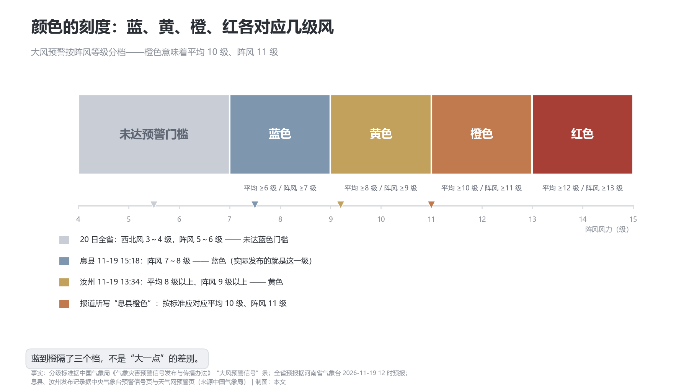
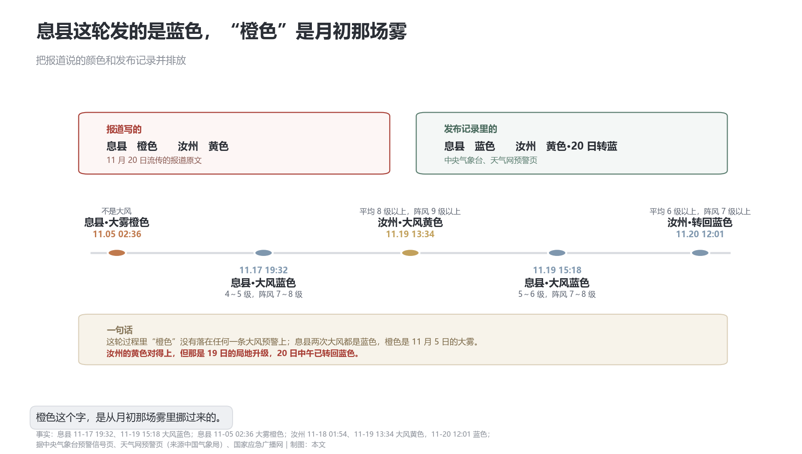
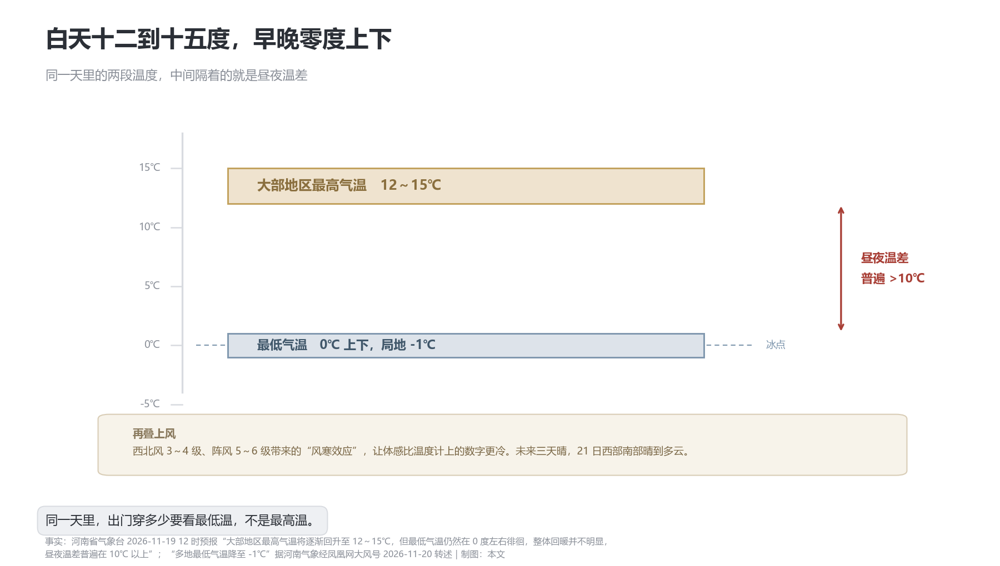

# 河南这场风，"橙色预警"是个误会

11 月 20 日，河南的大风刮到第三天。

河南省气象台 11 月 19 日 12 时的预报写得很明确：20 日全省西北风 3 到 4 级，阵风 5 到 6 级，中西部同样是 3 到 4 级、阵风 5 到 6 级。郑州晴天间多云，白天西北风 3 到 4 级，阵风 5 到 6 级。

而当天流传的报道里有一句："多地连发大风预警，其中息县发布橙色预警，汝州发布黄色预警。"

"橙色"这两个字，值得对一下。

## 一、颜色不是形容词，是刻度

按中国气象局《气象灾害预警信号发布与传播办法》，大风预警（除台风外）分四级，由低到高是蓝、黄、橙、红。每一级都挂着具体的风力门槛：

**蓝色**：24 小时内可能受影响，平均风力可达 6 级以上，或阵风 7 级以上。

**黄色**：12 小时内可能受影响，平均风力可达 8 级以上，或阵风 9 级以上。

**橙色**：6 小时内可能受影响，平均风力可达 10 级以上，或阵风 11 级以上。

**红色**：6 小时内可能受影响，平均风力可达 12 级以上，或阵风 13 级以上。

从蓝到橙隔了三个档。10 级风在陆地上属于少见，能拔树、损毁房屋；11 级更强。而 11 月 20 日河南全省的预报是 3 到 4 级西北风、阵风 5 到 6 级。

这两个量级之间，不是"大一点"的差别。

## 二、息县这两天发的是蓝色

查气象部门的发布记录，息县在这轮大风里发过两次预警，都是蓝色。

11 月 17 日 19 时 32 分：预计未来 24 小时内，城区及所辖乡镇和街道将出现 4 到 5 级偏北风，阵风 7 到 8 级。

11 月 19 日 15 时 18 分：未来 24 小时内，5 到 6 级偏北风，阵风 7 到 8 级。

息县确实出现过橙色预警——但那是 11 月 5 日 2 时 36 分的**大雾**橙色预警，不是大风。

同一时段，汝州的记录是另一个样子：11 月 18 日 1 时 54 分升级发布大风黄色预警（平均风力可达 8 级以上，阵风 9 级以上）；19 日 13 时 34 分再次升级为黄色；到 20 日 12 时 1 分，转回蓝色（平均 6 级以上，阵风 7 级以上）。

把这四条摆在一起看：这轮过程里，"橙色"没有落在任何一条大风预警上；汝州的黄色倒是实打实对得上——那是局地 8 级、阵风 9 级，够黄色（平均 8 级/阵风 9 级）的门槛。而报道里给息县的颜色，比它实际发的那个还高了两级。

## 三、20 日真正在刮多大

按省气象台 19 日 12 时的预报，20 日白天全省西北风 3 到 4 级，阵风 5 到 6 级。

对着标准看，这个量级连蓝色预警的门槛（平均 6 级、阵风 7 级）都没有普遍达到。所以 20 日各地发出来的多是蓝色：平顶山市气象台 11 时 53 分蓝色，叶县 12 时 20 分蓝色，汝州 12 时 1 分蓝色。

汝州 19 日的黄色是个例外，因为一个县和全省不是一回事。看预警先看发布单位：省台说的是全省大势，县台说的是本县那几个乡镇。把县台的局地数字当成全省的量级，或者反过来，都会读错。

## 四、比风更该注意的两件事

风在减弱，另外两件事没减弱。

一是温差。未来三天全省继续受西北气流控制，阳光控场，大部最高气温回升到 12 到 15℃，但最低气温还在 0℃ 上下，局地已经降到 -1℃。昼夜温差普遍超过 10℃。加上大风带来的"风寒效应"，体感比温度计上的数字更冷。

二是干燥。随着中东部雨雪迅速减少，干燥的偏北气流影响南北方超过 20 个省区市，河南正处在"白天干燥、注意保湿"的范围内。大风预警的防御指南一共五条，最后一条是"注意森林、草原等防火"——这几天，这一条比前面四条更用得上。

## 写在最后

11 月 21 日，西部、南部晴天到多云，其他县市晴天间多云；22 日，西部、南部多云到晴天。风会小下去，晴会继续。

看预警，别只看颜色好不好听，要看它后面跟的风级。蓝色是平均 6 级、阵风 7 级，对应的动作是"关好门窗、加固围板棚架"；橙色是平均 10 级、阵风 11 级，对应的是"房屋抗风能力较弱的中小学校和单位停课、停业，人员减少外出"。

同一个颜色词，两种完全不同的天气。写错一级，读的人就会按错的那一级去准备。

---

*事实来源：河南省气象台 2026-11-19 12 时预报"今天白天，中西部西北风3到4级，阵风5到6级""21日，西部、南部晴天到多云；其他县（市、区）晴天间多云""22日，西部、南部多云到晴天"；"大部地区最高气温将逐渐回升至12～15℃，但最低气温仍然在0度左右徘徊……昼夜温差普遍在10℃以上，加上大风带来的'风寒效应'，体感更冷"；郑州"今天，晴天间多云，白天西北风3到4级，阵风5到6级"——据河南气象经凤凰网大风号 2026-11-20 10:03 发布（城市速递）。预警分级标准见中国气象局《气象灾害预警信号发布与传播办法》"大风预警信号"条：蓝色为"24小时内可能受大风影响，平均风力可达6级以上，或者阵风7级以上"，黄色为"12小时内……平均风力可达8级以上，或者阵风9级以上"，橙色为"6小时内……平均风力可达10级以上，或者阵风11级以上"，红色为"6小时内……平均风力可达12级以上，或者阵风13级以上"；各级防御指南分别为"关好门窗，加固围板、棚架、广告牌等易被风吹动的搭建物"（蓝）、"停止露天活动和高空等户外危险作业"（黄）、"房屋抗风能力较弱的中小学校和单位应当停课、停业，人员减少外出"（橙）。息县发布记录：2026-11-17 19:32 大风蓝色（4～5级偏北风，阵风7～8级）、2026-11-19 15:18 大风蓝色（5～6级偏北风，阵风7～8级），据天气网预警页（来源中国气象局）、中央气象台预警信号页；2026-11-05 02:36 大雾橙色预警据国家应急广播网、中央气象台预警信号页。汝州发布记录：2026-11-18 01:54 大风黄色升级（平均风力可达8级以上，阵风9级以上）、2026-11-19 13:34 大风黄色升级、2026-11-20 12:01 大风蓝色（平均6级以上，阵风7级以上），据中央气象台预警信号页与天气网预警页。2026-11-20 平顶山市气象台 11:53 大风蓝色、叶县气象台 12:20 大风蓝色，据中央气象台预警信号页。11 月 18 日至 20 日大风持续、18 日全省西北风 4 级左右阵风 7 级左右，据光明网 2026-11-18《河南大风持续！未来三天气温缓慢回升》；15 日至 18 日降水大风降温过程据河南省气象局 2026-11-13。干燥范围"影响南北方超过20个省区市"、"白天干燥、注意保湿"据中国天气网预报图经凤凰网大风号 2026-11-20 转述。本文核对的三处：其一，"息县发布橙色预警"与发布记录不符——息县这轮大风两次预警均为蓝色，"橙色"实为 11 月 5 日的大雾橙色预警；其二，"汝州发布黄色预警"成立，但那是 19 日 13:34 的局地升级，20 日 12:01 已转回蓝色；其三，报道未区分省台与县台的口径，全省 20 日为 3～4 级、阵风 5～6 级，与汝州局地 8 级、阵风 9 级不是同一量级。本文所据发布记录来自天气网与中央气象台预警信号页，未穷尽县级台站全部发布条目，如息县另有未收录的大风橙色预警，结论需相应修订。*

*文中"风力等级"按蒲福风级，3 级为微风（树叶及微枝摆动不息），6 级为强风（大树枝摇动，举伞困难），8 级为大风（微枝折毁，人向前行走感觉阻力甚大），10 级为狂风（陆上少见，可拔树毁屋），11 级为暴风；"阵风"指短时间内风速的峰值，与"平均风力"是两个口径，预警标准对两者分别设了门槛；"风寒效应"指大风加速人体散热，使体感温度低于气温实测值。*