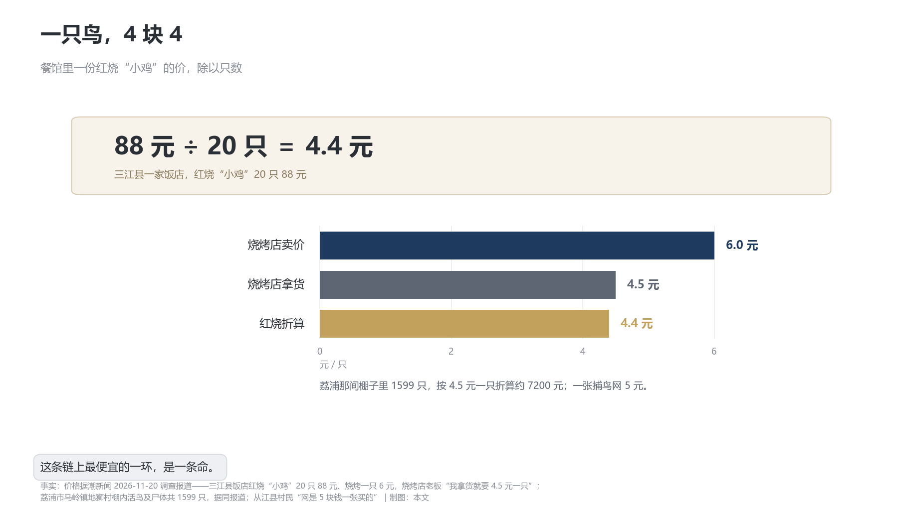
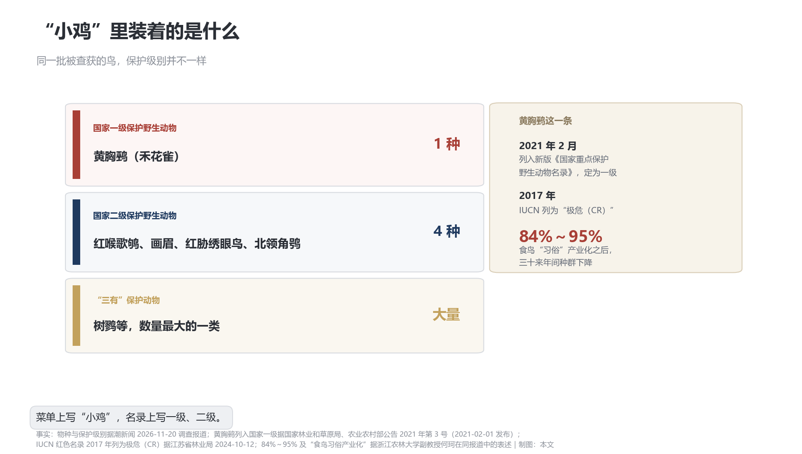
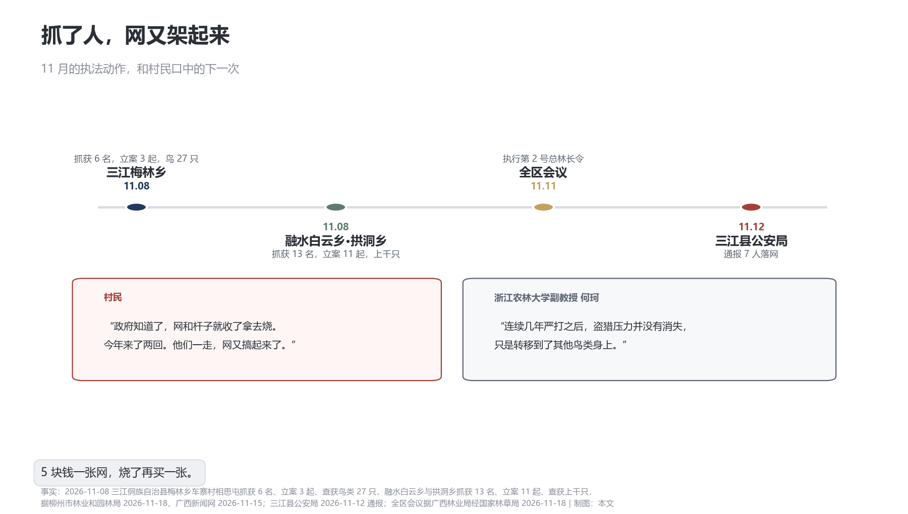

# 一只鸟，4 块 4

秋末冬初是候鸟南迁的高峰。10 月以来，潮新闻记者与护鸟志愿者走了广西柳州融水县、三江县，桂林荔浦市和贵州从江县。

三江县一些饭店里，红烧"小鸡"20 只 88 元，烧烤一只 6 元。烧烤店老板把进货价也说了："我拿货就要 4.5 元一只。"

88 除以 20，是 4 块 4。

## 一、"小鸡"是个代号

这个词不新。2016 年就有报道说，广州一些餐馆管禾花雀叫"荷叶"或"小鸡"。十年过去，词没换。

这次拍清楚的是代号底下装着什么：国家一级保护野生动物黄胸鹀（别名禾花雀）；国家二级保护的红喉歌鸲、画眉、红胁绣眼鸟、北领角鸮；还有树鹨等大量"三有"保护动物。

黄胸鹀值得单独说。2021 年 2 月它被列入新版《国家重点保护野生动物名录》，直接定为国家一级；世界自然保护联盟 2017 年把它列为"极危"。浙江农林大学副教授何珂给了个数：食鸟"习俗"产业化之后，三十来年间黄胸鹀种群下降了 84% 到 95%。

## 二、一张网 5 块钱

链条的起点便宜得离谱。

融水县枫木山风电场四周的灌木丛里，捕鸟网比比皆是，网阵中间放着电子诱鸟器。10 月 26 日上午，记者看到一个头发花白的老人来回走动，把撞网的鸟一只只取下来。航拍里，上山收鸟的还有夫妻，还有十多岁的孩子。

从江县刚边乡，一位正在架网的村民说得很直接："网是 5 块钱一张买的，今天架了 3 张。"

手段还在更新：竹竿顶部的枝丫涂满胶水，旁边放诱鸟器，鸟一停上去就挣不脱。护鸟志愿者廖昌勇说："这种手段，我们都没有见过。"

捕到之后是暂养催肥。桂林荔浦市马岭镇地狮村，村民陆某某搭了个棚子，对外称是圈养家禽的"养殖场"。他被控制后，多部门联合清点：棚内活鸟及尸体共 1599 只，其中禾花雀 8 只。

再往后是腌制和冷冻——从江县有村民用盐和辣椒把鸟腌进坛子，成了"酸鸟"；融水县捕鸟的村民家里，冰箱里冻着几十只到上百只。

## 三、几千块，和刑期

一只烧烤"小鸡"卖 6 元，老板拿货 4.5 元；一份红烧 20 只卖 88 元，合 4.4 元一只。棚里那 1599 只按 4.5 元折算，约 7200 元。

对应的法律后果却不在这个量级。《刑法》第三百四十一条第一款管国家重点保护动物：非法猎捕、杀害，或者非法收购、运输、出售及其制品，处五年以下有期徒刑或者拘役，并处罚金；情节严重的五年以上十年以下；情节特别严重的十年以上。

第三款是 2021 年 3 月 1 日起施行的《刑法修正案（十一）》新增的："违反野生动物保护管理法规，以食用为目的非法猎捕、收购、运输、出售第一款规定以外的在野外环境自然生长繁殖的陆生野生动物，情节严重的，依照前款的规定处罚。"

也就是说，"抓一点自己吃"这句话，2021 年之后不能再拿来当理由。

## 四、抓了，网又架起来

执法不是没有动作。

11 月 8 日，柳州林业部门联合公安在三江梅林乡车寨村相思屯行动，抓获非法狩猎嫌疑人 6 名，立案 3 起，查获涉案鸟类 27 只及捕鸟网、诱鸟器；此前专案组在融水白云乡、拱洞乡同步收网，抓获 13 名，立案 11 起，查获上千只。11 月 12 日，三江县公安局通报 7 人落网。

11 月 11 日，全区鸟类保护工作视频会议在南宁召开，执行 2026 年第 2 号总林长令。

但村民的话更直接："政府知道了，（网和杆子）就收了拿去烧。今年来了两回，上个月就来收过。他们一走，网又搞起来了。"

何珂的判断是同一个方向：连续几年严打之后，盗猎压力并没有消失，只是转移到了其他鸟类身上。

## 写在最后

4 块 4。一只国家一级保护动物，在餐桌上大概就是这个价。

便宜到不像生意，于是也没人拿它当生意看——抓几只自己吃，网 5 块钱一张，烧了就再买。这条链上真正贵的部分不在这里，在于那些鸟回不来。

黄胸鹀从最常见的鸣禽变成极危，用了三十年。

---

*事实来源：潮新闻记者王嘉楠、季建荣、于瓅 2026-11-20 调查报道《候鸟消失在南迁途中：多地非法猎捕贩卖食用鸟类乱象调查》（经澎湃新闻、中国青年报、大众网转载）：走访时间 2026 年 10 月以来，地点为广西柳州融水县、三江县，桂林荔浦市，贵州从江县；三江县饭店"红烧'小鸡'20 只，88 元；烧烤'小鸡'一只 6 元"，烧烤店老板"我拿货就要 4.5 元一只"；荔浦市马岭镇地狮村陆某某棚子经多部门联合清点"活鸟及尸体共计 1599 只，其中禾花雀（黄胸鹀）8 只"；从江县 X882 县道旁砂场隔壁至少 15 张大网、村民腌制"酸鸟"（盐与辣椒腌制一至两个月）；融水县枫木山风电场周边捕鸟网与电子诱鸟器、10 月 26 日一名老人收鸟、航拍中有夫妻与十多岁孩子参与；"胶水粘鸟"手段及护鸟志愿者廖昌勇"这种手段，我们都没有见过"；从江县刚边乡村民"网是 5 块钱一张买的，今天架了 3 张"、"政府知道了就收了拿去烧……他们一走，网又搞起来了"；融水县捕鸟村民家中冰箱冻存几十只到上百只。物种与保护级别：国家一级黄胸鹀（禾花雀），国家二级红喉歌鸲、画眉、红胁绣眼鸟、北领角鸮，以及树鹨等"三有"保护动物，据该报道。黄胸鹀列入国家一级：国家林业和草原局、农业农村部公告 2021 年第 3 号发布新版《国家重点保护野生动物名录》，2021-02-01 发布；IUCN 红色名录 2017 年列为极危（CR），据江苏省林业局 2024-10-12、人民日报客户端 2021-04-22。种群下降 84%～95%、"严打后盗猎压力转移到其他鸟类"，据浙江农林大学动物科技学院副教授何珂在该报道中的表述。2016 年餐馆化名（夜鹭"夜游鹤"、禾花雀"荷叶""小鸡"）据澎湃新闻 2016-11-23《迁徙劫③｜广州餐馆为规避风险，为野鸟化名荷叶、小鸡、鲍鱼》。《刑法》第三百四十一条第一款、第三款条文据国家市场监督管理总局公布文本、最高人民法院 2022-04 答记者问；第三款系《刑法修正案（十一）》（2020-12-26 十三届全国人大常委会第二十四次会议通过）新增，2021-03-01 起施行，据中国人大网、最高人民检察院官网。执法数据：2026-11-08 三江侗族自治县梅林乡车寨村相思屯抓获 6 名、立案 3 起、查获鸟类 27 只，融水白云乡与拱洞乡抓获 13 名、立案 11 起、查获上千只，据柳州市林业和园林局 2026-11-18、广西新闻网 2026-11-15；三江县公安局 2026-11-12 通报 7 人落网，据三江县政府网；2026-11-11 全区鸟类保护工作视频会议、2026 年第 2 号总林长令、纳入美丽广西专项考核体系，据广西壮族自治区林业局经国家林业和草原局 2026-11-18、澎湃新闻政务号 2026-11-13。本文换算："88÷20＝4.4 元/只"为两个公开报价的直接相除；"1599×4.5≈7200 元"为按烧烤店自述拿货价的折算，用于说明量级，1599 只中绝大多数为"三有"鸟类而非黄胸鹀，该折算不代表任何一笔实际成交额。需说明：原始素材为"20 只红烧'小鸡'售价 88 元，烧烤一只 6 元，捕猎者还通过冷冻、腌制等方式销赃"，与原文一致；本文补入的进货价 4.5 元/只、荔浦 1599 只、涉案物种保护级别与《刑法》第三百四十一条条文，均为素材未提及的公开信息。*

*文中"三有"指《国家保护的有益的或者有重要经济、科学研究价值的陆生野生动物名录》所列物种，2023 年新版称"有重要生态、科学、社会价值的陆生野生动物"；"极危（CR）"是世界自然保护联盟濒危物种红色名录中的最高等级，高于"濒危"与"易危"；"总林长令"指由省级总林长签发的政令，用于压实地方各级林长责任。*