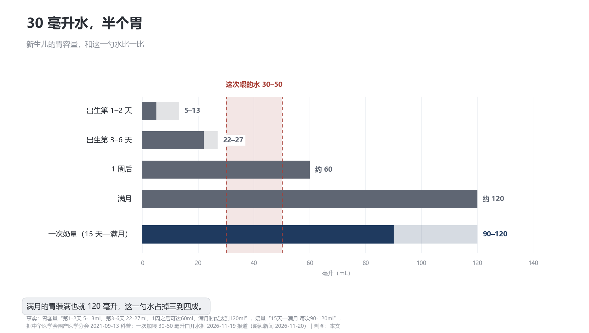
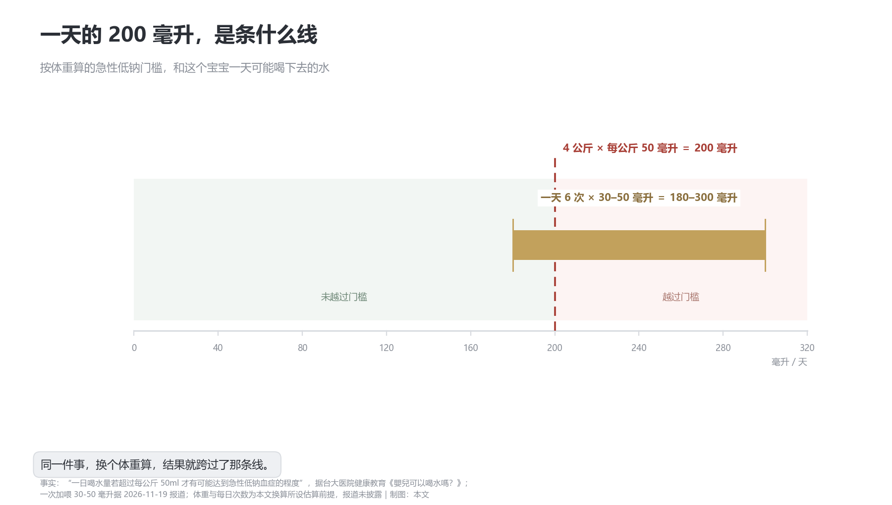
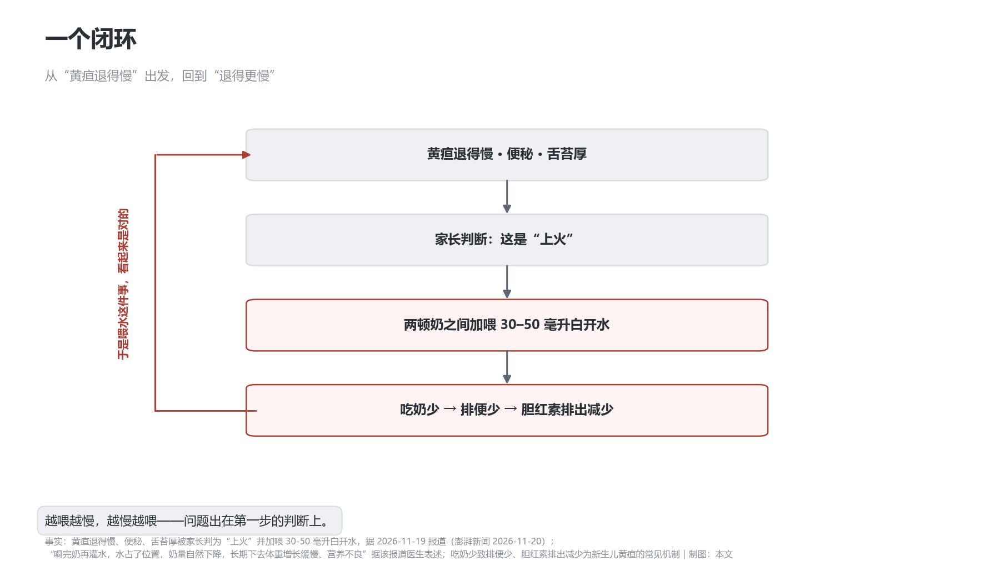

# 30 毫升水，占掉了半个胃

11 月 19 日，一个话题挂上了热搜。河南一名出生 20 多天的宝宝，家长见黄疸退得慢、便秘、舌苔厚，以为是"上火"，在两顿奶之间加喂 30 到 50 毫升白开水。就诊时孩子精神很差，双手、双脚和阴囊都肿了，查出肾功能异常、电解质紊乱、肾脏负荷过重。

水没降下火。

## 一、30 到 50 毫升，是多大的量

中华医学会围产医学分会的科普给过一组胃容量：出生第 1 到 2 天 5 到 13 毫升，第 3 到 6 天 22 到 27 毫升，1 周后约 60 毫升，满月约 120 毫升。

同一份材料里的奶量是：15 天到满月，每次 90 到 120 毫升，一天 8 到 10 次。

这个宝宝 20 多天，一顿吃进去大约 100 毫升。家长灌下去的 30 到 50 毫升白开水，占了胃容量的三成到四成，等于半顿奶的位置。

还有个时间差：水在胃里 1 到 2 小时排空，母乳要 2 到 3 小时，牛奶 3 到 4 小时。水来得快去得也快，可它占位的那段时间，足够让一顿奶少喝一半。

## 二、水怎么变成"毒"

医学上说的水中毒，指高容量性低钠血症——水进得比出得多，血钠被稀释，细胞外液渗透压下降，水往细胞里跑。脑细胞对渗透压变化最敏感，肿起来就是抽搐和意识障碍。

新生儿的处境更差。医生在采访里说，0 到 3 个月宝宝的肾脏过滤、排泄功能不到成人的一半。

台大医院一篇科普给了个量化门槛：按体重算，一天喝水量超过每公斤 50 毫升，才可能达到急性低血钠的程度。

按 4 公斤算，这条线是 200 毫升。一次 30 到 50 毫升，一天喂 6 次，就是 180 到 300 毫升——上限已经压在线上。

## 三、还有一条更慢的路

急性的是水肿和肾损伤。慢的那条，藏在胃口里。

医生把话说得很直：宝宝胃容量极小，喝完奶再灌水，水占了位置，奶量自然下降，长期下去体重增长缓慢、营养不良。

再往下推一步：吃奶少，排便就少；排便少，胆红素排出减少，黄疸退得更慢。

而家长当初喂水的理由，正是"黄疸退得慢"。

一个闭环，从"退得慢"开始，回到"退得更慢"。

## 四、"上火"这个词，兜住了太多东西

医生列了几样：嘴唇干、眼屎多、长疹子、大便间隔久。这些被家长当成"上火"的表现，大多是环境温度太高、包裹太厚、过敏、奶蛋白不耐受、肠道适应过程、室内干燥。

喝水解决不了这些，只会越喂越伤。

判断孩子水分够不够，有个更硬的指标：24 小时尿片数量。大于等于 6 片，就是正常。

## 五、权威口径其实很一致

美国儿科学会的说法是，六个月以下的宝宝不需要任何除母乳或配方奶以外的液体，包括水和果汁。中国营养学会《0—6 月龄婴儿喂养指南》写的是，纯母乳喂养能满足 6 月龄内婴儿全部液体、能量和营养素的需要。国家卫健委 2025 年发布的《婴幼儿营养喂养评估服务指南（试行）》也写明，母乳"能够满足 0～6 个月婴儿生长发育所需全部营养，不需要添加水和其他食物"。

落到操作上，采访里的医生给了三条：

纯母乳，6 个月内不喂水，无论冬夏、无论干燥与否。

配方奶，按比例冲调，不浓不稀，不需要每顿奶后加水。

真需要补的是例外：高烧出汗多、严重腹泻脱水、天气极高温出汗异常多——而且要在医生指导下。

## 写在最后

母乳里约 87% 是水，配方奶冲开之后也一样。一个正常吃奶的宝宝，需要的水都在奶里。

那次喂水，一次 30 到 50 毫升。放进一个 120 毫升的胃，是半顿。

---

*事实来源：2026-11-19 报道、2026-11-20 澎湃新闻《河南一名出生20多天新生儿被喂白开水"下火"，手脚、阴囊水肿，一查竟水中毒、肾损伤，医生紧急提醒》：患儿为河南一名出生 20 多天的新生儿，就诊时"精神状态很差，双手、双脚和阴囊都出现了水肿"，诊断为"肾功能异常、电解质紊乱、肾脏负荷过重"；起因是"出生 20 天左右，黄疸退得慢，还出现了便秘、舌苔厚的情况，家长以为是'上火'，就在两顿奶之间加喂 30-50 毫升的白开水"；医生解释"母乳的水分含量约 87%，配方奶冲调后水分同样充足""0–3个月宝宝肾脏过滤、排泄功能不到成人的一半""过多水分摄入会加重肾脏代谢负担，引发低钠血症、电解质紊乱，严重时可导致水肿、肾损伤、水中毒""宝宝胃容量极小，喝完奶再灌水，水占了位置，奶量自然下降，长期下去体重增长缓慢、营养不良"；判断标准"24 小时尿片数量……大于等于 6 片"；"嘴唇干、眼屎多、长疹子、大便间隔久"多由"环境温度太高、包裹太厚、过敏、奶蛋白不耐受、肠道适应过程、室内干燥"引起；三条喂养建议及三类可遵医嘱补水的例外情形，均据该报道。胃容量"第1-2天 5-13ml、第3-6天 22-27ml、1周之后可达60ml、满月时能达到120ml"、奶量"15天—满月 每次90-120ml、一天8-10次"、胃排空时间"水为1-2小时，母乳2-3小时，牛奶3-4小时"，据中华医学会围产医学分会 2021-09-13 科普《新生儿胃有多大？1岁以内的宝宝该给多少奶量呢？》。"一日喝水量若超过每公斤 50ml 才有可能达到急性低钠血症"、婴儿肾小球滤过率不足致纯水排出不够，据台大医院健康教育《嬰兒可以喝水嗎？》。水中毒即高容量性低钠血症、细胞外液稀释致细胞肿胀、脑细胞反应最快，据 MedSci 2016-09-10《婴儿杀手：水中毒》及 PMC 综述。"6 个月以下不需除母乳或配方奶以外液体（含水和果汁）"据美国儿科学会口径经中华医学会围产医学分会、北京清华长庚医院转述；"纯母乳喂养能满足6月龄内婴儿全部液体、能量和营养素的需要"据中国营养学会《0—6月龄婴儿喂养指南》；"母乳含有丰富的营养素、免疫活性物质和水分，能够满足0～6个月婴儿生长发育所需全部营养，不需要添加水和其他食物"据国家卫生健康委《婴幼儿营养喂养评估服务指南（试行）》文件解读（中国政府网 2025-02-08）。本文换算："按 4 公斤算，每公斤 50 毫升为 200 毫升""一次 30～50 毫升、一天 6 次为 180～300 毫升""30～50 毫升占 120 毫升胃容量的三成到四成"均为公开数字的直接相乘或相除；报道未披露患儿体重与每日喂水次数，"4 公斤""一天 6 次"是本文为使换算成立所设的估算前提，不代表该患儿的实际情况。需说明：原始素材表述为"出现肾功能异常及电解质紊乱"，与报道一致；本文补入的胃容量与奶量对照、每公斤 50 毫升的量化门槛、水中毒的病理表述、三家权威机构的口径，均为素材未提及的公开信息，"半个胃"是按满月胃容量约 120 毫升推算的说法，不是医学诊断用语。*

*文中"水中毒"指机体摄入水总量超过排出量、致水分潴留、血浆渗透压下降和循环血量增多的状态，又称高容量性低钠血症，与"喝了不干净的水中毒"不是一回事；"低钠血症"指血清钠低于正常范围，严重时可引发脑水肿、抽搐；"纯母乳喂养"指除母乳外不给婴儿任何其他食物和液体（药物、维生素滴剂除外）。*